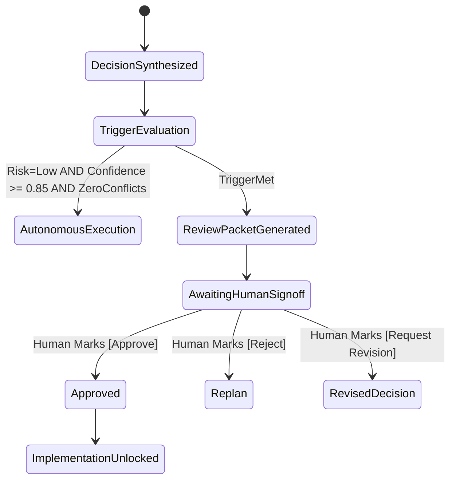

# DAVE Human Approval Contract

This rule establishes the mandatory governance protocol for compiling **DAVE Review Packets** and enforcing human approval gates across the Soda OS decision lifecycle.

---

## 1. Zero-Transcript Burden Invariant

Human reviewers MUST NOT be required to read unstructured multi-turn conversational agent transcripts, verbose shell outputs, or unparsed diff dumps.

DAVE MUST present a compact, structured **DAVE Review Packet** whenever human review is requested or triggered:

```text
DAVE Review Packet
├── Decision Summary (1-2 sentences on what choice is being made)
├── Decision Type & Target Goal ID
├── Proposed Concrete Action
├── Calibrated Confidence Score (c in [0.0, 1.0]) & Reliability Assessment
├── Quantitative Risk Level (low | medium | high)
├── First-Class References (with URIs and SHA-256 hashes)
├── Explicit Assumptions
├── Alternatives Rejected (with technical rationale)
├── Verification Plan (Harnesses and invariants)
├── Blast Radius & Reversibility Assessment
└── Human Action Gate:
    [ ] 1. Approve as proposed
    [ ] 2. Reject and replan
    [ ] 3. Request specific revision (with write-in slot)
    [ ] 4. Approve with conditions
```

---

## 2. Mandatory Human Approval Triggers

DAVE is strictly forbidden from executing autonomously, and MUST escalate to `human_action: "approve"` under any of the following 6 conditions:

1. **High Risk Threshold:** Any decision evaluated with `risk: "high"`.
2. **Sub-Threshold Confidence:** Any decision where calibrated confidence $c < 0.8500$.
3. **Visual Reference Conflict:** Unresolvable geometry or layout contradiction between two visual references.
4. **Brand / Design Token Changes:** Any mutation to canonical palette, font stack, or base spacing tokens.
5. **Accessibility Exceptions:** Any request that would compromise WCAG 2.2 AA contrast or focus visibility.
6. **Destructive or Irreversible Flows:** Database schema drop columns, billing mutations, or auth credential resets.

---

## 3. Human Approval State Machine



- When human approves, the decision is signed with the reviewer's identity and ISO timestamp, and appended to `.agents/audit/decisions.jsonl`.
- Code generation tools (`soda-os implement`) MUST verify the approval record in the ledger before proceeding.
