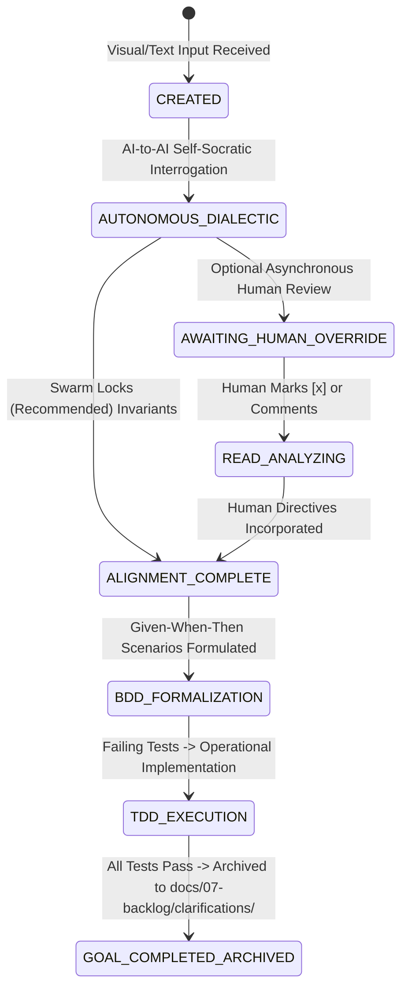

# Global File-Based State Machine: Goal-Partitioned Iterative Multi-Round Async Q&A via Markdown

This document defines the mandatory protocol for managing **Iterative Multi-Turn Requirements Alignment, Multi-Round Socratic Questioning, and Autonomous Goal Execution Gate** using goal-partitioned **File-Based State Machines (Async Q&A via Markdown)**.

---

## 1. Concurrency Safety: Goal-Partitioned Clarification Files

To eliminate concurrency hazards where multiple concurrent agents or subagents overwrite or corrupt a single shared `CLARIFICATION.md`, all clarification sessions MUST be strictly partitioned by Goal ID:

- **Canonical Active Path:** `<workspace_root>/CLARIFICATION-{GOAL-ID}.md`
- **Examples:**
  - `CLARIFICATION-G-193.md`
  - `CLARIFICATION-G-PAY-001.md`
  - `CLARIFICATION-G-EVOLVE-014.md`
- **Archived Path:** `<workspace_root>/docs/07-backlog/clarifications/CLARIFICATION-{GOAL-ID}.md`
- **Core Rule:** Workflows, scripts, and agents MUST resolve the clarification file path dynamically from the Goal ID and NEVER assume a global `CLARIFICATION.md`.

---

## 2. Autonomous Swarm Iteration & Zero-HITL Self-Convergence Mechanics

Requirements alignment operates in an **Autonomous-First (Zero-HITL Blocking)** mode with optional asynchronous human review:
- **Autonomous Swarm Convergence (Default):** When high-level intent is initiated, the Agent Swarm self-interrogates across Architect, Engineer, Critic, and Adversary personas. If human input is not immediately present, the swarm evaluates architectural trade-offs, selects the **`(Recommended)`** invariants, and transitions status directly to **`[STATE: AUTONOMOUS_ALIGNMENT_COMPLETE]`**.
- **Human Input Loop (When Provided):** If a human provides feedback or marks checkboxes in `CLARIFICATION-{GOAL-ID}.md`, the Agent transitions to **`[STATE: READ_ANALYZING]`**, incorporates the human directives, resolves any cascading implications, and advances to execution.
- **Exit Condition:** When all core invariants, schemas, and quantitative SLAs are locked (0 remaining ambiguities), the Agent launches BDD formalization and Red-Green-Refactor TDD execution without stalling.

---

## 3. State Machine Transition Graph



---

## 4. The Discrete Lifecycle States

1. `[STATE: CREATED]`: Goal clarification initiated from visual or textual requirement.
2. `[STATE: AUTONOMOUS_DIALECTIC]`: Multi-agent personas (Architect, Engineer, Critic, Adversary) deconstruct requirements and debate edge cases.
3. `[STATE: AWAITING_HUMAN_OVERRIDE]`: State file written to `CLARIFICATION-{GOAL-ID}.md` providing asynchronous visibility without blocking execution.
4. `[STATE: READ_ANALYZING]`: Agent parses human input if provided, auditing for contradictions or second-order impacts.
5. `[STATE: ALIGNMENT_COMPLETE]`: Zero remaining ambiguities. Exact contracts, schemas, and quantitative bounds locked.
6. `[STATE: BDD_FORMALIZATION]`: Compiling confirmed decisions into executable Gherkin feature files.
7. `[STATE: TDD_EXECUTION]`: Executing Red-Green-Refactor cycle with zero stubs and zero mocks.
8. `[STATE: GOAL_COMPLETED_ARCHIVED]`: All tests green, deliverables generated, and state session archived to `docs/07-backlog/clarifications/CLARIFICATION-{GOAL-ID}.md`.

---

## 5. Mandatory State File Schema (`CLARIFICATION-{GOAL-ID}.md`)

Each clarification file MUST contain the following mandatory metadata and sections:

```markdown
# 🔄 Socratic Clarification State Machine: [Target Feature]

> **Goal ID:** `G-193`  
> **Owning Agent/Session:** `Antigravity Master Agent`  
> **State:** `[STATE: READ_ANALYZING]` -> `[STATE: AWAITING_HUMAN_ROUND_2]`  
> **Iteration:** `Round 2 of Socratic Dialogue`  
> **Goal Reference:** [G-193](file:///.../docs/07-backlog/goals/G-193.md)  
> **Created At:** `2026-08-22T10:05:00+07:00`  
> **Updated At:** `2026-08-22T10:06:00+07:00`  

---

## 🔒 ZERO-CODE LOCK STATUS
*Status: LOCKED. Clarification round in progress. Code execution unlocks ONLY upon `[STATE: ALIGNMENT_COMPLETE]`.*

---

## 📜 Append-Only Q&A History
- Round 1: Point 1.1 (Data Ingestion) -> Real-time Server-Sent Events (SSE) with 1-second rolling aggregation.
- Round 1: Point 1.2 (Export Engine) -> Synchronous client-side CSV stream (Max 10,000 rows).

---

## ❓ Round 2 Follow-Up Questions (Cascading Details)

### Point 2.1: SSE Reconnection & Replay Buffer Mechanics
*Because SSE was selected in Round 1, how should missed ticks be recovered after a network disconnect?*
- [x] **Option A (Recommended):** Client sends `Last-Event-ID` header; server replays missing ticks from a 60-second in-memory RingBuffer.
- [ ] **Option B:** Client performs a full REST state re-fetch upon reconnect.
- [ ] **Option C:** Discard missed intermediate ticks and resume live stream immediately.
> **Human Custom Note / Write-in:**

---

## 🚦 Transition Gate
- If you have answered all Round 2 questions, save this file.
- The Agent will transition to `[STATE: READ_ANALYZING]`. If 0 questions remain, it will immediately proceed to **`[STATE: ALIGNMENT_COMPLETE]`** and execute the goal.
```

---

## 6. Path Resolution & Archival Workflow

1. **Resolution from Goal ID:**
   - Active: `<repo_root>/CLARIFICATION-{GOAL-ID}.md`
   - Archive: `<repo_root>/docs/07-backlog/clarifications/CLARIFICATION-{GOAL-ID}.md`
2. **Archival on Completion:**
   - When a goal reaches `[STATE: ALIGNMENT_COMPLETE]` and work completes, the active file is relocated to `docs/07-backlog/clarifications/CLARIFICATION-{GOAL-ID}.md`.
3. **Legacy Migration Rule:**
   - If an old root `CLARIFICATION.md` exists, treat it as legacy.
   - Scripts and core engines inspect its content to identify the Goal ID (`**Goal ID:** ...`).
   - If identified, the legacy file is safely migrated to `docs/07-backlog/clarifications/CLARIFICATION-{GOAL-ID}.md` (if completed) or `CLARIFICATION-{GOAL-ID}.md` in workspace root (if active).
   - If Goal ID cannot be identified, leave it intact and alert the operator.

---

## 7. Agent Autonomous Execution Invariants

1. **Mandatory 'Read' Acknowledgment:** As soon as the agent detects human input in `CLARIFICATION-{GOAL-ID}.md`, it updates the state header to `[STATE: READ_ANALYZING]` before processing.
2. **Exhaustive Ambiguity Check:** The agent MUST NOT proceed to coding if any technical, schema, or SLA question remains unanswered.
3. **Autonomous Execution Handoff:** Once all rounds are resolved and 0 questions remain, the agent transitions to `[STATE: ALIGNMENT_COMPLETE]`, formulates BDD specifications, and executes until all tests pass without halting for permission.or permission.
