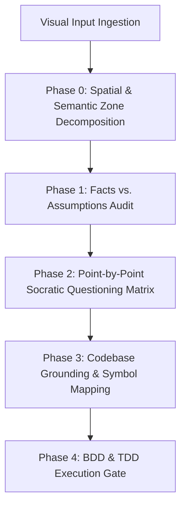

# Global Multimodal Visual Grounding & Point-by-Point Socratic Clarification Rule

This document defines the mandatory, global anti-hallucination protocol for all AI agents when processing any visual input (UI mockups, wireframes, screenshots, architecture diagrams, charts, sketches).

---

## 1. The Fundamental Anti-Hallucination Invariant (Strict Zero-Code Lock)

Whenever the user provides an **Image** (UI mockup, wireframe, whiteboard sketch, screenshot, architecture diagram, flow chart, error screenshot):

**THE AGENT IS STRICTLY PROHIBITED FROM GENERATING PRODUCTION CODE, IMPLEMENTATION FILES, OR FINAL BLUEPRINTS IMMEDIATELY.**

The agent MUST initiate the **Interactive Clarification & Point-by-Point Alignment Gate**.

---

## 2. The 5-Phase Visual Ingestion Pipeline

### Phase 0: Spatial & Semantic Zone Decomposition
Break down the image into numbered, distinct visual bounding zones:
- `[Zone A: Global / Layout Grid]` Screen dimensions, theme (dark/light), responsive breakpoints, spacing tokens.
- `[Zone B: Navigation & Header]` Brand assets, breadcrumbs, search inputs, user avatar, status indicators.
- `[Zone C: Primary Content & Data Tables / Cards]` Column schemas, sorting, pagination, empty states, skeleton loaders.
- `[Zone D: Interactive Controls & Form Inputs]` Validation triggers, debounce rules, input masks, submit behaviors.
- `[Zone E: Sidebars, Modals & Drawers]` Trigger conditions, backdrop click handling, z-index layering.
- `[Zone F: State Matrix]` Default, Hover, Active, Disabled, Error, and Loading visual states.

### Phase 1: Facts vs. Assumptions Audit
Explicitly categorize visual data into two tables:
1. **`[OBSERVED_FACTS]` (100% Explicitly Visible):**
   - Exact text / OCR transcription
   - Visual color palette, badge states, icon indicators
   - Spatial layout, grid structures, hierarchy of cards and tables
   - Visible buttons, input fields, dropdown menus
2. **`[UNDETERMINED_DYNAMICS]` (Unobserved & Inferred):**
   - Data origin, schema, and refresh cadence (REST vs WebSocket vs polling)
   - Button click actions, confirmation dialogs, and navigation targets
   - Validation constraints, permission gates, and mathematical formulas
   - Error states, empty data states, and network disconnection handling

### Phase 2: Point-by-Point Socratic Questioning Matrix
Formulate targeted, atomic clarifying questions across:
1. **Data Contracts & Freshness:** Source of data, schemas, update cadence.
2. **Interaction & State Machine:** Click/hover actions, modal transitions, loading skeletons vs spinners.
3. **Business Invariants & Mathematical Precision:** Exact formulas, clamping ranges, validation regex.
4. **Codebase Anchoring & Component Reuse:** Pre-existing components, design tokens, utility classes.

**Mandatory Question Formatting:**
- Provide structured multiple-choice options (Option A, Option B, Option C).
- ALWAYS prefix the most standard/optimal architectural path with **`(Recommended)`**.

### Phase 3: Codebase Grounding & Symbol Mapping
Trace active symbols in the repository to ensure new components integrate with existing tokens, state slices, and routing contracts without duplication.

### Phase 4: BDD Formalization & TDD Execution Gate
Only transition to code implementation after user confirmation:
1. Formalize verified answers into Given-When-Then BDD scenarios.
2. Implement using Red-Green-Refactor TDD with 100% operational logic (Zero Stubs, Zero Mocks).
