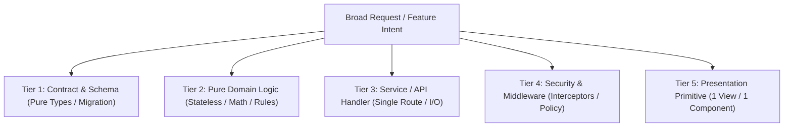

# Soda OS Universal Atomic Unit Scoping & De-Bloat Engine

This skill governs the mandatory decomposition of any software task, feature request, bug fix, or refactor into **truly atomic, minimal, single-deliverable units** across any project, technology stack, and engineering domain.

---

## 🏛️ SECTION I: THE UNIVERSAL LAWS OF ATOMIC SCOPE

### 1. The Law of Single Outcome
A goal MUST deliver **exactly one independently verifiable outcome**. If a goal description contains conjunctions like *"and"*, *"also"*, *"with accompanying UI"*, *"both backend and frontend"*, or *"full lifecycle"*, the goal is structurally invalid and MUST be split.

### 2. The 3-File Touch Map Ceiling
An atomic goal MUST NOT touch more than **3 operational source files** (excluding tests, docs, and satellite specs). If an implementation requires modifying 4 or more application files, it indicates high coupling or excessive breadth and MUST be decomposed.

### 3. The Strict Zero Cross-Stack Coupling Invariant
A single goal MUST NEVER cross stack or layer boundaries. Mixing any of the following within one goal is strictly prohibited:
- Database Schema / Migration $\neq$ Backend Service Logic
- Backend REST / gRPC API $\neq$ Frontend Web / Mobile UI
- Core Domain Model $\neq$ Infrastructure / DevOps Manifests
- Production Application Code $\neq$ External Documentation / Marketing Artifacts

### 4. The 60-Second Verification Bound
An atomic unit must be verifiable via automated testing in $\le 60$ seconds. If verification requires running full end-to-end integration suites across multiple services, the scope is too broad.

---

## 📏 SECTION II: THE UNIVERSAL 5-TIER ATOMIC DECOMPOSITION TAXONOMY

Whenever an agent receives ANY feature or change request, regardless of domain (fintech, AI/ML, e-commerce, gaming, IoT, systems programming), it MUST decompose the request into these 5 universal discrete tiers:

| Tier | Name | Bounded Deliverable | Permitted Touch Map | Applicable Workflow |
| :--- | :--- | :--- | :--- | :--- |
| **Tier 1** | **Data Contract & Persistence** | Exactly 1 database migration, ORM model, Protobuf/JSON schema, or OpenAPI type definition | Migration files, schema files, schema verification tests | `soda-db-migration` (or project migration workflow) |
| **Tier 2** | **Domain & Business Engine** | Pure business logic, financial math, state machine transitions, or validation functions | 1 domain file + 1 pure unit test file (zero I/O, zero network) | `soda-testing` (or project domain workflow) |
| **Tier 3** | **Service API / Store Endpoint** | Exactly 1 HTTP route, gRPC RPC method, or database store query method | 1 service/store file, 1 router entry, 1 integration test binary | `soda-rest-api` (or project API workflow) |
| **Tier 4** | **Middleware & Policy Enforcement** | 1 security check, auth header resolution, rate limiter rule, or interceptor | 1 middleware/guard file + test matrix | `soda-security-threat-modeling` (or project auth workflow) |
| **Tier 5** | **UI Component & Presentation** | Exactly 1 UI component or screen with 5-state coverage (Skeleton, Populated, Empty, Error, Disabled) | 1 UI component file + 1 Storybook story + component test | `soda-design` (or project UI workflow) |

---

## 🚫 SECTION III: GENERAL CODE SMELLS & AUTO-SPLIT TRIGGERS

If an agent or human detects any of the following patterns in a proposed goal, it triggers an **Immediate Scope Rejection & Auto-Split**:

| Scope Smell | Diagnosis | Mandatory Auto-Split Action |
| :--- | :--- | :--- |
| **"Create X feature and display it on Y portal"** | Coupling backend logic with frontend UI | Split into:  1. Backend API Goal 2. Frontend UI Goal |
| **"Add table X and create CRUD endpoints"** | Coupling persistence with API surface | Split into:  1. Migration & Schema Goal 2. Endpoint Implementation Goal |
| **"Implement login, registration, and password recovery"** | Multi-flow amalgamation | Split into:  1. Login Goal 2. Registration Goal 3. Password Reset Goal |
| **"Refactor auth service and migrate to Redis"** | Mixing refactor with infrastructure change | Split into:  1. Redis Cache Client Goal 2. Auth Session Adapter Goal |
| **"Add settings page with profile, notifications, and billing tabs"** | Multi-view UI container | Split into separate goals per tab or atomic form |

---

## 🔍 SECTION IV: PRE-AUTHORING ATOMICITY AUDIT CHECKLIST

Before generating any goal file `docs/07-backlog/goals/G-xxx.md`, the agent MUST execute this self-audit:

1. [ ] **Verifiable in 1 Sentence:** Can the primary outcome be written as *"Implement X in Y to ensure Z"* without commas or conjunctions?
2. [ ] **Touch Map $\le 3$ Files:** Are operational source files bounded to 3 or fewer?
3. [ ] **Single Technology Stack:** Is the goal purely Rust, purely Python, purely React, or purely SQL—never a hybrid?
4. [ ] **Isolated Test Failure:** If this code fails, does it break only 1 unit test rather than cascading across system components?
5. [ ] **Dependency-Driven Baseline:** Does the change require a schema change or prerequisite contract? If yes, begin with that prerequisite; if not, select the lowest applicable layer directly (e.g. for a UI fix, select Tier 5 directly).

---

## ⚡ SECTION V: THE SCOPE-DOWN CONVERSATION PROTOCOL

When the user says:
- *"you define a goal scope is too big"*
- *"scope down the task as small unit / atomic goal"*
- *"split this goal"*
- *"too broad / too complex"*

The Agent MUST:
1. **Immediately Halt & Acknowledge:** Confirm that the previous proposal violated the Law of Single Outcome.
2. **Apply the 5-Tier Taxonomy:** Deconstruct the user's intent into Tier 1 through Tier 5 single-responsibility slices.
3. **Select the Lowest Applicable Tier:** Identify the minimal actionable slice based on actual dependencies (e.g., if a UI bug or pure API endpoint has all required schema in place, start directly at Tier 5 or Tier 3 without manufacturing unneeded Tier 1 schema work).
4. **Draft ONLY That Single Micro-Goal:** Write exactly one canonical goal file and its satellite specifications, ensuring the touch map $\le 3$ files.
5. **Run Template Conformance Harness:** Execute `node scripts/harness/goal-template-conformance-harness.mjs G-xxx` and achieve 100% green before presenting to the user.
