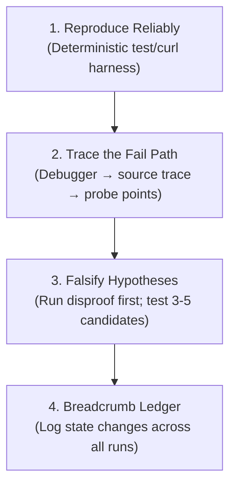

# Soda OS Debug Mantra

Disciplined 4-stage protocol for isolating, diagnosing, and resolving software defects. Refuses to guess or propose code edits without a reproducible test harness.

---

## 🏛️ The 4 Core Disciplines

### 1. Reproduce Reliably
Build a runnable, deterministic reproduction before any code modification:
- **Fast signal:** Aim for $\le 5\text{s}$ execution via unit test, curl script, or isolated CLI command.
- **Flaky defects:** Pin timestamps, seed PRNGs, isolate file system, freeze mocks/fixtures until reproducibility exceeds $95\%$.
- **No repro:** Stop immediately. Refuse to guess root cause without empirical reproduction.

### 2. Trace the Fail Path
Isolate the exact boundary where software state diverges from expected invariants:
1. **Debugger first:** Step directly to the failure site; verify stack frames.
2. **Knob enumeration:** Enumerate and test environment variables, feature flags, and input bounds one at a time.
3. **In-code instrumentation:** Add prefixed diagnostic probes (`[DBG-<hash>]`); remove via single grep upon resolution.

### 3. Falsify the Hypothesis
Generate 3 to 5 ranked hypotheses rather than anchoring on the first plausible assumption:
- For each hypothesis, identify the simplest **disproof test**.
- Execute the disproof first: if an assumption collapses, discard it immediately.

### 4. Breadcrumb Ledger
Record every trial in a running tabular ledger:
- `Attempt #` | `Mutation / Parameter` | `Observed Outcome` | `Hypothesis Invalidation`
- Never repeat a failed action expecting different results. Cap failed repair attempts at 3 before stepping back to re-evaluate the model.
