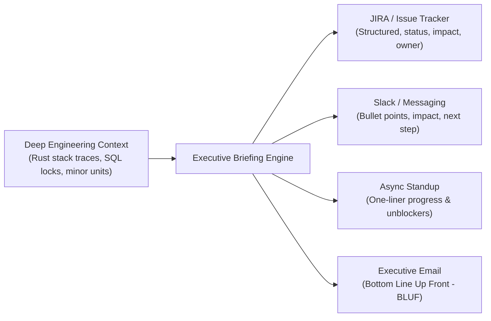

# Soda OS Executive Briefing & Leadership Communication

Translates engineering truth into high-signal communication for engineering leadership and cross-functional stakeholders.

---

## 🏛️ The Translation Matrix



### 1. Information Filtering Rules
- **KEEP:** Product/feature names, impact on user experience, SLA availability, financial/GMV implications, JIRA keys, PR links, and assigned owners.
- **STRIP:** Internal function names, memory addresses, variable names, regex expressions, and internal plumbing details.
- **TRANSLATE:** Describe mechanisms via clear cause-and-effect (e.g. *"Users experienced 502 errors due to session token expiration race"* rather than *"tokio mutex deadlock in GotrueTokenStore::refresh"*).

---

## 📋 Channel Formatting Specifications

### Channel A: JIRA Status Comment
```markdown
**Status:** [Fixed / In Review / Blocked]
**Customer Impact:** [Who was affected and how]
**Root Cause:** [1-2 sentences in plain English]
**Resolution:** [How the fix permanently resolves it]
**Next Steps:** [Code review, staging deployment, rollout schedule]
```

### Channel B: Slack Announcement
```markdown
*Update on [Feature / Issue Name]* (JIRA-xxx)
• *What happened:* [Plain English summary of symptom and scope]
• *Resolution:* [Fix deployed / in review; key impact]
• *Owner & Next Step:* [@Owner; rollout timeline]
```

### Channel C: Async Standup Update
```markdown
• *Completed:* [High-level deliverable + PR link]
• *In Progress:* [Current milestone]
• *Blockers:* [None / explicit dependencies]
```
