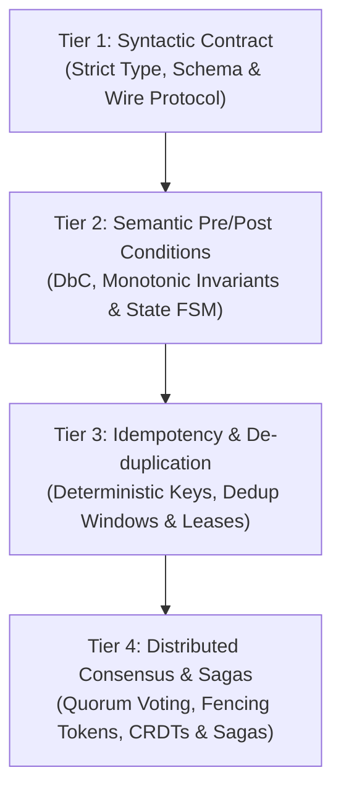

# Soda OS Inter-Node Consensus & Contract Engine

Architects, specifies, and verifies **syntactic and semantic contracts**, **distributed consensus protocols**, **idempotency guarantees**, and **state convergence invariants** between communicating nodes, services, or autonomous agents.

---

## 🏛️ The 4-Tier Node Agreement Model

---

## 🏛️ First Principles & System Invariants

| Principle | Meaning & Non-Negotiable Invariant |
|:---|:---|
| **Zero Implicit Contracts** | Two nodes must NEVER exchange untyped payloads. Schemas must be statically or formally specified (OpenAPI 3.1, Protobuf, JSON Schema) with zero float tolerances for money or tokens. |
| **Strict Pre/Post Condition Enforcement** | Every state transition between nodes must explicitly validate preconditions before mutating state, and verify postcondition invariants upon completion. |
| **Monotonic Fencing Invariant** | Distributed locks or node leases MUST issue strictly increasing monotonic fencing tokens. A receiving node MUST reject any write bearing a non-increasing fencing token ($t_{\text{req}} \le t_{\text{curr}}$) per Pillar 6, guaranteeing absolute linearizability and preventing split-brain zombie writes. Multi-write sessions under a single lease must track an internal monotonic sub-sequence counter or acquire incremented tokens. |
| **At-Least-Once Delivery Idempotency** | In physical distributed systems, messages may duplicate or arrive out of order. Every receiving node must enforce a deterministic deduplication window with atomic idempotency locks. |
| **Consensus Quorum Safety** | Distributed state decisions requiring consensus must achieve a majority quorum ($Q = \lfloor N/2 \rfloor + 1$) under Raft/Paxos models to eliminate split-brain hazards. |
| **Compensating Sagas over Blocking 2PC** | Across distinct microservice trust boundaries, avoid long-lived blocking 2PC resource locks; use state-tracked asynchronous Sagas with verified compensating undo transactions. |

---

## 🔄 The 4-Stage Node Agreement Protocol

### Stage 1: Contract Formalization (Syntactic & Semantic)
1. **Wire Protocol & Schema:** Define strict data types, minor-unit representations (`amount_minor: i64`, `scale: u8`), and required headers (`x-correlation-id`, `x-idempotency-key`).
2. **State Machine Verification:** Define valid transitions ($S_0 \to S_1 \to S_2$) and forbidden transitions. Document all error response envelopes using RFC 7807 problem details.
3. **Behavioral BDD Scenarios:** Formulate `Given-When-Then` test fixtures for node-to-node communication.

### Stage 2: Idempotency & Concurrency Coordination
1. **Deterministic Idempotency Key:** Ensure client/upstream nodes pass a cryptographically unique idempotency key.
2. **Atomic Dedup Lock:** Receiver executes an atomic check-and-set:
   - If key exists in `in_flight`: Reject concurrent attempt or return pending status.
   - If key exists in `completed`: Return cached, immutable response payload without re-executing side effects.
3. **Monotonic Watermarking:** Assign monotonically increasing sequence numbers or version vectors to detect out-of-order deliveries.

### Stage 3: Consensus & Partition Strategy
Select the appropriate consensus and synchronization strategy based on CAP tradeoffs:
1. **Strong Consistency (CP):** Leader-based consensus with Raft/Paxos quorum for sovereign ledgers, single-source inventory, and authorization quorums.
2. **Eventual Convergence (AP):** Local-first conflict-free replicated data types (CRDTs) or State-based Synchronization for multi-region read replicas and collaborative editing.
3. **Split-Brain Mitigation:** Auto-stepdown if a leader node loses quorum heartbeat for $> T_{\text{lease}}$.

### Stage 4: Formal Verification & Chaos Testing
Before declaring a contract or consensus bridge production-ready:
1. **Contract Parity Test:** Automated schema linters and bi-directional contract verification (Pact / Schema conformance).
2. **Network Chaos Simulation:** Inject synthetic latency spikes, packet drops, and duplicate message delivery to verify that invariants hold under partition.
3. **Failure Recovery Test:** Verify that crashed or restarted nodes catch up via log compaction or snapshot synchronization without human intervention.
