# Soda OS Multi-Node Contract Invariant & Payload Conformance Engine

Enforces **zero-hallucination, bi-directional schema contracts, and typed payload invariants** across all communicating software nodes:
`Frontend Portal` $\longleftrightarrow$ `Portal BFF` $\longleftrightarrow$ `KrakenD Gateway` $\longleftrightarrow$ `BFF Core API` $\longleftrightarrow$ `KrakenD Gateway` $\longleftrightarrow$ `Backend Microservices`.

---

## 🏛️ The Multi-Node Architectural Topology

```mermaid
flowchart LR
    UI["Frontend UI Portal<br>(React / TypeScript)"] -->|Node Contract 1<br>Typed DTO & Props| BFF_P["Portal BFF<br>(Fastify / Node / Rust)"]
    BFF_P -->|Node Contract 2<br>JWT + Correl-ID| KRAKEN_E["KrakenD Edge Gateway<br>(Rate-Limit & Route)"]
    KRAKEN_E -->|Node Contract 3<br>REST / OpenAPI 3.1| BFF_C["BFF Core API<br>(Axum / Domain Orchestration)"]
    BFF_C -->|Node Contract 4<br>mTLS + Traceparent| KRAKEN_I["KrakenD Internal Mesh<br>(Load Balancing)"]
    KRAKEN_I -->|Node Contract 5<br>gRPC / NATS binary / SQL| SVC["Core Microservices<br>(Rust / PostgreSQL / ClickHouse)"]
```



---

## 🏛️ First Principles & Non-Negotiable Invariants

| Invariant | Meaning & Operational Law |
|:---|:---|
| **Zero-Hallucination Contract Law** | An agent or LLM is **STRICTLY FORBIDDEN** from inventing response fields in UI components or mock payloads in tests that do not verifiably exist in the upstream schema contract (`OpenAPI 3.1`, `Protobuf`, or `JSON Schema`). |
| **Bi-Directional Contract Parity** | If a UI component renders field `data.tenant.base_currency`, the Portal BFF, KrakenD transformation pipe, BFF Core API, and Backend Microservice DTO MUST all declare and serialize `base_currency: String` (ISO 4217). Missing or mismatched casing (`baseCurrency` vs `base_currency`) is a hard failure. |
| **Strict Money Minor-Unit Invariant** | Monetary fields across ALL node boundaries MUST adhere to `(amount_minor: string | i64, currency: ISO_4217, scale: u8)`. Floating-point numbers (`number`, `f64`, `Float`) are strictly banned from contract payloads to eliminate IEEE-754 rounding drift. Wire transfer utilizes integer strings (e.g. `"500000"`) to guarantee loss-free JSON serialization without BigInt exceptions. |
| **Deterministic Error Envelope (RFC 7807)** | All nodes MUST return errors encapsulated in standardized RFC 7807 envelopes `(type, title, status, detail, instance, invalid_params)`. Untyped 500 error strings or swallowed exceptions are classified as Critical Invariant Breaches. |
| **W3C Trace & Correlation Propagation** | Every request across the multi-node chain MUST propagate the unbroken W3C `traceparent` and `x-correlation-id` headers through every hop without truncation. |
| **Monotonic Dependency Stickiness** | Contract definitions in `docs/03-architecture/api/` or `schemas/` are immutable framework anchors. LLMs must NOT dynamically alter or delete schema contracts to make a broken test pass. Code MUST adapt to the contract, never the contract to lazy code. |

---

## 🔄 End-to-End Execution Protocol: From UI Datafield to Microservice Database

When building or updating a feature across the multi-node stack, agents MUST follow the **Closed-Loop 5-Hop Step-by-Step Procedure**:

### Step 1: Frontend UI Datafield Identification & Contract Grounding
1. Inspect the UI wireframe, mock, or acceptance criteria: identify every single data point to display (e.g. `creator_name`, `settled_amount_minor`, `currency`, `scale`, `payout_status`).
2. Verify against the OpenAPI 3.1 canonical contract (`docs/03-architecture/api/openapi.yaml`).
   - If a required field is missing from the contract, **STOP**. You must NOT fabricate fake properties in React state or mock fixtures.
   - Propose an explicit contract extension with typed properties and Banker's rounding / ISO 4217 specifications.

### Step 2: Portal BFF Aggregation & Transformation
1. Ensure the Portal BFF endpoint (Fastify/Node/Rust) aggregates data strictly from the KrakenD Gateway without dropping or mutating field names.
2. Ensure casing convention is strictly maintained (e.g. `snake_case` on the wire).

### Step 3: KrakenD Edge & Internal Gateway Route Configuration
1. Inspect `docker/krakend/krakend.json`:
   - Verify that the `backend.allow` list explicitly contains every property needed by the downstream consumer.
   - Confirm that no middleware or modifier drops, truncates, or renames payload keys unexpectedly.

### Step 4: BFF Core API & Domain Orchestration
1. Implement Axum / Rust handlers using strongly typed Rust Serde structs.
2. Strictly enforce integer minor-unit math and reject floats at compile time.
3. Handle domain errors by mapping them deterministically into RFC 7807 Problem Details responses with HTTP status codes, machine-readable `type` URIs, and `invalid_params` arrays.

### Step 5: Core Backend Microservices & Polyglot Persistence
1. Read/write to PostgreSQL / ClickHouse with explicit column mappings.
2. Propagate W3C `traceparent` and multi-tenant isolation claims (`tenant_id`) through every SQL query or gRPC payload.

---

## 🧪 Verification & Automated Conformance Gates

Every implementation task MUST execute the verification gate before declaring completion:
```bash
node scripts/harness/node-contract-invariant-harness.mjs
```
The harness enforces:
1. **Physical Contract Presence:** Schemas, OpenAPI YAML, KrakenD routes, and TypeScript DTOs exist on disk.
2. **Field & Type Parity:** 100% bi-directional match across all node boundaries.
3. **Requiredness Parity:** Mandatory fields cannot be made optional silently.
4. **Zero-Float Money Invariant:** Complete Money Value Object tuple `(*_minor, currency, scale)`.
5. **Lossless JSON Roundtrip:** Exact JSON wire serialization without data corruption or BigInt throwing.
6. **RFC 7807 Standard Compliance:** Validates error format across the entire system.
