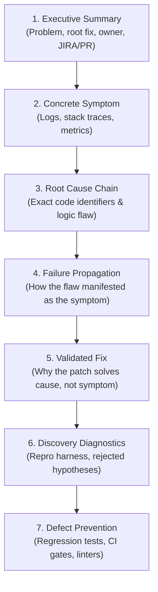

# Soda OS Engineering Post-Mortem & RCA Engine

The permanent technical record of a fixed defect, authored for engineers to preserve institutional memory and prevent regression cascades.

---

## 🏛️ Preflight Invariants (Refuse to draft without these)

An agent MUST NEVER draft a post-mortem based on unverified speculation. Execution requires:
1. [ ] **Deterministic Repro:** Fast passing/failing test or reproduction artifact.
2. [ ] **Confirmed Mechanism:** Exact lines of code and state failure sequence identified.
3. [ ] **Validated Fix:** Verified green test asserting the fix; zero regressions.

---

## 📋 The Canonical 7-Block Structure

### 1. Summary
One concise paragraph: what broke in customer/service terms, the core fix, and metadata (PR, Goal ID, Owner).

### 2. Symptom
Concrete observations: exact error envelopes, status codes, latency spikes, or failed assertions.

### 3. Root Cause Mechanism
Exhaustive walkthrough citing code identifiers (`struct`, `function`, `variable`, commit SHA). Avoid vague generalities.

### 4. Propagation Chain
Step-by-step causality connecting the underlying flaw to the observed external failure.

### 5. Validated Fix & Reversion of Workarounds
Detailed explanation of why the change fixes the root mechanism rather than papering over the symptom. Document and revert any temporary defensive hacks.

### 6. Diagnostic Journey
Summary of debugging steps: what repro isolated the defect, which hypotheses were disproven, and the pivotal experiment that confirmed root cause.

### 7. Prevention & CI Hardening
Concrete action items with assigned owners: new regression test suites, linter additions, or architectural invariants.
