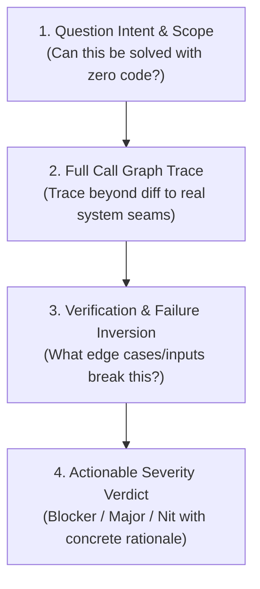

# Soda OS Scrutinize

An uncompromising, adversarial outsider audit for engineering designs, pull requests, and proposed architectural changes.

---

## 🏛️ The 4 Review Gates

### 1. Intent & Simpler Alternatives
Before reading the diff line-by-line, challenge the necessity of the entire change:
- Can this problem be avoided entirely (doing nothing)?
- Does an existing primitive in the codebase already satisfy 90% of the intent?
- Can this be solved at a simpler layer (declarative schema, configuration flag, build-time linter) instead of runtime application code?
- If a simpler path exists, state it immediately with architectural rationale.

### 2. Full Call-Path Trace (Beyond the Diff)
Bugs hide at the seams of unchanged code:
- Trace from incoming HTTP/gRPC transport boundary $\to$ middleware $\to$ domain entities $\to$ persistence $\to$ side effects.
- Audit assumptions about upstream state (nullability, concurrency, transaction isolation, clock skew).

### 3. Empirical Verification & Inversion
- Test claims with disproof: what inputs, network delays, or concurrent mutations cause silent data corruption or race conditions?
- Audit test coverage: do tests exercise real operational paths (Article I Zero-Mock) or do they mock the failure away?

### 4. Structured Finding Report
Report findings sorted strictly by severity:
- **Finding:** Specific statement citing `file:line`.
- **Consequence:** Concrete system impact (data leak, deadlock, memory blowup), not generic theory.
- **Evidence:** Reproducible input or trace step.
- **Recommendation:** Minimal, targeted correction.
- **Verdict:** `SHIP`, `FIX-THEN-SHIP`, `REWORK`, or `REJECT`.
