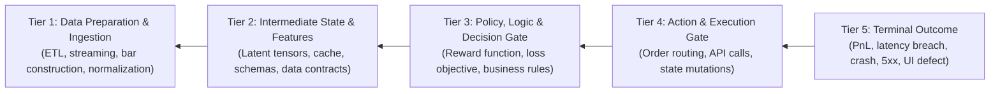

# Soda OS Software Reverse Engineering Protocol

A rigorous 5-tier engineering protocol to deconstruct, diagnose, and reverse-engineer complex software systems, ML pipelines, quantitative engines, and distributed legacy services **backwards from runtime outcome to data ingestion**.

---

## 🏛️ The Backward Deconstruction Architecture

Rather than guessing forward from raw code, reverse engineering flows strictly in reverse causality:



---

## 🏛️ The 5 Tiers of Reverse Engineering

### Tier 5: Terminal Outcome & Empirical Telemetry
Capture and isolate the observable real-world symptom without preconceptions:
- **Traceparent & Timestamps:** Capture exact millisecond timestamps, session IDs, W3C `traceparent`, and exit codes.
- **Quantitative Delta:** Measure exact variance between expected invariant and observed empirical reality (e.g. `Expectancy > +15 bps` vs `Observed = -48 bps`).
- **Blast Radius Audit:** Identify if the failure is systemic, asset-specific, concurrent, or environment-dependent.

### Tier 4: Action & Execution Gate (The "What Happened" Layer)
Trace the physical commands dispatched by the system:
1. **Network & System Calls:** Inspect outgoing REST requests, WebSocket frames, RPC calls, database writes, or order submissions.
2. **Execution Timing & Slippage:** Measure roundtrip time (RTT), wire latency, queue delay, and bid-ask spread crossing costs.
3. **Execution Mode Divergence:** Verify if mock/simulation execution behaves differently from production venue execution (e.g. simulated fill vs live exchange order rejection).

### Tier 3: Policy, Logic & Decision Mechanics (The "Why Was It Chosen" Layer)
Dissect the internal decision gate or loss function that selected the action:
1. **Objective vs Reality Alignment:** 
   - What was the model / logic optimizing for? (e.g. Did the reward function penalize trading fees, or did it assume frictionless execution?)
   - Does the loss function allow shortcutting or label leakage?
2. **Threshold & Gate Boundary Inspection:** Check all threshold boundaries (`confidence >= 0.70`, `stop_loss = 0.5%`, `margin_utilization <= 80%`).
3. **Decision Contradiction Audit:** Identify contradictory rules where Gate A authorizes an action while Gate B immediately closes or aborts it (e.g. rapid churn / flapping).

### Tier 2: Feature Representation & State Transitions (The "What Did It See" Layer)
Evaluate the internal state representation ingested by the decision layer:
1. **Signal-to-Noise Ratio (SNR):** Is the feature dominated by high-frequency microstructure noise rather than structural signal?
2. **Temporal Causality & Lookahead Check:** Ensure all rolling features and state transforms are strictly causal ($t \le T$). Lookahead bias in training creates catastrophic live failures.
3. **Data Contract & Schema Drift:** Verify that online inference feature distributions match offline training feature distributions (KL-divergence, Wasserstein distance, schema typing).

### Tier 1: Data Preparation & Ingestion (The "Source of Truth" Layer)
Scrutinize how the raw world was sampled and transformed:
1. **Sampling Bias:** Are time-based bars creating synthetic variance? (e.g. Uniform 1-minute time bars during low-volume periods vs high-volume spikes).
2. **Labeling Oracle Formulation:** 
   - Did the training dataset use realistic labeling (e.g. Triple-Barrier Method with fee hurdles)?
   - Was the label achievable in live market conditions given order queue priority?
3. **Normalization & Scale Leakage:** Did z-score or min-max scalers leak future standard deviations across historical test boundaries?

---

## 🔄 Reverse-Engineering Execution Lifecycle

```
[Observation of Bad Outcome]
       │
       ▼
1. T5: Capture Empirical Metrics & STR (Steps to Reproduce)
       │
       ▼
2. T4: Trace Dispatched Actions & Protocol Payloads
       │
       ▼
3. T3: Dissect Reward/Loss/Logic Objectives for Perverse Incentives
       │
       ▼
4. T2: Validate Feature Representation, Latents & Invariant Bounds
       │
       ▼
5. T1: Re-engineer Data Sampling, Labeling Oracles & Ingestion
       │
       ▼
[Closed-Loop Verification Harness: Re-test & Benchmark]
```

---

## ⚖️ Mandatory Invariants for Reverse-Engineering Tasks

1. **Zero Guessing Invariant:** Every hypothesis must be grounded in raw execution logs, telemetry packets, or network traces before proposing code fixes.
2. **Friction & Edge-Case Parity:** Simulation, backtesting, and offline training environments MUST incorporate 100% of real-world production friction (fees, slippage, latency, packet drop, disconnects).
3. **Formal Verification Pass:** After re-engineering from Tier 1 up, the pipeline must pass automated tests and historical regression benchmarks before deploying to live environments.
