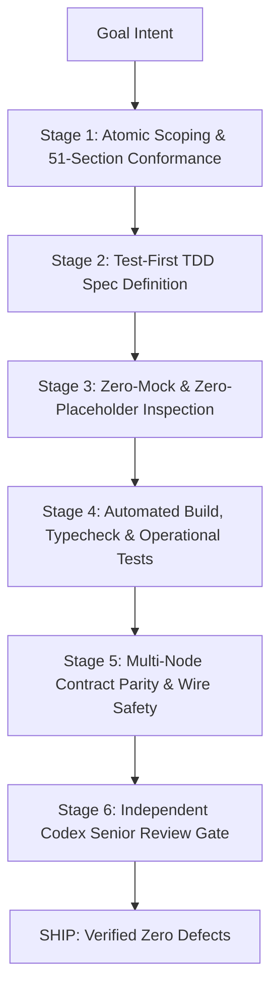

# Soda OS Enterprise Zero-Bug Quality & Verification Guarantee Engine

Enforces an automated, mathematical, and mechanical **Zero-Defect Guarantee** across all goal creation, development, and execution phases.

---

## 🏛️ The 6-Stage Zero-Bug Pipeline



---

## 🏛️ The Non-Negotiable Quality Invariants

| Pillar | Operational Law | Fail-Closed Enforcement |
|:---|:---|:---|
| **Pillar 1: Atomic Scope Lock** | Every goal has exactly 1 measurable outcome and touched files are constrained to $\le 5$ files within its declared touch map. | `parallel-goal-planner.js` + `soda-atomic-unit-scoping` |
| **Pillar 2: Zero Mocks & Placeholders** | Production trees (`src/`, `code/`) MUST NOT contain `TODO`, `FIXME`, `unimplemented!()`, `todo!()`, or dummy mock objects. | `zero-bug-verification-harness.mjs` |
| **Pillar 3: Zero Float Minor-Unit Math** | All currency, quotas, and financial fields strictly use minor units (`*_minor: string \| i64, currency, scale`). | `test-multi-currency-money.mjs` + Article V |
| **Pillar 4: Bi-Directional Contract Parity** | 100% field, type, and requiredness parity across UI $\longleftrightarrow$ BFF $\longleftrightarrow$ KrakenD $\longleftrightarrow$ Microservice. | `node-contract-invariant-harness.mjs` |
| **Pillar 5: Complete Operational Test Suite** | 100% unit and integration tests passing green (`npm test`, `cargo test`, `pytest`). Swallowed errors are forbidden. | CI / Automated Test Runner |
| **Pillar 6: Independent Adversarial Review** | Every commit diff is reviewed and approved with 0 blocking issues by OpenAI Codex CLI. | `codex review HEAD~1..HEAD` |

---

## 🧪 Verification Harness Execution

Before closing any goal or declaring a feature complete, run the master Zero-Bug Quality Gate:
```bash
node scripts/harness/zero-bug-verification-harness.mjs
```
Execution halts fail-closed (`exit 1`) if any invariant, mock, broken type, failing test, or contract mismatch is detected.
