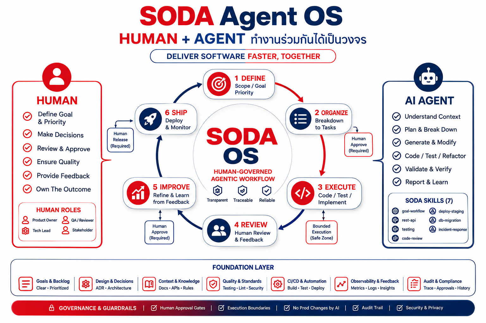
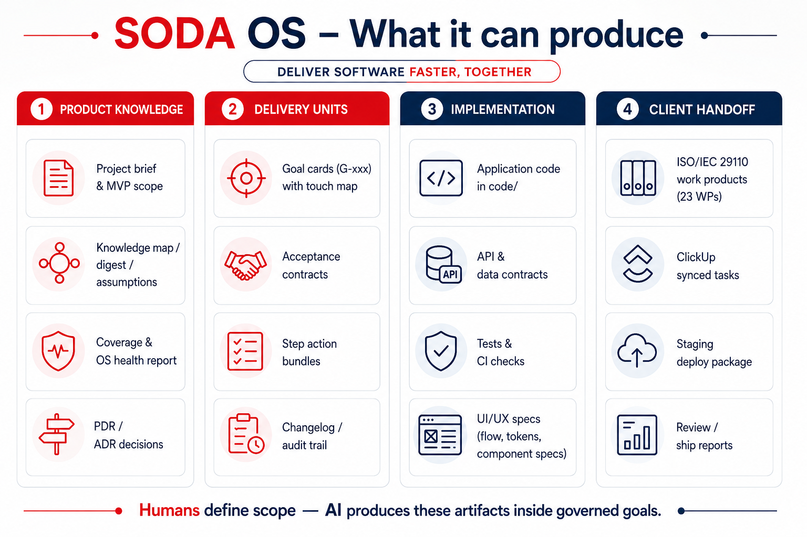

# LivePilot OS

LivePilot OS is a simulated live-commerce control room that helps Hosts respond to audience demand while Live Ops protects promotions, margin, inventory, and consequential actions.

Primary architecture document: [LivePilot OS Architecture](docs/03-architecture/live-pilot-os-deep-context.md)

Additional references: [Architecture Overview](docs/03-architecture/overview.md) · [Requirements Baseline](docs/03-architecture/live-pilot-os-requirements.md) · [Domain Model](docs/03-architecture/live-pilot-os-domain-model.md) · [Integration Boundaries](docs/03-architecture/live-pilot-os-integration-boundaries.md)

DigitalOcean infrastructure scaffolding is in [`infra/`](infra/README.md). It follows the Aflovia deployment model with an Ubuntu 24.04 Droplet and private Docker Compose services.


## LivePilot OS — System Overview and Architecture

### Mission and Value

LivePilot OS is a live-commerce operations system that helps Hosts respond to audience interest faster while enabling Live Ops to control promotion, margin, inventory, and platform-action risk. It acts as a control room where the Host and Live Ops share a consistent view of the same live session.

The system provides four bounded capabilities:

1. **Live Chat & Telemetry Understanding** — Ingests and normalizes chat and telemetry, then produces typed signals such as product interest, discount requests, stock queries, complaints, and risk.
2. **Streamer Co-pilot HUD** — Shows grouped topics, product metrics, approved catalog facts, talking points, Q&A drafts, and alerts for the Host.
3. **StreamPilot Agent** — Proposes bounded actions such as product pins, vouchers, and inventory reservations without bypassing policy or approval gates.
4. **Compliance & Operator Control** — Governs margin policy, approvals, moderation escalation, audit, and Emergency Pause.

### Users and Scope

- **Host** sees simulated live video/chat, audience metrics, interest topics, product details, and concise guidance to express in their own words.
- **Live Ops** reviews the promotion recommendation, original and adjusted discounts, margin evidence, and policy rationale before approving or rejecting it.
- **Viewers** see the promotion banner and countdown in the simulated session after approval.

The Hackathon baseline uses a simulated live session, simulated chat, a fictional catalog, and a simulated adapter. The example fixture is a 400 mL shampoo product. There is no connection to Shopee, TikTok, or any real marketplace, no real payment, and no real inventory mutation.

### End-to-end flow

```text
Chat / Telemetry
  → Typed Intent, Engagement, and Risk Signals
  → Context + Evidence Retrieval
  → JEV-backed Decision Proposal
  → Host Cue or Operator Promotion Proposal
  → Deterministic Margin / Inventory / Approval Policy
  → Controlled Execution or Rejection
  → Adapter Result and Reconciliation
  → Immutable Audit Receipt and Observability
```

The Hackathon flow groups promotion questions within a rolling two-minute window, calculates the audience-interest ratio, shows product information and talking points to the Host, lets AI propose a discount, and uses Margin Policy to enforce a 10% minimum margin. Live Ops then approves or rejects the proposal. Approval simulates coupon issuance, stock reservation, a viewer banner, and a countdown until the live ends. Rejection shows a not-approved status with an optional reason and does not create another offer automatically.

### Logical Architecture

```text
Node 1  Host / Live Ops UI
          ↓
Node 2  Portal BFF — session handling, UI DTOs, validation
          ↓
Node 3  KrakenD Edge — authentication, TLS, rate limit, routing
          ↓
Node 4  Core BFF / API — use-case orchestration and screen aggregation
          ↓
Node 5  Domain Services + Decision Engine
          ↓
Node 6  PostgreSQL + NATS JetStream + Redis + Temporal + Platform Adapters
          ↓
        Reconciliation + Audit + OpenTelemetry
```

The proposed production baseline includes Next.js for the Host HUD and Live Ops Console, Node.js LTS + NestJS domain services, the KrakenD API Gateway, PostgreSQL as the transactional source of truth, NATS JetStream for durable events and replay, Redis for caching, deduplication windows, and rate limits, Temporal for timer/retry/approval/compensation workflows, JEV through the LivePilot Decision Engine, and OpenTelemetry tracing across signal → decision → policy → execution → audit. This is an architecture baseline that requires runtime verification; it does not claim that every service or production integration is already deployed.

The selected Node/NestJS implementation baseline uses the NestJS Node adapter, `class-validator`/`class-transformer` for HTTP DTOs, Ajv with JSON Schema for events, `pg` + Kysely for PostgreSQL, the official `nats` client for JetStream, the Temporal TypeScript SDK for durable workflows, and Jest + Supertest + fast-check for verification.

### Domain Model and Service Ownership

| Domain concept | Responsibility |
|---|---|
| `LiveSession` | Correlation boundary for the live; status is `planned/live/paused/ended` and mode is `simulated/sandbox/production`. |
| `ChatMessage` | Preserves the original source message without replacing it with an AI interpretation. |
| `Signal` | Typed intent/risk signal with confidence, evidence IDs, resolved SKU, and risk level. |
| `DecisionProposal` | Advisory JEV recommendation with uncertainty, model version, and lifecycle status. |
| `MarginDecision` | Deterministic policy result: `APPROVED/NEEDS_APPROVAL/REJECTED`, with policy version and reason. |
| `InventoryReservation` | Temporary stock allocation that must be created, released, or finalized idempotently and exactly once. |
| `AuditReceipt` | Evidence for the actor, trigger, proposal, policy, approval, adapter result, retry, and final outcome. |

Service boundaries are split into `session-service`, `catalog-service`, `telemetry-service`, `intent-risk-service`, `decision-engine-service`, `copilot-service`, `margin-policy-service`, `inventory-service`, `promotion-service`, `approval-control-service`, `execution-service`, `platform-adapter-service`, and `audit-service`. Each service owns its contract, persistence boundary, lifecycle, and failure behavior, and must not read another service's tables directly.

### Decisioning, Safety, and Integration Boundary

JEV is a TypeSafe AI System One model used to create structured recommendations inside the Decision Engine. It is not the entire system and cannot directly issue mutations. The decision sequence is retrieve bounded context → JEV inference → schema validation → confidence/uncertainty evaluation → recommendation or deferral → deterministic policy → human approval or controlled execution.

Key system requirements:

- Product Q&A uses approved catalog facts only; an unresolved SKU must never be guessed or trigger an action.
- An AI proposal remains advisory until it passes margin, inventory, authorization, and approval gates.
- Money uses integer minor units; production calculations must not use floating-point arithmetic.
- Every mutation requires an idempotency key, timeout, retry, compensation, and reconciliation strategy.
- An unknown adapter result must be reconciled before retry to prevent duplicate consequential effects.
- Emergency Pause stops automated mutations while signal capture and audit logging continue.
- Adapters are an Anti-Corruption Layer that isolates platform protocols, permissions, rate limits, and statuses from business rules.
- Every adapter must declare capabilities as `supported`, `sandbox_only`, `simulated`, or `unsupported`.
- Every hop must preserve actor identity, `live_session_id`, role/capability, correlation ID, trace context, contract version, idempotency key, and locale.
- Simulated, sandbox, and production modes must remain visibly distinct.

### Audit, Localization, and Operational Targets

Every consequential action creates an append-only audit receipt linked to the session, actor, source evidence, proposal/action, model version, policy verdict, adapter mode, retry state, outcome, trace ID, and input/evidence hashes. Tokens, credentials, PII, COGS, and supplier data must not appear in ordinary logs or prompts.

The system supports `th` and `en` locales, defaults to `th`, uses ISO 4217 integer minor units and ISO-8601 UTC timestamps, and performs locale-aware formatting only at the UI/document boundary. It must also support degraded read-only operation, durable event replay, rollback/feature flags, and recovery of PostgreSQL, NATS streams, audit records, and projections.

Verification targets include operator read p95 below 150 ms, JEV proposal p95 below 3 s, margin verdict p95 below 50 ms, chat-to-signal p95 below 1 s, and inventory reservation p95 below 150 ms per SKU. These are verification targets, not confirmed performance claims.

### Non-Goals

LivePilot OS does not allow JEV, prompts, frontend routes, or endpoints to directly issue vouchers, pins, reservations, or marketplace commands. Model confidence cannot replace deterministic policy. The Hackathon does not perform real marketplace mutations and does not include multi-tenant hierarchy, multi-region deployment, logistics, or unsupported platform capabilities.

For this development cycle, **Soda Agent OS** is used as the tool and governed implementation framework for defining goals, limiting the touch map, implementing, testing, reviewing, validating evidence, and delivering LivePilot OS through the `DEFINE → PLAN → EXECUTE → REVIEW → SHIP` workflow.

## Soda Agent OS

**Sodality** — goal-driven Human + Agent development with **governance layer** for human-approved AI delivery.

```text
Soda Agent OS = Context + Skill + Goal + Governance + Approval + Audit
```

The **Agent OS** provides the process, skills, rules, and governance needed to implement the project through controlled goals.

## Human + Agent cycle (collaboration phases — PR-First)

SODA OS is a human-governed agentic workflow: **Transparent, Traceable, Reliable.** Cycle: **DEFINE → PLAN → EXECUTE → REVIEW → SHIP (PR-First)**, with human approval gates, dedicated `feature/G-xxx` branch isolation, zero local integration merging, and PR-first delivery into `develop`.



Framework map: [docs/03-architecture/design-spec.md](docs/03-architecture/design-spec.md) · Terminology: design-spec §8 · Collaboration cycle: [docs/06-workflows/team-workflow.md](docs/06-workflows/team-workflow.md) · GitHub Governance: [docs/06-workflows/github-governance.md](docs/06-workflows/github-governance.md)

## What it can produce

Humans define scope — AI produces these artifacts inside governed goals.



---

## Team workflow (start here)

1. **[docs/06-workflows/team-workflow.md](docs/06-workflows/team-workflow.md)** — collaboration cycle, Mermaid diagrams, command-trigger cheat sheet
2. **[AGENTS.md](AGENTS.md)** — AI entry point (agents read first every session)
3. **[docs/04-agents/skills-library.md](docs/04-agents/skills-library.md)** — 10 versioned Soda skills

---

---

```text
DEFINE → PLAN → EXECUTE → REVIEW → SHIP (PR-First)
```

| Collaboration phase | Skill (agent) |
|-------|---------------|
| PLAN / any goal | `soda-goal-workflow` |
| API work | `soda-rest-api` |
| Tests | `soda-testing` |
| Before done | `soda-code-review` |
| Staging | `soda-deploy-staging` |
| Upgrade OS | `soda-upgrade-os` |
| Schema | `soda-db-migration` |
| 3rd-Party APIs | `soda-thirdparty-api-resilience` |
| Incidents | `soda-incident-response` |

---

## How to assign work (cheat sheet)

| ✅ Good | ❌ Avoid |
|---------|----------|
| Execute G-003 according to goals.md | Finish the application |
| Review G-003 using the code-review skill | Merge without review |
| Ship G-003 / create a PR | Merge into develop/main locally |
| Continue with the next ready goal | Refactor the entire repository |
| Commit G-003 | Commit every changed file |

**Humans define scope — AI implements on feature branches — Humans review and merge PRs.**

---

## Folder map

```text
AGENTS.md                      ← AI entry point
.agents/
  rules/                       ← core, governance, security, guidelines, commits, stack
  skills/soda-*/               ← standard skills (versioned)
docs/
  00-index.md                  ← doc map
  00-project-snapshot.md       ← agent reload TL;DR
  01-vision.md                 ← optional principles
  02-product/                  ← brief, scope, acceptance contracts
  03-architecture/
    design-spec.md             ← framework map (do not remove)
    overview.md, folder-structure.md
    api/                       ← API contracts (fill per goal)
    data/                      ← business rules (fill per goal)
  04-agents/                   ← dev roles, skills-library
  05-decisions/                ← ADR template + example
  06-workflows/                ← dev loop, DoD, team-workflow, github-governance
  07-backlog/                  ← goals, changelog-goals, audit changelog
  assets/                      ← diagrams and visual assets
.github/
  workflows/                   ← governance + CI
  pull_request_template.md
  ci-config.example.yml
docker/                        ← optional
code/                          ← application source (fill at G-001)
soda-os pr                     ← generate PR payload & checklist for G-xxx
```

---

## Project-specific extensions

Add only when a convention is unique to one product:

```text
.agents/skills/{project}-api/SKILL.md
.agents/rules/{stack}.md
```

Register in [docs/04-agents/skills-library.md](docs/04-agents/skills-library.md) and [AGENTS.md](AGENTS.md).

---

Maintained by **Sodality**.  
GitHub: [Sodality-Company-Limited/soda-os](https://github.com/Sodality-Company-Limited/soda-os)
