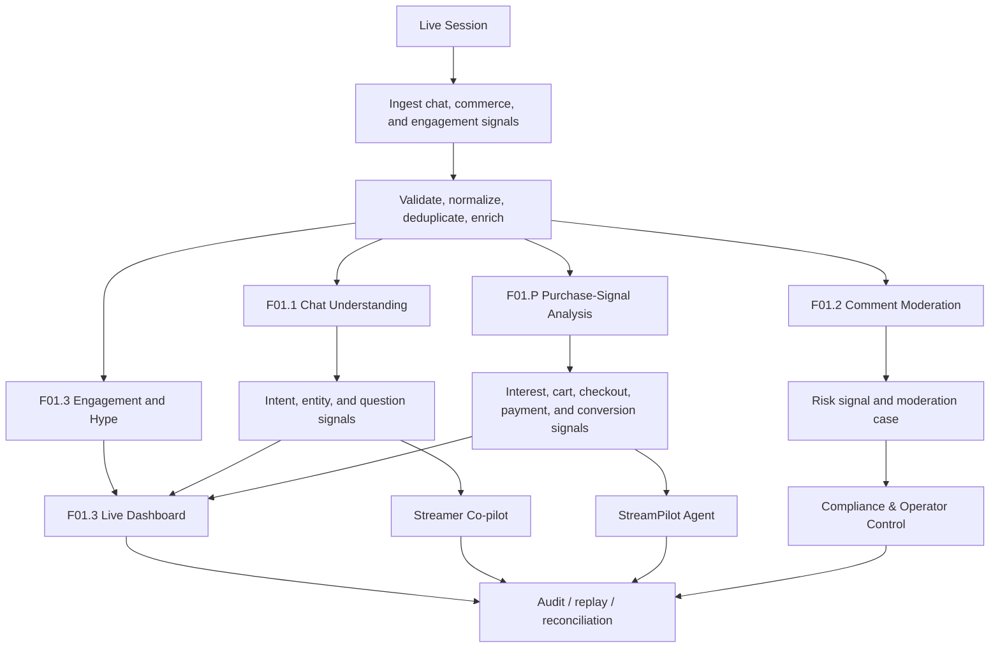

# Feature 01 — Real-Time Chat and Purchase-Signal Analysis

> **Feature ID:** F01  
> **Capability:** Live Chat & Telemetry Understanding  
> **BDD contract:** Version 1.0  
> **Status:** Drafted from the canonical LivePilot OS feature map

> **BRD:** [Feature 01 BRD — Real-Time Chat and Purchase-Signal Analysis](../brd/feature-01-live-chat-purchase-signal-analysis.md)

This document is the behavior contract for Feature 01. It translates the three canonical
sub-features and the purchase-signal pipeline into traceable Given/When/Then flows.

## Traceability

| Feature | Sub-feature | Responsibility | Canonical source |
|---|---|---|---|
| F01 | F01.1 Live Chat Understanding AI | Classify chat intent and resolve product context | [Feature Map §1.1](../../03-architecture/live-pilot-os-feature-map.md#11-live-chat-understanding-ai) |
| F01 | F01.2 Intelligent Comment Moderation | Detect and rank chat risk, then escalate | [Feature Map §1.2](../../03-architecture/live-pilot-os-feature-map.md#12-intelligent-comment-moderation) |
| F01 | F01.3 Customer Intent & Hype Dashboard | Project live interest, purchase, engagement, and sentiment signals | [Feature Map §1.3](../../03-architecture/live-pilot-os-feature-map.md#13-customer-intent--hype-dashboard) |
| F01 | F01.P Purchase-Signal Analysis | Separate cart-add, checkout, payment, voucher, and conversion signals | [Core Features §1](../../03-architecture/live-pilot-os-core-features.md#1-real-time-chat-and-purchase-signal-analysis-live-chat--telemetry-understanding) |

## Flow map

## Event vocabulary

| Event | Meaning |
|---|---|
| `live.chat.received` | A raw chat message was received from a platform adapter |
| `commerce.cart_added` | A viewer added a SKU to cart |
| `commerce.checkout_completed` | A viewer completed checkout |
| `commerce.order_updated` | Payment/order state changed |
| `telemetry.intent.detected` | A normalized chat intent was classified |
| `telemetry.risk.detected` | A moderation risk was classified |
| `chat.question.clustered` | Similar questions were grouped |
| `product.interest.updated` | Product interest changed for a time window |
| `purchase.signal.updated` | Purchase funnel or conversion signal changed |
| `live.engagement.updated` | Engagement/hype metrics changed |

## BDD scenarios

### Session and ingestion

#### F01-FLOW-001 — Initialize a live session

**Given** a valid workspace, platform channel, and live campaign  
**When** the live session starts  
**Then** the system creates a session context and accepts telemetry only within that context.

#### F01-FLOW-002 — Ingest a multi-source signal

**Given** an active live session  
**When** chat, cart, checkout, order, voucher, engagement, or stock data arrives  
**Then** the ingestion service records source, event ID, timestamp, tenant, workspace, and session.

#### F01-FLOW-003 — Normalize an incoming event

**Given** a platform-specific event payload  
**When** the telemetry normalizer processes it  
**Then** it emits a canonical event with stable event type, product/SKU reference when available, and correlation ID.

#### F01-FLOW-004 — Ignore a duplicate event

**Given** an event ID has already been committed  
**When** the platform retries the same event  
**Then** the system does not increment metrics or create a second downstream signal.

#### F01-FLOW-005 — Handle a late or out-of-order event

**Given** a checkout event arrives before its cart-add event  
**When** the late cart-add event arrives  
**Then** the system reconciles the time window without double counting.

### F01.1 — Live Chat Understanding AI

#### F01.1-FLOW-001 — Classify product interest

**Given** a viewer says “show shade 02”  
**When** the chat classifier processes the message  
**Then** it emits `telemetry.intent.detected` with `PRODUCT_INTEREST`, SKU when available, and confidence.

#### F01.1-FLOW-002 — Classify a product question

**Given** a viewer asks about ingredients, size, color, shipping, or usage  
**When** the classifier processes the message  
**Then** it emits `PRODUCT_QUESTION` with question entity and product context.

#### F01.1-FLOW-003 — Classify a promotion request

**Given** a viewer asks for a discount or voucher  
**When** the classifier processes the message  
**Then** it emits `DISCOUNT_REQUEST` or `VOUCHER_REQUEST` without issuing a promotion.

#### F01.1-FLOW-004 — Classify stock and size intent

**Given** a viewer asks whether a product or variant is available  
**When** the classifier processes the message  
**Then** it emits `STOCK_QUERY` or `SIZE_QUERY` linked to the best-known SKU.

#### F01.1-FLOW-005 — Resolve a product entity

**Given** a message contains an alias, shade name, or partial product name  
**When** entity resolution checks the approved catalog  
**Then** it links the message to one SKU when confidence is sufficient, otherwise returns unresolved.

#### F01.1-FLOW-006 — Reject an unsupported claim

**Given** a message asks for medical or pregnancy-safety advice absent from the approved catalog  
**When** the system evaluates the message  
**Then** it does not generate a factual answer and marks the request for host/operator review.

#### F01.1-FLOW-007 — Cluster repeated questions

**Given** multiple viewers ask semantically equivalent questions about one SKU  
**When** the question clustering worker processes the time window  
**Then** it emits `chat.question.clustered` with summary, count, SKU, and time window.

#### F01.1-FLOW-008 — Escalate uncertain intent

**Given** intent confidence is below the configured threshold  
**When** classification completes  
**Then** the system publishes an uncertain result and does not trigger an automated commerce action.

### F01.2 — Intelligent Comment Moderation

#### F01.2-FLOW-001 — Detect spam or toxic content

**Given** a chat message contains spam, abusive, or toxic language  
**When** moderation analysis completes  
**Then** it emits `telemetry.risk.detected` with type, score, severity, and recommended action.

#### F01.2-FLOW-002 — Detect an off-platform attempt

**Given** a viewer asks others to add LINE or transfer money directly  
**When** moderation analysis completes  
**Then** the message is withheld from the host overlay and a high-risk escalation is created.

#### F01.2-FLOW-003 — Detect a scam pattern

**Given** a message contains a known scam pattern  
**When** risk screening evaluates it  
**Then** the system records a scam risk signal and routes it to moderation policy.

#### F01.2-FLOW-004 — Detect coordinated bot behavior

**Given** multiple accounts produce correlated abnormal messages  
**When** the behavior window reaches its threshold  
**Then** the system creates a bot-raid risk signal instead of treating every message as interest.

#### F01.2-FLOW-005 — Rank risk severity

**Given** a risk signal has been detected  
**When** the risk policy evaluates type, score, and context  
**Then** the system assigns severity and action: ignore, filter, alert, or escalate.

#### F01.2-FLOW-006 — Escalate to a moderator

**Given** a risk signal requires human review  
**When** escalation is triggered  
**Then** the system creates a moderation case with evidence, correlation ID, and recommended action.

#### F01.2-FLOW-007 — Preserve moderation audit trail

**Given** a message is filtered, hidden, or escalated  
**When** the moderation action completes  
**Then** the system records input hash, risk result, policy version, actor, and outcome.

### F01.P — Purchase-Signal Analysis

#### F01.P-FLOW-001 — Record cart-add interest

**Given** a viewer adds a SKU to cart  
**When** `commerce.cart_added` is normalized  
**Then** the product-interest projection increments for that SKU and session.

#### F01.P-FLOW-002 — Record checkout completion

**Given** a viewer completes checkout  
**When** `commerce.checkout_completed` is normalized  
**Then** the checkout projection increments separately from cart-add interest.

#### F01.P-FLOW-003 — Record payment or order state

**Given** a payment or order state changes  
**When** `commerce.order_updated` is normalized  
**Then** the system updates paid, cancelled, or failed state without treating it as a new cart-add.

#### F01.P-FLOW-004 — Calculate cart-to-checkout conversion

**Given** a time window contains cart-add and checkout counts  
**When** the purchase projection updates  
**Then** it computes conversion while preserving underlying counts.

#### F01.P-FLOW-005 — Detect high interest but low conversion

**Given** cart-add interest is high and paid orders remain low  
**When** conversion rules evaluate the window  
**Then** the system emits `purchase.signal.updated` with `HIGH_INTEREST_LOW_CONVERSION`.

#### F01.P-FLOW-006 — Correlate voucher usage with purchase

**Given** a voucher is claimed or used  
**When** voucher and order events are correlated  
**Then** the dashboard distinguishes claims, checkout, and paid orders.

#### F01.P-FLOW-007 — Rank product purchase interest

**Given** several products have chat, cart, checkout, and order signals  
**When** the ranking projection updates  
**Then** it ranks products using the configured time window and evidence weights.

#### F01.P-FLOW-008 — Prevent purchase-signal inflation

**Given** a webhook is retried or an order state is replayed  
**When** deduplication and reconciliation run  
**Then** funnel metrics remain idempotent and auditable.

### F01.3 — Customer Intent & Hype Dashboard

#### F01.3-FLOW-001 — Project live interest metrics

**Given** intent and product-interest events are available  
**When** the projection worker processes them  
**Then** the dashboard shows interest count, top product, and repeated-question count per SKU.

#### F01.3-FLOW-002 — Separate behavioral metrics

**Given** the same product has cart-add, checkout, and paid-order events  
**When** the dashboard renders the product card  
**Then** it displays each metric separately and never labels cart-add as a completed sale.

#### F01.3-FLOW-003 — Show sentiment and engagement

**Given** normalized chat and viewer telemetry exists  
**When** engagement projection updates  
**Then** the dashboard shows sentiment, engagement level, and active time windows.

#### F01.3-FLOW-004 — Detect a hype window

**Given** engagement or product interest rises above its threshold  
**When** the time-window evaluator runs  
**Then** it emits `live.engagement.updated` with the active hype window.

#### F01.3-FLOW-005 — Trigger a dashboard alert

**Given** a configured threshold is crossed, such as repeated questions or low stock  
**When** the alert evaluator runs  
**Then** dashboard and host alert streams receive a concise alert with severity and evidence.

#### F01.3-FLOW-006 — Rebuild a failed projection

**Given** a dashboard read model is missing or corrupted  
**When** replay is requested for a known event range  
**Then** the projection is rebuilt from immutable events without changing source events.

### Downstream integrations

#### F01-INTEGRATION-001 — Send a signal to Streamer Co-pilot

**Given** a repeated question, high interest, or actionable purchase signal exists  
**When** the signal meets the co-pilot threshold  
**Then** the system publishes a concise suggestion or alert for the host.

#### F01-INTEGRATION-002 — Send product interest to StreamPilot

**Given** product interest or conversion evidence crosses the automation threshold  
**When** StreamPilot receives the signal  
**Then** it may evaluate product pinning or promotion but must run policy gates before execution.

#### F01-INTEGRATION-003 — Send risk to Compliance

**Given** a high-severity risk signal exists  
**When** the risk event is published  
**Then** Compliance & Operator Control receives it and can filter, escalate, or pause automation.

#### F01-INTEGRATION-004 — Correlate stock with purchase interest

**Given** purchase interest rises while stock is low or unavailable  
**When** correlation runs  
**Then** dashboard and host receive a stock-aware alert and no invalid promotion is proposed.

#### F01-INTEGRATION-005 — Feed action outcomes back into telemetry

**Given** a pin, voucher, reservation, or platform action completes  
**When** its outcome is reconciled  
**Then** the result becomes telemetry for measuring conversion and future recommendations.

### Reliability, safety, and audit

#### F01-SAFETY-001 — Enter degraded read-only mode

**Given** a platform adapter is unavailable or its state cannot be reconciled  
**When** the failure threshold is reached  
**Then** safe reads continue where possible and consequential automation is blocked.

#### F01-SAFETY-002 — Propagate Emergency Pause

**Given** an authorized operator activates Emergency Pause  
**When** the control signal propagates through NATS  
**Then** downstream promotion and platform automation stop and the pause is audited.

#### F01-SAFETY-003 — Write an end-to-end decision trace

**Given** an input event produces a signal, recommendation, or action  
**When** processing completes  
**Then** the audit record links input event, model/policy result, actor, action, outcome, and correlation ID.

## Acceptance checklist

- [ ] F01.1 chat intents are classified and product context is resolved safely
- [ ] F01.2 moderation risks are scored, filtered, escalated, and audited
- [ ] F01.P cart-add, checkout, payment, voucher, and conversion are separate signals
- [ ] F01.3 dashboard projections are real-time, replayable, and metric-separated
- [ ] Downstream integrations publish versioned events through NATS
- [ ] Duplicate, late, low-confidence, and unavailable-platform cases are handled
- [ ] Every consequential path has correlation, idempotency, and audit evidence

## Backlinks

- [LivePilot OS Deep Context](../../03-architecture/live-pilot-os-deep-context.md)
- [LivePilot OS Feature Map](../../03-architecture/live-pilot-os-feature-map.md)
- [LivePilot OS Core Features](../../03-architecture/live-pilot-os-core-features.md)
- [NATS / OpenAPI contract index](../../03-architecture/api/README.md)

