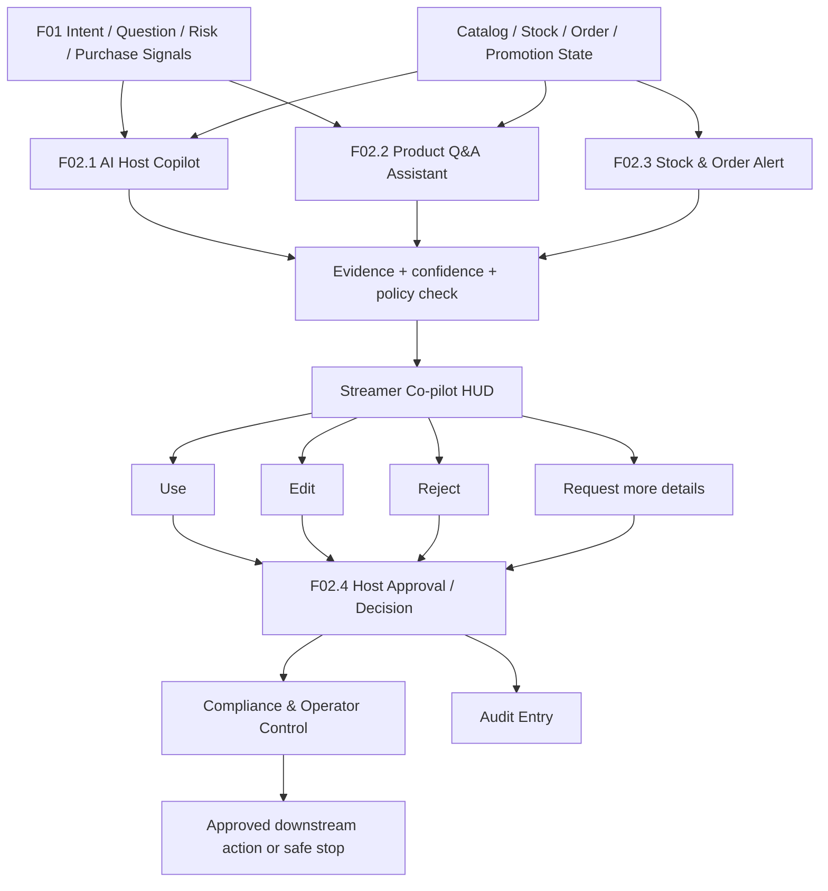

# Feature 02 — Host Screen Assistant (Streamer Co-pilot HUD)

> **Feature ID:** F02  
> **Capability:** Streamer Co-pilot HUD  
> **BDD contract:** Version 1.0  
> **Status:** Drafted from the canonical LivePilot OS feature map

> **BRD:** [Feature 02 BRD — Host Screen Assistant (Streamer Co-pilot HUD)](../brd/feature-02-host-screen-assistant.md)

This document defines the behavior contract for the host-facing assistant. The co-pilot
does not rewrite the host's script; it delivers short, evidence-based suggestions and
alerts that the host can use, edit, dismiss, or escalate.

## Traceability

| Feature | Sub-feature | Responsibility | Canonical source |
|---|---|---|---|
| F02 | F02.1 AI Host Copilot | Create glanceable suggestions, talking points, and next-product recommendations | [Feature Map §2.1](../../03-architecture/live-pilot-os-feature-map.md#21-ai-host-copilot) |
| F02 | F02.2 Product Q&A Assistant | Answer only from approved product catalog facts | [Feature Map §2.2](../../03-architecture/live-pilot-os-feature-map.md#22-product-qa-assistant) |
| F02 | F02.3 Stock & Order Alert — Host View | Show stock, order, voucher, and promotion alerts to the host | [Feature Map §2.3](../../03-architecture/live-pilot-os-feature-map.md#23-stock--order-alert--host-view) |
| F02 | F02.4 Host Approval UI | Let the host use, edit, reject, or inspect a recommendation | [Feature Map §2.4](../../03-architecture/live-pilot-os-feature-map.md#24-host-approval-ui) |

## Flow map

## Event vocabulary

| Event | Meaning |
|---|---|
| `copilot.suggestion.created` | A host-facing suggestion was created |
| `copilot.alert.created` | A host-facing alert was created |
| `copilot.answer.approved` | The host approved an answer for use |
| `copilot.answer.edited` | The host edited an answer before use |
| `copilot.answer.dismissed` | The host rejected or dismissed an answer |
| `copilot.detail.requested` | The host requested more evidence or detail |
| `copilot.delivery.updated` | A suggestion was delivered, read, expired, or withdrawn |

## BDD scenarios

### HUD session and delivery

#### F02-FLOW-001 — Open the host HUD for an active session

**Given** an authenticated host has an active live session  
**When** the host opens the Co-pilot HUD  
**Then** the system loads session-scoped suggestions, alerts, stock state, and current promotion state.

#### F02-FLOW-002 — Receive a real-time suggestion

**Given** a new intent, question cluster, or purchase signal passes the co-pilot threshold  
**When** the signal is published through NATS  
**Then** the HUD receives a concise suggestion without requiring a full page refresh.

#### F02-FLOW-003 — Deliver a glanceable suggestion

**Given** a suggestion is intended for live host use  
**When** it is rendered in the HUD  
**Then** the primary message can be read in approximately three seconds and includes the relevant product context.

#### F02-FLOW-004 — Expire stale guidance

**Given** a suggestion is tied to a short-lived signal or promotion state  
**When** its validity window expires  
**Then** the HUD marks it stale and prevents the host from treating it as current guidance.

#### F02-FLOW-005 — Withdraw unsafe guidance

**Given** a suggestion is later found to be unsupported, unsafe, or based on invalid state  
**When** a withdrawal signal is received  
**Then** the HUD removes or marks the suggestion unsafe and records the withdrawal.

#### F02-FLOW-006 — Maintain session isolation

**Given** multiple workspaces or live sessions are active  
**When** a signal is published  
**Then** only the matching workspace and session HUD receives it.

### F02.1 — AI Host Copilot

#### F02.1-FLOW-001 — Create a repeated-question talking point

**Given** a question cluster exceeds the configured repetition threshold  
**When** the co-pilot service receives the cluster  
**Then** it creates a concise talking point referencing the approved product context.

#### F02.1-FLOW-002 — Suggest an answer for the host

**Given** a product question has sufficient catalog evidence  
**When** the host asks for a suggestion  
**Then** the HUD shows an answer draft with product reference, evidence status, and confidence.

#### F02.1-FLOW-003 — Alert on rising product attention

**Given** product interest or purchase intent rises sharply  
**When** the signal reaches the configured threshold  
**Then** the HUD alerts the host to the product and explains the supporting signal.

#### F02.1-FLOW-004 — Recommend the next product

**Given** multiple products are active in a live session  
**When** the ranking signal identifies a next-best product  
**Then** the HUD provides a recommendation with the reason, such as repeated questions, stock, or conversion signal.

#### F02.1-FLOW-005 — Preserve the host's selling rhythm

**Given** the host already has an active script or speaking state  
**When** a suggestion is generated  
**Then** the HUD displays a short prompt and does not replace or rewrite the host's full script.

#### F02.1-FLOW-006 — Suppress low-value notification noise

**Given** multiple signals arrive close together  
**When** prioritization runs  
**Then** duplicate or low-value suggestions are grouped, suppressed, or queued so the host is not overwhelmed.

#### F02.1-FLOW-007 — Attach evidence to a suggestion

**Given** a suggestion is generated from chat, purchase, stock, or promotion data  
**When** it is delivered  
**Then** the suggestion includes a traceable source summary, timestamp/window, and correlation ID.

#### F02.1-FLOW-008 — Handle low-confidence guidance

**Given** the evidence or model confidence is below the configured threshold  
**When** the co-pilot prepares the message  
**Then** it labels the guidance as uncertain or routes it for review instead of presenting it as a fact.

### F02.2 — Product Q&A Assistant

#### F02.2-FLOW-001 — Answer from the approved catalog

**Given** a viewer question maps to an approved catalog fact  
**When** the Q&A assistant generates a draft  
**Then** the answer contains only supported product information such as price, color, size, ingredients, usage, stock, shipping, or returns.

#### F02.2-FLOW-002 — Refuse an unsupported product claim

**Given** the catalog has no approved fact for the requested claim  
**When** the Q&A assistant processes the question  
**Then** it refuses to assert the claim and asks the host to review or provide a safe response.

#### F02.2-FLOW-003 — Refuse an unverified medical claim

**Given** a viewer asks for medical advice or pregnancy-safety confirmation  
**When** no approved supporting fact exists  
**Then** the assistant does not provide a medical or safety conclusion.

#### F02.2-FLOW-004 — Show the evidence source

**Given** an answer is generated from catalog data  
**When** the host opens answer details  
**Then** the HUD shows catalog version, fact type, and freshness metadata.

#### F02.2-FLOW-005 — Handle catalog version change

**Given** a catalog fact changes or is revoked  
**When** the new catalog version becomes active  
**Then** affected drafts are revalidated, withdrawn, or regenerated before further use.

#### F02.2-FLOW-006 — Handle an ambiguous product question

**Given** a question could refer to multiple products or variants  
**When** entity resolution cannot select one product safely  
**Then** the assistant asks for clarification or routes the question to the host instead of guessing.

#### F02.2-FLOW-007 — Reflect current stock safely

**Given** a product answer includes stock availability  
**When** stock state is stale or unavailable  
**Then** the assistant labels the stock as unknown or stale and does not promise availability.

### F02.3 — Stock & Order Alert — Host View

#### F02.3-FLOW-001 — Alert on low stock

**Given** a SKU falls below its configured stock threshold  
**When** the stock signal is received  
**Then** the HUD shows a warning with SKU, current availability, and timestamp.

#### F02.3-FLOW-002 — Alert on out-of-stock

**Given** a SKU has no available inventory  
**When** the inventory state changes  
**Then** the HUD shows an out-of-stock alert and prevents guidance that promises availability.

#### F02.3-FLOW-003 — Alert on high order volume

**Given** order volume rises above the configured window threshold  
**When** the order projection updates  
**Then** the HUD alerts the host with the affected product and time window.

#### F02.3-FLOW-004 — Highlight a best-selling product

**Given** a product leads the configured sales or conversion ranking  
**When** the ranking projection updates  
**Then** the HUD highlights it as a best seller with the metric used.

#### F02.3-FLOW-005 — Alert when voucher usage nears its limit

**Given** voucher claims approach the configured limit  
**When** usage telemetry crosses the warning threshold  
**Then** the HUD shows remaining capacity and voucher expiry information.

#### F02.3-FLOW-006 — Alert on abnormal price or promotion

**Given** a product price or promotion differs from the approved state  
**When** the consistency check detects the mismatch  
**Then** the HUD shows a high-severity alert and blocks unsafe host guidance.

#### F02.3-FLOW-007 — Show a flash-voucher countdown

**Given** an approved flash voucher has a start and expiry time  
**When** the voucher is active  
**Then** the HUD shows a countdown based on the authoritative promotion state.

### F02.4 — Host Approval UI

#### F02.4-FLOW-001 — Use a suggestion

**Given** the host receives a supported suggestion  
**When** the host selects Use  
**Then** the system records `copilot.answer.approved` or the corresponding decision and sends the decision to Compliance.

#### F02.4-FLOW-002 — Edit before use

**Given** the host wants to adapt a suggestion to their speaking style  
**When** the host edits and confirms it  
**Then** the system records the original, edited content, actor, and approval state.

#### F02.4-FLOW-003 — Reject a suggestion

**Given** the host does not want to use a suggestion  
**When** the host selects Reject or Dismiss  
**Then** the suggestion is marked dismissed and is not reused as an approved answer.

#### F02.4-FLOW-004 — Request more details

**Given** the host needs more context  
**When** the host selects Request more details  
**Then** the system returns supporting evidence, source metadata, or a clarification request without presenting unsupported facts.

#### F02.4-FLOW-005 — Require approval before consequential action

**Given** a suggestion would lead to a promotion, product pin, or other consequential action  
**When** workspace approval mode requires human review  
**Then** the action remains pending until an authorized decision is recorded.

#### F02.4-FLOW-006 — Prevent unauthorized approval

**Given** the current user lacks host/operator permission  
**When** they attempt to approve or trigger an action  
**Then** the system rejects the decision and records an authorization failure.

#### F02.4-FLOW-007 — Preserve approval idempotency

**Given** the host submits the same approval twice because of a delayed response  
**When** the same idempotency key is processed  
**Then** the system records one decision and returns the original result.

#### F02.4-FLOW-008 — Stop approval during Emergency Pause

**Given** Emergency Pause is active  
**When** the host attempts to approve a consequential action  
**Then** the system displays the paused state and does not dispatch the action.

### Cross-cutting safety and integration

#### F02-SAFETY-001 — Keep AI output grounded

**Given** a suggestion or answer is generated  
**When** its evidence set is empty, stale, revoked, or out of scope  
**Then** the HUD marks it unavailable or requires review and does not present it as verified.

#### F02-SAFETY-002 — Redact sensitive data

**Given** a suggestion or evidence payload contains tokens, COGS, supplier data, or PII  
**When** it crosses into the host UI  
**Then** sensitive fields are redacted according to policy.

#### F02-SAFETY-003 — Handle co-pilot service outage

**Given** the co-pilot service or event stream is unavailable  
**When** the HUD detects the outage  
**Then** it shows the last-known state with freshness metadata and does not invent new guidance.

#### F02-SAFETY-004 — Audit every host decision

**Given** the host uses, edits, rejects, or requests details  
**When** the decision completes  
**Then** the audit record contains suggestion ID, original content hash, actor, decision, edited content hash when applicable, and correlation ID.

#### F02-INTEGRATION-001 — Receive F01 signals

**Given** Feature 01 publishes intent, question, risk, engagement, or purchase signals  
**When** the co-pilot consumes them  
**Then** it creates only the suggestion or alert types allowed by the signal and policy.

#### F02-INTEGRATION-002 — Send host decision to Compliance

**Given** a host decision is recorded  
**When** the decision is committed  
**Then** Compliance & Operator Control receives the decision event for policy and audit processing.

#### F02-INTEGRATION-003 — Receive StreamPilot state

**Given** stock, promotion, voucher, or order state changes  
**When** StreamPilot publishes the state event  
**Then** the HUD refreshes the related alert or countdown using the authoritative state.

## Acceptance checklist

- [ ] F02.1 suggestions are short, prioritized, evidence-backed, and session-scoped
- [ ] F02.2 answers use approved catalog facts and refuse unsupported claims
- [ ] F02.3 stock, order, voucher, price, and promotion alerts are current and actionable
- [ ] F02.4 host can use, edit, reject, or inspect suggestions with authorization and idempotency
- [ ] Consequential actions respect approval mode and Emergency Pause
- [ ] Co-pilot events and host decisions are versioned, correlated, and auditable

## Backlinks

- [LivePilot OS Deep Context](../../03-architecture/live-pilot-os-deep-context.md)
- [LivePilot OS Feature Map](../../03-architecture/live-pilot-os-feature-map.md)
- [LivePilot OS Core Features](../../03-architecture/live-pilot-os-core-features.md)
- [Feature 01 BDD — Live Chat & Telemetry](./feature-01-live-chat-telemetry.md)
- [NATS / OpenAPI contract index](../../03-architecture/api/README.md)

