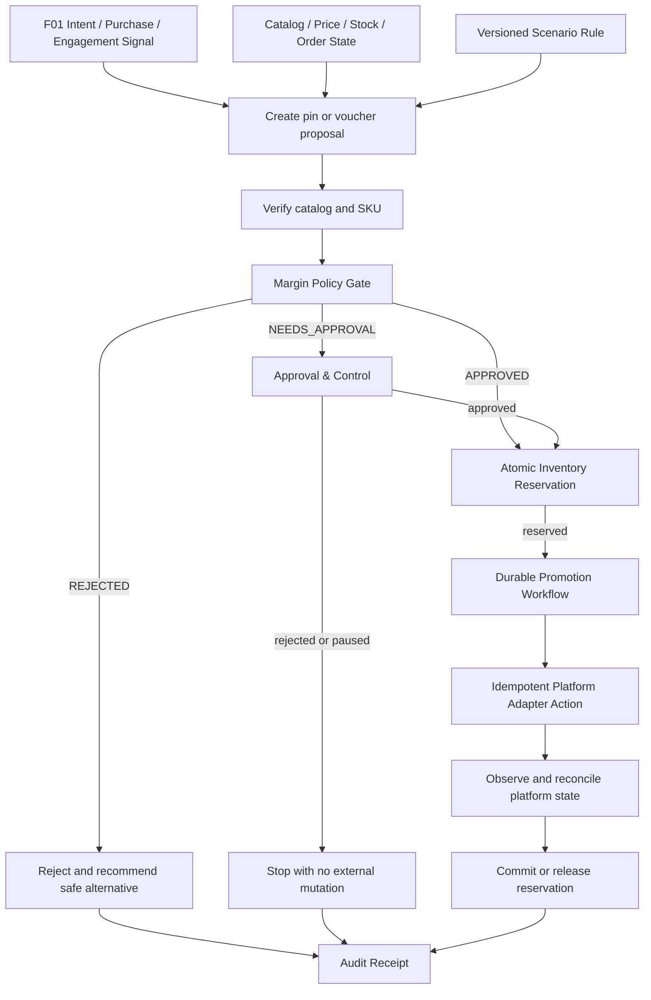

# Feature 03 — Store Management and Back-Office Profit Protection

> **Feature ID:** F03  
> **Capability:** StreamPilot Agent  
> **BDD contract:** Version 1.0  
> **Status:** Drafted from the canonical LivePilot OS feature map

> **BRD:** [Feature 03 BRD — Store Management and Back-Office Profit Protection](../brd/feature-03-store-management-profit-protection.md)

This document defines the behavior contract for the automated back-office system. StreamPilot
may propose or execute bounded actions, but every consequential action must pass catalog,
margin, inventory, approval, idempotency, and audit controls.

## Traceability

| Feature | Sub-feature | Responsibility | Canonical source |
|---|---|---|---|
| F03 | F03.1 Auto Product Pinning | Resolve and pin the right product when intent is strong | [Feature Map §3.1](../../03-architecture/live-pilot-os-feature-map.md#31-auto-product-pinning) |
| F03 | F03.2 Smart Voucher Engine | Propose and manage bounded voucher lifecycles | [Feature Map §3.2](../../03-architecture/live-pilot-os-feature-map.md#32-smart-voucher-engine) |
| F03 | F03.3 Margin Protection | Enforce server-side contribution-margin floors | [Feature Map §3.3](../../03-architecture/live-pilot-os-feature-map.md#33-margin-protection) |
| F03 | F03.4 Stock Reservation and Order State | Reserve, commit, release, and reconcile inventory safely | [Feature Map §3.4](../../03-architecture/live-pilot-os-feature-map.md#34-stock-reservation-and-order-state) |
| F03 | F03.5 Scenario Automation | Run versioned event/threshold rules | [Feature Map §3.5](../../03-architecture/live-pilot-os-feature-map.md#35-scenario-automation) |

## Flow map



## State machines

### Voucher lifecycle

```text
DRAFT → SCHEDULED → ACTIVE → EXHAUSTED
                         ├──→ EXPIRED
                         └──→ CANCELLED
```

### Margin verdict

```text
APPROVED
NEEDS_APPROVAL
REJECTED
```

### Inventory reservation

```text
REQUESTED → RESERVED → COMMITTED
                    └──→ RELEASED
                    └──→ EXPIRED
```

## Event vocabulary

| Event | Meaning |
|---|---|
| `product.pin.requested` | A product pin was proposed |
| `product.pin.executed` | A platform confirmed the product pin |
| `voucher.proposed` | A voucher proposal was created |
| `voucher.approved` | A voucher passed policy/approval and may execute |
| `voucher.rejected` | A voucher was rejected by policy or operator |
| `margin.verdict.recorded` | Margin evaluation completed |
| `stock.reserved` | Inventory was reserved atomically |
| `stock.released` | Inventory was released |
| `scenario.triggered` | A versioned automation rule matched |
| `platform.action.requested` | An idempotent external action was requested |
| `platform.action.completed` | The platform confirmed the action |
| `platform.action.failed` | The platform rejected or failed the action |

## BDD scenarios

### Proposal and policy preconditions

#### F03-FLOW-001 — Receive a product-interest signal

**Given** Feature 01 publishes a product-interest or purchase-intent signal  
**When** StreamPilot consumes it  
**Then** the signal is correlated to the live session, product/SKU, evidence window, and policy version before any proposal is created.

#### F03-FLOW-002 — Verify catalog membership

**Given** a proposal references a product or SKU  
**When** the Promotion Service validates it  
**Then** the product must exist in the active live catalog and have an approved state.

#### F03-FLOW-003 — Reject an unknown SKU

**Given** a proposal references an unknown, inactive, or unapproved SKU  
**When** catalog validation runs  
**Then** the proposal is rejected and no platform action or inventory reservation occurs.

#### F03-FLOW-004 — Respect approval mode

**Given** a workspace is configured as RECOMMEND_ONLY, ASSISTED, or AUTONOMOUS  
**When** StreamPilot evaluates a proposal  
**Then** it applies the corresponding execution boundary and never bypasses a required approval.

### F03.1 — Auto Product Pinning

#### F03.1-FLOW-001 — Resolve a product to pin

**Given** a strong product-interest signal identifies one approved SKU  
**When** the pinning rule evaluates it  
**Then** StreamPilot creates `product.pin.requested` with product, SKU, evidence, confidence, and session.

#### F03.1-FLOW-002 — Check stock before pinning

**Given** a pin proposal exists  
**When** the Inventory Service checks the SKU  
**Then** the product is pinned only when it is available or the configured policy explicitly permits an out-of-stock display.

#### F03.1-FLOW-003 — Prevent excessive repinning

**Given** the same SKU was pinned recently  
**When** a second pin proposal arrives inside the cooldown window  
**Then** the proposal is suppressed or queued and the host is not spammed.

#### F03.1-FLOW-004 — Execute a product pin

**Given** catalog, confidence, stock, approval mode, and policy checks pass  
**When** the adapter dispatcher sends the pin command  
**Then** the platform action uses an idempotency key and emits `product.pin.executed` only after confirmation.

#### F03.1-FLOW-005 — Show pin context to the host

**Given** a product pin is requested or executed  
**When** the Co-pilot consumes the event  
**Then** the host sees product name, price, promotion, and the SKU to mention.

#### F03.1-FLOW-006 — Handle pin failure

**Given** the platform rejects or times out on a pin command  
**When** reconciliation evaluates the action  
**Then** the system marks it failed, does not claim success, and sends an actionable host alert.

#### F03.1-FLOW-007 — Avoid duplicate pin execution

**Given** a platform response is delayed and the dispatcher retries  
**When** the same idempotency key is reused  
**Then** the platform receives at most one effective pin action.

### F03.2 — Smart Voucher Engine

#### F03.2-FLOW-001 — Create a voucher proposal

**Given** purchase intent, engagement, or a scenario rule meets the proposal threshold  
**When** the voucher engine runs  
**Then** it emits `voucher.proposed` with discount, claim limit, timing, eligibility, and evidence.

#### F03.2-FLOW-002 — Schedule a flash voucher

**Given** an approved proposal has start and expiry times  
**When** the scheduler persists it  
**Then** the voucher enters SCHEDULED and becomes ACTIVE only at the configured start time.

#### F03.2-FLOW-003 — Enforce claim limit

**Given** an active voucher has a finite claim limit  
**When** claims reach the limit  
**Then** the voucher transitions to EXHAUSTED and no additional claim is accepted.

#### F03.2-FLOW-004 — Expire an unused voucher

**Given** a voucher reaches its expiry time without sufficient payment completion  
**When** the durable workflow timer fires  
**Then** the voucher transitions to EXPIRED and related inventory reservations are released.

#### F03.2-FLOW-005 — Cancel a voucher

**Given** an operator, policy, or Emergency Pause requires cancellation  
**When** cancellation is authorized  
**Then** the voucher transitions to CANCELLED and no new issuance occurs.

#### F03.2-FLOW-006 — Restrict voucher eligibility

**Given** a voucher targets an eligible customer group  
**When** a claim is evaluated  
**Then** only customers matching the versioned eligibility rule may claim it.

#### F03.2-FLOW-007 — Reject a malformed voucher

**Given** a voucher has invalid discount, timing, limit, or eligibility fields  
**When** validation runs  
**Then** it is rejected before margin evaluation or platform mutation.

#### F03.2-FLOW-008 — Reconcile delayed voucher responses

**Given** an external platform response is delayed  
**When** the dispatcher retries or receives a duplicate callback  
**Then** the voucher state remains idempotent and is reconciled against observed platform state.

### F03.3 — Margin Protection

#### F03.3-FLOW-001 — Calculate contribution margin

**Given** a voucher proposal contains price, discount, COGS, giveaway cost, and platform fees  
**When** Margin Policy evaluates it  
**Then** it calculates margin using integer minor units and the configured currency scale.

#### F03.3-FLOW-002 — Approve a safe discount

**Given** calculated margin is above the configured floor  
**When** the margin verdict is recorded  
**Then** the result is APPROVED and the policy version is attached.

#### F03.3-FLOW-003 — Reject a loss-making discount

**Given** calculated margin is below the configured floor  
**When** the margin verdict is recorded  
**Then** the result is REJECTED and no voucher or promotion mutation is allowed.

#### F03.3-FLOW-004 — Request human approval

**Given** a proposal falls into a configured review band  
**When** the margin policy evaluates it  
**Then** the result is NEEDS_APPROVAL and the action waits for an authorized operator decision.

#### F03.3-FLOW-005 — Recommend a safer alternative

**Given** the requested discount is rejected  
**When** alternative bundle or discount rules are available  
**Then** StreamPilot returns a safer alternative with its own recalculated margin verdict.

#### F03.3-FLOW-006 — Prevent floating-point money errors

**Given** a margin calculation is requested  
**When** the service computes the verdict  
**Then** it uses integer minor units and never uses floating-point arithmetic as the financial source of truth.

#### F03.3-FLOW-007 — Preserve margin evidence

**Given** a verdict is APPROVED, NEEDS_APPROVAL, or REJECTED  
**When** the verdict is emitted  
**Then** it includes inputs or input hash, calculated margin, floor, currency, policy version, and correlation ID.

#### F03.3-FLOW-008 — Re-evaluate changed economics

**Given** price, fee, COGS, or promotion terms change before execution  
**When** the action workflow reaches the execution gate  
**Then** margin is re-evaluated and a stale verdict cannot authorize the changed action.

### F03.4 — Stock Reservation and Order State

#### F03.4-FLOW-001 — Reserve stock atomically

**Given** a promotion is eligible to proceed  
**When** Inventory Service receives a reservation request  
**Then** it reserves available quantity atomically and emits `stock.reserved`.

#### F03.4-FLOW-002 — Prevent overselling

**Given** concurrent proposals target the same SKU  
**When** reservations are processed  
**Then** row/version locking or equivalent serialization prevents available inventory from becoming negative.

#### F03.4-FLOW-003 — Reject insufficient stock

**Given** requested quantity exceeds available quantity  
**When** reservation runs  
**Then** the reservation is rejected and the promotion cannot proceed to external execution.

#### F03.4-FLOW-004 — Commit stock after payment

**Given** a reserved promotion results in a completed payment/order  
**When** order reconciliation confirms payment  
**Then** the reservation transitions to COMMITTED and stock is deducted from the available ledger.

#### F03.4-FLOW-005 — Release expired reservation

**Given** a voucher expires without completed payment  
**When** the workflow compensation runs  
**Then** the reservation transitions to RELEASED or EXPIRED and quantity returns to availability.

#### F03.4-FLOW-006 — Synchronize order state

**Given** an order changes to paid, cancelled, failed, or refunded  
**When** the order event is received  
**Then** inventory and promotion state transition according to the versioned state machine.

#### F03.4-FLOW-007 — Alert on low stock

**Given** available stock falls below the configured threshold  
**When** the inventory projection updates  
**Then** the host and operator receive a stock alert and scenario rules may be triggered.

#### F03.4-FLOW-008 — Make reservation idempotent

**Given** the same reservation command is retried  
**When** Inventory Service receives the same idempotency key  
**Then** it returns the original reservation result without reserving quantity twice.

### F03.5 — Scenario Automation

#### F03.5-FLOW-001 — Trigger a repeated-question rule

**Given** the same product is asked about at least five times in the configured window  
**When** the versioned scenario rule evaluates the signal  
**Then** it emits `scenario.triggered` and proposes product pinning plus a host alert.

#### F03.5-FLOW-002 — Trigger a high-engagement rule

**Given** engagement rises above the configured threshold  
**When** the scenario evaluator runs  
**Then** it proposes a flash voucher subject to margin, inventory, and approval gates.

#### F03.5-FLOW-003 — Trigger a margin floor rule

**Given** calculated margin is below the configured floor  
**When** the scenario evaluator receives the verdict  
**Then** it blocks discount issuance and records the rejection reason.

#### F03.5-FLOW-004 — Trigger a low-stock rule

**Given** stock falls below the configured threshold  
**When** the inventory event is consumed  
**Then** it emits a host/operator alert and prevents unsafe promotion proposals.

#### F03.5-FLOW-005 — Use versioned policy configuration

**Given** an automation scenario is evaluated  
**When** the rule runs  
**Then** the event includes the scenario ID and policy version; the rule is not inferred from an LLM prompt.

#### F03.5-FLOW-006 — Disable a scenario safely

**Given** an operator disables a scenario  
**When** a matching signal arrives  
**Then** no new proposal is created, while already-running workflows follow their explicit cancellation policy.

#### F03.5-FLOW-007 — Prevent scenario loops

**Given** an action outcome generates a related event  
**When** the same scenario receives that event  
**Then** causation and cooldown rules prevent recursive proposal loops.

### Workflow, platform, and audit

#### F03-WORKFLOW-001 — Run the promotion workflow

**Given** a proposal passes catalog, margin, inventory, and approval gates  
**When** the durable workflow runs  
**Then** it executes the adapter command, observes acknowledgement, commits or compensates state, and appends an audit receipt.

#### F03-WORKFLOW-002 — Stop on Emergency Pause

**Given** Emergency Pause is active  
**When** a proposal or running workflow reaches an external mutation boundary  
**Then** no new pin, voucher, or reservation mutation is dispatched.

#### F03-WORKFLOW-003 — Reconcile requested and observed state

**Given** a platform action has been requested  
**When** the platform callback or polling result arrives  
**Then** the reconciliation worker compares requested, accepted, and observed state and records the result.

#### F03-WORKFLOW-004 — Retry safely

**Given** a transient adapter failure is retryable  
**When** the retry policy schedules a retry  
**Then** the same idempotency key and correlation ID are reused and retry count is audited.

#### F03-WORKFLOW-005 — Dead-letter a non-retryable failure

**Given** an action fails with a non-retryable error or exceeds retry limits  
**When** the workflow stops retrying  
**Then** the message enters a dead-letter path, state is safe, and an operator alert is created.

#### F03-WORKFLOW-006 — Record a complete action trace

**Given** any proposal, verdict, reservation, approval, platform action, or compensation occurs  
**When** the transition completes  
**Then** Audit contains actor, event IDs, policy/model versions, input hash, status, error, and outcome.

## Acceptance checklist

- [ ] F03.1 product pinning validates catalog, confidence, stock, cooldown, approval, and idempotency
- [ ] F03.2 voucher lifecycle enforces limits, timing, eligibility, expiry, cancellation, and reconciliation
- [ ] F03.3 margin protection is a deterministic server-side hard gate using integer minor units
- [ ] F03.4 inventory reservation is atomic, idempotent, and compensated on expiry or failed payment
- [ ] F03.5 scenarios are versioned configuration, not prompt instructions
- [ ] Every consequential action passes Approval & Control and writes an audit receipt
- [ ] Platform failures, retries, dead letters, Emergency Pause, and reconciliation are handled

## Backlinks

- [LivePilot OS Deep Context](../../03-architecture/live-pilot-os-deep-context.md)
- [LivePilot OS Feature Map](../../03-architecture/live-pilot-os-feature-map.md)
- [LivePilot OS Core Features](../../03-architecture/live-pilot-os-core-features.md)
- [Feature 01 BDD — Live Chat & Telemetry](./feature-01-live-chat-telemetry.md)
- [Feature 02 BDD — Streamer Co-pilot HUD](./feature-02-streamer-copilot-hud.md)
- [NATS / OpenAPI contract index](../../03-architecture/api/README.md)

