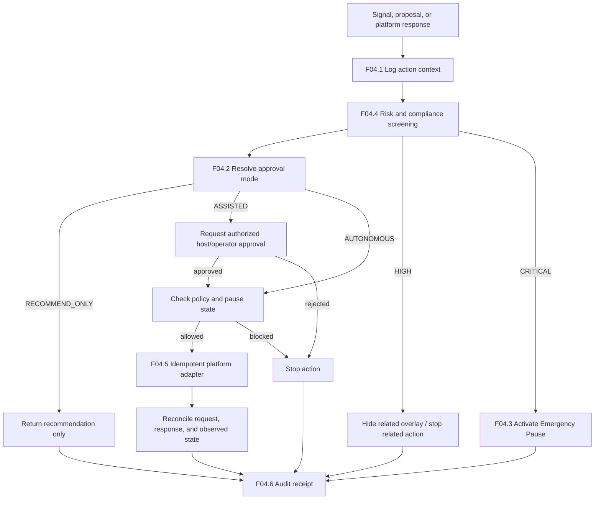

# Feature 04 — Risk Screening and Emergency Operator Control

> **Feature ID:** F04  
> **Capability:** Compliance & Operator Control  
> **BDD contract:** Version 1.0  
> **Status:** Drafted from the canonical LivePilot OS feature map

> **BRD:** [Feature 04 BRD — Risk Screening and Emergency Operator Control](../brd/feature-04-risk-screening-operator-control.md)

This document defines the control-plane behavior for consequential LivePilot OS actions.
It governs approval, moderation escalation, Emergency Pause, platform adapter safety,
execution logging, and auditability across Features 01–03.

## Traceability

| Feature | Sub-feature | Responsibility | Canonical source |
|---|---|---|---|
| F04 | F04.1 Action Log & Approval Control | Show and govern the complete decision sequence | [Feature Map §4.1](../../03-architecture/live-pilot-os-feature-map.md#41-action-log--approval-control) |
| F04 | F04.2 Approval Modes | Apply RECOMMEND_ONLY, ASSISTED, or AUTONOMOUS execution policy | [Feature Map §4.2](../../03-architecture/live-pilot-os-feature-map.md#42-approval-modes) |
| F04 | F04.3 Emergency Pause | Stop consequential automation immediately while preserving telemetry | [Feature Map §4.3](../../03-architecture/live-pilot-os-feature-map.md#43-emergency-pause) |
| F04 | F04.4 Moderation Escalation | Route risk events by severity and take the required control action | [Feature Map §4.4](../../03-architecture/live-pilot-os-feature-map.md#44-moderation-escalation) |
| F04 | F04.5 Platform Adapter Safety | Make external actions idempotent, retry-safe, and traceable | [Feature Map §4.5](../../03-architecture/live-pilot-os-feature-map#45-platform-adapter-safety) |
| F04 | F04.6 Execution Audit | Preserve the decision, policy, actor, request, response, and outcome chain | [Deep Context invariants](../../03-architecture/live-pilot-os-deep-context.md#non-negotiable-invariants) |

## Flow map



## Approval and risk policy

### Approval modes

```text
RECOMMEND_ONLY
→ AI provides recommendations only

ASSISTED
→ Host or operator must approve

AUTONOMOUS
→ Act automatically only when policy checks pass
```

### Risk severity

```text
LOW
→ Record in the log

MEDIUM
→ Alert host or moderator

HIGH
→ Hide on overlay and stop related actions

CRITICAL
→ Alert operator and activate Emergency Pause according to policy
```

## Event vocabulary

| Event | Meaning |
|---|---|
| `approval.requested` | A consequential action requires an authorized decision |
| `approval.resolved` | An approval request was approved, rejected, or expired |
| `action.logged` | A proposed or executed action was recorded |
| `action.failed` | An action failed or was rejected by the adapter |
| `emergency.pause.activated` | Automation was stopped by policy or operator |
| `emergency.pause.released` | Automation was allowed to resume |
| `compliance.escalated` | A risk was routed to an operator/moderator |
| `platform.action.requested` | An idempotent external command was sent |
| `platform.action.completed` | The external platform confirmed the command |
| `platform.action.failed` | The external platform rejected or failed the command |
| `audit.decision.appended` | An immutable decision receipt was stored |

## BDD scenarios

### F04.1 — Action Log & Approval Control

#### F04.1-FLOW-001 — Log an incoming proposal

**Given** Feature 02 or Feature 03 produces a recommendation or consequential proposal  
**When** Compliance receives it  
**Then** the action log records event ID, session ID, tenant/workspace, actor, proposed action, and correlation ID.

#### F04.1-FLOW-002 — Log a policy verdict

**Given** a margin, inventory, catalog, or risk policy evaluates an action  
**When** the verdict is returned  
**Then** the log records policy name, policy version, verdict, evidence hash, and causation ID.

#### F04.1-FLOW-003 — Show the live decision sequence

**Given** an action moves through proposal, verification, approval, execution, and reconciliation  
**When** the operator opens the action log  
**Then** the events appear in causal order with timestamp and current status.

#### F04.1-FLOW-004 — Record actor identity

**Given** an action is generated or approved  
**When** it is logged  
**Then** the actor is identified as AI, host, operator, system, or platform adapter.

#### F04.1-FLOW-005 — Log failure and retry information

**Given** a platform action fails or retries  
**When** the failure is handled  
**Then** the log includes error code, retry count, idempotency key, next action, and final outcome.

#### F04.1-FLOW-006 — Show safe operator detail

**Given** an operator views an action record  
**When** the detail is rendered  
**Then** secrets, tokens, raw PII, and protected financial inputs are redacted according to policy.

#### F04.1-FLOW-007 — Preserve append-only history

**Given** an action has been logged  
**When** a later correction or reconciliation occurs  
**Then** the system appends a new receipt and does not mutate the original decision evidence.

### F04.2 — Approval Modes

#### F04.2-FLOW-001 — Apply RECOMMEND_ONLY mode

**Given** a workspace is configured as RECOMMEND_ONLY  
**When** StreamPilot proposes a pin or voucher  
**Then** the system displays the recommendation but dispatches no consequential platform action.

#### F04.2-FLOW-002 — Apply ASSISTED mode

**Given** a workspace is configured as ASSISTED  
**When** an eligible action reaches the approval boundary  
**Then** the system creates `approval.requested` and waits for an authorized host/operator decision.

#### F04.2-FLOW-003 — Apply AUTONOMOUS mode

**Given** a workspace is configured as AUTONOMOUS  
**When** an action passes catalog, margin, inventory, risk, and pause checks  
**Then** the system may dispatch it using the approved idempotent workflow.

#### F04.2-FLOW-004 — Reject an unauthorized approval

**Given** a user lacks the required host/operator permission  
**When** they approve or reject a request  
**Then** the system denies the decision and records an authorization failure.

#### F04.2-FLOW-005 — Expire an approval request

**Given** an approval request reaches its decision deadline  
**When** the deadline workflow fires  
**Then** the request becomes expired and no external mutation is dispatched.

#### F04.2-FLOW-006 — Prevent approval replay

**Given** an approval decision has already been committed  
**When** the same decision is submitted again  
**Then** the original result is returned and no second action is started.

#### F04.2-FLOW-007 — Change approval mode safely

**Given** an authorized operator changes the workspace approval mode  
**When** the configuration update is committed  
**Then** new proposals use the new version while already-running workflows follow their explicit transition policy.

### F04.3 — Emergency Pause

#### F04.3-FLOW-001 — Activate pause from the control

**Given** an authorized operator presses Emergency Pause or the configured Spacebar shortcut  
**When** the control request is accepted  
**Then** the system writes an auditable pause state and publishes `emergency.pause.activated`.

#### F04.3-FLOW-002 — Activate pause from a critical risk

**Given** a CRITICAL compliance risk or configured system anomaly is detected  
**When** the policy evaluates the signal  
**Then** it activates Emergency Pause according to workspace policy and alerts the operator.

#### F04.3-FLOW-003 — Stop product pinning

**Given** Emergency Pause is active  
**When** a product pin proposal reaches execution  
**Then** the action is blocked and no platform pin command is sent.

#### F04.3-FLOW-004 — Stop voucher issuance

**Given** Emergency Pause is active  
**When** a voucher proposal reaches execution  
**Then** issuance is blocked, while existing state is reconciled safely.

#### F04.3-FLOW-005 — Stop new stock reservations

**Given** Emergency Pause is active  
**When** a new reservation request arrives  
**Then** the request is rejected or held according to policy and no new reservation is created.

#### F04.3-FLOW-006 — Stop scenario automation

**Given** Emergency Pause is active  
**When** a scenario rule is triggered  
**Then** the system records the trigger but creates no new consequential action.

#### F04.3-FLOW-007 — Continue telemetry and logging

**Given** Emergency Pause is active  
**When** chat, order, risk, and platform events arrive  
**Then** the system continues receiving, classifying, and logging telemetry.

#### F04.3-FLOW-008 — Release Emergency Pause

**Given** the operator has resolved the pause reason  
**When** an authorized operator releases the pause  
**Then** the system publishes `emergency.pause.released` and resumes only actions allowed by current policy.

#### F04.3-FLOW-009 — Prevent unsafe resume

**Given** the original pause reason remains unresolved  
**When** a release is attempted  
**Then** the system rejects the release and keeps consequential automation stopped.

### F04.4 — Moderation Escalation

#### F04.4-FLOW-001 — Record a LOW risk

**Given** Feature 01 emits a LOW risk signal  
**When** Compliance consumes it  
**Then** the system records it in the action log without interrupting the live session.

#### F04.4-FLOW-002 — Alert on MEDIUM risk

**Given** a MEDIUM risk signal is received  
**When** the severity policy evaluates it  
**Then** the host or moderator receives an alert with evidence and recommended handling.

#### F04.4-FLOW-003 — Control a HIGH risk

**Given** a HIGH risk signal is received  
**When** the escalation policy evaluates it  
**Then** the related message is hidden from the overlay and related automation is stopped.

#### F04.4-FLOW-004 — Control a CRITICAL risk

**Given** a CRITICAL risk signal is received  
**When** the escalation policy evaluates it  
**Then** the operator is alerted and Emergency Pause activates according to policy.

#### F04.4-FLOW-005 — Preserve risk evidence

**Given** a risk is escalated  
**When** a moderation case is created  
**Then** it contains risk type, score, severity, source event, evidence hash, policy version, and resolution state.

#### F04.4-FLOW-006 — Resolve a moderation case

**Given** a moderator or operator reviews an escalated case  
**When** they select a resolution  
**Then** the system records the actor, decision, reason, timestamp, and related action impact.

#### F04.4-FLOW-007 — Avoid duplicate escalation

**Given** a platform retries the same risk event  
**When** the same event ID is received again  
**Then** the system maintains one moderation case and one escalation chain.

### F04.5 — Platform Adapter Safety

#### F04.5-FLOW-001 — Validate an external command

**Given** a platform action is ready for dispatch  
**When** the adapter receives it  
**Then** it validates platform, session, action type, authorization, payload, and idempotency key.

#### F04.5-FLOW-002 — Send a traceable command

**Given** an external command passes adapter validation  
**When** it is sent  
**Then** the request stores platform, request payload hash, correlation ID, idempotency key, and timestamp.

#### F04.5-FLOW-003 — Retry a safe transient error

**Given** the adapter returns a known retryable error  
**When** retry policy allows another attempt  
**Then** the system retries with the same idempotency key and records the attempt.

#### F04.5-FLOW-004 — Do not retry an unknown result blindly

**Given** the platform result is unknown after timeout  
**When** the dispatcher considers a retry  
**Then** it reconciles platform state first and does not issue a duplicate voucher or action.

#### F04.5-FLOW-005 — Handle an adapter failure

**Given** the platform rejects an action  
**When** the failure is received  
**Then** the system emits `platform.action.failed`, preserves the error, and moves the workflow to safe compensation or operator review.

#### F04.5-FLOW-006 — Reconcile requested and observed state

**Given** a command was requested and a platform callback or poll result arrives  
**When** reconciliation runs  
**Then** it records requested, accepted, observed, and final state.

#### F04.5-FLOW-007 — Isolate platform credentials

**Given** an adapter needs platform credentials  
**When** it executes a command  
**Then** credentials remain inside the adapter boundary and never appear in UI payloads, logs, or model prompts.

### F04.6 — Execution Audit

#### F04.6-FLOW-001 — Append a complete decision receipt

**Given** a signal leads to a proposal, verdict, approval, action, or compensation  
**When** processing completes  
**Then** Audit stores event IDs, actor, model version, policy version, input hash, decision, status, and outcome.

#### F04.6-FLOW-002 — Link causation and correlation

**Given** several services participate in one action  
**When** each event is appended  
**Then** every receipt carries correlation ID and causation ID linking the complete chain.

#### F04.6-FLOW-003 — Prove no duplicate voucher

**Given** a voucher command is retried or the result is delayed  
**When** an audit query is performed  
**Then** the record proves the idempotency key and effective platform outcome.

#### F04.6-FLOW-004 — Export an evidence bundle

**Given** an operator or support workflow requests an investigation  
**When** the evidence bundle is generated  
**Then** it contains the relevant event chain, policy verdicts, actions, responses, and redacted payload references.

#### F04.6-FLOW-005 — Rebuild an audit projection

**Given** an audit read model is unavailable  
**When** replay is requested  
**Then** the projection is rebuilt from append-only audit receipts without changing source evidence.

## Acceptance checklist

- [ ] F04.1 every consequential action has a complete, append-only action log
- [ ] F04.2 RECOMMEND_ONLY, ASSISTED, and AUTONOMOUS modes are enforced
- [ ] F04.3 Emergency Pause blocks pinning, vouchers, reservations, and scenario automation
- [ ] F04.3 telemetry and audit continue while automation is paused
- [ ] F04.4 LOW/MEDIUM/HIGH/CRITICAL risk handling is explicit and testable
- [ ] F04.5 adapters are idempotent, retry-safe, credential-isolated, and reconciled
- [ ] F04.6 decisions carry actor, policy/model versions, causation, correlation, and evidence
- [ ] All Feature 01–03 consequential paths are governed by this control plane

## Backlinks

- [LivePilot OS Deep Context](../../03-architecture/live-pilot-os-deep-context.md)
- [LivePilot OS Feature Map](../../03-architecture/live-pilot-os-feature-map.md)
- [LivePilot OS Core Features](../../03-architecture/live-pilot-os-core-features.md)
- [Feature 01 BDD — Live Chat & Telemetry](./feature-01-live-chat-telemetry.md)
- [Feature 02 BDD — Streamer Co-pilot HUD](./feature-02-streamer-copilot-hud.md)
- [Feature 03 BDD — StreamPilot Agent](./feature-03-streampilot-agent.md)
- [NATS / OpenAPI contract index](../../03-architecture/api/README.md)

