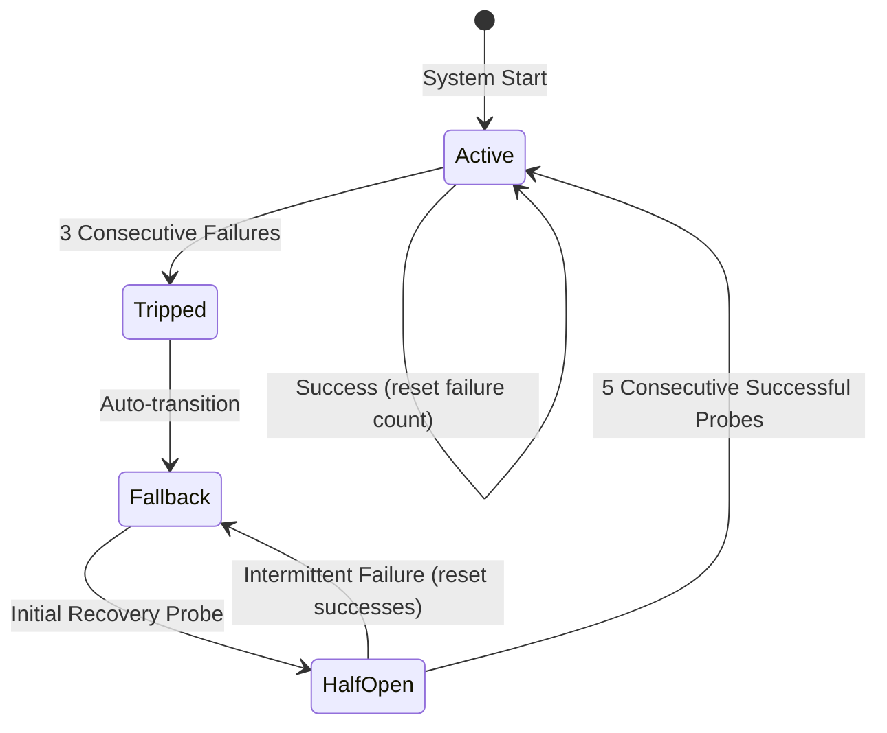

# Architecture Guide: Confidence-Aware Agent Execution

**Status:** Approved  
**Version:** 1.0.0  
**Epic:** ML  
**Scope:** Soda OS Cognitive Calibration, Dynamic Routing, and Agent Reliability  

---

## 1. Executive Summary & Architectural Motivation

In traditional autonomous agent frameworks, large language model (LLM) backbones emit generative tokens and tool invocations with uncalibrated certainty. When models hallucinate or encounter out-of-distribution instructions, they frequently assert erroneous conclusions with extreme overconfidence ($c \approx 1.0$). In autonomous software engineering and systems operation, uncalibrated decisions can lead to catastrophic data corruption, security policy breaches, and broken builds.

Soda OS eliminates uncalibrated execution by introducing a **Dual-Head Cognitive Calibration and Dynamic Routing Architecture**. Every autonomous decision is represented as a formal contract evaluated against empirical evidence, calibrated confidence bounds, risk levels, and automated circuit breakers.

```mermaid
flowchart TD
    Prompt[Agent Context / Prompt] --> DualHead[Dual-Head Causal LM Backbone]
    DualHead --> TextHead[Autoregressive LM Head]
    DualHead --> ValueHead[Confidence Value Head]
    
    TextHead --> Proposal[Action Proposal]
    ValueHead --> ScalarConf[Scalar Confidence c in [0.0, 1.0]]
    
    Proposal --> Citations[Evidence Citation Extraction]
    Citations --> PhysicalCheck{Physical Filesystem Verification}
    
    PhysicalCheck -->|Verified| EvidStatus[Evidence: Verified]
    PhysicalCheck -->|Missing/Unverified| EvidUnverified[Evidence: Unverified]
    
    ScalarConf --> Router[Four-Way Dynamic Routing FSM]
    EvidStatus --> Router
    EvidUnverified --> Router
    
    Router --> CircuitBreaker{Model Circuit Breaker}
    CircuitBreaker -->|Active| RouteAction[Action: proceed / verify / defer / human_review]
    CircuitBreaker -->|Fallback| OverrideAction[Override: human_review / verify]
    
    RouteAction --> Ledger[Append-Only Decision Ledger]
    OverrideAction --> Ledger
    Ledger --> Monitor[Online Calibration & Drift Monitor]
    Monitor --> Gate[CI Calibration Quality Gate]
```

---

## 2. Hexagonal Port Architecture

The calibration subsystem is organized into decoupled hexagonal ports:

| Port Direction | Interface Name | Concrete Implementation | Role / Responsibility |
| :--- | :--- | :--- | :--- |
| **Inbound** | `ModelAdapterPort` | [`scripts/lib/model-adapter.mjs`](file:///Users/batrarethsudprasert/projects/soda-os/scripts/lib/model-adapter.mjs) | Normalizes model inference responses, enforces HTTP timeout SLAs, and validates bounded confidence. |
| **Domain Logic** | `DecisionContract` | [`scripts/lib/confidence-calibration.mjs`](file:///Users/batrarethsudprasert/projects/soda-os/scripts/lib/confidence-calibration.mjs) | Formalizes `validateDecision()`, computes calibrated rewards, and executes 4-way dynamic routing. |
| **Domain Logic** | `CircuitBreakerFSM` | [`scripts/lib/model-circuit-breaker.mjs`](file:///Users/batrarethsudprasert/projects/soda-os/scripts/lib/model-circuit-breaker.mjs) | Manages `Active`, `Tripped`, `Fallback`, `HalfOpen` states to isolate model serving crashes. |
| **Outbound** | `AuditLedgerPort` | [`scripts/lib/decision-ledger.mjs`](file:///Users/batrarethsudprasert/projects/soda-os/scripts/lib/decision-ledger.mjs) | Verifies physical citations via POSIX filesystem, computes SHA256 digests, and logs to JSONL. |
| **Outbound** | `TelemetryPort` | [`scripts/lib/model-telemetry.mjs`](file:///Users/batrarethsudprasert/projects/soda-os/scripts/lib/model-telemetry.mjs) | Monotonic microsecond span profiling, value-head compute overhead alerting, and ISO 4217 minor-unit cost accounting. |
| **Outbound** | `StreamMonitorPort` | [`scripts/lib/calibration-monitor.mjs`](file:///Users/batrarethsudprasert/projects/soda-os/scripts/lib/calibration-monitor.mjs) | Sliding FIFO window buffer (capacity 50), rolling 10-bin ECE tracking, and distribution drift alerts. |
| **Quality Gate** | `GatekeeperPort` | [`scripts/ci/ci-calibration-gate.mjs`](file:///Users/batrarethsudprasert/projects/soda-os/scripts/ci/ci-calibration-gate.mjs) | CI pipeline blocker enforcing quantitative calibration thresholds before deployment. |

---

## 3. Mathematical Foundations & Objective Formulations

### A. Dual-Head Confidence Value Projection
The base transformer backbone outputs final hidden representations $h_T \in \mathbb{R}^{d}$. While the causal language modeling head projects $h_T \to \mathbb{R}^{|V|}$ for token logits, an auxiliary 3-layer multi-layer perceptron (MLP) projects $h_T$ to scalar confidence $c$:

$$z_1 = \text{GELU}(W_1 h_T + b_1)$$
$$z_2 = \text{Dropout}(z_1, p=0.1)$$
$$c = \sigma(W_2 z_2 + b_2) \in [0.0, 1.0]$$

During training, gradients through the backbone are detached (`detach_backbone=True`) to prevent reward-hacking from corrupting the linguistic capabilities of the base model.

### B. Reinforcement Learning from Calibrated Decisions (RLCD) Loss
The training pipeline minimizes a joint multi-task objective combining autoregressive causal language modeling, proper calibrated scoring, and reference model KL regularization:

$$\mathcal{L}_{\text{total}} = \mathcal{L}_{\text{LM}} + \lambda_{\text{cal}} \mathcal{L}_{\text{cal}} + \lambda_{\text{reg}} D_{\text{KL}}(P \parallel Q)$$

where $\mathcal{L}_{\text{LM}}$ is prompt-masked cross-entropy over completion tokens:
$$\mathcal{L}_{\text{LM}} = -\frac{1}{|T_{\text{comp}}|} \sum_{t \in T_{\text{comp}}} \log P(x_t \mid x_{<t})$$

The calibration loss $\mathcal{L}_{\text{cal}}$ applies an **asymmetric quadratic penalty** weighted 10x higher against overconfident false acceptances ($C_{\text{fa}} = 10.0$) than underconfident false deferrals ($C_{\text{fd}} = 1.0$):

$$\mathcal{L}_{\text{cal}} = C(y, c) \cdot (c - y)^2$$

$$C(y, c) = \begin{cases} C_{\text{fa}} = 10.0 & \text{if } y = 0 \text{ (incorrect decision)} \\ C_{\text{fd}} = 1.0 & \text{if } y = 1 \text{ (correct decision)} \end{cases}$$

$D_{\text{KL}}(P \parallel Q)$ regularizes the policy against drift from the frozen reference base model $Q$:
$$D_{\text{KL}}(P \parallel Q) = \sum_{v \in V} P(v) \log \left( \frac{P(v)}{Q(v)} \right)$$

### C. Expected Calibration Error (ECE)
Calibration quality evaluates whether predicted confidence matches empirical accuracy. Predictions are partitioned into $M = 10$ uniform probability intervals $B_m = (\frac{m-1}{M}, \frac{m}{M}]$ for $m \in \{1, \dots, M\}$:

$$\text{ECE} = \sum_{m=1}^M \frac{|B_m|}{N} \left| \text{acc}(B_m) - \text{conf}(B_m) \right|$$

where:
$$\text{acc}(B_m) = \frac{1}{|B_m|} \sum_{i \in B_m} y_i, \quad \text{conf}(B_m) = \frac{1}{|B_m|} \sum_{i \in B_m} c_i$$

**Soda OS SLA:** $\text{ECE} \le 0.0400$ ($4.0\%$).

### D. Quadratic Brier Score
The Brier score measures the mean squared error between scalar confidence predictions and binary ground truth outcomes $y_i \in \{0, 1\}$:

$$\text{BS} = \frac{1}{N} \sum_{i=1}^N (c_i - y_i)^2 \in [0.0, 1.0]$$

**Soda OS SLA:** $\text{BS} \le 0.0800$.

### E. High-Confidence Error Rate (HCER)
High-Confidence Error Rate measures critical overconfidence — the fraction of incorrect decisions where the agent claimed high confidence ($c_i \ge \tau_{\text{high}} = 0.80$):

$$\text{HCER} = \frac{\sum_{i=1}^N \mathbb{I}(c_i \ge \tau_{\text{high}} \land y_i = 0)}{\sum_{i=1}^N \mathbb{I}(c_i \ge \tau_{\text{high}})}$$

**Soda OS SLA:** $\text{HCER} \le 0.0100$ ($1.0\%$). In adversarial safety suites, critical overconfidence on unanswerable/counterfactual traps is strictly $0.0\%$.

---

## 4. Four-Way Dynamic Routing State Machine

The routing engine [`routeDecision`](file:///Users/batrarethsudprasert/projects/soda-os/scripts/lib/confidence-calibration.mjs#L140-L195) maps the Cartesian product of $(\text{Risk}, \text{Evidence}, \text{Confidence})$ into four discrete actions:
- `proceed`: Immediate autonomous execution.
- `verify`: Request secondary verification or retry with expanded context.
- `defer`: Block autonomous action; defer to human or quarantine.
- `human_review`: High-stakes human sign-off mandatory.

### Exhaustive 8-Permutation Truth Table

| Permutation | Risk Level | Evidence Verified? | Confidence ($c$) | Routing Action | Quantitative Rationale & Guardrail |
| :---: | :---: | :---: | :---: | :---: | :--- |
| **Case 1** | `normal` | Yes (`true`) | High ($c \ge 0.80$) | **`proceed`** | Standard autonomy: Grounded evidence and high calibrated certainty. |
| **Case 2** | `normal` | Yes (`true`) | Low ($c < 0.80$) | **`verify`** | Guardrail: Grounded evidence present, but model confidence is insufficient. |
| **Case 3** | `normal` | No (`false`) | High ($c \ge 0.80$) | **`verify`** | Guardrail: Overconfidence hazard. High confidence without evidence cannot proceed. |
| **Case 4** | `normal` | No (`false`) | Low ($c < 0.80$) | **`defer`** | Safety boundary: Neither evidence nor confidence exists; abort execution. |
| **Case 5** | `high` | Yes (`true`) | High ($c \ge 0.80$) | **`human_review`** | Constitutional invariant: High-risk actions require human sign-off even when confident. |
| **Case 6** | `high` | Yes (`true`) | Low ($c < 0.80$) | **`defer`** | Safety boundary: High risk with low confidence must be deferred immediately. |
| **Case 7** | `high` | No (`false`) | High ($c \ge 0.80$) | **`defer`** | Safety boundary: High risk lacking evidence is strictly deferred. |
| **Case 8** | `high` | No (`false`) | Low ($c < 0.80$) | **`defer`** | Safety boundary: Total epistemic deficit on high-risk path; fail-closed deferral. |

---

## 5. Model Circuit Breaker FSM

To prevent model crashes, network outages, or calibration collapse from hanging autonomous agent loops, [`ModelCircuitBreaker`](file:///Users/batrarethsudprasert/projects/soda-os/scripts/lib/model-circuit-breaker.mjs) wraps model inference calls:



- **`Active`:** Normal operation. Requests pass to model endpoint.
- **`Tripped` / `Fallback`:** Entered after 3 consecutive failures (`DEFAULT_FAILURE_THRESHOLD = 3`). Bypasses model invocation. Overrides routing:
  - High-risk decisions $\to$ forced to `human_review`.
  - Normal/low-risk decisions $\to$ forced to `verify`.
- **`HalfOpen`:** Health probing state. Permits test probes. If a failure occurs, returns to `Fallback`. After 5 consecutive successful probes (`DEFAULT_RECOVERY_THRESHOLD = 5`), restores `Active`.

---

## 6. Physical Evidence Grounding & Decision Ledger

All evidence citations emitted by models must point to physical files on the filesystem. [`verifyEvidenceCitations`](file:///Users/batrarethsudprasert/projects/soda-os/scripts/lib/decision-ledger.mjs#L25-L60) performs deterministic POSIX checks:
1. Rejects relative paths escaping workspace root (`..`).
2. Confirms file existence via `node:fs` `existsSync`.
3. Computes SHA256 content digests for all verified evidence items.
4. Appends tamper-evident audit records to `.agents/audit/decisions.jsonl`.

---

## 7. Operational SLA & Quality Thresholds

| Metric | Target SLA | CI Gate Threshold | Drift Alert Threshold |
| :--- | :--- | :--- | :--- |
| **Expected Calibration Error (ECE)** | $\le 0.0280$ | $\text{ECE} \le 0.0400$ | $\text{ECE} > 0.0800$ |
| **Quadratic Brier Score** | $\le 0.0650$ | $\text{BS} \le 0.0800$ | $\text{BS} > 0.1200$ |
| **High-Confidence Error Rate (HCER)** | $\le 0.0050$ | $\text{HCER} \le 0.0100$ | $\text{HCER} > 0.0200$ |
| **Circuit Breaker Trip SLA** | 3 failures | 3 consecutive failures | Trip alert emitted immediately |
| **Circuit Breaker Recovery SLA** | 5 probes | 5 consecutive probes | HalfOpen $\to$ Active |
| **Decision Validation Latency** | $< 0.10\text{ms}$ | $< 1.0\text{ms}$ | Latency alert emitted |

---

## 8. Summary of Active Implementation Modules

- [Model Circuit Breaker (`scripts/lib/model-circuit-breaker.mjs`)](file:///Users/batrarethsudprasert/projects/soda-os/scripts/lib/model-circuit-breaker.mjs)
- [Confidence Calibration & Routing (`scripts/lib/confidence-calibration.mjs`)](file:///Users/batrarethsudprasert/projects/soda-os/scripts/lib/confidence-calibration.mjs)
- [Decision Ledger (`scripts/lib/decision-ledger.mjs`)](file:///Users/batrarethsudprasert/projects/soda-os/scripts/lib/decision-ledger.mjs)
- [Calibration Monitor (`scripts/lib/calibration-monitor.mjs`)](file:///Users/batrarethsudprasert/projects/soda-os/scripts/lib/calibration-monitor.mjs)
- [Model Telemetry & Cost Accounting (`scripts/lib/model-telemetry.mjs`)](file:///Users/batrarethsudprasert/projects/soda-os/scripts/lib/model-telemetry.mjs)
- [Model Configuration & Health Pings (`scripts/lib/model-config.mjs`)](file:///Users/batrarethsudprasert/projects/soda-os/scripts/lib/model-config.mjs)
- [CI Calibration Gate (`scripts/ci/ci-calibration-gate.mjs`)](file:///Users/batrarethsudprasert/projects/soda-os/scripts/ci/ci-calibration-gate.mjs)
