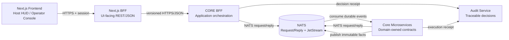

# LivePilot OS Deep Context

> Canonical deep-context entry point for LivePilot OS architecture, product intent,
> capability boundaries, and source documents.

## Architecture entry point

- [Architecture Overview](./overview.md)
- [OpenAPI contract](./api/openapi.yaml)
- [Feature 01 BDD contract](../02-product/bdd/feature-01-live-chat-telemetry.md)
- [Feature 01 BRD](../02-product/brd/feature-01-live-chat-purchase-signal-analysis.md)
- [Feature 02 BDD contract](../02-product/bdd/feature-02-streamer-copilot-hud.md)
- [Feature 02 BRD](../02-product/brd/feature-02-host-screen-assistant.md)
- [Feature 03 BDD contract](../02-product/bdd/feature-03-streampilot-agent.md)
- [Feature 03 BRD](../02-product/brd/feature-03-store-management-profit-protection.md)
- [Feature 04 BDD contract](../02-product/bdd/feature-04-risk-operator-control.md)
- [Feature 04 BRD](../02-product/brd/feature-04-risk-screening-operator-control.md)

## Canonical source documents

- [LivePilot OS Feature Map — Detailed Canonical Specification](./live-pilot-os-feature-map.md)
- [LivePilot OS Features — Core Summary](./live-pilot-os-core-features.md)
- [LivePilot OS Sub-features — Quick Reference](./live-pilot-os-sub-features.md)
- [LivePilot OS — Business Model Canvas](./live-pilot-os-business-model-canvas.md)
- [LivePilot OS — Production Technology Stack](./live-pilot-os-tech-stack.md)
- [LivePilot OS — Executive Briefing Notes](./live-pilot-os-briefing-notes-product-domain-lead-bd-manager.md)
- [Product Brief](../02-product/project-brief.md)
- [Requirements Baseline (`REQ-LP-NNN`)](./live-pilot-os-requirements.md)
- [Business Case](./live-pilot-os-business-case.md)
- [Domain and Event Model](./live-pilot-os-domain-model.md)
- [Integration Boundaries](./live-pilot-os-integration-boundaries.md)
- [Goal Generation Completeness Contract](./goal-generation-completeness.md)

### UX and visual design sources

- [Information Architecture and UX Flow — G-UX-041](./ux/G-UX-041.md)
- [UI Specification — G-UX-041](../02-product/design/G-UX-041.md)
- [Live OS Design Token Proposal](./ux/live-os-design-tokens.md)
- [Runtime Design Tokens](../../src/tokens.css)

> **Approval status:** G-UX-041's UX flow, UI specification, and token proposal are drafts pending Product/Design approval. Treat them as the current proposal, not a frozen implementation contract.

## Deep-context operating model

LivePilot OS coordinates live-commerce operations across four bounded capabilities:

1. **Live Chat & Telemetry Understanding** analyzes live signals and produces structured intent,
   engagement, question, and risk events.
2. **Streamer Co-pilot HUD** turns verified signals into short, evidence-based host guidance.
3. **StreamPilot Agent** proposes or executes bounded store actions such as product pinning,
   vouchers, and inventory reservations.
4. **Compliance & Operator Control** governs approval, audit, moderation escalation, and
   emergency pause across all consequential actions.

The governing flow is:

```text
observe → classify → recommend → verify policy → approve/execute → reconcile → audit
```

## Contract topology

LivePilot OS uses three explicit application boundaries. The browser talks only to the
Next.js BFF over HTTP. The Next.js BFF talks to the CORE BFF using an application HTTP
contract. The CORE BFF and microservices communicate through NATS request/reply and
durable NATS JetStream events. The CORE BFF does not reimplement catalog, margin,
inventory, approval, or audit rules.



### Boundary responsibilities

| Boundary | Contract | Owns | Must not do |
|---|---|---|---|
| Browser ↔ Next.js BFF | Public UI REST/JSON | Session handling, UI DTOs, input validation, response shaping | Calculate margin, mutate inventory, or call microservices directly |
| Next.js BFF ↔ CORE BFF | Versioned application REST/JSON | Use-case orchestration and aggregation for screens and commands | Become the source of truth for domain rules |
| CORE BFF ↔ microservices | NATS request/reply | Domain commands and queries with explicit subjects and schemas | Bypass Margin, Inventory, Approval, or Audit boundaries |
| Microservice ↔ microservice | NATS JetStream events | Immutable facts, state transitions, and receipts | Share database tables as an implicit contract |

### Contract rules

1. `docs/03-architecture/api/openapi.yaml` is the source of truth for HTTP contracts
   between the browser, Next.js BFF, and CORE BFF.
2. NATS request/reply and JetStream message contracts must use versioned JSON Schema
   (or AsyncAPI when the subject catalog is introduced) under
   `docs/03-architecture/api/asyncapi.yaml` and/or `docs/03-architecture/api/schemas/`.
   The subject name, direction, schema version, delivery semantics, and idempotency
   behavior are part of the contract.
3. Every request carries tenant/workspace scope, authorization, and `X-Correlation-Id`.
4. Every consequential mutation carries an `Idempotency-Key` and returns a traceable
   decision or action identifier.
5. Errors use one problem-details shape with a stable machine-readable `code`; stack
   traces, secrets, COGS, and customer PII never cross the public BFF boundary.
6. Additive response fields are backward compatible. Removed or renamed fields require a
   new major API version.
7. NATS events describe facts that happened; NATS request/reply describes requested
   actions or queries. An AI
   suggestion is not a platform command.

### Consequential action contract

```text
Next.js BFF
  → CORE BFF
    → Promotion proposal
      → Margin verdict
      → Inventory reservation
      → Approval / Emergency Pause check
      → Idempotent platform action
      → Reconciliation
      → Audit receipt
```

The CORE BFF may coordinate this flow, but the authoritative decision remains in the
owning microservice. No LLM or frontend route may issue a platform mutation directly.

## Non-negotiable invariants

| Invariant | Required behavior |
|-----------|-------------------|
| Catalog grounding | Product Q&A uses brand-approved catalog facts only; unknown or medical claims are escalated. |
| Margin protection | Discounts and vouchers pass the server-side contribution-margin floor before issuance. |
| Inventory safety | Cross-channel reservations are atomic and returned when a promotion expires without payment. |
| Idempotent execution | Delayed or repeated platform responses must not create duplicate coupons or actions. |
| Operator sovereignty | Approval modes and Emergency Pause can stop automated actions immediately. |
| Traceability | AI proposals, deterministic verdicts, platform state, and operator decisions are audit-visible. |
| Script respect | Co-pilot guidance is glanceable and complements the host's existing selling rhythm. |

## Source precedence

When documents conflict, resolve them in this order:

1. Approved decisions and explicit acceptance contracts.
2. The Requirements Baseline for canonical requirement IDs and proposed scope; its current entries remain draft until Product approval.
3. This deep-context entry point for LivePilot OS invariants and contract boundaries.
4. The detailed feature map and core-feature specification.
5. The sub-feature quick reference and Business Model Canvas (hypotheses only).

For UX-specific questions, use the G-UX-041 flow for roles, information hierarchy, shared-session behavior, screen states, and responsive behavior; use its UI specification for component behavior; use `src/tokens.css` for actual token values. The token proposal documents intent. Any mismatch between the approved design and CSS must be resolved and recorded before implementation proceeds.

Unresolved product or architecture intent must be recorded as an assumption or decision;
agents must not silently invent a new platform contract, financial rule, or workflow state.

## Context loading contract

For LivePilot OS work, load this document first, then only the linked source document required
by the goal's touch map. A goal that changes a flow must identify the affected capability,
events, policy gate, operator control, and verification evidence.

## Related architecture

- [Architecture Overview](./overview.md)
- [API contract source](./api/README.md)
- [Data policy source](./data/README.md)
- [Soda OS design specification](./design-spec.md)
