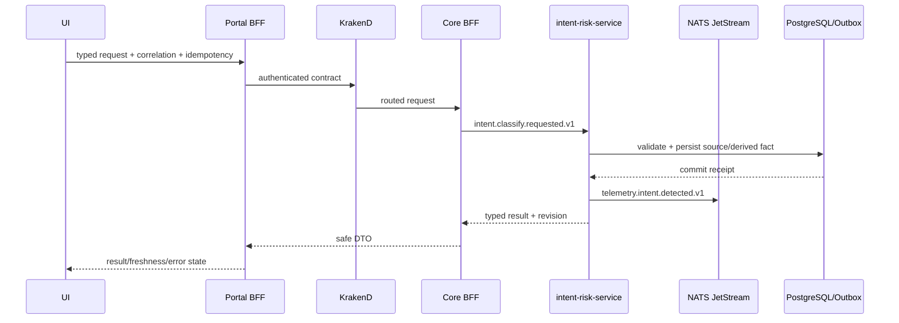

# F01.1-FLOW-001 — Classify Product Interest

> Flow-level Source of Truth for Feature F01. This document is linked from the
> [F01 feature index](../index.md) and follows the
> [LivePilot flow SOT template](../../../live-pilot-flow-sot-template.md).

## Machine-readable contract coverage

| Source | Link | Coverage |
|---|---|---|
| BRD | [BR-F01-004](../../../../../02-product/brd/feature-01-live-chat-purchase-signal-analysis.md) | Business requirement for this flow |
| BDD | [F01.1-FLOW-001](../../../../../02-product/bdd/feature-01-live-chat-telemetry.md) | Given/When/Then behavior |
| Feature index | [F01 index](../index.md) | Parent scope and flow linkage |
| Architecture | [overview.md](../../../../overview.md) | UI, BFF, gateway, service boundary |
| Deep context | [deep context](../../../../live-pilot-os-deep-context.md) | LiveSession, NATS, JEV, safety invariants |

Status: detailed contract baseline. Proposed routes, subjects, thresholds, and
schemas remain open until the verification gates in this document are closed.

## Purpose and scope

Turn product-directed chat such as “show shade 02” into a confidence-aware intent signal.

### Actor and input

- Actor: Viewer / Intent-Risk Service
- Input: `redacted normalized chat, catalog snapshot, session context`
- Output: PRODUCT_INTEREST signal with confidence, evidence, and optional SKU
- Service owner: `intent-risk-service`
- Flow group: Chat understanding

### Scope boundary

In scope: validate, process, persist, and publish this flow's typed fact.
Out of scope: direct browser-to-service calls, cross-session data, platform
mutation, and any capability not explicitly owned by this flow.

## Shared boundary and topology

```text
UI → Portal BFF → KrakenD → Core BFF
  → NATS request/reply + JetStream
  → intent-risk-service
  → PostgreSQL/outbox → projections/audit
```

| Node | Contract responsibility | Must not do |
|---|---|---|
| Node 1 UI | Render input, pending, success, stale, degraded, and error states | Classify or write source facts |
| Node 2 Portal BFF | Validate session scope, filters, locale, and safe DTO shape | Own domain rules or service tables |
| Node 3 KrakenD | Authenticate, rate-limit, route, and preserve correlation | Implement flow semantics |
| Node 4 Core BFF | Orchestrate command/query and map ProblemDetails | Become a second writer |
| Node 5 Domain Service | Apply the flow rule and publish the typed fact | Read another service's database |
| Node 6 Persistence/Event | Commit source/projection state, outbox, replay, and audit | Hide duplicates, late events, or unknown state |

## Canonical aggregate and lifecycle

| Fact | Contract |
|---|---|
| Parent boundary | `live_session_id` and authorized platform context |
| Owner | `intent-risk-service` |
| Subject | `intent.classify.requested.v1 → telemetry.intent.detected.v1` |
| Source of truth | PostgreSQL facts plus transactional outbox |
| Derived output | PRODUCT_INTEREST signal with confidence, evidence, and optional SKU |
| Idempotency | Provider event ID or deterministic flow key; same key + same fingerprint is a no-op |

```text
RECEIVED → VALIDATED → PROCESSING → COMMITTED → PUBLISHED → PROJECTED
                         ├──→ REJECTED
                         └──→ DEFERRED / RECONCILIATION_REQUIRED
```

| Transition | Guard | Result |
|---|---|---|
| received → validated | active session, schema, authorization, required fields | processing allowed |
| validated → processing | owner service and dependency available | flow rule evaluated |
| processing → committed | transaction succeeds | source fact durable |
| committed → published | outbox delivery succeeds | consumers can process |
| processing → rejected/deferred | invalid, unsafe, ambiguous, or low confidence | no false success |

## Frontend contract

| UI concern | Contract |
|---|---|
| Request | Send only typed fields through Portal BFF; include correlation and idempotency headers |
| Loading | Show pending state and preserve prior known revision |
| Success | Render PRODUCT_INTEREST signal with confidence, evidence, and optional SKU with freshness, confidence/revision, and evidence availability |
| Empty | Distinguish no matching fact from unavailable or unauthorized data |
| Error | Render safe ProblemDetails code and retryable flag; never expose provider secrets |
| Degraded | Mark stale/degraded explicitly and block controls that require authoritative state |
| Accessibility | Keyboard reachable, screen-reader label, focus-preserving error, Thai/English locale |

The UI must never infer a domain transition from an optimistic button state. It
refreshes from the committed DTO or event-backed projection.

## Backend contract

### Portal BFF

- Validates `live_session_id`, actor capability, locale, query/body shape, and
  idempotency before forwarding.
- Redacts raw provider payloads and sensitive model evidence.
- Preserves `X-Correlation-ID`, `Idempotency-Key`, causation, and projection
  revision metadata.
- Returns stable ProblemDetails; it does not calculate the authoritative result.

### KrakenD

- Authenticates and rate-limits the public operation.
- Routes to Core BFF and preserves correlation and locale headers.
- Rejects malformed/oversized input before business processing.
- Does not retry non-idempotent commands without an idempotency key.

### Core BFF

- Maps the public DTO to `intent.classify.requested.v1` request semantics.
- Uses NATS request/reply for synchronous acknowledgement and JetStream for facts.
- Does not implement classification, risk, aggregation, or source-of-truth rules.
- Returns the service receipt only after commit or an explicit typed failure.

## Microservice contract

### Owner: `intent-risk-service`

| Responsibility | Contract |
|---|---|
| Validate | session scope, schema version, required fields, policy guard |
| Decide/process | Low confidence may inform UI but cannot trigger commerce mutation. |
| Persist | intent signal, taxonomy version, model/policy version, evidence IDs |
| Publish | `intent.classify.requested.v1 → telemetry.intent.detected.v1` with event, causation, correlation, producer, and schema version |
| Consume | only versioned contracts needed for this flow |
| Replay | deterministic result from durable source facts and revision |
| Security | fail closed on missing authorization or unavailable policy |

### Event payload

```json
{
  "event_id": "evt_01",
  "event_type": "telemetry.intent.detected.v1",
  "occurred_at": "2026-11-20T10:00:00Z",
  "live_session_id": "session_01",
  "correlation_id": "trace_01",
  "causation_id": "evt_source_01",
  "schema_version": 1,
  "producer": "intent-risk-service",
  "idempotency_key": "flow-key-01",
  "data": {
    "status": "committed",
    "result": "PRODUCT_INTEREST signal with confidence, evidence, and optional SKU",
    "evidence_ids": ["evt_source_01"]
  }
}
```

## Persistence and idempotency

- Source facts are append-only; derived projections carry a monotonic revision.
- A unique key on `live_session_id + provider_event_id + flow discriminator`
  prevents duplicate processing where provider identity exists.
- Command retries use `Idempotency-Key` plus request fingerprint.
- A fingerprint mismatch returns `IDEMPOTENCY_PAYLOAD_MISMATCH`; it never overwrites
  the first request.
- Outbox commit and source state commit are atomic. Consumers remain replayable.

## Errors, retry, and recovery

| Error | Retry | Behavior |
|---|---|---|
| INTENT_SCHEMA_INVALID | no unless input changes | reject with no downstream fact |
| CATALOG_UNRESOLVED | bounded with same key | retry only if operation is idempotent |
| LOW_CONFIDENCE | no blind retry | defer/review or explicit unresolved result |
| NATS/DB temporary failure | bounded | no success response without commit receipt |
| duplicate delivery | safe no-op | return original receipt; no counter inflation |
| unknown external result | reconcile first | do not claim success or retry blindly |

All failures include `correlation_id`, safe error code, retryable flag, and
redacted evidence reference. HTTP mapping uses the shared ProblemDetails contract.

## Observability, privacy, and localization

| Concern | Requirement |
|---|---|
| Trace | event, causation, correlation, producer, schema, service, and revision |
| Metrics | accepted/rejected/deferred, latency, duplicate rate, freshness, replay count |
| Logs | structured and redacted; no tokens, raw PII, or unapproved prompt content |
| Privacy | hash or minimize raw text; session-scope all evidence |
| Localization | `X-Locale: th|en`; machine codes stable; timestamps UTC |
| Safety | no low-confidence or unavailable result may trigger consequential mutation |

## Sequence



## Verification and readiness

| Verification | Evidence required |
|---|---|
| Happy path | input produces exactly one committed result and event |
| Authorization | wrong session/actor is rejected before persistence |
| Idempotency | replay does not duplicate facts, counts, or events |
| Failure | DB/NATS outage produces typed retry/degraded behavior |
| Contract | OpenAPI/NATS schema and consumer-provider compatibility test |
| Recovery | replay/reconciliation rebuilds same deterministic result |
| Audit | source, decision, output, and outcome are trace-linked |

### Flow-specific acceptance

- Low confidence may inform UI but cannot trigger commerce mutation.
- Result is `PRODUCT_INTEREST signal with confidence, evidence, and optional SKU` and is scoped to `live_session_id`.
- Consumers receive `intent.classify.requested.v1 → telemetry.intent.detected.v1` only after durable commit.
- INTENT_SCHEMA_INVALID, CATALOG_UNRESOLVED, LOW_CONFIDENCE are observable and do not become silent empty success.
- Downstream consumers: co-pilot, dashboard, StreamPilot.

## Open decisions

| ID | Decision | Closure evidence |
|---|---|---|
| F01.1-FLOW-001-OPEN-001 | Exact HTTP route or adapter ingress contract | OpenAPI/adapter schema revision |
| F01.1-FLOW-001-OPEN-002 | Final NATS subject registry and schema location | Async registry + compatibility test |
| F01.1-FLOW-001-OPEN-003 | Threshold, retention, or source-readiness policy for this flow | Approved policy + executable test |

## Definition of done

- This flow is linked from the F01 feature index and links back to its BDD/BRD.
- Frontend, Portal BFF, KrakenD, Core BFF, NATS, microservice, persistence, and
  audit contracts are explicitly documented.
- Duplicate, late/unknown, unauthorized, degraded, and retry behavior is tested.
- No Organization, Workspace, Campaign, tenant aggregate, or direct platform mutation
  is introduced by this flow.

