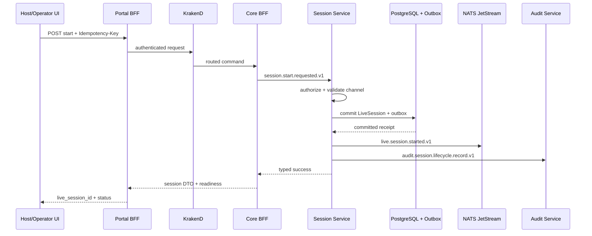

# F01-FLOW-001 — Initialize a Live Session

> Flow-level Source of Truth. This document is generated from the F01 BRD/BDD
> and follows the [LivePilot flow SOT template](../../../live-pilot-flow-sot-template.md).
> It is the first detailed flow under the [F01 feature index](../index.md).

## Machine-readable contract coverage

| Source              | Link                                                                                   | Coverage                                                     |
| ------------------- | -------------------------------------------------------------------------------------- | ------------------------------------------------------------ |
| BRD requirement     | [BR-F01-001](../../../../../02-product/brd/feature-01-live-chat-purchase-signal-analysis.md) | Accept telemetry only inside an active live-session context  |
| BDD flow            | [F01-FLOW-001](../../../../../02-product/bdd/feature-01-live-chat-telemetry.md)              | Initialize a live session                                    |
| Parent architecture | [overview.md](../../../../overview.md)                                                       | Public and internal topology                                 |
| Parent context      | [live-pilot-os-deep-context.md](../../../../live-pilot-os-deep-context.md)                   | LiveSession, authorization, NATS, JEV, and safety invariants |
| API baseline        | [openapi.yaml](../../../../api/openapi.yaml)                                             | Existing HTTP contract; new operation remains proposed       |

Status: detailed contract baseline; implementation route and wire schemas are
not frozen until the open decisions in this document are closed.

## Companion ownership and references

The F01 feature index owns the feature map and cross-flow rules. This document
owns only initialization of one `LiveSession`: authorization, lifecycle, source
capability registration, event publication, and failure behavior.

This flow does not own chat ingestion, event normalization, classification,
promotion execution, margin, inventory, or Emergency Pause implementation.

## Shared boundary

```text
Host/Operator UI
  → Portal BFF
  → KrakenD
  → Core BFF
  → NATS request/reply + JetStream
  → Session Service
  → PostgreSQL + outbox + Audit Service
```

### Node responsibility for this flow

| Node                             | Responsibility                                                                         | Limit                                             |
| -------------------------------- | -------------------------------------------------------------------------------------- | ------------------------------------------------- |
| Node 1 — UI                      | Collect start intent and render session state                                          | Cannot authorize or create session state          |
| Node 2 — Portal BFF              | Validate UI input, session context, locale, and idempotency header; shape DTO          | Cannot write the session aggregate                |
| Node 3 — KrakenD                 | Authenticate, rate-limit, route, and enforce public contract                           | Cannot implement lifecycle rules                  |
| Node 4 — Core BFF                | Orchestrate start command and preserve correlation/error semantics                     | Cannot become a second session writer             |
| Node 5 — Session Service         | Authorize capability, transition lifecycle, register source capabilities, publish fact | Owns the only session state transition            |
| Node 6 — Persistence/Event/Audit | Atomic state + outbox commit, event delivery, immutable receipt                        | Must not hide unknown delivery or partial failure |

### Shared facts and projections

- `LiveSession` is the canonical aggregate; its owner is `session-service`.
- A UI status badge is not proof that the session transition committed.
- `live.session.started` is published only after the aggregate and outbox commit.
- A start retry returns the existing committed result when the idempotency key and
  request fingerprint match.
- Session start does not mean platform ingestion is healthy; source readiness is
  returned explicitly per source.

## Purpose

Create an authorized, active `LiveSession` context that downstream telemetry
services can use as the boundary for accepting chat, commerce, engagement, and
stock events.

## 1. Complete flow work for this round

| Actor           | Action                      | Route/command status                 | Result                                        |
| --------------- | --------------------------- | ------------------------------------ | --------------------------------------------- |
| Host/Operator   | Start a live session        | `[PROPOSED] POST /v1/live-sessions`  | Committed `LiveSession` with `status=live`    |
| Portal BFF      | Forward typed start command | `[PROPOSED] session.start.requested` | Correlated command receipt                    |
| Session Service | Validate and transition     | Internal NATS request/reply          | One authoritative state change                |
| Audit Service   | Record decision receipt     | `audit.session.lifecycle.recorded`   | Immutable trace of actor, session, and result |

This flow does not accept raw chat or commerce payloads. Those belong to
`F01-FLOW-002` and must be rejected if sent to this command.

## 2. Authority

Source precedence for this flow:

1. LivePilot architecture overview and deep context.
2. F01 BRD requirement `BR-F01-001`.
3. F01 BDD scenario `F01-FLOW-001`.
4. Existing API and executable evidence once implemented.

The BDD phrase “workspace, platform channel, and live campaign” is adapted to
the current architecture as `live_session_id` creation plus `platform_channel`.
No workspace, campaign, organization, or tenant aggregate is introduced.

## 3. One `LiveSession` aggregate

| Fact            | Contract                                                                     |
| --------------- | ---------------------------------------------------------------------------- |
| Identity        | `live_session_id` — server-generated opaque ID                               |
| Owner           | `session-service` — one writer for lifecycle state                           |
| Parent boundary | Actor authorization and selected platform channel                            |
| Source of truth | PostgreSQL `live_sessions` plus transactional outbox                         |
| Evidence        | `session.started` receipt, correlation ID, request fingerprint, audit record |

### Logical request

```json
{
  "platform": "tiktok",
  "channel_ref": "channel_01",
  "mode": "live",
  "requested_at": "2026-11-20T10:00:00Z",
  "idempotency_key": "start:channel_01:2026-11-20T10:00:00Z"
}
```

`channel_ref` is resolved server-side. Tokens and credentials never enter this
payload or browser-visible responses.

### Logical response

```json
{
  "live_session_id": "session_01",
  "status": "live",
  "platform": "tiktok",
  "channel_ref": "channel_01",
  "source_readiness": {
    "chat": "pending",
    "commerce": "pending",
    "engagement": "pending"
  },
  "correlation_id": "trace_01",
  "schema_version": 1
}
```

`source_readiness` is not a claim that telemetry has arrived. It reports the
connection/registration state that the session service can prove.

## 4. Lifecycle

```text
planned → starting → live
             ├──→ start_failed
             └──→ already_live (idempotent result, not a new state)
```

| From       | Command/event                | Guard                                     | To             | Failure behavior                           |
| ---------- | ---------------------------- | ----------------------------------------- | -------------- | ------------------------------------------ |
| `planned`  | `session.start.requested`    | actor can start channel; channel is valid | `starting`     | reject without creating telemetry boundary |
| `starting` | source registration complete | required registration succeeds            | `live`         | commit `start_failed` with typed reason    |
| `starting` | dependency timeout           | no committed start                        | `start_failed` | no `live.session.started` fact             |
| `live`     | same idempotency request     | fingerprint matches                       | `live`         | return original result, no duplicate event |
| `live`     | same key, different payload  | fingerprint mismatch                      | unchanged      | `IDEMPOTENCY_PAYLOAD_MISMATCH`             |

The session remains `live` even if one optional source is degraded; the response
must identify source readiness. Consequential downstream actions remain blocked
when required source or policy state is unavailable.

## 5. Flow type and capability

| Capability                 |           Required | Owner                                | Unsupported behavior                                        |
| -------------------------- | -----------------: | ------------------------------------ | ----------------------------------------------------------- |
| Start a LiveSession        |                yes | `session-service`                    | `UNSUPPORTED_SESSION_MODE`                                  |
| Validate platform channel  |                yes | `session-service` + adapter registry | `CHANNEL_NOT_READY`                                         |
| Register chat source       | yes for chat pilot | platform adapter boundary            | session may be `live` only if policy allows degraded source |
| Register commerce source   |   pilot-configured | platform adapter boundary            | readiness=`unavailable`; no false commerce metrics          |
| Publish session-start fact |                yes | outbox/JetStream                     | bounded retry; never silently drop                          |

## 6. Who may act

| Permission/capability          | Actor                              | Boundary                          |
| ------------------------------ | ---------------------------------- | --------------------------------- |
| `live_session.start`           | Host or authorized Operator        | Portal BFF and Session Service    |
| `live_session.view`            | Host, Operator, downstream service | Portal BFF/Core BFF read boundary |
| `live_session.source.register` | Session Service                    | Internal service boundary only    |

UI visibility is not authorization. Session Service must reject forged actor or
channel context even when the request came through a valid gateway token.

## 7. Participants, signals, and evidence

### Command envelope

```json
{
  "command_id": "cmd_01",
  "command_type": "session.start.requested",
  "live_session_id": null,
  "actor_ref": "actor_01",
  "correlation_id": "trace_01",
  "causation_id": null,
  "schema_version": 1,
  "idempotency_key": "start:channel_01:2026-11-20T10:00:00Z",
  "data": {}
}
```

### Event envelope

```json
{
  "event_id": "evt_01",
  "event_type": "live.session.started",
  "occurred_at": "2026-11-20T10:00:01Z",
  "live_session_id": "session_01",
  "correlation_id": "trace_01",
  "causation_id": "cmd_01",
  "schema_version": 1,
  "producer": "session-service",
  "data": {
    "status": "live",
    "platform": "tiktok",
    "source_readiness": {}
  }
}
```

### Evidence required

- authorization decision and actor capability;
- channel validation and adapter capability result;
- request fingerprint and idempotency key;
- database transaction ID/outbox sequence;
- published event ID and audit receipt;
- failure reason if start does not reach `live`.

## 8. Routes and commands

### Frontend contract

| UI concern        | Contract                                                                  |
| ----------------- | ------------------------------------------------------------------------- |
| Start control     | Disabled while submitting; sends only platform/channel/mode               |
| Request headers   | `Authorization`, `X-Correlation-ID`, `Idempotency-Key`, `X-Locale`        |
| Success state     | Navigate/update to session overview using returned `live_session_id`      |
| Pending state     | Show “starting”; do not imply telemetry is flowing                        |
| Partial readiness | Show each source as `pending`, `ready`, `degraded`, or `unavailable`      |
| Failure state     | Show typed safe error and allow retry with same or new key as appropriate |

### Portal BFF contract

`[PROPOSED] POST /v1/live-sessions` validates the request shape, actor/session
context, locale, and idempotency header, then forwards a typed command to Core BFF.
It must not create a session row or call a platform adapter directly.

### KrakenD contract

KrakenD authenticates, rate-limits, routes, and preserves correlation and
idempotency headers. It must reject oversized or malformed requests before they
reach Core BFF. It does not decide whether a channel may start.

### Core BFF contract

Core BFF sends `session.start.requested` through NATS request/reply, maps typed
service errors to the public ProblemDetails shape, and returns the committed
session result only after receiving a service receipt.

### NATS subjects

| Direction                   | Subject                             | Delivery      |
| --------------------------- | ----------------------------------- | ------------- |
| Core BFF → Session Service  | `session.start.requested.v1`        | request/reply |
| Session Service → JetStream | `live.session.started.v1`           | durable event |
| Session Service → Audit     | `audit.session.lifecycle.record.v1` | durable event |

## 9. Errors

| Code                           |                 HTTP mapping | Retry                      | Meaning                                    |
| ------------------------------ | ---------------------------: | -------------------------- | ------------------------------------------ |
| `UNAUTHORIZED`                 |                          401 | no                         | No valid actor identity                    |
| `FORBIDDEN`                    |                          403 | no                         | Actor cannot start this channel            |
| `CHANNEL_NOT_FOUND`            |                          404 | no                         | Channel reference is not known             |
| `SESSION_ALREADY_LIVE`         | 409 or 200 idempotent replay | safe with same key         | Existing session is already active         |
| `IDEMPOTENCY_PAYLOAD_MISMATCH` |                          409 | no                         | Same key was reused with different request |
| `UNSUPPORTED_SESSION_MODE`     |                          422 | no                         | Requested mode is not supported by pilot   |
| `CHANNEL_NOT_READY`            |                          424 | bounded after state change | Adapter cannot prove source readiness      |
| `DEPENDENCY_UNAVAILABLE`       |                          503 | bounded with same key      | Start was not committed                    |
| `INTERNAL_ERROR`               |                          500 | bounded                    | No success claim without receipt           |

All errors use `ProblemDetails` and include `correlation_id`, safe `code`, and a
stable `retryable` flag. Secrets, tokens, raw provider errors, and private actor
data are never returned to the UI.

## 10. Screens and UX states

| State          | UI behavior                                           | Forbidden interpretation           |
| -------------- | ----------------------------------------------------- | ---------------------------------- |
| `planned`      | Enable start when authorization and channel are valid | Not yet live                       |
| `starting`     | Progress indicator and disable duplicate submit       | Not proof of committed session     |
| `live`         | Show session ID and per-source readiness              | Not proof every source has data    |
| `degraded`     | Show affected source and safe-read mode               | Do not show zero as healthy data   |
| `start_failed` | Show typed recovery action                            | Do not retry a non-retryable error |
| `forbidden`    | Explain access failure without channel details        | Do not leak authorization facts    |

## 11. Topology



### Sequence invariants

1. No `live.session.started` event exists without a committed aggregate.
2. No UI success response exists without a service commit receipt.
3. Repeated delivery cannot create a second session for the same idempotency key.
4. Source readiness is explicit and cannot be inferred from session status alone.
5. JEV/Decision Engine is not invoked to authorize session creation; it may later
   consume session facts for decision context only.

## 12. Verification that exists / must be added

| Verification           | Expected evidence                                                       |
| ---------------------- | ----------------------------------------------------------------------- |
| Authorized start       | Service integration test with committed aggregate and event             |
| Forged actor/channel   | 403/404 test with no state or event mutation                            |
| Idempotent retry       | Same response/event count for same key                                  |
| Payload mismatch       | 409 with no second transition                                           |
| Adapter unavailable    | Explicit degraded/unavailable readiness; no false success               |
| Outbox failure         | Transaction rollback or durable retry; no phantom UI success            |
| Audit trace            | Event ID, command ID, correlation, actor capability, and receipt linked |
| Contract compatibility | OpenAPI/NATS schema and consumer-provider test                          |

## 13. Decisions that remain blocked

| ID                    | Decision                                            | Owner / closure evidence            |
| --------------------- | --------------------------------------------------- | ----------------------------------- |
| F01-FLOW-001-OPEN-001 | Final public route and request schema               | API contract update + review        |
| F01-FLOW-001-OPEN-002 | Required versus optional source readiness for pilot | Pilot capability matrix             |
| F01-FLOW-001-OPEN-003 | Exact actor capability vocabulary                   | Session authorization contract      |
| F01-FLOW-001-OPEN-004 | Adapter registration handshake and timeout          | Adapter integration test            |
| F01-FLOW-001-OPEN-005 | NATS subject registry location and schema format    | Async registry + compatibility test |

## 14. What this document refuses to generate

- No Organization, Workspace, Campaign, or tenant contract.
- No direct browser-to-service or browser-to-platform call.
- No platform token in a UI, BFF response, event, or model prompt.
- No automatic promotion, inventory, margin, or order mutation.
- No successful empty response when authorization, source readiness, or commit
  status is unknown.

## 15. Consolidated implementation and production-readiness gaps

The flow is ready for contract review, not production implementation. The main
gaps are the public route, source-readiness policy, adapter handshake, and durable
NATS schema registry. These must be closed before creating implementation goals.

## 16. Required implementation plan

### P0 — Contract gates

1. Freeze the request/response ProblemDetails and NATS envelope schemas.
2. Confirm session capability and source-readiness policy.
3. Add authorization, idempotency, outbox, and audit acceptance tests.

### P1 — Vertical slice

1. Implement Session Service aggregate and one-writer lifecycle.
2. Implement Portal BFF/Core BFF path through KrakenD.
3. Publish and consume `live.session.started.v1` with replay-safe tests.

### Definition of done for this flow

- The feature index links to this flow and this flow links back to the index.
- BR-F01-001 and F01-FLOW-001 are covered by executable acceptance tests.
- Frontend, Portal BFF, KrakenD, Core BFF, NATS, Session Service, persistence,
  adapter readiness, and Audit contracts are versioned.
- Duplicate, forbidden, unavailable, and outbox-failure behavior is proven.
- No organization/workspace/campaign context is introduced.

## 17. Inter-node contract topology and invariants

| Handoff                       | Required contract                                           |
| ----------------------------- | ----------------------------------------------------------- |
| UI → Portal BFF               | typed request, locale, correlation, idempotency, safe error |
| Portal BFF → KrakenD          | authenticated route and preserved headers                   |
| KrakenD → Core BFF            | rate-limited command with no business-rule mutation         |
| Core BFF → Session Service    | versioned NATS request/reply                                |
| Session Service → persistence | one-writer transaction + outbox                             |
| Outbox → consumers            | durable event with session/correlation/causation metadata   |
| Service → Audit               | immutable lifecycle receipt                                 |

### Localization and security

`X-Locale: th|en` is presentation metadata only; lifecycle state and error codes
are stable machine values. All timestamps are UTC. Authorization is server-side,
session-scoped, and fail-closed. Logs must redact tokens and private channel data.

## 18. Related flow links

- [F01 feature index](../index.md)
- F01-FLOW-002 — Ingest a multi-source signal — planned
- [F01 BDD](../../../../../02-product/bdd/feature-01-live-chat-telemetry.md)
- [F01 BRD](../../../../../02-product/brd/feature-01-live-chat-purchase-signal-analysis.md)
- [LivePilot flow SOT template](../../../live-pilot-flow-sot-template.md)
