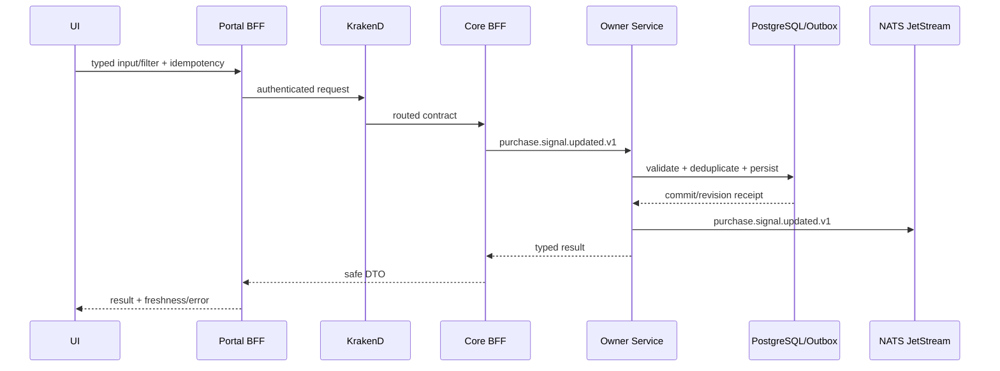

# F01.P-FLOW-004 — Calculate Cart-to-Checkout Conversion

> Flow-level Source of Truth for Feature F01. Linked from the
> [F01 feature index](../index.md), generated from the
> BRD/BDD, and structured with the [LivePilot flow SOT template](../../../live-pilot-flow-sot-template.md).

## Machine-readable contract coverage

| Source | Link | Coverage |
|---|---|---|
| BRD | [BR-F01-011](../../../../../02-product/brd/feature-01-live-chat-purchase-signal-analysis.md) | Business requirement |
| BDD | [F01.P-FLOW-004](../../../../../02-product/bdd/feature-01-live-chat-telemetry.md) | Behavioral scenario |
| Feature index | [F01 index](../index.md) | Parent scope and linkage |
| Architecture | [overview.md](../../../../overview.md) | UI → BFF → gateway → service topology |
| Deep context | [deep context](../../../../live-pilot-os-deep-context.md) | LiveSession, NATS, JEV, safety |

Status: detailed baseline. Proposed route/subject/schema values require contract
review and executable compatibility evidence before implementation.

## Purpose, actors, and scope

Calculate conversion from separate cart and checkout counts while preserving the underlying facts.

| Contract fact | Value |
|---|---|
| Group | Purchase-signal analysis |
| Actor | Purchase Projection Worker |
| Input | `session, SKU/window, cart count, checkout count, projection revision` |
| Output | conversion metric with numerator, denominator, window, and freshness |
| Owner | `purchase-projection` |
| NATS | `purchase.signal.updated.v1` |

In scope: this flow's validation, state transition, durable evidence, projection,
and downstream event. Out of scope: direct platform mutation, cross-session
identity, hidden fallback success, and capabilities owned by another feature.

## Shared boundary

```text
UI → Portal BFF → KrakenD → Core BFF
  → NATS request/reply + JetStream
  → purchase-projection
  → PostgreSQL/outbox → projection/audit consumers
```

| Node | Responsibility | Boundary rule |
|---|---|---|
| UI | Render typed input/output, confidence, freshness, stale, and error states | Never writes facts or makes policy decisions |
| Portal BFF | Validate session scope, authorization, locale, filters, and DTOs | Never owns authoritative counters or classifications |
| KrakenD | Authenticate, rate-limit, route, preserve correlation | Never implements business rules |
| Core BFF | Orchestrate request/query, map ProblemDetails, preserve revisions | Never reads another service's tables |
| Domain service | Apply Conversion is a derived ratio with explicit denominator and never replaces source counts. | One owner for this flow's state |
| Event/persistence | Atomic fact/outbox, replay, audit, and revision | Never hide duplicate or unknown outcomes |

## Canonical contract and lifecycle

| Fact | Contract |
|---|---|
| Parent | `live_session_id` with authorized source context |
| Source of truth | Immutable source fact + PostgreSQL projection |
| Event | `purchase.signal.updated.v1` |
| Persistence | derived metric revision; immutable source counts remain unchanged |
| Idempotency | Source/provider event ID plus flow-stage fingerprint |
| Consumers | dashboard, co-pilot, StreamPilot |

```text
RECEIVED → VALIDATED → PROCESSING → COMMITTED → PUBLISHED → PROJECTED
                         ├──→ REJECTED
                         ├──→ DEFERRED
                         └──→ RECONCILIATION_REQUIRED
```

| Transition | Guard | Result |
|---|---|---|
| received → validated | active session, schema, event identity, authorization | processable fact |
| validated → processing | owner and policy dependencies available | flow rule evaluated |
| processing → committed | transaction and dedup constraints pass | durable source/derived fact |
| committed → published | outbox delivery succeeds | versioned consumer event |
| processing → rejected/deferred | invalid, unsafe, stale, or ambiguous evidence | no false success |

## Frontend contract

| UI state | Required behavior |
|---|---|
| Loading | Show pending and preserve last known projection revision |
| Success | Show conversion metric with numerator, denominator, window, and freshness with freshness, confidence/score, window, and evidence status |
| Empty | Explain no matching signal separately from unavailable or unauthorized |
| Degraded | Mark stale/degraded and disable controls requiring authoritative truth |
| Error | Use safe ProblemDetails code and retryable flag |
| Accessibility | Keyboard/focus-safe status, screen-reader label, Thai/English copy |

The UI consumes a safe projection or event-backed DTO. It never receives raw
provider payloads, model prompts, platform tokens, or private identity data.

## Backend contract

### Portal BFF

- Accepts only typed input and validates `live_session_id` before forwarding.
- Preserves `X-Correlation-ID`, `Idempotency-Key`, `X-Locale`, causation,
  and projection revision metadata.
- Shapes localized DTOs and redacts evidence; it does not calculate truth.
- Rejects cross-session filters before pagination/count calculation.

### KrakenD

- Authenticates, rate-limits, routes, and enforces payload size.
- Does not retry a non-idempotent operation without a stable key.
- Preserves correlation and safe error semantics.

### Core BFF

- Maps the public request/query to `purchase.signal.updated.v1`.
- Uses NATS request/reply for acknowledgement and JetStream for durable facts.
- Returns only committed or explicitly typed degraded/deferred results.
- Does not duplicate projection, risk, catalog, purchase, or policy logic.

## Microservice contract

### Owner: `purchase-projection`

| Responsibility | Contract |
|---|---|
| Validate | session, schema, source identity, authorization, policy guard |
| Process | Conversion is a derived ratio with explicit denominator and never replaces source counts. |
| Persist | derived metric revision; immutable source counts remain unchanged |
| Publish | `purchase.signal.updated.v1` with event/correlation/causation/schema metadata |
| Replay | deterministic rebuild from source facts and revision |
| Security | fail closed on missing policy, session, or evidence |

### Canonical event

```json
{
  "event_id": "evt_01",
  "event_type": "purchase.signal.updated.v1",
  "occurred_at": "2026-11-20T10:00:00Z",
  "live_session_id": "session_01",
  "correlation_id": "trace_01",
  "causation_id": "evt_source_01",
  "schema_version": 1,
  "producer": "purchase-projection",
  "idempotency_key": "stage-key-01",
  "data": {
    "status": "committed",
    "result": "conversion metric with numerator, denominator, window, and freshness",
    "evidence_ids": ["evt_source_01"],
    "projection_revision": 1
  }
}
```

## Persistence, privacy, and idempotency

- Facts are append-only; derived projections use monotonic revisions.
- Stage identity prevents cart, checkout, paid, and voucher events from being
  counted as one another.
- Same key and same fingerprint is a safe no-op; mismatched payload is a conflict.
- Raw text and provider payloads are minimized or hashed; no token/PII enters UI
  payloads or model prompts.
- Outbox and source state commit atomically; consumers can replay without mutation.

## Errors and recovery

| Error | Retry | Expected behavior |
|---|---|---|
| WINDOW_INVALID | no unless input changes | reject with no downstream fact |
| DIVISION_UNDEFINED | bounded with same key | retry only when idempotent |
| PROJECTION_STALE | no blind retry | defer, reconcile, or show explicit stale state |
| duplicate event | safe no-op | original receipt; no counter inflation |
| NATS/DB outage | bounded | no success without commit receipt |
| unknown provider state | reconcile first | never claim paid/converted success |

All errors include `correlation_id`, stable safe code, retryable flag, and a
redacted evidence reference. HTTP errors use shared ProblemDetails.

## Sequence and contracts



## Verification and flow-specific acceptance

| Verification | Evidence |
|---|---|
| Valid path | exactly one fact, event, and expected projection revision |
| Invalid/session boundary | rejected before persistence and publication |
| Idempotency | replay keeps counts/results stable |
| Late/revision | stale revision rejected or reconciled deterministically |
| Privacy | redaction/hash test proves no sensitive payload leakage |
| Contract | OpenAPI/NATS/provider compatibility test |
| Audit | source → processing → output trace with correlation/causation |

- Conversion is a derived ratio with explicit denominator and never replaces source counts.
- Output is conversion metric with numerator, denominator, window, and freshness and is scoped to `live_session_id`.
- Event `purchase.signal.updated.v1` is published only after durable commit.
- Consumers are dashboard, co-pilot, StreamPilot.

## Open decisions and Definition of Done

| ID | Decision | Closure evidence |
|---|---|---|
| F01.P-FLOW-004-OPEN-001 | Exact route/adapter contract and DTO fields | OpenAPI or adapter schema revision |
| F01.P-FLOW-004-OPEN-002 | Final NATS subject/schema registry | Async registry + consumer test |
| F01.P-FLOW-004-OPEN-003 | Window, threshold, retention, or attribution policy | Approved policy + executable test |

- Linked from F01 index and linked back to BRD/BDD.
- Frontend, Portal BFF, KrakenD, Core BFF, NATS, microservice, persistence, and
  audit behavior are explicit.
- Duplicate, stale/late, unauthorized, degraded, and retry behavior is proven.
- No Organization, Workspace, Campaign, tenant aggregate, or direct platform
  mutation is introduced.

