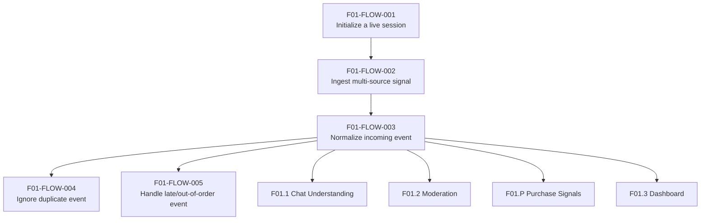

# Feature F01 — Live Chat and Purchase-Signal Analysis

> Feature-level index. Each executable behavior is documented as an individual
> flow under `flows/`. This index owns feature scope, traceability, and the
> flow map; flow details own contracts, state transitions, payloads, and evidence.

## Machine-readable contract coverage

| Source | Link | Role |
|---|---|---|
| F01 BRD | [feature-01-live-chat-purchase-signal-analysis.md](../../../../02-product/brd/feature-01-live-chat-purchase-signal-analysis.md) | Business scope and requirements |
| F01 BDD | [feature-01-live-chat-telemetry.md](../../../../02-product/bdd/feature-01-live-chat-telemetry.md) | Given/When/Then behavior and flow IDs |
| SOT template | [live-pilot-flow-sot-template.md](../../live-pilot-flow-sot-template.md) | Flow document structure |
| Architecture | [overview.md](../../../overview.md) | `UI → Portal BFF → KrakenD → Core BFF → Services` |
| Deep context | [live-pilot-os-deep-context.md](../../../live-pilot-os-deep-context.md) | Session, node, JEV, NATS, and safety boundaries |

## Feature authority and boundaries

F01 is the observation and classification capability for a live session. It ingests
chat and commerce telemetry, produces typed signals, builds read projections, and
publishes evidence for downstream features.

F01 does not own voucher creation, product pin execution, margin calculation,
inventory mutation, final approval, or Emergency Pause control. Those capabilities
remain in their owning features and consume F01 signals through versioned contracts.

The source BDD uses workspace/campaign wording in its original scenario. For the
current LivePilot architecture this is resolved as an authorized `live_session_id`
and platform channel. No Organization, Workspace, Campaign, or tenant aggregate is
created by F01.

## Canonical flow map

## Flow index

| Flow ID | Flow | Detail SOT | Status |
|---|---|---|---|
| F01-FLOW-001 | Initialize a live session | [F01-FLOW-001](flows/f01-flow-001-initialize-live-session.md) | First flow detailed |
| F01-FLOW-002 | Ingest a multi-source signal | [F01-FLOW-002](flows/f01-flow-002-ingest-multi-source-signal.md) | Detailed |
| F01-FLOW-003 | Normalize an incoming event | [F01-FLOW-003](flows/f01-flow-003-normalize-incoming-event.md) | Detailed |
| F01-FLOW-004 | Ignore a duplicate event | [F01-FLOW-004](flows/f01-flow-004-ignore-duplicate-event.md) | Detailed |
| F01-FLOW-005 | Handle a late or out-of-order event | [F01-FLOW-005](flows/f01-flow-005-handle-late-out-of-order-event.md) | Detailed |
| F01.1-FLOW-001 | Classify product interest | [F01.1-FLOW-001](flows/f01-1-flow-001-classify-product-interest.md) | Detailed |
| F01.1-FLOW-002 | Classify a product question | [F01.1-FLOW-002](flows/f01-1-flow-002-classify-product-question.md) | Detailed |
| F01.1-FLOW-003 | Classify a promotion request | [F01.1-FLOW-003](flows/f01-1-flow-003-classify-promotion-request.md) | Detailed |
| F01.1-FLOW-004 | Classify stock and size intent | [F01.1-FLOW-004](flows/f01-1-flow-004-classify-stock-size-intent.md) | Detailed |
| F01.1-FLOW-005 | Resolve a product entity | [F01.1-FLOW-005](flows/f01-1-flow-005-resolve-product-entity.md) | Detailed |
| F01.1-FLOW-006 | Reject an unsupported claim | [F01.1-FLOW-006](flows/f01-1-flow-006-reject-unsupported-claim.md) | Detailed |
| F01.1-FLOW-007 | Cluster repeated questions | [F01.1-FLOW-007](flows/f01-1-flow-007-cluster-repeated-questions.md) | Detailed |
| F01.1-FLOW-008 | Escalate uncertain intent | [F01.1-FLOW-008](flows/f01-1-flow-008-escalate-uncertain-intent.md) | Detailed |
| F01.2-FLOW-001 | Detect spam or toxic content | [F01.2-FLOW-001](flows/f01-2-flow-001-detect-spam-toxic-content.md) | Detailed |
| F01.2-FLOW-002 | Detect an off-platform attempt | [F01.2-FLOW-002](flows/f01-2-flow-002-detect-off-platform-attempt.md) | Detailed |
| F01.2-FLOW-003 | Detect a scam pattern | [F01.2-FLOW-003](flows/f01-2-flow-003-detect-scam-pattern.md) | Detailed |
| F01.2-FLOW-004 | Detect coordinated bot behavior | [F01.2-FLOW-004](flows/f01-2-flow-004-detect-coordinated-bot-behavior.md) | Detailed |
| F01.2-FLOW-005 | Rank risk severity | [F01.2-FLOW-005](flows/f01-2-flow-005-rank-risk-severity.md) | Detailed |
| F01.2-FLOW-006 | Escalate to a moderator | [F01.2-FLOW-006](flows/f01-2-flow-006-escalate-to-moderator.md) | Detailed |
| F01.2-FLOW-007 | Preserve moderation audit trail | [F01.2-FLOW-007](flows/f01-2-flow-007-preserve-moderation-audit-trail.md) | Detailed |
| F01.P-FLOW-001 | Record cart-add interest | [F01.P-FLOW-001](flows/f01-p-flow-001-record-cart-add-interest.md) | Detailed |
| F01.P-FLOW-002 | Record checkout completion | [F01.P-FLOW-002](flows/f01-p-flow-002-record-checkout-completion.md) | Detailed |
| F01.P-FLOW-003 | Record payment or order state | [F01.P-FLOW-003](flows/f01-p-flow-003-record-payment-order-state.md) | Detailed |
| F01.P-FLOW-004 | Calculate cart-to-checkout conversion | [F01.P-FLOW-004](flows/f01-p-flow-004-calculate-cart-to-checkout-conversion.md) | Detailed |
| F01.P-FLOW-005 | Detect high interest but low conversion | [F01.P-FLOW-005](flows/f01-p-flow-005-detect-high-interest-low-conversion.md) | Detailed |
| F01.P-FLOW-006 | Correlate voucher usage with purchase | [F01.P-FLOW-006](flows/f01-p-flow-006-correlate-voucher-usage.md) | Detailed |
| F01.P-FLOW-007 | Rank product purchase interest | [F01.P-FLOW-007](flows/f01-p-flow-007-rank-product-purchase-interest.md) | Detailed |
| F01.P-FLOW-008 | Prevent purchase-signal inflation | [F01.P-FLOW-008](flows/f01-p-flow-008-prevent-purchase-signal-inflation.md) | Detailed |
| F01.3-FLOW-001 | Project live interest metrics | [F01.3-FLOW-001](flows/f01-3-flow-001-project-live-interest-metrics.md) | Detailed |
| F01.3-FLOW-002 | Separate behavioral metrics | [F01.3-FLOW-002](flows/f01-3-flow-002-separate-behavioral-metrics.md) | Detailed |
| F01.3-FLOW-003 | Show sentiment and engagement | [F01.3-FLOW-003](flows/f01-3-flow-003-show-sentiment-engagement.md) | Detailed |
| F01.3-FLOW-004 | Detect a hype window | [F01.3-FLOW-004](flows/f01-3-flow-004-detect-hype-window.md) | Detailed |
| F01.3-FLOW-005 | Trigger a dashboard alert | [F01.3-FLOW-005](flows/f01-3-flow-005-trigger-dashboard-alert.md) | Detailed |
| F01.3-FLOW-006 | Rebuild a failed projection | [F01.3-FLOW-006](flows/f01-3-flow-006-rebuild-failed-projection.md) | Detailed |
| F01-INTEGRATION-001 | Send a signal to Streamer Co-pilot | [F01-INTEGRATION-001](flows/f01-integration-001-send-signal-streamer-copilot.md) | Detailed |
| F01-INTEGRATION-002 | Send product interest to StreamPilot | [F01-INTEGRATION-002](flows/f01-integration-002-send-product-interest-streampilot.md) | Detailed |
| F01-INTEGRATION-003 | Send risk to Compliance | [F01-INTEGRATION-003](flows/f01-integration-003-send-risk-compliance.md) | Detailed |
| F01-INTEGRATION-004 | Correlate stock with purchase interest | [F01-INTEGRATION-004](flows/f01-integration-004-correlate-stock-purchase-interest.md) | Detailed |
| F01-INTEGRATION-005 | Feed action outcomes back into telemetry | [F01-INTEGRATION-005](flows/f01-integration-005-feed-action-outcomes-telemetry.md) | Detailed |
| F01-SAFETY-001 | Enter degraded read-only mode | [F01-SAFETY-001](flows/f01-safety-001-enter-degraded-read-only-mode.md) | Detailed |
| F01-SAFETY-002 | Propagate Emergency Pause | [F01-SAFETY-002](flows/f01-safety-002-propagate-emergency-pause.md) | Detailed |
| F01-SAFETY-003 | Write an end-to-end decision trace | [F01-SAFETY-003](flows/f01-safety-003-write-end-to-end-decision-trace.md) | Detailed |

## Feature-level contract rules

1. Every flow is scoped by `live_session_id` and carries correlation, causation,
   schema-version, producer, and idempotency metadata.
2. The browser never calls a microservice directly and never writes source facts.
3. Portal BFF validates session context and shapes DTOs; Core BFF orchestrates;
   domain services own rules and state.
4. Internal service communication uses NATS request/reply and JetStream events.
5. F01 projections are rebuildable from durable source events and never become a
   second writer for another service's domain.
6. Low-confidence, unavailable, duplicate, late, or unknown results are explicit;
   they must not be represented as successful empty data.

## Required feature evidence

- All flow IDs map to the BDD and BRD requirement IDs.
- OpenAPI operations and NATS schemas are versioned before implementation.
- Session authorization is tested at the service boundary, not only hidden in UI.
- Duplicate, late, out-of-order, replay, and degraded cases have executable proof.
- Downstream consumers can trace a signal back to its source event and session.

## Related

- [LivePilot flow SOT template](../../live-pilot-flow-sot-template.md)
- [Architecture overview](../../../overview.md)
- [LivePilot OS tech stack](../../../live-pilot-os-tech-stack.md)
