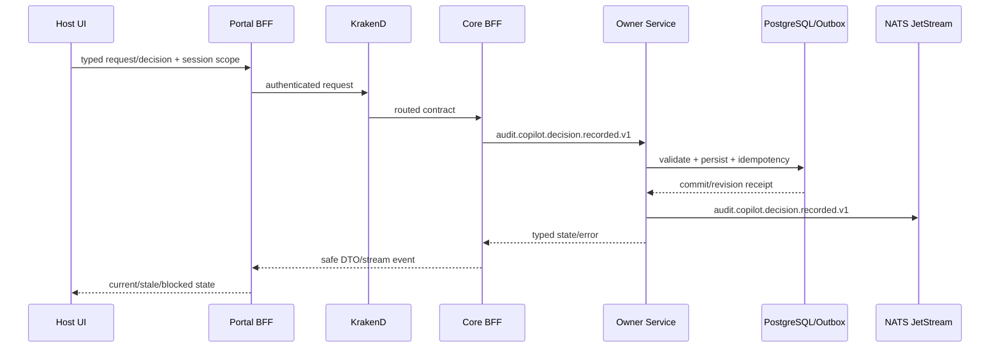

# F02-SAFETY-004 — Audit Every Host Decision

> Flow-level Source of Truth for Feature F02. Linked from the
> [F02 feature index](../index.md) and structured with the
> [LivePilot flow SOT template](../../../live-pilot-flow-sot-template.md).

## Machine-readable contract coverage

| Source | Link | Coverage |
|---|---|---|
| BRD | [BR-F02-019](../../../../../02-product/brd/feature-02-host-screen-assistant.md) | Business requirement |
| BDD | [F02-SAFETY-004](../../../../../02-product/bdd/feature-02-streamer-copilot-hud.md) | Behavioral scenario |
| Feature index | [F02 index](../index.md) | Parent scope and linkage |
| Architecture | [overview.md](../../../../overview.md) | UI → Portal BFF → KrakenD → Core BFF |
| Deep context | [deep context](../../../../live-pilot-os-deep-context.md) | LiveSession, NATS, JEV, safety |

Status: detailed contract baseline. Proposed routes, subjects, policies, and
schemas require approval and executable compatibility evidence.

## Purpose, actors, and scope

Audit use, edit, reject, dismiss, and detail requests with original/edited content lineage.

| Contract fact | Value |
|---|---|
| Actor | Host Decision Service / Audit |
| Input | `decision event, actor, content hashes, evidence, correlation` |
| Output | immutable host-decision audit receipt |
| Owner | `audit-service` |
| Event | `audit.copilot.decision.recorded.v1` |

In scope: session-scoped host guidance/control, safe DTOs, lifecycle, freshness,
evidence, and audit. Out of scope: direct browser-to-service calls, cross-session
identity, and domain mutation owned by F01, F03, or F04.

## Shared boundary

```text
Host UI → Portal BFF → KrakenD → Core BFF
  → NATS request/reply + JetStream
  → audit-service
  → PostgreSQL/outbox → SSE/UI/audit
```

| Node | Responsibility | Limit |
|---|---|---|
| UI | Render safe guidance/control state and explicit stale/degraded status | Never decides policy or writes facts |
| Portal BFF | Validate session/actor scope, locale, filters, DTO shape | Never owns source truth |
| KrakenD | Authenticate, rate-limit, route, preserve correlation | Never implements flow rules |
| Core BFF | Orchestrate snapshot/decision/event delivery | Never owns F01/F03/F04 domain truth |
| Domain service | Apply Audit links original suggestion, edited content, actor, policy, and downstream outcome. | One owner for this state |
| Persistence/event | Commit, outbox, replay, audit, and revision | Never hide unknown or stale state |

## Canonical aggregate and lifecycle

| Fact | Contract |
|---|---|
| Parent | `live_session_id`, actor capability, suggestion/action/evidence ID |
| Owner | `audit-service` |
| Source of truth | Immutable lifecycle/decision/evidence receipt |
| Event | `audit.copilot.decision.recorded.v1` |
| Rule | Audit links original suggestion, edited content, actor, policy, and downstream outcome. |
| Consumers | Compliance, operations, learning loop |

```text
RECEIVED → VALIDATED → EVIDENCE_CHECKED → COMMITTED → DELIVERED
                         ├──→ REFUSED/REJECTED
                         ├──→ STALE/WITHDRAWN
                         └──→ BLOCKED/DEFERRED
```

| Transition | Guard | Result |
|---|---|---|
| received → validated | session, actor, schema, revision, authorization | processable request |
| validated → evidence_checked | source/policy/redaction dependencies available | safe decision |
| evidence_checked → committed | transaction and idempotency pass | durable state |
| committed → delivered | outbox/stream delivery succeeds | consumer-visible event |
| any → blocked/deferred | pause, stale, unsafe, or missing evidence | no consequential success |

## Frontend contract

| UI state | Required behavior |
|---|---|
| Loading | Show shell/pending state while preserving last known revision |
| Current | Show audit-service result: immutable host-decision audit receipt with freshness and evidence status |
| Stale/unknown | Mark explicitly; disable claims or controls requiring current truth |
| Refused/blocked | Explain safe reason and provide review/recovery path |
| Degraded | Show last-known state and stream freshness; never invent content |
| Accessibility | Keyboard/focus-safe state, screen-reader labels, Thai/English locale |

The UI receives only a safe projection. Tokens, COGS, private provider payloads,
raw model prompts, and unnecessary PII remain outside the HUD contract.

## Backend contract

### Portal BFF

- Validates `live_session_id`, actor capability, request revision, locale,
  and idempotency before forwarding.
- Shapes safe DTOs and preserves correlation, causation, freshness, and evidence
  metadata; it does not make the flow decision.
- Rejects cross-session access before pagination, cache lookup, or delivery subscription.
- Does not call a platform adapter directly.

### KrakenD

- Authenticates, rate-limits, routes, and preserves correlation/locale/idempotency.
- Rejects malformed or oversized payloads before Core BFF.
- Never retries a non-idempotent host decision without a stable key.

### Core BFF

- Maps the UI operation to `audit.copilot.decision.recorded.v1` or a versioned query.
- Uses NATS request/reply for acknowledgement and JetStream for durable events.
- Provides SSE only as a delivery projection; reconnect uses revision/Last-Event-ID.
- Returns committed, stale, refused, blocked, or degraded status explicitly.

## Microservice contract

### Owner: `audit-service`

| Responsibility | Contract |
|---|---|
| Validate | session, actor, schema, evidence scope, freshness/pause policy |
| Process | Audit links original suggestion, edited content, actor, policy, and downstream outcome. |
| Persist | immutable host-decision audit receipt with revision, evidence, and idempotency metadata |
| Publish | `audit.copilot.decision.recorded.v1` with correlation, causation, producer, schema version |
| Replay | deterministic safe state from durable facts and latest valid evidence |
| Security | fail closed on missing authorization, redaction, policy, or pause state |

### Canonical event

```json
{
  "event_id": "evt_f02_02",
  "event_type": "audit.copilot.decision.recorded.v1",
  "occurred_at": "2026-11-20T10:00:00Z",
  "live_session_id": "session_01",
  "correlation_id": "trace_01",
  "causation_id": "evt_source_01",
  "schema_version": 1,
  "producer": "audit-service",
  "idempotency_key": "f02-key-01",
  "data": {
    "status": "committed",
    "result": "immutable host-decision audit receipt",
    "revision": 1,
    "freshness": "current",
    "evidence_ids": ["evt_source_01"]
  }
}
```

## Persistence, redaction, and idempotency

- IDs and revisions are scoped to `live_session_id`; source ownership is preserved.
- Content changes keep original/edited hashes and never overwrite original evidence.
- Same key/fingerprint is a safe replay; mismatched payload is a conflict.
- Stale, revoked, paused, and unknown state is stored explicitly, not as empty success.
- Redaction occurs before HUD/SSE publication; outbox commit precedes delivery.
- SSE disconnects replay from durable event/revision state; it is not source of truth.

## Errors and recovery

| Error | Retry | Expected behavior |
|---|---|---|
| AUDIT_WRITE_FAILED | no unless input changes | safe rejection, no false guidance |
| TRACE_LINK_MISSING | bounded with same key | retry only when idempotent |
| HASH_MISMATCH | no blind retry | explicit stale/refused/blocked state |
| stream disconnect | reconnect/replay | last-known state plus freshness |
| NATS/DB outage | bounded | no success without durable receipt |
| pause/revocation | no | block or withdraw before delivery/approval |

All errors include `correlation_id`, stable code, retryable flag, and redacted
evidence. HTTP mapping uses shared ProblemDetails.

## Sequence and verification



| Verification | Evidence |
|---|---|
| Session/actor authorization | cross-session or unauthorized request rejected before persistence |
| Grounding/freshness | stale, revoked, unknown, or paused state blocks unsafe display/action |
| Idempotency | replay keeps one decision/state and one event effect |
| Redaction | sensitive fields absent from HUD/SSE/evidence payload |
| Delivery | stream/reconnect/revision behavior is deterministic |
| Audit | source, evidence, actor, content revision, and outcome trace linked |
| Contract | OpenAPI/NATS/provider compatibility test |

### Flow-specific acceptance

- Audit links original suggestion, edited content, actor, policy, and downstream outcome.
- Output is immutable host-decision audit receipt and is scoped to `live_session_id`.
- Event `audit.copilot.decision.recorded.v1` is published only after durable commit/evidence decision.
- Consumers are Compliance, operations, learning loop.

## Open decisions and Definition of Done

| ID | Decision | Closure evidence |
|---|---|---|
| F02-SAFETY-004-OPEN-001 | Final HTTP/SSE/decision route and DTO shape | OpenAPI revision + UI test |
| F02-SAFETY-004-OPEN-002 | Final NATS subjects and schema registry | Async registry + consumer test |
| F02-SAFETY-004-OPEN-003 | Freshness, threshold, pause, or redaction policy | Versioned policy + executable test |

- Linked from F02 index and back to BRD/BDD.
- Frontend, Portal BFF, KrakenD, Core BFF, NATS, microservice, persistence,
  redaction/evidence, and audit behavior are explicit.
- Unauthorized, stale, revoked, paused, degraded, duplicate, and retry behavior is tested.
- No Organization, Workspace, Campaign, tenant aggregate, or direct platform mutation
  is introduced by this flow.

