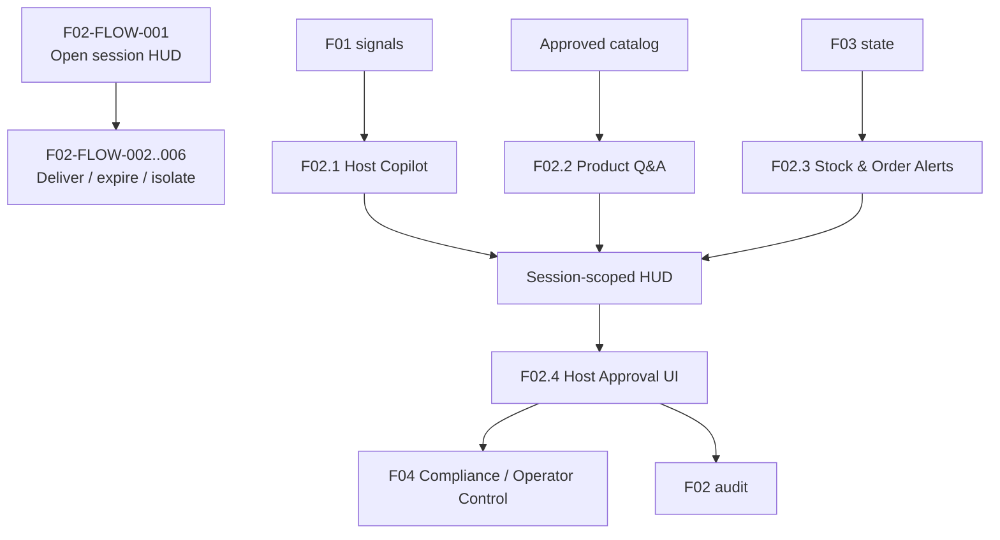

# Feature F02 — Host Screen Assistant (Streamer Co-pilot HUD)

> Feature-level index. Each behavior is an individual flow under `flows/`.
> This index owns F02 scope, traceability, and flow navigation. Each flow file
> owns its frontend, backend, microservice, state, payload, event, and evidence contract.

## Machine-readable contract coverage

| Source | Link | Role |
|---|---|---|
| F02 BRD | [feature-02-host-screen-assistant.md](../../../../02-product/brd/feature-02-host-screen-assistant.md) | Business scope and requirements |
| F02 BDD | [feature-02-streamer-copilot-hud.md](../../../../02-product/bdd/feature-02-streamer-copilot-hud.md) | Behavior and flow IDs |
| SOT template | [live-pilot-flow-sot-template.md](../../live-pilot-flow-sot-template.md) | Flow document structure |
| Architecture | [overview.md](../../../overview.md) | `UI → Portal BFF → KrakenD → Core BFF → Services` |
| Deep context | [live-pilot-os-deep-context.md](../../../live-pilot-os-deep-context.md) | Session, JEV, NATS, safety, and node boundaries |
| F01 dependency | [F01 feature index](../F01-live-chat-telemetry/index.md) | Signals consumed by F02 |

## Feature authority and boundaries

F02 owns the host-facing Co-pilot HUD: loading session-scoped guidance,
prioritizing and delivering suggestions, grounding Product Q&A in approved
catalog facts, showing stock/order/promotion alerts, and recording host decisions.

F02 does not own the Feature 01 source signals, Feature 03 promotion/margin/
inventory truth, or Feature 04 approval-control/Emergency Pause authority. It
consumes and publishes versioned contracts across those boundaries.

The source BRD/BDD uses workspace language in some requirements. In the current
LivePilot architecture, F02 is scoped by authorized `live_session_id`,
host capability, and platform channel. It does not create Organization,
Workspace, Campaign, or tenant aggregates.

## Canonical flow map

## Flow index

| Flow ID | Flow | Detail SOT | Status |
|---|---|---|---|
| **HUD session and delivery** |  |  |  |
| F02-FLOW-001 | Open the host HUD for an active session | [F02-FLOW-001](flows/f02-flow-001-open-host-hud.md) | Detailed |
| F02-FLOW-002 | Receive a real-time suggestion | [F02-FLOW-002](flows/f02-flow-002-receive-realtime-suggestion.md) | Detailed |
| F02-FLOW-003 | Deliver a glanceable suggestion | [F02-FLOW-003](flows/f02-flow-003-deliver-glanceable-suggestion.md) | Detailed |
| F02-FLOW-004 | Expire stale guidance | [F02-FLOW-004](flows/f02-flow-004-expire-stale-guidance.md) | Detailed |
| F02-FLOW-005 | Withdraw unsafe guidance | [F02-FLOW-005](flows/f02-flow-005-withdraw-unsafe-guidance.md) | Detailed |
| F02-FLOW-006 | Maintain session isolation | [F02-FLOW-006](flows/f02-flow-006-maintain-session-isolation.md) | Detailed |
| **AI Host Copilot** |  |  |  |
| F02.1-FLOW-001 | Create a repeated-question talking point | [F02.1-FLOW-001](flows/f02-1-flow-001-create-repeated-question-talking-point.md) | Detailed |
| F02.1-FLOW-002 | Suggest an answer for the host | [F02.1-FLOW-002](flows/f02-1-flow-002-suggest-answer-host.md) | Detailed |
| F02.1-FLOW-003 | Alert on rising product attention | [F02.1-FLOW-003](flows/f02-1-flow-003-alert-rising-product-attention.md) | Detailed |
| F02.1-FLOW-004 | Recommend the next product | [F02.1-FLOW-004](flows/f02-1-flow-004-recommend-next-product.md) | Detailed |
| F02.1-FLOW-005 | Preserve the host's selling rhythm | [F02.1-FLOW-005](flows/f02-1-flow-005-preserve-host-selling-rhythm.md) | Detailed |
| F02.1-FLOW-006 | Suppress low-value notification noise | [F02.1-FLOW-006](flows/f02-1-flow-006-suppress-low-value-notification-noise.md) | Detailed |
| F02.1-FLOW-007 | Attach evidence to a suggestion | [F02.1-FLOW-007](flows/f02-1-flow-007-attach-evidence-suggestion.md) | Detailed |
| F02.1-FLOW-008 | Handle low-confidence guidance | [F02.1-FLOW-008](flows/f02-1-flow-008-handle-low-confidence-guidance.md) | Detailed |
| **Product Q&A Assistant** |  |  |  |
| F02.2-FLOW-001 | Answer from the approved catalog | [F02.2-FLOW-001](flows/f02-2-flow-001-answer-approved-catalog.md) | Detailed |
| F02.2-FLOW-002 | Refuse an unsupported product claim | [F02.2-FLOW-002](flows/f02-2-flow-002-refuse-unsupported-product-claim.md) | Detailed |
| F02.2-FLOW-003 | Refuse an unverified medical claim | [F02.2-FLOW-003](flows/f02-2-flow-003-refuse-unverified-medical-claim.md) | Detailed |
| F02.2-FLOW-004 | Show the evidence source | [F02.2-FLOW-004](flows/f02-2-flow-004-show-evidence-source.md) | Detailed |
| F02.2-FLOW-005 | Handle catalog version change | [F02.2-FLOW-005](flows/f02-2-flow-005-handle-catalog-version-change.md) | Detailed |
| F02.2-FLOW-006 | Handle an ambiguous product question | [F02.2-FLOW-006](flows/f02-2-flow-006-handle-ambiguous-product-question.md) | Detailed |
| F02.2-FLOW-007 | Reflect current stock safely | [F02.2-FLOW-007](flows/f02-2-flow-007-reflect-current-stock-safely.md) | Detailed |
| **Stock & Order Alert — Host View** |  |  |  |
| F02.3-FLOW-001 | Alert on low stock | [F02.3-FLOW-001](flows/f02-3-flow-001-alert-low-stock.md) | Detailed |
| F02.3-FLOW-002 | Alert on out-of-stock | [F02.3-FLOW-002](flows/f02-3-flow-002-alert-out-of-stock.md) | Detailed |
| F02.3-FLOW-003 | Alert on high order volume | [F02.3-FLOW-003](flows/f02-3-flow-003-alert-high-order-volume.md) | Detailed |
| F02.3-FLOW-004 | Highlight a best-selling product | [F02.3-FLOW-004](flows/f02-3-flow-004-highlight-best-selling-product.md) | Detailed |
| F02.3-FLOW-005 | Alert when voucher usage nears its limit | [F02.3-FLOW-005](flows/f02-3-flow-005-alert-voucher-limit.md) | Detailed |
| F02.3-FLOW-006 | Alert on abnormal price or promotion | [F02.3-FLOW-006](flows/f02-3-flow-006-alert-abnormal-price-promotion.md) | Detailed |
| F02.3-FLOW-007 | Show a flash-voucher countdown | [F02.3-FLOW-007](flows/f02-3-flow-007-show-flash-voucher-countdown.md) | Detailed |
| **Host Approval UI** |  |  |  |
| F02.4-FLOW-001 | Use a suggestion | [F02.4-FLOW-001](flows/f02-4-flow-001-use-suggestion.md) | Detailed |
| F02.4-FLOW-002 | Edit before use | [F02.4-FLOW-002](flows/f02-4-flow-002-edit-before-use.md) | Detailed |
| F02.4-FLOW-003 | Reject a suggestion | [F02.4-FLOW-003](flows/f02-4-flow-003-reject-suggestion.md) | Detailed |
| F02.4-FLOW-004 | Request more details | [F02.4-FLOW-004](flows/f02-4-flow-004-request-more-details.md) | Detailed |
| F02.4-FLOW-005 | Require approval before consequential action | [F02.4-FLOW-005](flows/f02-4-flow-005-require-approval-consequential-action.md) | Detailed |
| F02.4-FLOW-006 | Prevent unauthorized approval | [F02.4-FLOW-006](flows/f02-4-flow-006-prevent-unauthorized-approval.md) | Detailed |
| F02.4-FLOW-007 | Preserve approval idempotency | [F02.4-FLOW-007](flows/f02-4-flow-007-preserve-approval-idempotency.md) | Detailed |
| F02.4-FLOW-008 | Stop approval during Emergency Pause | [F02.4-FLOW-008](flows/f02-4-flow-008-stop-approval-emergency-pause.md) | Detailed |
| **Safety** |  |  |  |
| F02-SAFETY-001 | Keep AI output grounded | [F02-SAFETY-001](flows/f02-safety-001-keep-ai-output-grounded.md) | Detailed |
| F02-SAFETY-002 | Redact sensitive data | [F02-SAFETY-002](flows/f02-safety-002-redact-sensitive-data.md) | Detailed |
| F02-SAFETY-003 | Handle co-pilot service outage | [F02-SAFETY-003](flows/f02-safety-003-handle-copilot-service-outage.md) | Detailed |
| F02-SAFETY-004 | Audit every host decision | [F02-SAFETY-004](flows/f02-safety-004-audit-every-host-decision.md) | Detailed |
| **Integration** |  |  |  |
| F02-INTEGRATION-001 | Receive F01 signals | [F02-INTEGRATION-001](flows/f02-integration-001-receive-f01-signals.md) | Detailed |
| F02-INTEGRATION-002 | Send host decision to Compliance | [F02-INTEGRATION-002](flows/f02-integration-002-send-host-decision-compliance.md) | Detailed |
| F02-INTEGRATION-003 | Receive StreamPilot state | [F02-INTEGRATION-003](flows/f02-integration-003-receive-streampilot-state.md) | Detailed |

## Feature-level contract rules

1. Every HUD payload is scoped to `live_session_id` and authorized host capability.
2. The browser uses Portal BFF and never calls a microservice or platform directly.
3. Portal BFF shapes safe DTOs; Core BFF orchestrates; Co-pilot Service owns
   suggestion lifecycle; catalog/stock/promotion truth remains with owning services.
4. NATS request/reply is used for commands/queries and JetStream for durable facts;
   SSE is a proposed one-way delivery path for live HUD updates.
5. Guidance carries evidence summary, confidence, freshness, correlation ID, and
   catalog/policy version where relevant.
6. Host decisions are explicit, authorized, idempotent, and blocked by Emergency Pause
   when they could cause a consequential downstream action.
7. Missing, stale, revoked, ambiguous, or low-confidence evidence is visible and
   never represented as verified guidance.

## Required feature evidence

- All 43 F02 BDD flow IDs map to an individual detail SOT.
- Product answers are proven against approved catalog facts and revocation behavior.
- HUD delivery, expiry, withdrawal, isolation, and degraded-mode behavior are tested.
- Host use/edit/reject/detail decisions are authorization-checked and auditable.
- F01 and F03 integrations use versioned contracts and preserve causal traceability.
- Sensitive tokens, COGS, provider credentials, and unnecessary PII are redacted.

## Related

- [LivePilot flow SOT template](../../live-pilot-flow-sot-template.md)
- [Architecture overview](../../../overview.md)
- [LivePilot OS tech stack](../../../live-pilot-os-tech-stack.md)
- [F01 feature index](../F01-live-chat-telemetry/index.md)

