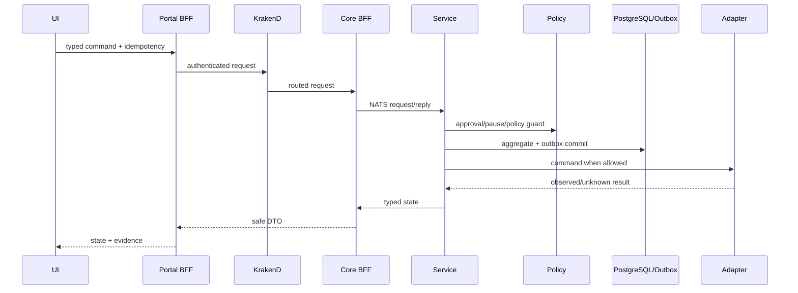

# F03-WORKFLOW-005 — Dead-letter a non-retryable failure

> Flow SOT for Feature 03. Linked from [F03 index](../index.md) and based on the
> [LivePilot flow SOT template](../../../live-pilot-flow-sot-template.md).

## Machine-readable contract coverage

| Source | Link | Coverage |
|---|---|---|
| BRD | [BR-F03-019](../../../../../02-product/brd/feature-03-store-management-profit-protection.md) | Business requirement |
| BDD | [F03-WORKFLOW-005](../../../../../02-product/bdd/feature-03-streampilot-agent.md) | Behavioral scenario |
| Feature index | [F03 index](../index.md) | Parent scope |
| Architecture | [overview.md](../../../../overview.md) | UI → Portal BFF → Core BFF |
| Deep context | [deep context](../../../../live-pilot-os-deep-context.md) | JEV, NATS, adapters |

Status: detailed baseline; route, event schema, policy threshold, and adapter
capability remain proposed until contract and executable tests are approved.

## Purpose, actors, and scope

Implement **Dead-letter a non-retryable failure** in the **Promotion Workflow** bounded context.

| Contract fact | Definition |
|---|---|
| Actor | Promotion Workflow Service / Workflow |
| Input | typed flow input + `live_session_id`, correlation, causation |
| Output | typed result, status, revision, freshness, evidence |
| Owner | `promotion-workflow` |
| Event | `promotion.workflow.updated.v1` |

Out of scope: raw chat interpretation, direct browser-to-platform calls, bypassing
Feature 04 approval/Emergency Pause, and claiming external success without observation.

## Shared boundary

```text
UI → Portal BFF → KrakenD → Core BFF → NATS → promotion-workflow
  → PostgreSQL/outbox → Platform Adapter → Audit
```

| Node | Contract | Limit |
|---|---|---|
| UI | Render proposal/policy/pending/executing/unknown/error states | Never mutates domain/platform |
| Portal BFF | Validate session, actor, DTO, locale, idempotency | Never owns money/stock/adapter truth |
| KrakenD | Auth, rate-limit, route, correlation | Never implements policy/workflow |
| Core BFF | Orchestrate command/query and map typed errors | Never becomes second writer |
| Service | Apply Run durable steps with approval, pause, timers, retries, compensation, observation, reconciliation, and dead-letter. | Owns only its bounded fact |
| Event/adapter | Outbox, translation, observed state, audit | Must not hide unknown result |

## Aggregate and lifecycle

| Fact | Contract |
|---|---|
| Parent | `live_session_id` + proposal/action/reservation/workflow ID |
| Source of truth | Domain aggregate + immutable policy/evidence receipt |
| State path | `DRAFT → VALIDATED → POLICY_CHECKED → APPROVED/PENDING → EXECUTING → OBSERVED` |
| Failure path | `REJECTED/CANCELLED/EXPIRED` or `UNKNOWN → RECONCILING → DEAD_LETTER` |
| Rule | Run durable steps with approval, pause, timers, retries, compensation, observation, reconciliation, and dead-letter. |
| Consumers | operator, adapter, telemetry, audit |

Guards: session/catalog/schema/evidence first; approval/pause/margin/stock policy
before command; adapter observation before success. Replays use the same key and
fingerprint; mismatches are conflicts.

## Frontend contract

- Show current status, evidence, freshness, policy/approval state, and revision.
- Pending, unknown, or reconciling never renders as success.
- Disable consequential controls while approval/pause/adapter state is unavailable.
- Redact COGS, credentials, tokens, private provider errors, and unnecessary PII.
- Use keyboard-safe focus, screen-reader status, and Thai/English locale.

## Backend contract

### Portal BFF

Validate `live_session_id`, actor capability, domain ID, idempotency, currency/
quantity format, approval mode, and pause status. Shape safe DTOs and preserve
correlation, causation, policy version, revision, freshness, and observed state.
Never calculate margin, reserve stock, call adapters, or decide approval.

### KrakenD

Authenticate, rate-limit, route, reject malformed/oversized input, and preserve
safe ProblemDetails. Never retry a consequential command without a stable key.

### Core BFF

Map UI operations to versioned NATS request/reply and JetStream facts. Return
committed, approved, pending, rejected, unknown, reconciling, or dead-letter
explicitly. Unknown is never converted to success.

## Microservice contract

### Owner: `promotion-workflow`

| Responsibility | Contract |
|---|---|
| Validate | session, catalog, policy, approval/pause, schema, idempotency |
| Process | Run durable steps with approval, pause, timers, retries, compensation, observation, reconciliation, and dead-letter. |
| Persist | typed Dead-letter a non-retryable failure result, evidence, policy version, provider revision |
| Publish | `promotion.workflow.updated.v1` with correlation, causation, producer, schema version |
| Replay | deterministic state from durable facts and provider observations |
| Security | fail closed on missing approval, pause, money/stock truth, or adapter capability |

### Event envelope

```json
{
  "event_id": "evt_f03",
  "event_type": "promotion.workflow.updated.v1",
  "occurred_at": "2026-11-20T10:00:00Z",
  "live_session_id": "session_01",
  "aggregate_id": "aggregate_01",
  "correlation_id": "trace_01",
  "causation_id": "evt_source_01",
  "schema_version": 1,
  "producer": "promotion-workflow",
  "idempotency_key": "f03-key-01",
  "data": {
    "flow_id": "F03-WORKFLOW-005",
    "status": "pending",
    "evidence_ids": ["evt_source_01"],
    "policy_version": "policy_01",
    "observed_state": "unknown"
  }
}
```

## Money, inventory, adapter, and idempotency

- Money uses integer minor units and explicit currency scale; never floating point.
- Inventory transitions are atomic and revision-checked.
- Adapter commands require capability, idempotency, correlation, and observed state.
- Unknown outcomes reconcile before retry; non-retryable failures dead-letter.
- Approval mode and Emergency Pause are checked before dispatch and at commit.
- Policy/evidence changes invalidate prior approval and require a new evaluation.

## Errors and recovery

| Error | Retry | Result |
|---|---|---|
| WORKFLOW_PRECONDITION_FAILED | no unless input changes | reject/block; no unsafe command |
| OUTCOME_UNKNOWN | bounded with same key | retry only when classified safe |
| NON_RETRYABLE_ERROR | no blind retry | pending/reconcile/dead-letter |
| adapter timeout/unknown | reconcile first | no false success |
| NATS/DB outage | bounded | no success without durable receipt |
| pause/approval change | no | stop or compensate safely |

All errors include `correlation_id`, stable code, retryable flag, policy/version
context, and redacted provider reason. HTTP uses shared ProblemDetails.

## Sequence and verification



| Verification | Evidence |
|---|---|
| Preconditions | unverified signal/catalog/approval/pause rejected |
| Money/stock | integer arithmetic, atomic reservation, revision tests |
| Adapter | capability, idempotency, observation, timeout tests |
| Workflow | timers, compensation, reconciliation, dead-letter tests |
| Replay | duplicate command cannot duplicate external effect |
| Audit | proposal, policy, command, outcome, actor, correlation linked |
| Security | no COGS, tokens, credentials, or private provider errors leak |

### Definition of Done

- Run durable steps with approval, pause, timers, retries, compensation, observation, reconciliation, and dead-letter.
- Output is session-scoped and event is emitted only after durable evidence/state.
- Frontend, Portal BFF, KrakenD, Core BFF, NATS, service, persistence, adapter,
  policy, error, retry, and audit contracts are explicit.
- Unknown outcome, pause, approval, idempotency, reconciliation, and dead-letter
  behavior is tested.
- No Organization, Workspace, Campaign, tenant aggregate, or unguarded platform mutation.

