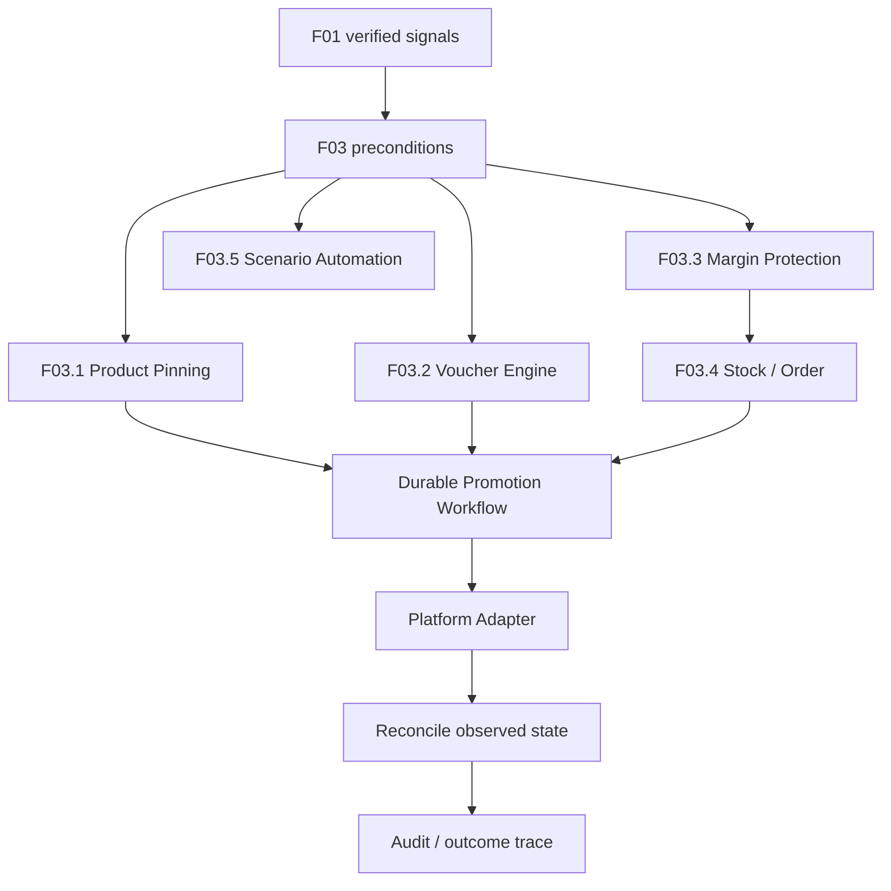

# Feature F03 — Store Management and Back-Office Profit Protection

> Feature-level index. Each bounded behavior is an individual flow under `flows/`.
> This index owns F03 scope, traceability, and navigation; each flow owns the
> frontend, backend, microservice, state, money/inventory, adapter, and audit contract.

## Machine-readable contract coverage

| Source | Link | Role |
|---|---|---|
| F03 BRD | [feature-03-store-management-profit-protection.md](../../../../02-product/brd/feature-03-store-management-profit-protection.md) | Business scope and requirements |
| F03 BDD | [feature-03-streampilot-agent.md](../../../../02-product/bdd/feature-03-streampilot-agent.md) | Behavior and flow IDs |
| SOT template | [live-pilot-flow-sot-template.md](../../live-pilot-flow-sot-template.md) | Flow document structure |
| Architecture | [overview.md](../../../overview.md) | `UI → Portal BFF → KrakenD → Core BFF → Services` |
| Deep context | [live-pilot-os-deep-context.md](../../../live-pilot-os-deep-context.md) | LiveSession, JEV, NATS, safety, and adapters |
| F01 dependency | [F01 feature index](../F01-live-chat-telemetry/index.md) | Verified intent/purchase signals |
| F02 dependency | [F02 feature index](../F02-host-screen-assistant/index.md) | Host guidance and decisions |
| F04 boundary | [Feature 04 BRD](../../../../02-product/brd/feature-04-risk-screening-operator-control.md) | Approval, pause, and risk control |

## Feature authority and boundaries

F03 owns proposal generation, product pinning, voucher lifecycle, margin policy,
stock reservation/order state, scenario automation, durable promotion workflows,
platform adapter execution, reconciliation, and action evidence.

F03 does not own raw telemetry, host HUD rendering, or Emergency Pause authority.
Feature 04 owns approval-control and pause state; F03 must consume those controls
and fail closed.

The source BRD/BDD uses workspace language in some business statements. The current
architecture resolves this as authorized `live_session_id`, platform channel, and
service-scoped policy context. F03 does not create Organization, Workspace,
Campaign, or tenant aggregates.

## Canonical flow map

## Flow index

| Flow ID | Flow | Detail SOT | Status |
|---|---|---|---|
| **Proposal and policy preconditions** |  |  |  |
| F03-FLOW-001 | Receive a product-interest signal | [F03-FLOW-001](flows/f03-flow-001-receive-a-product-interest-signal.md) | Detailed |
| F03-FLOW-002 | Verify catalog membership | [F03-FLOW-002](flows/f03-flow-002-verify-catalog-membership.md) | Detailed |
| F03-FLOW-003 | Reject an unknown SKU | [F03-FLOW-003](flows/f03-flow-003-reject-an-unknown-sku.md) | Detailed |
| F03-FLOW-004 | Respect approval mode | [F03-FLOW-004](flows/f03-flow-004-respect-approval-mode.md) | Detailed |
| **F03.1 Auto Product Pinning** |  |  |  |
| F03.1-FLOW-001 | Resolve a product to pin | [F03.1-FLOW-001](flows/f03-1-flow-001-resolve-a-product-to-pin.md) | Detailed |
| F03.1-FLOW-002 | Check stock before pinning | [F03.1-FLOW-002](flows/f03-1-flow-002-check-stock-before-pinning.md) | Detailed |
| F03.1-FLOW-003 | Prevent excessive repinning | [F03.1-FLOW-003](flows/f03-1-flow-003-prevent-excessive-repinning.md) | Detailed |
| F03.1-FLOW-004 | Execute a product pin | [F03.1-FLOW-004](flows/f03-1-flow-004-execute-a-product-pin.md) | Detailed |
| F03.1-FLOW-005 | Show pin context to the host | [F03.1-FLOW-005](flows/f03-1-flow-005-show-pin-context-to-the-host.md) | Detailed |
| F03.1-FLOW-006 | Handle pin failure | [F03.1-FLOW-006](flows/f03-1-flow-006-handle-pin-failure.md) | Detailed |
| F03.1-FLOW-007 | Avoid duplicate pin execution | [F03.1-FLOW-007](flows/f03-1-flow-007-avoid-duplicate-pin-execution.md) | Detailed |
| **F03.2 Smart Voucher Engine** |  |  |  |
| F03.2-FLOW-001 | Create a voucher proposal | [F03.2-FLOW-001](flows/f03-2-flow-001-create-a-voucher-proposal.md) | Detailed |
| F03.2-FLOW-002 | Schedule a flash voucher | [F03.2-FLOW-002](flows/f03-2-flow-002-schedule-a-flash-voucher.md) | Detailed |
| F03.2-FLOW-003 | Enforce claim limit | [F03.2-FLOW-003](flows/f03-2-flow-003-enforce-claim-limit.md) | Detailed |
| F03.2-FLOW-004 | Expire an unused voucher | [F03.2-FLOW-004](flows/f03-2-flow-004-expire-an-unused-voucher.md) | Detailed |
| F03.2-FLOW-005 | Cancel a voucher | [F03.2-FLOW-005](flows/f03-2-flow-005-cancel-a-voucher.md) | Detailed |
| F03.2-FLOW-006 | Restrict voucher eligibility | [F03.2-FLOW-006](flows/f03-2-flow-006-restrict-voucher-eligibility.md) | Detailed |
| F03.2-FLOW-007 | Reject a malformed voucher | [F03.2-FLOW-007](flows/f03-2-flow-007-reject-a-malformed-voucher.md) | Detailed |
| F03.2-FLOW-008 | Reconcile delayed voucher responses | [F03.2-FLOW-008](flows/f03-2-flow-008-reconcile-delayed-voucher-responses.md) | Detailed |
| **F03.3 Margin Protection** |  |  |  |
| F03.3-FLOW-001 | Calculate contribution margin | [F03.3-FLOW-001](flows/f03-3-flow-001-calculate-contribution-margin.md) | Detailed |
| F03.3-FLOW-002 | Approve a safe discount | [F03.3-FLOW-002](flows/f03-3-flow-002-approve-a-safe-discount.md) | Detailed |
| F03.3-FLOW-003 | Reject a loss-making discount | [F03.3-FLOW-003](flows/f03-3-flow-003-reject-a-loss-making-discount.md) | Detailed |
| F03.3-FLOW-004 | Request human approval | [F03.3-FLOW-004](flows/f03-3-flow-004-request-human-approval.md) | Detailed |
| F03.3-FLOW-005 | Recommend a safer alternative | [F03.3-FLOW-005](flows/f03-3-flow-005-recommend-a-safer-alternative.md) | Detailed |
| F03.3-FLOW-006 | Prevent floating-point money errors | [F03.3-FLOW-006](flows/f03-3-flow-006-prevent-floating-point-money-errors.md) | Detailed |
| F03.3-FLOW-007 | Preserve margin evidence | [F03.3-FLOW-007](flows/f03-3-flow-007-preserve-margin-evidence.md) | Detailed |
| F03.3-FLOW-008 | Re-evaluate changed economics | [F03.3-FLOW-008](flows/f03-3-flow-008-re-evaluate-changed-economics.md) | Detailed |
| **F03.4 Stock Reservation and Order State** |  |  |  |
| F03.4-FLOW-001 | Reserve stock atomically | [F03.4-FLOW-001](flows/f03-4-flow-001-reserve-stock-atomically.md) | Detailed |
| F03.4-FLOW-002 | Prevent overselling | [F03.4-FLOW-002](flows/f03-4-flow-002-prevent-overselling.md) | Detailed |
| F03.4-FLOW-003 | Reject insufficient stock | [F03.4-FLOW-003](flows/f03-4-flow-003-reject-insufficient-stock.md) | Detailed |
| F03.4-FLOW-004 | Commit stock after payment | [F03.4-FLOW-004](flows/f03-4-flow-004-commit-stock-after-payment.md) | Detailed |
| F03.4-FLOW-005 | Release expired reservation | [F03.4-FLOW-005](flows/f03-4-flow-005-release-expired-reservation.md) | Detailed |
| F03.4-FLOW-006 | Synchronize order state | [F03.4-FLOW-006](flows/f03-4-flow-006-synchronize-order-state.md) | Detailed |
| F03.4-FLOW-007 | Alert on low stock | [F03.4-FLOW-007](flows/f03-4-flow-007-alert-on-low-stock.md) | Detailed |
| F03.4-FLOW-008 | Make reservation idempotent | [F03.4-FLOW-008](flows/f03-4-flow-008-make-reservation-idempotent.md) | Detailed |
| **F03.5 Scenario Automation** |  |  |  |
| F03.5-FLOW-001 | Trigger a repeated-question rule | [F03.5-FLOW-001](flows/f03-5-flow-001-trigger-a-repeated-question-rule.md) | Detailed |
| F03.5-FLOW-002 | Trigger a high-engagement rule | [F03.5-FLOW-002](flows/f03-5-flow-002-trigger-a-high-engagement-rule.md) | Detailed |
| F03.5-FLOW-003 | Trigger a margin floor rule | [F03.5-FLOW-003](flows/f03-5-flow-003-trigger-a-margin-floor-rule.md) | Detailed |
| F03.5-FLOW-004 | Trigger a low-stock rule | [F03.5-FLOW-004](flows/f03-5-flow-004-trigger-a-low-stock-rule.md) | Detailed |
| F03.5-FLOW-005 | Use versioned policy configuration | [F03.5-FLOW-005](flows/f03-5-flow-005-use-versioned-policy-configuration.md) | Detailed |
| F03.5-FLOW-006 | Disable a scenario safely | [F03.5-FLOW-006](flows/f03-5-flow-006-disable-a-scenario-safely.md) | Detailed |
| F03.5-FLOW-007 | Prevent scenario loops | [F03.5-FLOW-007](flows/f03-5-flow-007-prevent-scenario-loops.md) | Detailed |
| **Workflow, platform, and audit** |  |  |  |
| F03-WORKFLOW-001 | Run the promotion workflow | [F03-WORKFLOW-001](flows/f03-workflow-001-run-the-promotion-workflow.md) | Detailed |
| F03-WORKFLOW-002 | Stop on Emergency Pause | [F03-WORKFLOW-002](flows/f03-workflow-002-stop-on-emergency-pause.md) | Detailed |
| F03-WORKFLOW-003 | Reconcile requested and observed state | [F03-WORKFLOW-003](flows/f03-workflow-003-reconcile-requested-and-observed-state.md) | Detailed |
| F03-WORKFLOW-004 | Retry safely | [F03-WORKFLOW-004](flows/f03-workflow-004-retry-safely.md) | Detailed |
| F03-WORKFLOW-005 | Dead-letter a non-retryable failure | [F03-WORKFLOW-005](flows/f03-workflow-005-dead-letter-a-non-retryable-failure.md) | Detailed |
| F03-WORKFLOW-006 | Record a complete action trace | [F03-WORKFLOW-006](flows/f03-workflow-006-record-a-complete-action-trace.md) | Detailed |

## Feature-level contract rules

1. F03 acts only on verified, session-scoped signals and approved catalog facts.
2. Margin decisions use integer minor units, explicit currency scale, policy version,
   and immutable evidence; no floating-point money arithmetic is allowed.
3. Inventory reservations are atomic, idempotent, and owned by the inventory boundary.
4. Platform mutations go only through the adapter registry and require observed-state
   confirmation before success is claimed.
5. Approval mode and Emergency Pause are checked before and at consequential commit.
6. Scenario rules are versioned, bounded, disabled safely, and cannot recursively
   trigger uncontrolled proposals.
7. Unknown external outcomes reconcile before retry; non-retryable failures go to
   a durable dead-letter path.
8. Every proposal, policy verdict, adapter command, reservation, and outcome is traceable
   through correlation, causation, idempotency, and audit metadata.

## Required feature evidence

- All 48 F03 BDD flow IDs map to individual detail SOT files.
- Product pin, voucher, margin, stock, scenario, workflow, and adapter contracts are versioned.
- Money, reservation, approval, pause, retry, reconciliation, and dead-letter behavior is tested.
- No direct browser-to-platform call or hidden platform success is introduced.
- F03 never overrides Feature 04 approval or Emergency Pause state.

## Related

- [LivePilot flow SOT template](../../live-pilot-flow-sot-template.md)
- [Architecture overview](../../../overview.md)
- [LivePilot OS tech stack](../../../live-pilot-os-tech-stack.md)
- [F01 feature index](../F01-live-chat-telemetry/index.md)
- [F02 feature index](../F02-host-screen-assistant/index.md)

