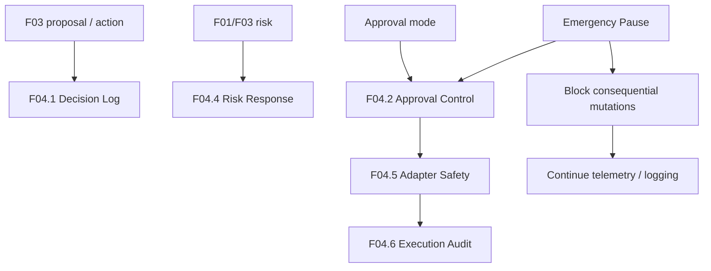

# Feature F04 — Risk Screening and Emergency Operator Control

> Feature-level index. Each bounded control behavior is an individual flow under
> `flows/`. This index owns F04 scope, traceability, control boundaries, and
> flow navigation; each flow owns its contracts, state, evidence, and verification.

## Machine-readable contract coverage

| Source | Link | Role |
|---|---|---|
| F04 BRD | [feature-04-risk-screening-operator-control.md](../../../../02-product/brd/feature-04-risk-screening-operator-control.md) | Business scope and requirements |
| F04 BDD | [feature-04-risk-operator-control.md](../../../../02-product/bdd/feature-04-risk-operator-control.md) | Behavior and flow IDs |
| SOT template | [live-pilot-flow-sot-template.md](../../live-pilot-flow-sot-template.md) | Flow document structure |
| Architecture | [overview.md](../../../overview.md) | `UI → Portal BFF → KrakenD → Core BFF → Services` |
| Deep context | [live-pilot-os-deep-context.md](../../../live-pilot-os-deep-context.md) | JEV, NATS, safety, nodes, adapters |
| F01 dependency | [F01 feature index](../F01-live-chat-telemetry/index.md) | Risk and telemetry signals |
| F02 dependency | [F02 feature index](../F02-host-screen-assistant/index.md) | Host decisions and HUD |
| F03 dependency | [F03 feature index](../F03-streampilot-agent/index.md) | Proposals, actions, workflows |

## Feature authority and boundaries

F04 owns append-only decision logging, approval modes, Emergency Pause, risk
severity response, moderation escalation, external-command safety, credential
isolation, and execution evidence.

F04 is the control plane. It may block or require approval, but it does not own
catalog, margin, inventory, raw telemetry, host guidance, or platform credentials.
Those remain with F01/F02/F03 and adapter boundaries.

The original BRD contains tenant/workspace wording. The current LivePilot contract
uses authorized `live_session_id`, actor capability, policy context, and control
scope. F04 does not create Organization, Workspace, Campaign, or tenant aggregates.

## Canonical control map

## Flow index

| Flow ID | Flow | Detail SOT | Status |
|---|---|---|---|
| **F04.1 Action Log & Approval Control** |  |  |  |
| F04.1-FLOW-001 | Log an incoming proposal | [F04.1-FLOW-001](flows/f04-1-flow-001-log-an-incoming-proposal.md) | Detailed |
| F04.1-FLOW-002 | Log a policy verdict | [F04.1-FLOW-002](flows/f04-1-flow-002-log-a-policy-verdict.md) | Detailed |
| F04.1-FLOW-003 | Show the live decision sequence | [F04.1-FLOW-003](flows/f04-1-flow-003-show-the-live-decision-sequence.md) | Detailed |
| F04.1-FLOW-004 | Record actor identity | [F04.1-FLOW-004](flows/f04-1-flow-004-record-actor-identity.md) | Detailed |
| F04.1-FLOW-005 | Log failure and retry information | [F04.1-FLOW-005](flows/f04-1-flow-005-log-failure-and-retry-information.md) | Detailed |
| F04.1-FLOW-006 | Show safe operator detail | [F04.1-FLOW-006](flows/f04-1-flow-006-show-safe-operator-detail.md) | Detailed |
| F04.1-FLOW-007 | Preserve append-only history | [F04.1-FLOW-007](flows/f04-1-flow-007-preserve-append-only-history.md) | Detailed |
| **F04.2 Approval Modes** |  |  |  |
| F04.2-FLOW-001 | Apply RECOMMEND_ONLY mode | [F04.2-FLOW-001](flows/f04-2-flow-001-apply-recommend-only-mode.md) | Detailed |
| F04.2-FLOW-002 | Apply ASSISTED mode | [F04.2-FLOW-002](flows/f04-2-flow-002-apply-assisted-mode.md) | Detailed |
| F04.2-FLOW-003 | Apply AUTONOMOUS mode | [F04.2-FLOW-003](flows/f04-2-flow-003-apply-autonomous-mode.md) | Detailed |
| F04.2-FLOW-004 | Reject an unauthorized approval | [F04.2-FLOW-004](flows/f04-2-flow-004-reject-an-unauthorized-approval.md) | Detailed |
| F04.2-FLOW-005 | Expire an approval request | [F04.2-FLOW-005](flows/f04-2-flow-005-expire-an-approval-request.md) | Detailed |
| F04.2-FLOW-006 | Prevent approval replay | [F04.2-FLOW-006](flows/f04-2-flow-006-prevent-approval-replay.md) | Detailed |
| F04.2-FLOW-007 | Change approval mode safely | [F04.2-FLOW-007](flows/f04-2-flow-007-change-approval-mode-safely.md) | Detailed |
| **F04.3 Emergency Pause** |  |  |  |
| F04.3-FLOW-001 | Activate pause from the control | [F04.3-FLOW-001](flows/f04-3-flow-001-activate-pause-from-the-control.md) | Detailed |
| F04.3-FLOW-002 | Activate pause from a critical risk | [F04.3-FLOW-002](flows/f04-3-flow-002-activate-pause-from-a-critical-risk.md) | Detailed |
| F04.3-FLOW-003 | Stop product pinning | [F04.3-FLOW-003](flows/f04-3-flow-003-stop-product-pinning.md) | Detailed |
| F04.3-FLOW-004 | Stop voucher issuance | [F04.3-FLOW-004](flows/f04-3-flow-004-stop-voucher-issuance.md) | Detailed |
| F04.3-FLOW-005 | Stop new stock reservations | [F04.3-FLOW-005](flows/f04-3-flow-005-stop-new-stock-reservations.md) | Detailed |
| F04.3-FLOW-006 | Stop scenario automation | [F04.3-FLOW-006](flows/f04-3-flow-006-stop-scenario-automation.md) | Detailed |
| F04.3-FLOW-007 | Continue telemetry and logging | [F04.3-FLOW-007](flows/f04-3-flow-007-continue-telemetry-and-logging.md) | Detailed |
| F04.3-FLOW-008 | Release Emergency Pause | [F04.3-FLOW-008](flows/f04-3-flow-008-release-emergency-pause.md) | Detailed |
| F04.3-FLOW-009 | Prevent unsafe resume | [F04.3-FLOW-009](flows/f04-3-flow-009-prevent-unsafe-resume.md) | Detailed |
| **F04.4 Moderation Escalation** |  |  |  |
| F04.4-FLOW-001 | Record a LOW risk | [F04.4-FLOW-001](flows/f04-4-flow-001-record-a-low-risk.md) | Detailed |
| F04.4-FLOW-002 | Alert on MEDIUM risk | [F04.4-FLOW-002](flows/f04-4-flow-002-alert-on-medium-risk.md) | Detailed |
| F04.4-FLOW-003 | Control a HIGH risk | [F04.4-FLOW-003](flows/f04-4-flow-003-control-a-high-risk.md) | Detailed |
| F04.4-FLOW-004 | Control a CRITICAL risk | [F04.4-FLOW-004](flows/f04-4-flow-004-control-a-critical-risk.md) | Detailed |
| F04.4-FLOW-005 | Preserve risk evidence | [F04.4-FLOW-005](flows/f04-4-flow-005-preserve-risk-evidence.md) | Detailed |
| F04.4-FLOW-006 | Resolve a moderation case | [F04.4-FLOW-006](flows/f04-4-flow-006-resolve-a-moderation-case.md) | Detailed |
| F04.4-FLOW-007 | Avoid duplicate escalation | [F04.4-FLOW-007](flows/f04-4-flow-007-avoid-duplicate-escalation.md) | Detailed |
| **F04.5 Platform Adapter Safety** |  |  |  |
| F04.5-FLOW-001 | Validate an external command | [F04.5-FLOW-001](flows/f04-5-flow-001-validate-an-external-command.md) | Detailed |
| F04.5-FLOW-002 | Send a traceable command | [F04.5-FLOW-002](flows/f04-5-flow-002-send-a-traceable-command.md) | Detailed |
| F04.5-FLOW-003 | Retry a safe transient error | [F04.5-FLOW-003](flows/f04-5-flow-003-retry-a-safe-transient-error.md) | Detailed |
| F04.5-FLOW-004 | Do not retry an unknown result blindly | [F04.5-FLOW-004](flows/f04-5-flow-004-do-not-retry-an-unknown-result-blindly.md) | Detailed |
| F04.5-FLOW-005 | Handle an adapter failure | [F04.5-FLOW-005](flows/f04-5-flow-005-handle-an-adapter-failure.md) | Detailed |
| F04.5-FLOW-006 | Reconcile requested and observed state | [F04.5-FLOW-006](flows/f04-5-flow-006-reconcile-requested-and-observed-state.md) | Detailed |
| F04.5-FLOW-007 | Isolate platform credentials | [F04.5-FLOW-007](flows/f04-5-flow-007-isolate-platform-credentials.md) | Detailed |
| **F04.6 Execution Audit** |  |  |  |
| F04.6-FLOW-001 | Append a complete decision receipt | [F04.6-FLOW-001](flows/f04-6-flow-001-append-a-complete-decision-receipt.md) | Detailed |
| F04.6-FLOW-002 | Link causation and correlation | [F04.6-FLOW-002](flows/f04-6-flow-002-link-causation-and-correlation.md) | Detailed |
| F04.6-FLOW-003 | Prove no duplicate voucher | [F04.6-FLOW-003](flows/f04-6-flow-003-prove-no-duplicate-voucher.md) | Detailed |
| F04.6-FLOW-004 | Export an evidence bundle | [F04.6-FLOW-004](flows/f04-6-flow-004-export-an-evidence-bundle.md) | Detailed |
| F04.6-FLOW-005 | Rebuild an audit projection | [F04.6-FLOW-005](flows/f04-6-flow-005-rebuild-an-audit-projection.md) | Detailed |

## Feature-level contract rules

1. Every control decision is scoped by `live_session_id`, actor capability,
   policy version, correlation ID, causation ID, and idempotency key.
2. Approval mode and Emergency Pause are server-side gates checked before and
   at consequential commit; UI hiding is never authorization.
3. CRITICAL risk and active pause block consequential mutation while telemetry,
   reconciliation, and audit remain available.
4. External commands are validated, traceable, idempotent, credential-isolated,
   and successful only after observed-state confirmation.
5. Audit history is append-only; corrections are new receipts, never overwrites.
6. Redacted operator detail preserves explainability without exposing secrets,
   tokens, raw PII, COGS, or protected financial data.
7. Unknown external results reconcile before retry; non-retryable failures are
   preserved in a durable dead-letter/evidence path.

## Required feature evidence

- All 42 F04 BDD flow IDs map to individual detail SOT files.
- Approval mode transitions, pause propagation/release, risk response, adapter
  safety, credential isolation, and evidence export are executable-tested.
- F04 can block F03 without becoming the owner of F03 domain state.
- Safe telemetry/logging continues during pause or adapter outage.
- No direct browser-to-platform call or hidden successful external action exists.

## Related

- [LivePilot flow SOT template](../../live-pilot-flow-sot-template.md)
- [Architecture overview](../../../overview.md)
- [LivePilot OS tech stack](../../../live-pilot-os-tech-stack.md)
- [F01 feature index](../F01-live-chat-telemetry/index.md)
- [F02 feature index](../F02-host-screen-assistant/index.md)
- [F03 feature index](../F03-streampilot-agent/index.md)

