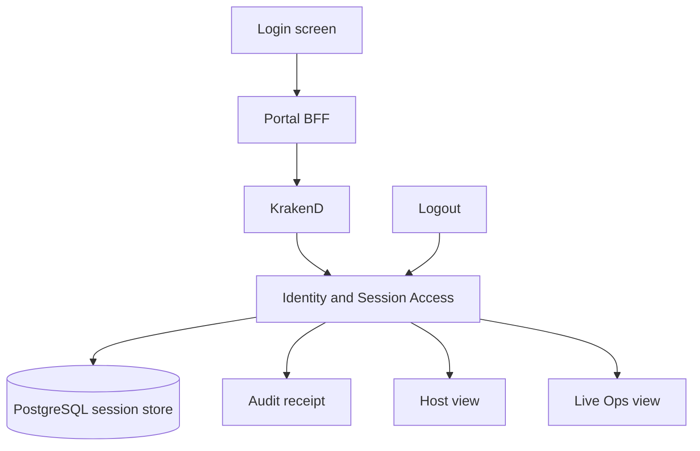

# Feature F05 — Test Authentication and Access Gate

> Feature-level index for the simple login required to enter the simulated
> LivePilot OS Hackathon experience.

## Machine-readable contract coverage

| Source | Link | Role |
|---|---|---|
| Requirement | [REQ-LP-017](../../../live-pilot-os-requirements.md) | Product acceptance |
| BRD | [Feature 05 BRD](../../../../02-product/brd/feature-05-test-authentication-access-gate.md) | Business authority |
| BDD | [Feature 05 BDD](../../../../02-product/bdd/feature-05-test-authentication-access-gate.md) | Behavior authority |
| API contract | [authentication.md](../../../api/authentication.md) | Login/session/logout HTTP contract |
| OpenAPI | [openapi.yaml](../../../api/openapi.yaml) | Canonical transport schema |
| Identity SOT | [identity-tenancy-authorization-sot.md](../../../api/identity-tenancy-authorization-sot.md) | Identity and authorization authority |
| Architecture | [overview.md](../../../overview.md) | UI/BFF/service boundaries |

Status: detailed baseline. Production OIDC provider, claim mapping, and tenant
authority remain `[NEEDS CLARIFICATION]`; this feature is local/simulated only.

## Feature authority and boundaries

F05 owns test-mode authentication, server-managed sessions, login/logout
lifecycles, and the initial Host/Live Ops role context. It does not own OIDC
federation, enterprise provisioning, live-session authorization, promotion
policy, inventory, or platform actions.

Production identity remains governed by the [Identity, Tenancy, and Authorization
SOT](../../../api/identity-tenancy-authorization-sot.md). The local test adapter
is a bounded simulation and must be visibly distinct from production identity.

## Canonical flow map

## Flow index

| Flow ID | Flow | Detail SOT | Status |
|---|---|---|---|
| F05.1-FLOW-001 | Sign in as a seeded test user | [detail](flows/f05-1-flow-001-test-login.md) | Detailed |
| F05.1-FLOW-002 | Reject invalid credentials | [detail](flows/f05-1-flow-002-reject-invalid-login.md) | Detailed |
| F05.1-FLOW-003 | Read current session and role | [detail](flows/f05-1-flow-003-read-session.md) | Detailed |
| F05.1-FLOW-004 | Log out and revoke the session | [detail](flows/f05-1-flow-004-logout.md) | Detailed |

## Feature-level contract rules

1. No Host or Live Ops screen is accessible without server-derived identity.
2. Test credentials work only in local/simulated mode.
3. Passwords and raw session tokens never enter logs, events, or audit records.
4. Invalid credentials reveal no account-existence information.
5. Logout and expiry revoke the session before protected requests can continue.
6. Authentication establishes identity; live-session authorization remains a
   separate capability check.
7. Browser role headers, route personas, and bearer tokens are never authorization evidence.

## Required feature evidence

- API contract and OpenAPI paths remain synchronized.
- Host and Live Ops login, invalid login, session, and logout tests pass.
- Password, token, cookie, and redaction tests pass.
- Production-mode configuration rejects the test adapter.
- `node scripts/architecture/check-sot.mjs` passes.
