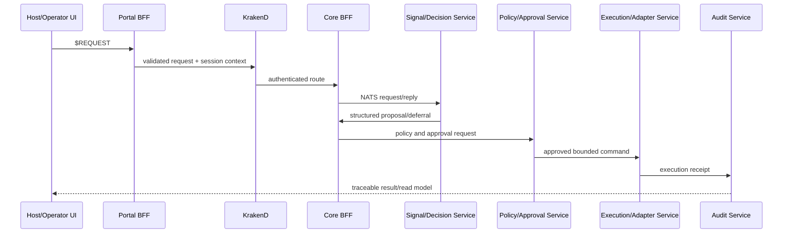

# [$FLOW_NAME] Flows — Source of Truth

> Copy this template for a LivePilot flow SOT. Replace every `$PLACEHOLDER`,
> remove unused sections, and link all claims to a LivePilot requirement,
> contract, ADR/PDR, source file, or executable evidence.

## Machine-readable contract coverage

Contract inventory and unresolved boundaries: [$COVERAGE_REGISTRY]($COVERAGE_REGISTRY_LINK).
Source hashes, operation pointers, schema compatibility, and verification status
are checked by `$COVERAGE_CHECK_COMMAND`.

Draft payload contracts:

- [$PAYLOAD_SCHEMA_NAME]($PAYLOAD_SCHEMA_LINK)
- [ProblemDetails](../../api/openapi.yaml#/components/schemas/ProblemDetails)
- [$EVENT_SCHEMA_NAME]($EVENT_SCHEMA_LINK)

Approval, runtime, security, and production evidence remain separate gates. A
path-shape match is not proof of semantic compatibility or deployment.

Status: scoped companion to [LivePilot OS Deep Context](../live-pilot-os-deep-context.md).

## Companion ownership and references

The parent deep context governs LivePilot-wide invariants, JEV/Decision Engine
rules, node boundaries, session authorization, policy gates, and platform adapter
contracts. This flow SOT owns only `$FLOW_NAME` command semantics, state
transitions, payloads, events, failure behavior, and evidence.

Related companions:

- [$RELATED_FLOW_SOT_1]($RELATED_FLOW_SOT_1_LINK) owns `$RELATED_SCOPE_1`.
- [$RELATED_FLOW_SOT_2]($RELATED_FLOW_SOT_2_LINK) owns `$RELATED_SCOPE_2`.
- [Domain and Event Model](../live-pilot-os-domain-model.md) owns shared vocabulary.
- [Integration Boundaries](../live-pilot-os-integration-boundaries.md) owns external adapters.

Companion documents reference command sections here instead of redefining the same
command, event, status, error, or ownership rule. Parent rules take precedence
over conflicting examples.

## Shared boundary

This section consolidates the handoff between `$FLOW_NAME` commands and its read,
decision, execution, or audit consumers. It adds no route, event, status, or
deployment unit unless an approved contract explicitly does so.

### Node responsibility for this flow

| Boundary | Responsibility | Limit |
|---|---|---|
| Node 1 — Host/Operator UI | Render `$FLOW_NAME` controls and states | Does not authorize or mutate domain state |
| Node 2 — Portal BFF | Resolve session context, validate UI input, shape DTOs | Does not become a second domain writer |
| Node 3 — KrakenD Edge | Authenticate, rate-limit, route, and enforce public contract | Does not implement flow rules |
| Node 4 — Core BFF | Orchestrate the use case and preserve errors/correlation | Does not own JEV, policy, inventory, or adapter truth |
| Node 5 — Domain/Decision Services | Validate, decide, transition state, publish facts | Does not read another service's tables |
| Node 6 — Persistence/Event/Adapter boundaries | Commit durable state, deliver events, translate external commands | Does not hide unknown outcomes or bypass audit |

### Shared facts and projections

- Source aggregates and read projections have separate ownership.
- A committed domain event is not the same thing as a browser refresh or an SSE hint.
- Consumers deduplicate events, reject stale revisions, and support replay.
- Authorization occurs before filtering, pagination, counts, or projection access.
- Unavailable dependencies are not represented as a successful empty result.
- Projection DTOs must identify whether a field is raw, derived, or presentation-only.

### Historical consolidation evidence

Preserve observed differences as evidence. Do not resolve a conflict by inventing
a wire value, status, route, or fallback.

| Existing evidence/gap | Difference to resolve | Owning decision/closure evidence |
|---|---|---|
| `$EVIDENCE_1` | `$CONFLICT_1` | `$OWNER_AND_RECEIPT_1` |
| `$EVIDENCE_2` | `$CONFLICT_2` | `$OWNER_AND_RECEIPT_2` |

### Consolidation verification boundary

For implementation, compare current and target behavior for the same authorized
`live_session_id` and flow input. Verify allowed/denied paths, state transitions,
null/degraded states, pagination, duplicate/out-of-order events, retries, and
Emergency Pause behavior. Documentation consolidation is not an implementation
or production-readiness receipt.

## Purpose

This file is the source of truth for generating bounded goals that implement or
repair `$FLOW_NAME` in LivePilot OS.

The flow may use existing screens and contracts or introduce a new contract only
when that change is explicitly marked proposed and linked to an approved goal.
This document does not silently create a new service, platform capability, policy,
role, financial rule, or workflow state.

## 1. Complete flow work for this round

These are the complete user/system actions this SOT may cover:

| Actor | Action | Frozen route/command | Result |
|---|---|---|---|
| `$ACTOR_1` | `$ACTION_1` | `$ROUTE_OR_COMMAND_1` | `$RESULT_1` |
| `$ACTOR_2` | `$ACTION_2` | `$ROUTE_OR_COMMAND_2` | `$RESULT_2` |

This SOT does not cover:

- `$OUT_OF_SCOPE_ACTION_1`
- `$OUT_OF_SCOPE_ACTION_2`

## 2. Authority

Use these sources in order:

1. Approved decisions and explicit acceptance contracts.
2. [LivePilot Requirements Baseline](../live-pilot-os-requirements.md).
3. [LivePilot OS Deep Context](../live-pilot-os-deep-context.md).
4. The owning BDD/BRD and domain/event contracts.
5. Existing implementation and test evidence.

Evidence is not authority when it conflicts with an approved contract. A draft
route, generated client, mock, screenshot, or illustrative payload is not proof
of deployment or authorization.

## 3. One `$FLOW_AGGREGATE` aggregate

The owning aggregate is `$AGGREGATE_NAME`, persisted by `$OWNER_SERVICE` in
`$SOURCE_OF_TRUTH_STORE`.

| Fact | Current value | Target rule | Future-goal rule |
|---|---|---|---|
| Identity | `$CURRENT_IDENTITY` | `$TARGET_IDENTITY` | `$MIGRATION_RULE` |
| Parent | `$CURRENT_PARENT` | `live_session_id` | `$PARENT_MIGRATION_RULE` |
| Owner | `$CURRENT_OWNER` | `$TARGET_OWNER` | `$ONE_WRITER_RULE` |
| Evidence | `$CURRENT_EVIDENCE` | `$TARGET_EVIDENCE` | `$PROOF_RULE` |

Do not create a second writer or second aggregate from this document.

## 4. Lifecycle

The canonical state machine is:

```text
$STATE_A → $STATE_B → $STATE_C
              ├──→ $STATE_D
              └──→ $STATE_E
```

| From | Command/event | Guard | To | Failure behavior |
|---|---|---|---|---|
| `$STATE_A` | `$COMMAND_1` | `$GUARD_1` | `$STATE_B` | `$FAILURE_1` |
| `$STATE_B` | `$COMMAND_2` | `$GUARD_2` | `$STATE_C` | `$FAILURE_2` |

Define terminal states, legal retries, replay behavior, expiry boundaries,
Emergency Pause behavior, and whether any reversal is allowed. Do not infer a
state from a UI badge or a JEV recommendation.

## 5. Flow type and capability

`$FLOW_TYPE` is a domain capability, not a platform-specific implementation name.

| Capability | Required | Source/owner | Unsupported behavior |
|---|---:|---|---|
| `$CAPABILITY_1` | yes/no | `$OWNER_1` | `$UNSUPPORTED_1` |
| `$CAPABILITY_2` | yes/no | `$OWNER_2` | `$UNSUPPORTED_2` |

If an external platform cannot perform the capability, return a typed
`UNSUPPORTED_CAPABILITY` result. Do not silently emulate production success.

## 6. Who may act

Use session-scoped capabilities and approved permission identifiers. Do not create
a second identity or permission vocabulary in this SOT.

| Permission | Actor/capability | Boundary |
|---|---|---|
| `$PERMISSION_1` | `$ACTOR_OR_ROLE_1` | `$BOUNDARY_1` |
| `$PERMISSION_2` | `$ACTOR_OR_ROLE_2` | `$BOUNDARY_2` |

The UI may hide a control, but only the service and persistence boundary decide
whether the action is authorized. Parent session suspension, role revocation, and
stale context fail closed.

## 7. Participants, signals, and evidence

List the records involved in the flow. Keep source facts, model interpretation,
policy verdicts, human actions, and external results distinct.

| Record | Owner | Status/state | What it decides |
|---|---|---|---|
| `$RECORD_1` | `$OWNER_1` | `$STATUS_1` | `$DECISION_1` |
| `$RECORD_2` | `$OWNER_2` | `$STATUS_2` | `$DECISION_2` |

JEV proposals must include evidence IDs, confidence, uncertainty, model provider,
and model version. A JEV proposal is never the source of catalog, margin,
inventory, approval, or platform truth.

## 8. Routes and commands

Frozen public contracts:

```text
$METHOD $PUBLIC_ROUTE_1
$METHOD $PUBLIC_ROUTE_2
```

Internal NATS request/reply subjects:

```text
$SERVICE.$FLOW.v1.command
$SERVICE.$FLOW.v1.query
```

The subject, operation ID, direction, schema version, delivery guarantee,
idempotency behavior, timeout, and retryability must be documented together.

## 9. Errors

Keep error ownership explicit. Similar names are not aliases unless a compatibility
mapping is approved.

| Contract | Codes owned |
|---|---|
| Public BFF | `VALIDATION_ERROR`, `UNAUTHORIZED`, `FORBIDDEN`, `NOT_FOUND`, `CONFLICT`, `RATE_LIMITED` |
| Decision Engine | `DECISION_SCHEMA_INVALID`, `DECISION_LOW_CONFIDENCE`, `DECISION_DEFERRED` |
| Policy service | `$POLICY_ERROR_CODES` |
| Adapter boundary | `UNSUPPORTED_CAPABILITY`, `UPSTREAM_UNAVAILABLE`, `UNKNOWN_EXTERNAL_RESULT` |

All public errors use the approved RFC 7807 `ProblemDetails` shape. Errors must
not leak prompts, secrets, COGS, customer PII, or unredacted platform payloads.

## 10. Screens and UX states

This SOT covers these existing/proposed surfaces:

| Surface | Route/screen | What this flow may change |
|---|---|---|
| Streamer Co-pilot HUD | `$HOST_ROUTE` | `$HOST_SCOPE` |
| Live Ops Console | `$OPS_ROUTE` | `$OPS_SCOPE` |

Required states:

```text
loading → ready → pending → approved/rejected
                         ├── policy_blocked
                         ├── adapter_unknown
                         ├── emergency_paused
                         └── recoverable_error
```

The UI must not imply that a cue was spoken, approved, or executed until the
corresponding event and receipt exist.

## 11. Topology

The canonical logical path is:

```text
UI → Portal BFF → KrakenD → Core BFF → Services →
Persistence/Event/Platform Integration Boundaries
```

Internal service communication uses NATS request/reply and NATS JetStream. The
topology is a contract map, not proof that each node is separately deployed.

### Node responsibility for this flow

| Node | Owns | Must not do |
|---|---|---|
| Node 1 — UI | Presentation and user interaction | Authorize or mutate domain state |
| Node 2 — Portal BFF | UI DTOs, validation, session context | Reimplement domain rules |
| Node 3 — KrakenD | Auth, routing, limits, contract enforcement | Calculate margin or inventory |
| Node 4 — Core BFF | Orchestration and aggregation | Become source of truth |
| Node 5 — Services | Domain state, JEV decisioning, policies, commands | Read peer tables |
| Node 6 — Integration boundaries | Persistence, events, adapters, reconciliation | Hide unknown outcomes |

## 12. Verification that exists

Existing executable evidence:

```text
$TEST_COMMAND_1
$TEST_COMMAND_2
$CONTRACT_CHECK_COMMAND
```

Each command must identify its package, fixture, environment, exit status, and
artifact path. A mock success, screenshot, or isolated provider invocation is not
end-to-end evidence.

## 13. Decisions that remain blocked

| Item | Current rule | Blocked decision |
|---|---|---|
| `$DECISION_1` | `$CURRENT_RULE_1` | `$BLOCKED_1` |
| `$DECISION_2` | `$CURRENT_RULE_2` | `$BLOCKED_2` |

A `ready` implementation goal cannot resolve these items by assumption.

## 14. What this document refuses to generate

This SOT does not generate:

- unapproved platform mutations;
- a second identity, policy, inventory, or audit authority;
- a new route or event merely to fill a matrix row;
- a UI redesign outside the approved UX scope;
- a production claim from simulated behavior;
- a goal that combines unrelated services without an atomic outcome.

## 15. Consolidated implementation and production-readiness gaps

| ID | Severity | Gap | Required closure evidence |
|---|---|---|---|
| `$GAP_ID_1` | P0/P1/P2 | `$GAP_DESCRIPTION_1` | `$CLOSURE_RECEIPT_1` |
| `$GAP_ID_2` | P0/P1/P2 | `$GAP_DESCRIPTION_2` | `$CLOSURE_RECEIPT_2` |

### 15.1 Readiness verdict

`$FLOW_NAME` is `$PLANNING_STATUS` as an architecture/planning baseline. It is
not production-ready until `$BLOCKING_GAPS` are closed. This verdict is distinct
from Soda goal status.

## 16. Detailed gap solutions, contracts, and implementation plan

### 16.1 Decision summary

`$DECISION_SUMMARY`

### 16.2 Scope and boundaries

#### In scope

- `$IN_SCOPE_1`
- `$IN_SCOPE_2`

#### Out of scope

- `$OUT_OF_SCOPE_1`
- `$OUT_OF_SCOPE_2`

### 16.3 Root-cause model

```text
$ROOT_CAUSE
  → $BOUNDARY_FAILURE
  → $USER_OR_SYSTEM_IMPACT
  → $REQUIRED_CONTROL
```

### 16.4 Recommended bounded contexts

| Context/service | Owns | Does not own |
|---|---|---|
| `$SERVICE_1` | `$OWNS_1` | `$NOT_OWNS_1` |
| `$SERVICE_2` | `$OWNS_2` | `$NOT_OWNS_2` |

### 16.5 Canonical domain model

#### Logical entities

| Entity | Key fields | Invariants |
|---|---|---|
| `$ENTITY_1` | `$FIELDS_1` | `$INVARIANTS_1` |
| `$ENTITY_2` | `$FIELDS_2` | `$INVARIANTS_2` |

#### Physical persistence authority

| Data | Authoritative store | Writer | Read/projection consumers |
|---|---|---|---|
| `$DATA_1` | `$STORE_1` | `$WRITER_1` | `$READERS_1` |

### 16.6 Solution per gap

#### `$GAP_ID_1` — `$GAP_TITLE_1`

**Cause:** `$CAUSE_1`

**Decision:** `$DECISION_1`

**Contract:** `$CONTRACT_1`

**Proof:** `$PROOF_1`

### 16.7 Canonical transaction pseudocode

```text
validate authenticated session context
validate command schema and idempotency key
load authoritative aggregate
validate lifecycle and policy preconditions
evaluate JEV proposal, if applicable
run deterministic margin/inventory/approval gates
commit source state and outbox atomically
publish durable fact
return traceable decision/action receipt
```

### 16.8 Contract changes required before implementation

| Contract | Current revision | Target revision | Compatibility rule |
|---|---|---|---|
| `$CONTRACT_1` | `$CURRENT_VERSION_1` | `$TARGET_VERSION_1` | `$COMPATIBILITY_1` |

### 16.9 Goal decomposition and gates

| Goal slice | Depends on | Touch map | Verification gate |
|---|---|---|---|
| `$GOAL_1` | `$DEPENDENCY_1` | `$TOUCH_MAP_1` | `$GATE_1` |
| `$GOAL_2` | `$DEPENDENCY_2` | `$TOUCH_MAP_2` | `$GATE_2` |

## 17. Flow sequence diagrams — path, contract, and service mapping

### `$FLOW_ID_1` — `$FLOW_TITLE_1`



### Failure and retry paths

| Failure | Expected behavior | Evidence |
|---|---|---|
| JEV timeout | Defer or human review; no mutation | `$EVIDENCE_1` |
| Policy rejection | Return blocked result; no adapter command | `$EVIDENCE_2` |
| Adapter unknown result | Reconcile before retry; preserve idempotency key | `$EVIDENCE_3` |
| Duplicate event | Return original result; no duplicate side effect | `$EVIDENCE_4` |
| Emergency Pause | Stop automated mutation; continue capture/audit | `$EVIDENCE_5` |

### Sequence invariants

1. `$SEQUENCE_INVARIANT_1`
2. `$SEQUENCE_INVARIANT_2`
3. `$SEQUENCE_INVARIANT_3`

## 18. Service-flow implementation readiness

### Required work by service

| Service | Required work | Current evidence | Missing evidence |
|---|---|---|---|
| `$SERVICE_1` | `$WORK_1` | `$CURRENT_EVIDENCE_1` | `$MISSING_1` |
| `$SERVICE_2` | `$WORK_2` | `$CURRENT_EVIDENCE_2` | `$MISSING_2` |

### Runtime sequence still missing

- `$MISSING_RUNTIME_1`
- `$MISSING_RUNTIME_2`

### Coverage verdict

`$COVERAGE_VERDICT`

## 19. Required implementation plan

### P0 — Architecture and contract gates

- `$P0_GATE_1`
- `$P0_GATE_2`

### P1 — Vertical slice

```text
$FIRST_USER_ACTION
  → $DECISION_OR_POLICY
  → $CONTROLLED_ACTION
  → $AUDIT_RECEIPT
```

### P1 — Lifecycle and operational hardening

- `$P1_HARDENING_1`
- `$P1_HARDENING_2`

### P2 — Platform expansion and deprecation

- `$P2_PLATFORM_1`
- `$P2_DEPRECATION_1`

### Definition of done for this flow

- contract revision and compatibility proof exist;
- allowed and denied paths pass;
- JEV output validation and low-confidence routing pass, if applicable;
- deterministic policy gates pass;
- idempotency/replay/unknown-outcome tests pass;
- audit receipt is complete;
- simulated/sandbox/production adapter mode is visible;
- exact commands and artifacts are recorded.

## 20. Inter-node contract topology and invariants

The target path is:

```text
UI → Portal BFF → KrakenD → Core BFF → Services →
Persistence/Event/Platform Integration Boundaries
```

Every adjacent boundary must prove identity, schema, authorization, session
context, correlation, timeout, retry, idempotency, and failure behavior.

### 20.1 Node agreement model

| Agreement | Required proof |
|---|---|
| Identity | Expected caller/service identity and audience are authenticated |
| Schema | Producer and consumer validate the same revision |
| Decision | JEV version, confidence, evidence, and routing status are preserved |
| Delivery | Duplicate/out-of-order delivery is safe |
| Failure | Timeout, retry, cancellation, and partition behavior are explicit |
| Observability | Trace, correlation, node, contract, and redacted outcome are retained |

### 20.2 Localization contract

- `X-Locale` is `th` or `en`, default `th`.
- RFC 7807 `title` and `detail` have Thai/English parity.
- Money uses integer minor units; timestamps use ISO-8601 UTC.

### 20.3 UX/UI contract

Every affected screen must link persona, job, state, component, frontend type,
BFF operation, permission, and evidence. Loading, empty, denied, policy-blocked,
stale, paused, adapter-unknown, and recovery states are mandatory where applicable.

### 20.4 Security and threat contract

| Threat | Control |
|---|---|
| Forged session context | Server-derived context and fail-closed authorization |
| Prompt/model injection | Approved context boundary, schema validation, no direct mutation |
| Replay/duplicate command | Idempotency key and atomic deduplication |
| Unknown adapter result | Reconciliation before retry |
| Secret/PII leakage | Redaction from prompts, logs, and public responses |

## 21. CFLOW source index and async registry

| Artifact | Owner | Status | Source |
|---|---|---|---|
| `$FLOW_NAME` SOT | `$OWNER` | `$STATUS` | `$SOURCE` |
| Payload schema | `$OWNER` | `$STATUS` | `$SCHEMA` |
| Event schema | `$OWNER` | `$STATUS` | `$EVENT_SCHEMA` |
| Coverage registry | `$OWNER` | `$STATUS` | `$REGISTRY` |

### Async registry

| Subject | Producer | Consumer | Version | Delivery | Idempotency |
|---|---|---|---|---|---|
| `$SUBJECT_1` | `$PRODUCER_1` | `$CONSUMER_1` | `$VERSION_1` | `$DELIVERY_1` | `$IDEMPOTENCY_1` |

No subject is considered implemented until producer, consumer, schema, route,
retry, replay, and evidence ownership are named.
