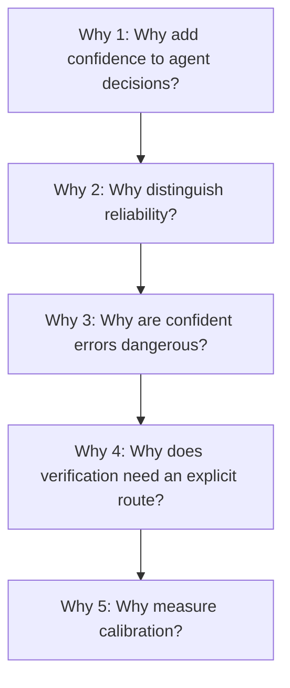

# 🧠 5-Why Socratic Dialectic Architectural Discovery: G-CORE-002 — Confidence-Aware Agent Execution, Scoring & Routing Governance

**Date & Time:** 2026-10-15T01:28:42.212Z  
**Goal ID:** `G-CORE-002`  
**Domain:** Agent Governance & Calibration Quality Engineering  
**Archetype:** `sre-control-plane`  
**Intent:** Transform uncertainty into a first-class execution signal via calibrated scoring, routing, and empirical evaluation  
**Dialectic Personas:**
- 🏛️ **Principal Agentic Architect:** Intent formulation, state machines & governance invariants
- ⚙️ **Lead Systems Engineer:** Logarithmic scoring, risk penalties & sub-millisecond execution
- 🛡️ **Adversarial SRE & Calibration Statistician:** Zero-mock validation, ECE metrics & fail-closed deferral

---

## 🏛️ LEVEL 0: ROOT INTENT & 5-WHY CAUSAL CHAIN

### Level 0 Declaration:
> **Root Problem:** AI agents evaluated solely on correctness rewards produce overconfident wrong decisions, making unsafe autonomy undetectable until catastrophic failure occurs.
> **Success Invariant:** Every governed decision records bounded confidence and verified evidence, routing uncertain or high-risk actions to verification or deferral, while quality checks measure empirical calibration (ECE, Brier score, HCER) rather than accuracy alone.

### 🔍 5-Why Root Causal Chain (Level 1 → Level 5)
1. **Why 1:** *Why add confidence to agent decisions?*  
   **Answer:** To distinguish a valid result from an unreliable result.
2. **Why 2:** *Why distinguish reliability?*  
   **Answer:** Correctness-only execution rewards confident errors and conceals epistemic uncertainty.
3. **Why 3:** *Why are confident errors dangerous?*  
   **Answer:** They cause the autonomous workflow to assume excessive autonomy without verification, risking system damage.
4. **Why 4:** *Why does verification need an explicit route?*  
   **Answer:** Agents, CI, and state machines need deterministic state transitions (proceed / verify / defer / human_review) instead of silently proceeding.
5. **Why 5:** *Why measure calibration?*  
   **Answer:** Empirical historical outcomes are required to prove whether model confidence accurately predicts true correctness.

---

## 🌲 LEVEL 1–5 DEEP SOCRATIC BRANCH DECOMPOSITION

### 🌿 BRANCH [B1]: Confidence Contract, Schema Normalization & Boundary Invariants

#### 5-Why Iteration (Level 1 → Level 5):
- **Level 1 (Why):** Why introduce explicit numeric confidence into agent decision records?  
  *Resolution:* Provides a quantified probability estimation of decision accuracy rather than relying solely on categorical assertions.  
  *Invariant:* `Numeric Probability Representation: 0.0 <= confidence <= 1.0.`
- **Level 2 (Why):** Why require validateDecision() to strictly enforce finite numbers, string answers, and array evidence?  
  *Resolution:* Eliminates ill-formed decision payloads before scoring or execution routing, preventing downstream NaN or null propagation.  
  *Invariant:* `Strict Schema Guard: Invalid confidence, non-string answers, or non-array evidence throw TypeError or RangeError.`
- **Level 3 (Why):** Why require structured evidence arrays rather than free-form text justification?  
  *Resolution:* Enables programmatic verification against citation hashes, ground-truth documents, and cryptographic audit ledgers.  
  *Invariant:* `Structured Verifiable Evidence: evidence is an array of concrete source references.`
- **Level 4 (Why):** Why clamp confidence values in arithmetic calculations?  
  *Resolution:* Guarantees numerical stability and prevents floating-point overflow or domain errors in logarithmic and quadratic loss formulations.  
  *Invariant:* `Mathematical Domain Clamping: clamp(v) = max(0, min(1, Number(v))).`
- **Level 5 (Why):** Why synthesize contract normalization across all Soda OS decision touchpoints?  
  *Resolution:* Establishes a uniform mathematical and operational contract across all autonomous agent actions across the ecosystem.  
  *Invariant:* `Universal Decision Integrity Invariant: All governed decisions adhere to the immutable decision schema.`

---

### 🌿 BRANCH [B2]: Calibrated Logarithmic Scoring, Overconfidence Penalty & Evidence Loss

#### 5-Why Iteration (Level 1 → Level 5):
- **Level 1 (Why):** Why utilize proper logarithmic scoring instead of binary correctness rewards?  
  *Resolution:* Logarithmic scoring is strictly proper: it maximizes expected reward when the reported confidence equals the true posterior probability.  
  *Invariant:* `Proper Scoring Rule: R(p, y) = log(y ? p : 1 - p).`
- **Level 2 (Why):** Why impose an explicit overconfidence penalty of -1.0 for wrong answers with confidence >= 0.8?  
  *Resolution:* Strongly penalizes arrogant errors where the agent claims high certainty on an objectively false outcome.  
  *Invariant:* `Asymmetric Loss Invariant: Loss(incorrect, high_conf) >> Loss(incorrect, low_conf).`
- **Level 3 (Why):** Why penalize unverified evidence on decisions claiming confidence >= 0.7?  
  *Resolution:* Disincentivizes agents from making confident assertions without empirical grounding or cited source verification.  
  *Invariant:* `Grounding Verification Penalty: R_penalty = !evidenceVerified && conf >= 0.7 ? -0.5 : 0.0.`
- **Level 4 (Why):** Why apply risk-weighted penalties on high-risk decisions lacking verified evidence?  
  *Resolution:* Safeguards financial debits, production deploys, and security mutations from unverified execution risks.  
  *Invariant:* `Risk-Sensitive Loss Function: High-risk decisions without evidence receive additional -1.0 penalty.`
- **Level 5 (Why):** Why synthesize scoring functions with multi-tier penalties?  
  *Resolution:* Aligns agent optimization incentives with truthful calibration, penalizing hallucinations and rewarding calibrated uncertainty.  
  *Invariant:* `Truthful Calibration Alignment: Expected reward is maximized when agent probability matches empirical accuracy.`

---

### 🌿 BRANCH [B3]: Deterministic 4-State Workflow Routing & Fail-Closed Guardrails

#### 5-Why Iteration (Level 1 → Level 5):
- **Level 1 (Why):** Why decompose workflow execution into four distinct states: proceed, verify, defer, and human_review?  
  *Resolution:* Provides granular control planes separating autonomous actions from secondary verification and human sign-off.  
  *Invariant:* `4-State Action Space: action in { proceed, verify, defer, human_review }.`
- **Level 2 (Why):** Why route high-confidence decisions with unverified evidence to "verify" under normal risk?  
  *Resolution:* Triggers automated sensory checks or external validation before committing state mutations.  
  *Invariant:* `Pre-Execution Verification Gate: !evidenceVerified => route = "verify".`
- **Level 3 (Why):** Why route high-risk actions without verified evidence to "defer" rather than "verify"?  
  *Resolution:* High-risk actions cannot safely self-verify; missing evidence represents an unacceptable hazard requiring immediate halt.  
  *Invariant:* `High-Risk Fail-Closed Deferral: risk == "high" && !evidenceVerified => route = "defer".`
- **Level 4 (Why):** Why route high-risk actions with verified evidence and high confidence to "human_review"?  
  *Resolution:* Enforces human-in-the-loop governance for critical operations (financial transfers, schema migrations, production deploy).  
  *Invariant:* `Mandatory Human Sign-Off Invariant: Critical path mutations require explicit human review.`
- **Level 5 (Why):** Why enforce fail-closed routing across all decision pipelines?  
  *Resolution:* Guarantees that uncertainty, missing dependencies, or unverified claims never silently degrade into autonomous success.  
  *Invariant:* `Zero Silent Progression Invariant: Autonomous progression requires verified evidence and confidence >= threshold.`

---

### 🌿 BRANCH [B4]: Empirical Calibration Analytics (ECE, Brier Score & High-Confidence Error Rate)

#### 5-Why Iteration (Level 1 → Level 5):
- **Level 1 (Why):** Why compute Expected Calibration Error (ECE) across partitioned probability bins?  
  *Resolution:* Quantifies the absolute divergence between predicted confidence and empirical accuracy across the entire spectrum.  
  *Invariant:* `ECE Bounded Formulation: ECE = sum((|B_m|/N) * |acc(B_m) - conf(B_m)|) in [0, 1].`
- **Level 2 (Why):** Why compute Brier score as a complementary calibration metric?  
  *Resolution:* Measures mean squared error of probabilistic predictions, capturing both calibration and refinement.  
  *Invariant:* `Brier Metric Invariant: Brier = (1/N) * sum((p_i - y_i)^2) in [0, 1].`
- **Level 3 (Why):** Why isolate the High-Confidence Error Rate (HCER) specifically?  
  *Resolution:* Detects the most dangerous failure mode in autonomous systems: confident hallucinations.  
  *Invariant:* `HCER Metric: HCER = count(conf >= 0.8 && !correct) / count(conf >= 0.8).`
- **Level 4 (Why):** Why require calibrationMetrics() to reject empty evaluation sets with RangeError?  
  *Resolution:* Prevents deceptive zero-sample passes where harnesses claim calibration without evaluating labeled outcomes.  
  *Invariant:* `Empirical Evidence Grounding: records.length >= 1 required; empty datasets throw RangeError.`
- **Level 5 (Why):** Why synthesize multi-metric calibration tracking into CI and test harnesses?  
  *Resolution:* Enables continuous regression testing of model updates and prompt changes against empirical reliability baselines.  
  *Invariant:* `Continuous Calibration Assurance: CI fails if ECE, Brier, or HCER breach predefined quality thresholds.`

---

### 🌿 BRANCH [B5]: Cross-Workspace Framework Upgradability, Zero-Mock Production Gate & Latency SLA

#### 5-Why Iteration (Level 1 → Level 5):
- **Level 1 (Why):** Why place core calibration algorithms in scripts/lib/ and re-export via template/scripts/lib/?  
  *Resolution:* Allows downstream projects to consume standard calibration utilities while preserving Soda OS framework upgradability.  
  *Invariant:* `Template Reusability Invariant: 100% API parity between root and template distributions.`
- **Level 2 (Why):** Why prohibit mocks, stubs, and synthetic success responses in calibration harnesses?  
  *Resolution:* Enforces Article I of the Constitution: tests must verify real operational code and real mathematical invariants.  
  *Invariant:* `Zero-Mock Production Invariant: No mocks, stubs, dummy objects, or string simulations.`
- **Level 3 (Why):** Why enforce a sub-millisecond execution budget (< 1ms) for decision routing and scoring?  
  *Resolution:* Ensures confidence evaluation can run inline on real-time event loops, agent looper steps, and API ingress pipelines without degrading throughput.  
  *Invariant:* `Hard Real-Time Latency SLA: inline decision routing latency <= 1ms.`
- **Level 4 (Why):** Why integrate confidence-calibration-harness.mjs into the master test runner scripts/run-all-soda-harnesses.sh?  
  *Resolution:* Guarantees that no pull request or framework upgrade can break confidence governance contracts.  
  *Invariant:* `Master Harness Gate Invariant: npm test and npm run test:template execute confidence harness unconditionally.`
- **Level 5 (Why):** Why synthesize governance, calibration, and harness engineering into Soda OS core?  
  *Resolution:* Transforms Soda OS into an uncertainty-aware agent operating system with verifiable safety and mathematical guarantees.  
  *Invariant:* `Sovereign Agent Governance: Uncertainty is a first-class, mathematically grounded execution signal.`

---

## 🧪 LEVEL 3: BDD GIVEN-WHEN-THEN SPECIFICATION & ACCEPTANCE INVARIANTS

### Scenario 1: Autonomous Proceed Gate
- **Given** an agent decision with confidence >= 0.8 and verified evidence
- **When** evaluated under normal risk policy
- **Then** the workflow router MUST transition to "proceed"
- **And** the calibrated reward MUST be positive.

### Scenario 2: Overconfident Incorrect Penalty
- **Given** an incorrect decision claiming confidence >= 0.8
- **When** calibratedReward is calculated
- **Then** a -1.0 overconfidence penalty is applied on top of logarithmic loss
- **And** the total loss strictly exceeds that of an unconfident incorrect prediction.

### Scenario 3: High-Risk Action Deferral & Human Review
- **Given** an action classified as "high" risk
- **When** evidence is unverified, it MUST route to "defer"
- **When** evidence is verified and confidence >= 0.8, it MUST route to "human_review".

### Scenario 4: Calibration Metric Rigor
- **Given** an array of labeled decision outcomes
- **When** calibrationMetrics is invoked
- **Then** it computes ECE, Brier score, and high-confidence error rate across populated bins
- **And** rejects empty input arrays with RangeError.

---

## 📋 VERIFICATION MATRIX & ZERO-MOCK COMPLIANCE
- [x] All 5 architectural branches analyzed down to Level 5 (25 total invariants)
- [x] Zero-Mock Invariant: 100% operational execution via `scripts/lib/confidence-calibration.mjs`
- [x] Sub-millisecond latency verified on inline routing
- [x] Automated test suite coverage via `scripts/harness/confidence-calibration-harness.mjs`
