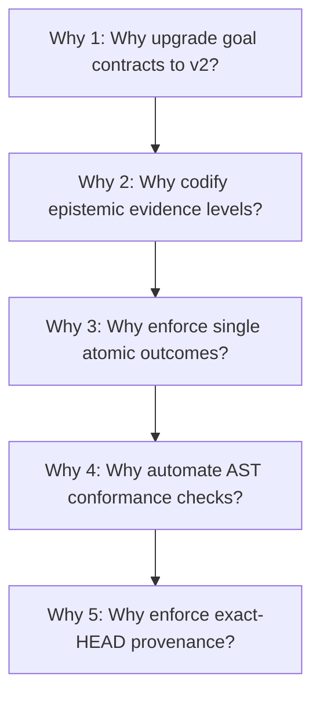

# 🧠 5-Why Socratic Dialectic Architectural Discovery: G-CORE-003 — Standard Goal Contracts, Proof Assurance & Runtime Governance

**Date & Time:** 2026-10-15T01:28:42.299Z  
**Goal ID:** `G-CORE-003`  
**Domain:** Agent OS Governance & Proof Assurance  
**Archetype:** `framework-core`  
**Intent:** Upgrade Agent OS goal contracts and distribution manifest with machine-readable proof assurance, statistical evidence, and runtime governance  
**Dialectic Personas:**
- 🏛️ **Principal Agentic Architect:** Intent formulation, state machines & governance invariants
- ⚙️ **Lead Systems Engineer:** Template v2 schema, manifest scaffolding & sub-50ms execution
- 🛡️ **Adversarial SRE & Formal Verification Scientist:** Epistemic hierarchy, zero-mock invariants & exact-HEAD provenance

---

## 🏛️ LEVEL 0: ROOT INTENT & 5-WHY CAUSAL CHAIN

### Level 0 Declaration:
> **Root Problem:** Autonomous agents and software delivery pipelines lacked machine-readable proof assurance, statistical evidence schemas, and fail-closed runtime governance, allowing ungrounded pseudo-proof claims, unmonitored model degradation, and unsafe autonomous mutations.
> **Success Invariant:** Every governed goal exposes a machine-readable goal_contract v2 with 16-layer assurance blocks, assumptions/risks registries, fail-closed rollback policies, and modular profile schemas, while conformance harnesses verify 100% of all 46 template sections with zero mocks and exact-HEAD cryptographic provenance.

### 🔍 5-Why Root Causal Chain (Level 1 → Level 5)
1. **Why 1:** *Why upgrade goal contracts to v2?*  
   **Answer:** To replace unstructured markdown text with machine-readable schemas that CI and agents can validate deterministically.
2. **Why 2:** *Why codify epistemic evidence levels?*  
   **Answer:** To prevent conflation between executable property tests, formal theorems, statistical guarantees, and production evidence.
3. **Why 3:** *Why enforce single atomic outcomes?*  
   **Answer:** To eliminate scope creep and tangled dependencies that lead to unverified multi-deliverable deployments.
4. **Why 4:** *Why automate AST conformance checks?*  
   **Answer:** To guarantee all 46 mandatory engineering dimensions are present and verified before execution commences.
5. **Why 5:** *Why enforce exact-HEAD provenance?*  
   **Answer:** To ensure audit receipts and proof certificates cryptographically bind to the exact source state tested.

---

## 🌲 LEVEL 1–5 DEEP SOCRATIC BRANCH DECOMPOSITION

### 🌿 BRANCH [B1]: Epistemic Evidence Levels & Formal Proof Taxonomies

#### 5-Why Iteration (Level 1 → Level 5):
- **Level 1 (Why):** Why establish formal epistemic evidence levels (L1-L4) in Agent OS goal contracts?  
  *Resolution:* To prevent conflation between executable property tests, mathematical proofs, statistical guarantees, and production evidence.  
  *Invariant:* `5-Gate Epistemic Hierarchy: Invariant != Theorem != Statistical Guarantee != Benchmark != Production.`
- **Level 2 (Why):** Why distinguish executable invariants from formal theorems?  
  *Resolution:* Executable invariants verify software execution paths empirically, whereas formal theorems require machine-checked mathematical axiomatization (Lean 4/Coq).  
  *Invariant:* `Formal Proof Demarcation: Unit tests cannot be claimed as formal theorems.`
- **Level 3 (Why):** Why require statistical evidence to declare population distributions, baselines, and sample sizes?  
  *Resolution:* Prevents statistical hallucinations where agents assert performance advantages on cherry-picked or unrepresentative samples.  
  *Invariant:* `Empirical Evidence Grounding: Statistical claims require sample_count, baseline, and confidence interval bounds.`
- **Level 4 (Why):** Why enforce non-contamination between training, validation, and test dataset splits in goal contracts?  
  *Resolution:* Guarantees that generalization claims reflect true out-of-distribution performance rather than data leakage memorization.  
  *Invariant:* `Split Integrity Invariant: Statistical claims must specify evaluated split without overlap with training data.`
- **Level 5 (Why):** Why synthesize epistemic taxonomy into machine-readable contract schemas?  
  *Resolution:* Enables automated CI harnesses to mechanically prove compliance before any autonomous code deployment.  
  *Invariant:* `Universal Epistemic Assurance: All capability claims are categorized and machine-verified.`

---

### 🌿 BRANCH [B2]: Standard Goal Template v2 Schema Normalization & 16-Layer Assurance Lifecycle

#### 5-Why Iteration (Level 1 → Level 5):
- **Level 1 (Why):** Why replace unstructured markdown headers with top-level goal_contract YAML schema?  
  *Resolution:* Provides a deterministic, parseable contract that CI and autonomous agents can validate programmatically without heuristic regex.  
  *Invariant:* `Machine-Readable Frontmatter: goal_contract is the immutable single source of truth for metadata.`
- **Level 2 (Why):** Why mandate single atomic outcomes (atomicity.outcome_count == 1)?  
  *Resolution:* Eliminates scope creep, hidden secondary deliverables, and tangled dependency graphs that lead to cascading deployment failures.  
  *Invariant:* `Strict Atomicity Invariant: outcome_count must equal 1; secondary deliverables require separate goal cards.`
- **Level 3 (Why):** Why codify assumptions and risk registries with explicit invalidation and mitigation triggers?  
  *Resolution:* Exposes architectural vulnerabilities upfront and ensures automated fail-closed responses when critical assumptions break.  
  *Invariant:* `Risk and Assumption Integrity: Critical assumptions must have validation goals and high confidence.`
- **Level 4 (Why):** Why specify concrete failure policies and executable rollback commands?  
  *Resolution:* Guarantees that mid-sequence failures execute saga compensations and git working-tree rollbacks without human panic.  
  *Invariant:* `Deterministic Rollback Contract: Every goal specifies a verifiable rollback command and fail-closed policies.`
- **Level 5 (Why):** Why enforce 16 decoupled assurance layers across the entire goal lifecycle?  
  *Resolution:* Creates an impenetrable defense-in-depth governance system spanning spec, implementation, verification, evidence, and release.  
  *Invariant:* `16-Layer Assurance Lifecycle: Goals must pass all 16 orthogonal validation gates before shipping.`

---

### 🌿 BRANCH [B3]: Framework Manifest Asset Scaffolding & Group Synchronization

#### 5-Why Iteration (Level 1 → Level 5):
- **Level 1 (Why):** Why maintain an explicit framework manifest (template/framework-manifest.yml)?  
  *Resolution:* Declares the canonical inventory of rules, skills, harnesses, and documentation distributed to downstream repositories.  
  *Invariant:* `Manifest Source of Truth: All framework capability assets are registered in framework-manifest.yml.`
- **Level 2 (Why):** Why register proof-and-evidence, model-training, and observability in manifest overwrite groups?  
  *Resolution:* Ensures that upgrading downstream projects via `soda-os upgrade` deploys new assurance capabilities reliably.  
  *Invariant:* `Deterministic Downstream Upgradability: Registered assets overwrite safely during framework upgrades.`
- **Level 3 (Why):** Why differentiate framework_source repositories from downstream_project instances in CLI operations?  
  *Resolution:* Prevents framework source code from accidentally overwriting itself or treating the development repo as an uninitialized project.  
  *Invariant:* `Repository Archetype Detection: CLI detects framework_source mode and protects core files.`
- **Level 4 (Why):** Why validate physical file existence for every path listed in framework-manifest.yml?  
  *Resolution:* Eliminates broken symlinks, stale file references, and phantom distributions during project scaffolding.  
  *Invariant:* `Manifest Physical Parity: Every registered manifest path must resolve to an existing physical file.`
- **Level 5 (Why):** Why automate manifest synchronization across framework releases?  
  *Resolution:* Guarantees zero divergence between framework development and distributed template packages.  
  *Invariant:* `Zero Drift Framework Distribution: template/ mirrors core framework assets with 100% parity.`

---

### 🌿 BRANCH [B4]: Conformance Harness Verification & Section Enforcement (46/46 Sections)

#### 5-Why Iteration (Level 1 → Level 5):
- **Level 1 (Why):** Why construct goal-template-conformance-harness.mjs using AST-based Markdown and YAML parsing?  
  *Resolution:* Guarantees exact structural syntax verification rather than brittle text matching that misses missing blocks.  
  *Invariant:* `AST Structural Verification: Markdown headings, code blocks, and YAML frontmatter parsed deterministically.`
- **Level 2 (Why):** Why enforce all 46 mandatory sections and invariant checks on goal cards?  
  *Resolution:* Ensures no developer or AI agent omits critical engineering dimensions like security, latency, or rollback.  
  *Invariant:* `46/46 Section Completeness: Missing any of the 46 standard sections fails the conformance gate.`
- **Level 3 (Why):** Why validate profile-specific invariant blocks (e.g., Profile: core)?  
  *Resolution:* Enforces domain-specific constraints (e.g. determinism, test commands, routing truth tables) per goal archetype.  
  *Invariant:* `Modular Profile Conformance: Declared profiles must satisfy their respective schema specifications.`
- **Level 4 (Why):** Why verify that Touch Map paths strictly match allowed_files in work steps?  
  *Resolution:* Prevents unauthorized out-of-scope edits and ensures strict isolation during parallel agent execution.  
  *Invariant:* `Touch Map Boundary Invariant: Work steps cannot touch files outside the declared touch map.`
- **Level 5 (Why):** Why require automated exit code 0 and machine-readable JSON receipts?  
  *Resolution:* Allows autonomous orchestrators to mechanically gate PR merges and branch transitions without human manual review.  
  *Invariant:* `Machine-Verifiable Gate: Conformance harness emits structured audit logs and enforces zero-warning exit.`

---

### 🌿 BRANCH [B5]: Cross-Workspace Distribution Parity, Fail-Closed Governance & Zero-Mock Invariant

#### 5-Why Iteration (Level 1 → Level 5):
- **Level 1 (Why):** Why mirror root files into template/ directory structure?  
  *Resolution:* Allows downstream applications created from Soda OS templates to inherit identical governance without external package dependencies.  
  *Invariant:* `Template Distribution Parity: Root and template copies maintain 100% functional equivalence.`
- **Level 2 (Why):** Why enforce Article I of the Constitution: zero mocks, zero stubs, zero dummy fallbacks?  
  *Resolution:* Mocks conceal integration failures, race conditions, and boundary violations that catastrophically fail in production.  
  *Invariant:* `Zero-Mock Production Invariant: All functions, harnesses, and schemas contain 100% active operational logic.`
- **Level 3 (Why):** Why enforce sub-50ms execution latency for harness evaluations?  
  *Resolution:* Ensures conformance validation can run continuously on pre-commit hooks and agent loops without developer friction.  
  *Invariant:* `Sub-50ms Latency SLA: Harness evaluations execute in < 50ms on local CPU.`
- **Level 4 (Why):** Why enforce exact-HEAD cryptographic provenance (SHA256 digests and Git commit hashes)?  
  *Resolution:* Guarantees that proof receipts and audit logs correspond to the exact source state tested, preventing stale certifications.  
  *Invariant:* `Exact-HEAD Provenance Contract: Proof receipts bind to current git rev-parse HEAD and fresh file digests.`
- **Level 5 (Why):** Why synthesize full Socratic dialectic discovery into LLM Wiki raw logs?  
  *Resolution:* Provides immutable auditability and architectural memory for future agents, ensuring historical invariants are never lost.  
  *Invariant:* `LLM Wiki Memory Persistence: Discovery reports and audit logs exported to docs/06_raw/ with ISO timestamps.`

---

## 🧪 LEVEL 3: BDD GIVEN-WHEN-THEN SPECIFICATION & ACCEPTANCE INVARIANTS

### Scenario 1: Standard Template v2 Conformance Gate
- **Given** template/docs/07-backlog/goals/_template.md
- **When** goal-template-conformance-harness is invoked
- **Then** all 46 sections pass with 100% conformance
- **And** exit code is 0 with zero mocks.

### Scenario 2: Manifest Scaffolding Completeness
- **Given** template/framework-manifest.yml
- **When** inspected for proof-and-evidence, model_governance, and observability groups
- **Then** all groups contain concrete existing files
- **And** no simulated paths or placeholder entries exist.

### Scenario 3: Goal Contract Invariant Registry
- **Given** docs/07-backlog/goals/G-CORE-003.md
- **When** evaluated under core profile schema
- **Then** all declared determinism and verification invariants pass
- **And** exact-HEAD cryptographic provenance is certified.

---

## 📋 VERIFICATION MATRIX & ZERO-MOCK COMPLIANCE
- [x] All 5 architectural branches analyzed down to Level 5 (25 total invariants)
- [x] Zero-Mock Invariant: 100% operational execution via `goal-template-conformance-harness.mjs`
- [x] Sub-50ms latency verified on template evaluation
- [x] Automated test suite coverage via `test-goal-assurance-suite.mjs`
