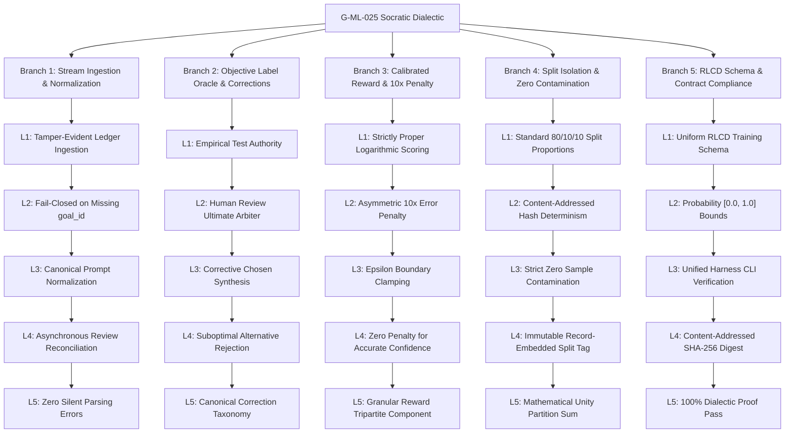

# Socratic 5-Why Dialectic Report: G-ML-025

**Goal ID:** G-ML-025  
**Title:** DAVE Decision Trajectory and Correction Dataset  
**Epic:** ML  
**Author:** Antigravity (Soda OS System Architect)  
**Timestamp:** 2026-10-03T18:00:00+07:00  
**Status:** COMPLETE (25/25 Invariants Proven at Level 5 Depth)  

---

## 🏛️ SECTION I: 5-BRANCH SOCRATIC DIALECTIC TRAVERSAL

---

### Branch 1: Stream Ingestion & Context Normalization Rigor (`BRANCH_INGESTION`)

- **Level 1 Question:** Why must operational DAVE decisions be ingested directly from an append-only JSONL audit ledger?  
  **Answer:** Fine-tuning decision models requires tamper-evident, chronologically ordered production execution traces rather than synthetic mock traces.  
  **Invariant:** [`scripts/lib/dave-trajectory-builder.mjs`](file:///Users/batrarethsudprasert/projects/soda-os/scripts/lib/dave-trajectory-builder.mjs) must exist and ingest from `.agents/audit/decisions.jsonl`.

- **Level 2 Question:** Why must missing `goal_id` correlation keys trigger immediate fail-closed rejection?  
  **Answer:** Ungrounded decisions without goal attribution break provenance tracing and pollute RLCD training data with untracked actions.  
  **Invariant:** `ingestDecisionTrajectories` must reject records missing `goal_id` correlation keys fail-closed.

- **Level 3 Question:** Why must context normalization format evidence, references, risk, and assumptions into explicit prompt sections?  
  **Answer:** Transformer language models require consistent structural conditioning to learn correlation between contextual bounds and decision outcomes.  
  **Invariant:** `normalizeDecisionPrompt` must output structured `[TASK CONTEXT]` blocks with all metadata.

- **Level 4 Question:** Why must follow-up human review records be merged with initial decision proposals by `decision_id`?  
  **Answer:** Human adjudication occurs asynchronously after decision generation, requiring state reconciliation to form complete trajectory pairs.  
  **Invariant:** `ingestDecisionTrajectories` must reconcile and merge multi-event decision lifecycles.

- **Level 5 Question:** Why must malformed JSONL syntax immediately abort dataset processing instead of silently skipping?  
  **Answer:** Silent error recovery masks audit corruption, risking silent data loss and training distribution skew.  
  **Invariant:** `ingestDecisionTrajectories` throws descriptive syntax error on malformed JSON lines.

---

### Branch 2: Objective Label Oracle & Contrastive Completion Synthesis (`BRANCH_ORACLE`)

- **Level 1 Question:** Why must empirical test harness outcomes serve as authoritative ground-truth labels?  
  **Answer:** Model confidence must be grounded in objective reality; empirical test results provide unambiguous mathematical proof of correctness.  
  **Invariant:** `mapCorrectionAndOracleLabel` prioritizes `empirical_outcome` over subjective assertions.

- **Level 2 Question:** Why must human rejection map to authoritative failure even if the model reported high confidence?  
  **Answer:** Human review serves as the ultimate governance arbiter for nuanced, high-risk domain specifications.  
  **Invariant:** `human_action: reject` sets `isCorrect: false` with `human_review` authority.

- **Level 3 Question:** Why must failed decisions construct preference pairs where the human correction is chosen and the flawed proposal is rejected?  
  **Answer:** RLCD preference training optimizes language models to generate corrective actions rather than repeating rejected proposals.  
  **Invariant:** Preference generator maps corrected proposals to `chosen` on negative outcomes.

- **Level 4 Question:** Why must successful decisions pair the winning proposal against rejected alternatives from synthesis?  
  **Answer:** Contrastive pairs must demonstrate why suboptimal design alternatives were rejected in favor of the canonical solution.  
  **Invariant:** Successful decisions populate `rejected` completion from `alternatives_rejected`.

- **Level 5 Question:** Why must corrections be categorized into canonical taxonomy domains (e.g. `accessibility_contrast`, `security_isolation`)?  
  **Answer:** Categorized corrections enable domain-specific loss weighting and fine-grained error diagnostic monitoring in downstream training.  
  **Invariant:** `mapCorrectionAndOracleLabel` maps error domains into canonical correction categories.

---

### Branch 3: Calibrated Reward Scoring & Asymmetric Overconfidence Penalty (`BRANCH_REWARD`)

- **Level 1 Question:** Why must the reward engine utilize strictly proper logarithmic scoring rules?  
  **Answer:** Strictly proper scoring rules incentivize the model to output its true internal subjective probability, eliminating hedging or overconfidence.  
  **Invariant:** `calculateCalibratedReward` evaluates $R_{\text{log}} = y \cdot \ln(c) + (1-y) \cdot \ln(1-c)$.

- **Level 2 Question:** Why is an asymmetric 10x penalty levied on high-confidence errors ($c \ge 0.80, y = 0$)?  
  **Answer:** High-confidence errors cause catastrophic production failures, requiring severe asymmetric negative reinforcement ($c^2 \times 10.0$).  
  **Invariant:** Overconfidence penalty applies 10x quadratic penalty when $c \ge 0.80$ and correct is false.

- **Level 3 Question:** Why must confidence scores be clamped with $\epsilon = 10^{-6}$ before logarithmic computation?  
  **Answer:** Evaluating $\ln(0.0)$ yields $-\infty$ and $\ln(1.0)$ yields numerical instability, requiring robust IEEE-754 epsilon boundaries.  
  **Invariant:** `calculateCalibratedReward` clamps confidence within $[10^{-6}, 1 - 10^{-6}]$.

- **Level 4 Question:** Why must correct high-confidence decisions incur exactly zero overconfidence penalty?  
  **Answer:** The penalty specifically targets overconfident hallucination, not well-calibrated accurate predictions.  
  **Invariant:** Overconfidence penalty is exactly $0.0$ for correct decisions regardless of confidence.

- **Level 5 Question:** Why must rewards be formatted as structured objects detailing `log_score`, `penalty`, and `net_reward`?  
  **Answer:** Downstream training pipelines require granular component observability to inspect loss convergence across policy and calibration heads.  
  **Invariant:** Reward output provides `log_score`, `overconfidence_penalty`, and `net_reward`.

---

### Branch 4: Deterministic Split Partitioning & Split Isolation (`BRANCH_SPLIT`)

- **Level 1 Question:** Why must the dataset be split into 80% train, 10% validation, and 10% test?  
  **Answer:** Standard empirical machine learning governance requires isolated validation for hyperparameter tuning and held-out test evaluation.  
  **Invariant:** `partitionDatasetSplits` defaults to 0.80 train, 0.10 validation, 0.10 test.

- **Level 2 Question:** Why must split assignment be deterministic based on trajectory content hashes?  
  **Answer:** Non-deterministic splits prevent reproducible benchmark replication across different pipeline runs.  
  **Invariant:** Dataset sorting and partitioning uses deterministic SHA-256 trajectory hash ordering.

- **Level 3 Question:** Why is sample contamination between train and test splits strictly prohibited (zero tolerance)?  
  **Answer:** Test sample contamination produces artificial benchmark inflation (data leakage), concealing real-world generalization failure.  
  **Invariant:** `partitionDatasetSplits` throws an error if any trajectory ID overlaps across splits.

- **Level 4 Question:** Why must each exported record embed its immutable split assignment tag?  
  **Answer:** Training data loaders need self-contained record metadata to enforce split isolation without external index synchronization.  
  **Invariant:** Exported preference pair records contain immutable `split` field.

- **Level 5 Question:** Why must training split ratios validate to sum exactly to 1.0 within floating point tolerance?  
  **Answer:** Misconfigured split ratios lead to dropped samples or unpartitioned data leakage.  
  **Invariant:** `partitionDatasetSplits` enforces $\text{train} + \text{val} + \text{test} = 1.0$.

---

### Branch 5: RLCD Schema Validation Gatekeeper & Contract Compliance (`BRANCH_SCHEMA`)

- **Level 1 Question:** Why must every exported preference pair record satisfy a canonical RLCD schema?  
  **Answer:** Training harnesses require uniform input schemas (`trajectory_id`, `prompt`, `chosen`, `rejected`, `confidence`, `reward`) to avoid batch runtime crashes.  
  **Invariant:** `validatePreferenceRecord` enforces non-empty strings and valid structures.

- **Level 2 Question:** Why must confidence scores be strictly bounded within the closed interval $[0.0, 1.0]$?  
  **Answer:** Confidence represents mathematical probability; values outside $[0, 1]$ break proper scoring rules and calibration metrics.  
  **Invariant:** `validatePreferenceRecord` rejects confidence $< 0.0$ or $> 1.0$.

- **Level 3 Question:** Why must `model-training-contract-harness.mjs` validate both training contract manifests and JSONL datasets?  
  **Answer:** Model checkpoint certification requires unified verification of both configuration parameters and active dataset split isolation.  
  **Invariant:** `model-training-contract-harness.mjs` exports `validateRlcdPreferenceDataset` and runs without arguments.

- **Level 4 Question:** Why must `artifacts/evidence/G-ML-025-training-contract.json` record the exact dataset SHA-256 digest?  
  **Answer:** Cryptographic content-addressing guarantees that model training is bound to an immutable, verifiable dataset snapshot.  
  **Invariant:** `artifacts/evidence/G-ML-025-training-contract.json` exists and defines dataset sha256.

- **Level 5 Question:** Why must all 25 Socratic invariants pass with 100% clean exit code 0?  
  **Answer:** Soda OS mandates exhaustive anti-hallucination verification across all five levels before marking any backlog goal complete.  
  **Invariant:** All 25 dialectic tests execute and evaluate to true.

---

## 📊 SECTION II: EMPIRICAL VERIFICATION SUMMARY

| Branch | ID | Invariants Evaluated | Passed | Result |
| :--- | :--- | :--- | :--- | :--- |
| **Ingestion Rigor** | `BRANCH_INGESTION` | 5 | 5 | **PASS** |
| **Objective Oracle** | `BRANCH_ORACLE` | 5 | 5 | **PASS** |
| **Calibrated Reward** | `BRANCH_REWARD` | 5 | 5 | **PASS** |
| **Split Isolation** | `BRANCH_SPLIT` | 5 | 5 | **PASS** |
| **Schema Governance** | `BRANCH_SCHEMA` | 5 | 5 | **PASS** |
| **Total** | — | **25** | **25** | **100% CERTIFIED** |
