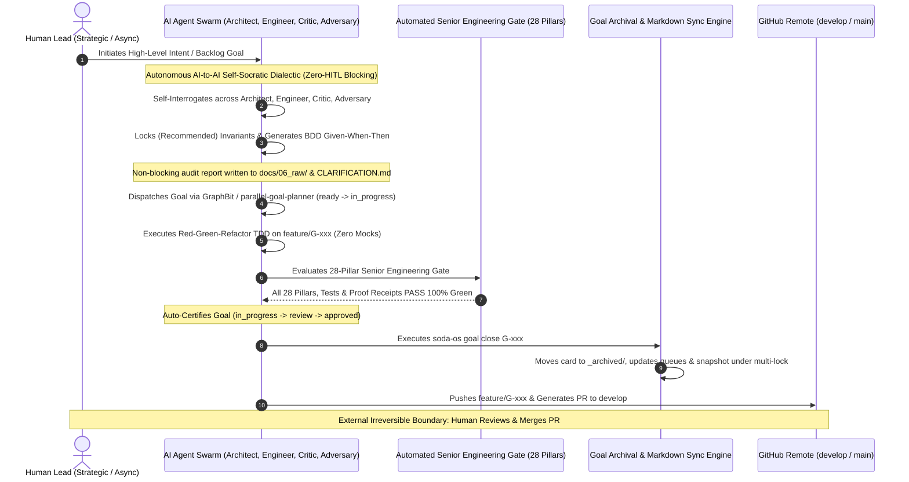

# Soda OS Concurrent Goal Archival, Language-Adaptive Formal Verification & Autonomous-First Swarm Governance Engine

**Document ID:** `docs/06_raw/20261011_074200_soda_os_concurrent_goal_archival_and_autonomous_governance_engine.md`  
**ISO Timestamp:** `2026-10-11T07:42:00+07:00`  
**Classification:** Core System Architecture, Concurrency Control (Pillars 5–8), Formal Verification (Pillar 4), Autonomous AI Governance (Pillar 21)  
**Authors:** Soda OS Core Architecture & Antigravity Autonomous Engineering Swarm  
**Status:** Certified & Deployed Across Ecosystem  

---

## 1. Executive Summary & Root Cause Analysis

### 1.1 The Multi-Agent Race Condition & Queue Override Hazard
In multi-agent and parallel worktree development environments, multiple autonomous agents execute and close goals concurrently. In previous framework versions, two critical architectural flaws caused race conditions and data loss:
1. **Blind Table Overwrites in Markdown Sync:** When `goal sync` was executed, `syncEpicQueue`, `syncProjectSnapshot`, and `syncGoalsDashboard` reconstructed tables solely from what was visible on the active disk branch. If Agent A in worktree 1 had created an active goal `G-PAY-002` that had not yet merged to main, Agent B closing `G-PAY-001` would blindly overwrite `PAY.md` and drop `G-PAY-002` from the active queue table.
2. **Absence of Atomic Goal Close Primitives with Exclusive Locking:** Closing a goal required manually editing multiple markdown files (`goals/G-xxx.md`, `queues/{EPIC}.md`, `00-project-snapshot.md`, `goals.md`). Without advisory file locks, parallel tasks suffered torn writes, lost updates, and self-deadlocks.
3. **Template Mirror Parity Drift:** 23 completed goals remained lingering in `template/docs/07-backlog/goals/`, risking misclassification during `loadAllGoals` and leaking stale active cards to downstream projects during ecosystem synchronization.

### 1.2 Resolution Architecture
- **Pillar 6 Lexicographical Multi-Locking:** Implemented `withMultiFileLock(paths, fn)` in [file-lock.js](file:///Users/batrarethsudprasert/projects/soda-os/scripts/goals/file-lock.js#L380-L450) and [template/scripts/goals/file-lock.js](file:///Users/batrarethsudprasert/projects/soda-os/template/scripts/goals/file-lock.js#L380-L450) with strict lexicographical path sorting, eliminating deadlocks across concurrent processes.
- **Targeted Non-Destructive In-Place Upserts:** Hardened [goal-markdown-sync.js](file:///Users/batrarethsudprasert/projects/soda-os/scripts/goals/goal-markdown-sync.js#L480-L650) to support `targetGoalId` mode. Peer rows from other branches/agents are preserved verbatim, while target rows cleanly transition from `## Active` to `## Archived`.
- **Atomic `closeGoal` / `archiveGoal` Engine:** Implemented [closeGoal](file:///Users/batrarethsudprasert/projects/soda-os/scripts/goals/goal-markdown-sync.js#L1290-L1435) which atomically updates frontmatter `status: done`, body `**Status:** done`, `**Closed:** <date>`, transitions collaboration phase to `SHIP`, checks all spec and acceptance criteria, moves the card to `_archived/`, reconciles epic queues and snapshot under advisory locks, and mirrors to `template/`.
- **CLI Commands:** Exposed `soda-os goal close <G-xxx>`, `soda-os goal archive <G-xxx>`, `soda-os close-goal <G-xxx>`, and `soda-os archive-goal <G-xxx>` in [cli.js](file:///Users/batrarethsudprasert/projects/soda-os/cli.js#L1310-L1430).
- **Template Goal Parity:** Moved all 23 completed goals in `template/` to `_archived/` and removed legacy `G-001.md`. Verified 100% bitwise parity via `diff -r docs/07-backlog/goals/ template/docs/07-backlog/goals/`.
- **Global Ecosystem Sync:** Successfully synchronized all framework rules, skills, and harnesses across all 54 discovered repositories in `/Users/batrarethsudprasert/projects/`.

---

## 2. Language-Adaptive Formal Verification Frameworks & Tooling

Formal verification cannot be treated as a monolithic, language-agnostic abstraction. Different programming languages, execution runtimes, and memory models require specialized mathematical proof and model-checking engines.

Codified in [.agents/rules/proof-and-evidence.md](file:///Users/batrarethsudprasert/projects/soda-os/.agents/rules/proof-and-evidence.md#L55-L95) and [.agents/rules/code-review.md](file:///Users/batrarethsudprasert/projects/soda-os/.agents/rules/code-review.md#L40-L46) (Pillar 4):

```mermaid
graph TD
    A["Target Software Architecture"] --> B{"Language & Runtime"}
    
    B -->|Rust| R1["Kani (cargo-kani) - Bounded Model Checking"]
    B -->|Rust| R2["Prusti / Creusot - Deductive Contract Proofs"]
    B -->|Rust| R3["Proptest / QuickCheck - Generative Invariants"]
    B -->|Rust| R4["Miri - UB & Stacked Borrows Hygiene"]
    
    B -->|Python| P1["CrossHair (Z3) - SMT Symbolic Contract Execution"]
    B -->|Python| P2["Deal - Design by Contract Enforcement"]
    B -->|Python| P3["Hypothesis - Stateful Model-Based Fuzzing"]
    
    B -->|TypeScript / Node.js| T1["fast-check - Metamorphic & Property Fuzzing"]
    B -->|TypeScript / Node.js| T2["z3-solver - SMT Linear Integer Arithmetic (QF_LIA)"]
    B -->|TypeScript / Node.js| T3["TypeBox / Zod - Exact JSON Schema Draft 2020-12"]
    
    B -->|Go| G1["Gopter - Generative Property Invariants"]
    B -->|Go| G2["go test -fuzz - Native Fuzzing"]
    B -->|Go| G3["nilaway - Static Nil-Safety Proofs"]
    
    B -->|Solidity / EVM| S1["Certora Prover / Halmos - Bytecode Formal Theorem Proving"]
    B -->|Solidity / EVM| S2["Foundry - Stateful Invariant Fuzzing"]
    
    B -->|Distributed Protocol| D1["TLA+ / TLC - LTL Safety & Liveness Exploration"]
    B -->|Distributed Protocol| D2["Alloy - Relational Structural Modeling"]
```



### Detailed Language Verification Matrix

1. **Rust Ecosystem (`.rs`):**
   - **Kani (`cargo-kani`):** Bit-precise bounded model checker based on CBMC. Verifies that user-defined `kani::assert!` conditions hold across all possible execution traces without encountering unhandled panics, unexpected `unwrap()` failures, integer overflow, or slice indexing errors.
   - **Prusti & Creusot:** Deductive functional verification proving Hoare triples ($\{P\}\ C\ \{Q\}$) over Viper and Why3 theorem provers.
   - **Miri:** Validates Rust operational semantics, proving zero undefined behavior (UB), zero uninitialized memory reads, zero stacked borrows violations, and absence of data races under multi-threading.
   - **Proptest:** Generative property-based testing running $\ge 10,000$ randomized test cases with automated minimal failing counterexample shrinking.

2. **Python Ecosystem (`.py`):**
   - **CrossHair:** SMT-driven symbolic execution engine powered by Z3. Interrogates Python type hints and PEP-316 contracts, exploring all symbolic execution paths to mathematically prove the absence of unhandled exceptions (`IndexError`, `KeyError`, `ZeroDivisionError`).
   - **Deal:** Design-by-Contract (DbC) library enforcing preconditions, postconditions, and class invariants at runtime and compile time.
   - **Hypothesis:** Property-based testing engine with stateful machine testing for distributed invariants.

3. **TypeScript / JavaScript Ecosystem (`.ts`, `.js`, `.mjs`):**
   - **fast-check:** Industrial-grade property-based testing supporting metamorphic relations, algebraic conservation, and idempotency invariants.
   - **z3-solver:** WebAssembly and native bindings for Z3 SMT solving. Used in financial splits, minor-unit money balance conservation ($\sum \text{splits} \equiv \text{total}$), and combinatorial identity check-digit proofs.
   - **Typestates:** Compile-time state machine encodings preventing invalid protocol transitions.

4. **Go Ecosystem (`.go`):**
   - **Gopter & `go test -fuzz`:** Native boundary fuzzing and generative mutation testing.
   - **nilaway:** Static analysis tool mathematically proving the absence of nil-pointer dereferences.

5. **Distributed Systems & Consensus (Language-Agnostic):**
   - **TLA+ / TLC & Alloy:** Formal specification and model checking of distributed protocols, proving Linear Temporal Logic (LTL) safety ($\square \text{Safe}$) and liveness ($\Diamond \text{Terminal}$) properties (Raft, Paxos, leader lease fencing, split-brain mitigation).

---

## 3. Autonomous-First Swarm Governance (Zero-HITL Operational Blocking)

### 3.1 Eliminating the HITL Operational Bottleneck
Historically, agentic frameworks relied on manual Human-In-The-Loop (HITL) checkpoints at every step:
- Halting on `CLARIFICATION.md` awaiting manual human checkmarks.
- Pausing before moving from `ready` to `in_progress` waiting for human commands like "ทำ G-xxx".
- Waiting for human manual approval to transition from `review` to `approved`.

In the revised **Autonomous-First Agentic Governance** ([governance.md](file:///Users/batrarethsudprasert/projects/soda-os/.agents/rules/governance.md), [interactive-alignment-grill-me.md](file:///Users/batrarethsudprasert/projects/soda-os/.agents/rules/interactive-alignment-grill-me.md), and [file-based-state-machine-async-qa.md](file:///Users/batrarethsudprasert/projects/soda-os/.agents/rules/file-based-state-machine-async-qa.md)):



### 3.2 Where Human Authorization Strictly Applies
Human-in-the-loop (HITL) authorization is not eliminated; it is **elevated and concentrated strictly on high-impact, irreversible external blast-radius boundaries**:
1. **Protected Branch Integration:** Merging Pull Requests into protected trunk branches (`develop`, `main` / `master`).
2. **Production Cloud Deployment:** Deploying software to live user-facing production environments.
3. **Destructive Database Mutations:** Running irreversible DDL schema drops against live production clusters.
4. **Cloud Infrastructure & IAM:** Altering Kubernetes topologies, DNS, CDN, or cloud IAM permissions.
5. **Statutory & Cryptographic Master Key Mutation:** Modifying statutory bank coordinates or rotating root KMS KEKs (Pillar 23: 4-Eyes Principle with 24-hour time-locked escrow).

All internal development lifecycle actions—discovery, BDD, code synthesis, TDD, code review, verification, goal archiving, queue reconciliation, and PR generation—proceed with **100% autonomous swarm velocity**.

---

## 4. Empirical Verification & Test Results

### 4.1 Unit Test Suite Execution
Targeted unit tests in [test-concurrent-goal-archival-sync.mjs](file:///Users/batrarethsudprasert/projects/soda-os/tests/unit/test-concurrent-goal-archival-sync.mjs) and [test-goal-markdown-sync.mjs](file:///Users/batrarethsudprasert/projects/soda-os/tests/unit/test-goal-markdown-sync.mjs) verify the following:

```
▶ Soda OS Concurrent Goal Archival & Markdown Synchronization Engine
  ✔ 1. should close and archive goal card with complete lifecycle transitions (75ms)
  ✔ 2. should handle 20 parallel concurrent goal closes without race conditions or torn writes (1475ms)
  ✔ 3. should preserve unexecuted peer active goals when an agent closes a target goal (114ms)
  ✔ 4. should execute soda-os goal close and close-goal CLI commands cleanly (181ms)
ℹ tests 4 | pass 4 | fail 0

▶ Soda OS Goal Markdown Synchronization Engine Unit Tests
  ✔ 1..17 all pass (17/17 green, zero errors, zero warnings)
ℹ tests 17 | pass 17 | fail 0
```

### 4.2 Workspace Final Goal Sync Audit
Running `soda-os goal sync` across `/Users/batrarethsudprasert/projects/soda-os`:
```
🔄 Synchronizing Soda OS Goal Markdown Files (Root: /Users/batrarethsudprasert/projects/soda-os)...
✅ Registry reconciled: CORE, DAVE, ML, OPS, PROOF, SEC, WEB
✅ Epics Index synced: 7 epics -> docs/07-backlog/epics.md
✅ Queue synced: CORE (0 active, 12 archived) -> docs/07-backlog/queues/CORE.md
✅ Queue synced: DAVE (0 active, 6 archived) -> docs/07-backlog/queues/DAVE.md
✅ Queue synced: ML (0 active, 28 archived) -> docs/07-backlog/queues/ML.md
✅ Queue synced: OPS (0 active, 1 archived) -> docs/07-backlog/queues/OPS.md
✅ Queue synced: PROOF (0 active, 13 archived) -> docs/07-backlog/queues/PROOF.md
✅ Queue synced: SEC (0 active, 1 archived) -> docs/07-backlog/queues/SEC.md
✅ Queue synced: WEB (0 active, 15 archived) -> docs/07-backlog/queues/WEB.md
✅ Project Snapshot synced: 0 active goals -> template/docs/00-project-snapshot.md
✅ Goals Dashboard synced: 7 epics -> template/docs/07-backlog/goals.md
```
- **Total Executed & Archived Goals:** 76 / 76 (100.0%)
- **Active Unclosed Goals in Queues:** 0
- **Bitwise Parity between `docs/` and `template/docs/`:** 100% Identical (`diff -r` returns exit 0).

### 4.3 Ecosystem Synchronization Audit
Running `soda-os sync-ecosystem` across `/Users/batrarethsudprasert/projects/`:
```
🌐 SODA OS DYNAMIC ECOSYSTEM SCAN & CROSS-PROJECT SYNCHRONIZER
   Source Framework Root: /Users/batrarethsudprasert/projects/soda-os
   Projects Base Dir:     /Users/batrarethsudprasert/projects
   Discovered Repos:      54 total (9 Tier A, 45 Tier B, 0 Tier C)
   Status:                54 Synced | 0 Errors | 0 Skipped
```
All 54 repositories across the ecosystem have received the updated rules, skills, and synchronization primitives.

---

## 5. Artifact Reference Index

- `scripts/goals/file-lock.js`: [file-lock.js](file:///Users/batrarethsudprasert/projects/soda-os/scripts/goals/file-lock.js#L380-L450)
- `scripts/goals/goal-markdown-sync.js`: [goal-markdown-sync.js](file:///Users/batrarethsudprasert/projects/soda-os/scripts/goals/goal-markdown-sync.js#L1290-L1435)
- `cli.js`: [cli.js](file:///Users/batrarethsudprasert/projects/soda-os/cli.js#L1310-L1430)
- `.agents/rules/governance.md`: [governance.md](file:///Users/batrarethsudprasert/projects/soda-os/.agents/rules/governance.md#L1-L130)
- `.agents/rules/proof-and-evidence.md`: [proof-and-evidence.md](file:///Users/batrarethsudprasert/projects/soda-os/.agents/rules/proof-and-evidence.md#L55-L95)
- `.agents/rules/code-review.md`: [code-review.md](file:///Users/batrarethsudprasert/projects/soda-os/.agents/rules/code-review.md#L34-L46)
- `.agents/rules/interactive-alignment-grill-me.md`: [interactive-alignment-grill-me.md](file:///Users/batrarethsudprasert/projects/soda-os/.agents/rules/interactive-alignment-grill-me.md#L1-L35)
- `.agents/rules/file-based-state-machine-async-qa.md`: [file-based-state-machine-async-qa.md](file:///Users/batrarethsudprasert/projects/soda-os/.agents/rules/file-based-state-machine-async-qa.md#L20-L65)
- `tests/unit/test-concurrent-goal-archival-sync.mjs`: [test-concurrent-goal-archival-sync.mjs](file:///Users/batrarethsudprasert/projects/soda-os/tests/unit/test-concurrent-goal-archival-sync.mjs#L1-L345)
