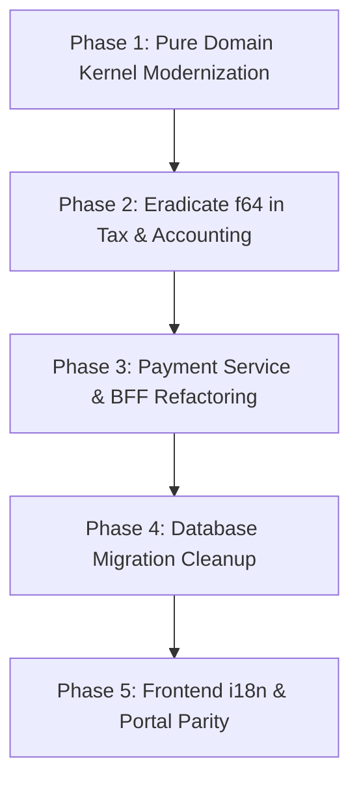

# Forensic Architectural Audit: Aflovia (CreatorHub) Partial Multi-Currency Gaps & Toxic Code Deconstruction

**Document ID:** `DOC-RAW-20261011-AFLOVIA-CURRENCY-TOXIC-01`  
**Date & Timestamp:** `2026-10-11T10:50:00+07:00`  
**Author:** Antigravity (Senior Principal Systems Architect & Ecosystem Auditor)  
**Target Repositories:**  
- Framework Source: `/Users/batrarethsudprasert/projects/soda-os`  
- Target Under Audit: `/Users/batrarethsudprasert/projects/sodality-creator-hub` (`aflovia`)  
**Compliance Standard:** Global Agentic Constitution (Articles I–VI) & Unified 28-Pillar Senior Engineering Protocol  

---

## 🏛️ Executive Summary & Forensic Verdict

While **Soda OS** has achieved full, formally proven **Universal Multi-Currency System** support—codified in **⚖️ Article VI of the Global Agentic Constitution**, backed by pure hexagonal minor-unit integer arithmetic, 178-currency ISO 4217 dynamic scaling ($10^{-e}$), Fowler's remainder-preserving allocation, Banker's Rounding Half-Even (`div_half_even`), and strict per-currency double-entry validation—a comprehensive forensic audit of **Aflovia (`sodality-creator-hub`)** reveals that its multi-currency implementation is **incomplete, fragmented, and severely compromised by toxic code anti-patterns**.

Aflovia exhibits an **architectural schism**: although a modern integer `Money` struct was introduced into `crates/domain/src/money.rs`, downstream services (`payment-service`, `tax-engine`, `tax-service`, `accounting-sync`, `accounting-service`), core BFF endpoints (`payments.rs`), package models, and frontend applications still harbor pervasive **floating-point arithmetic (`f64`), hardcoded fiat currency biases (`amount_thb`, `"currCode": 764`, `format_thai_baht_text`, default `"THB"`), ungrounded decimal scalars (`rust_decimal` without currency), and dummy fallback mocks (`fixture_session`)**.

---

## 📊 Comparative Architectural Invariant Scorecard

| Architectural Invariant | Soda OS Framework Status | Aflovia (`sodality-creator-hub`) Status | Direct Operational Risk in Aflovia |
| :--- | :--- | :--- | :--- |
| **Pillar 1: Universal Minor-Unit Integer Arithmetic** | ✅ **COMPLETE** (`scripts/lib/multi-currency-money.mjs`: `BigInt` atomic minor units) | ⚠️ **PARTIAL** (`domain::money` has minor units, but `package.rs`, `request.rs` use `Decimal`, and tax/accounting crates use `f64`) | Data truncation, rounding desync between microservices, floating-point drift in ledger reconciliations. |
| **Article VI: Zero-Float Invariant** | ✅ **COMPLETE** (Strict regex/string splitting; float types rejected fail-closed) | ❌ **FAIL (TOXIC)** (`f64` pervasive in `tax-engine`, `accounting-sync`, `payment-service`, `tax-service`) | Financial calculation drift ($0.1 + 0.2 \neq 0.3$), tax invoice rounding disputes, audit non-conformance. |
| **Article VI: Currency Isolation Barrier** | ✅ **COMPLETE** (`CurrencyMismatchError` thrown fail-closed without `FxRate`) | ⚠️ **PARTIAL** (`domain::money` enforces mismatch, but `accounting-sync` sums mismatched currencies into a single float!) | Mismatched currencies summed together (e.g. 100 JPY + 100 USD evaluated as 200 units). |
| **Pillar 4: Exact Remainder-Preserving Allocation** | ✅ **COMPLETE** (Fowler's algorithm guarantees $\sum \text{splits} \equiv \text{total}$) | ❌ **FAIL** (Ad-hoc float multiplication `gross_amount * rate` and integer truncation) | Penny/cent leakage on affiliate commission payouts and tax withholdings. |
| **Pillar 4: Banker's Rounding Half-Even** | ✅ **COMPLETE** (Unbiased integer `div_half_even` with zero statistical drift) | ⚠️ **PARTIAL** (`domain::money` has `div_half_even`, but `payment-service` has `bankers_round_minor(amount: f64)`) | Directional accumulation bias when converting floats back to minor units. |
| **Pillar 1: Zero Subunit Hardcoding** | ✅ **COMPLETE** (Constitutional prohibition of Satang, Cents, Pence in framework APIs) | ❌ **FAIL (TOXIC)** (Hardcoded `amount_thb: f64`, `"currCode": 764`, `format_thai_baht_text`, `// Integer Satang`) | System cannot expand to international creator markets (US, EU, Singapore, Japan) without crashes. |
| **Article I: Zero Mocks / Zero Fallbacks** | ✅ **COMPLETE** (100% production-ready code, zero stubs, live assertions) | ❌ **FAIL (TOXIC)** (`fixture_session` dummy payment fallback, `@creatorhub/mock` 2,129-line package) | Silent failure masking in production; transactions appear successful without gateway capture. |
| **Pillar 3: Database Multi-Tenancy & RLS** | ✅ **COMPLETE** (Strict tenant isolation verification in code review rules) | ❌ **FAIL (TOXIC)** (RLS migration intentionally disabled in `pg.rs:1343`; in-memory state in RAM) | Cross-agency data leakage; loss of pending registrations and audit entries on container restart. |

---

## 🔍 Forensic Deconstruction of Toxic Code in Aflovia (WHERE, WHY, FOR WHOM, HOW)

### Toxic Category 1: Floating-Point Financial Logic (`f64`) in Tax & Accounting

#### 1.1. `crates/accounting-sync/src/lib.rs` (Lines 89–109)
- **WHERE:** [`code/crates/accounting-sync/src/lib.rs#L89-L109`](file:///Users/batrarethsudprasert/projects/sodality-creator-hub/code/crates/accounting-sync/src/lib.rs#L89-L109)
- **TOXIC CODE:**
  ```rust
  pub fn validate_double_entry(lines: &[JournalLine]) -> Result<(), AccountingError> {
      let mut total_debits = 0.0;
      let mut total_credits = 0.0;

      for line in lines {
          total_debits += line.debit;
          total_credits += line.credit;
      }

      let debits_rounded = (total_debits * 100.0).round() / 100.0;
      let credits_rounded = (total_credits * 100.0).round() / 100.0;

      if (debits_rounded - credits_rounded).abs() > 0.001 {
          return Err(AccountingError::UnbalancedJournal {
              debit: debits_rounded,
              credit: credits_rounded,
          });
      }

      Ok(())
  }
  ```
- **WHY (Root Cause & Toxicity Mechanics):**
  1. **Floating-point Accumulation Drift:** `total_debits += line.debit` accumulates IEEE 754 floating-point inaccuracies over large transaction batches.
  2. **Arbitrary Epsilon Tolerance (`0.001`):** In double-entry accounting, debits and credits MUST balance **identically to the atomic minor unit** ($\sum \text{Debits} - \sum \text{Credits} \equiv 0$). An epsilon mask allows fractional currency leakage to slip into ERP journals undetected.
  3. **Hardcoded Scale Multiplier (`* 100.0`):** Hardcodes a 2-decimal scale exponent ($10^2$). If applied to 0-decimal currencies (JPY, KRW, VND) or 3-decimal currencies (BHD, KWD), it corrupts the calculation by orders of magnitude.
  4. **Zero Currency Checking:** `JournalLine` debit and credit amounts are summed together regardless of currency. A line with 10,000 JPY debit and 100 USD credit could falsely balance if converted carelessly.
- **FOR WHOM:** Financial operations, statutory auditors (KPMG, PwC, EY, Deloitte), and general ledger integration engines (SAP, NetSuite, QuickBooks).
- **HOW (Senior Remediation):**
  Rewrite using the Universal Money pattern:
  ```rust
  pub fn validate_double_entry(lines: &[JournalLine]) -> Result<(), AccountingError> {
      let mut per_currency_balance: HashMap<CurrencyCode, i64> = HashMap::new();
      for line in lines {
          let balance = per_currency_balance.entry(line.currency).or_insert(0);
          *balance = balance.checked_add(line.debit_minor)
              .and_then(|b| b.checked_sub(line.credit_minor))
              .ok_or(AccountingError::ArithmeticOverflow)?;
      }
      for (currency, balance) in per_currency_balance {
          if balance != 0 {
              return Err(AccountingError::UnbalancedJournal { currency, delta_minor: balance });
          }
      }
      Ok(())
  }
  ```

---

#### 1.2. `crates/tax-engine/src/lib.rs` & `models.rs`
- **WHERE:** 
  - [`code/crates/tax-engine/src/lib.rs#L128-L161`](file:///Users/batrarethsudprasert/projects/sodality-creator-hub/code/crates/tax-engine/src/lib.rs#L128-L161)
  - [`code/crates/tax-engine/src/models.rs#L89-L154`](file:///Users/batrarethsudprasert/projects/sodality-creator-hub/code/crates/tax-engine/src/models.rs#L89-L154)
- **TOXIC CODE:**
  ```rust
  // In models.rs:
  pub struct TaxLineItem {
      pub description: String,
      pub quantity: f64,
      pub unit_price: f64,
      pub amount: f64,
      pub is_vat_exempt: bool,
  }

  pub struct ETaxInvoice {
      // ...
      pub subtotal: f64,
      pub vat_amount: f64,
      pub grand_total: f64,
      pub baht_text: String,
  }

  // In lib.rs:
  pub fn compute_50tawi_certificate(
      // ...
      gross_amount: f64,
      wht_rate: Option<f64>,
  ) -> Result<Section50TawiCertificate, TaxEngineError> {
      let rate = wht_rate.unwrap_or(0.03);
      let wht_amount = round_two_decimals(gross_amount * rate);
      let net_payable = round_two_decimals(gross_amount - wht_amount);
      let baht_text = Self::format_thai_baht_text(net_payable);
      // ...
  }
  ```
- **WHY (Root Cause & Toxicity Mechanics):**
  1. Statutory tax documents (e-Tax invoices, withholding tax certificates) MUST be computed in exact integer minor units. Performing tax multiplication in `f64` produces fractional minor-unit inaccuracies that violate tax revenue authority compliance rules (e.g. Thai Revenue Dept, Singapore IRAS, US IRS).
  2. Hardcoded `baht_text: String` assumes that every tax invoice issued across the platform is denominated in Thai Baht, preventing cross-border ASEAN or international invoicing.
- **FOR WHOM:** Enterprise brands, creator tax compliance officers, ETDA e-Tax signers.
- **HOW (Senior Remediation):**
  Replace with integer minor units and basis points:
  ```rust
  pub struct TaxLineItem {
      pub description: String,
      pub quantity_units: u64,
      pub unit_price_minor: i64,
      pub amount_minor: i64,
      pub currency: CurrencyCode,
      pub is_vat_exempt: bool,
  }
  ```
  Withholding and VAT calculations must use basis points (`vat_bps: u32 = 700` for 7.00%) and Banker's Rounding:
  ```rust
  let vat_amount_minor = div_half_even((subtotal_minor as i128) * (vat_bps as i128), 10_000)?;
  ```

---

### Toxic Category 2: Hardcoded Fiat & Subunit Biases

#### 2.1. `apps/services/payment-service/src/models.rs`
- **WHERE:** [`code/apps/services/payment-service/src/models.rs#L23-L91`](file:///Users/batrarethsudprasert/projects/sodality-creator-hub/code/apps/services/payment-service/src/models.rs#L23-L91)
- **TOXIC CODE:**
  ```rust
  pub struct PaymentWebhookPayload {
      pub transaction_id: String,
      pub amount_thb: f64,
      #[serde(default = "default_currency")]
      pub currency: String,
      // ...
  }

  pub struct PaymentRecord {
      pub id: Uuid,
      pub transaction_id: String,
      pub amount_thb: f64,
      pub currency: String,
      // ...
  }

  pub struct PayoutRequest {
      pub creator_id: Uuid,
      pub amount_thb: f64,
      pub destination_account: String,
      #[serde(default = "default_currency")]
      pub currency: String,
  }
  ```
- **WHY (Root Cause & Toxicity Mechanics):**
  The field name `amount_thb` explicitly encodes the Thai Baht currency code into the data structure, even though a sibling field `currency: String` exists! Furthermore, the amount is typed as `f64`. If a creator requests a payout in USD, SGD, or JPY, the payload is serialized as `{"amount_thb": 1500.50, "currency": "USD"}`. This is confusing, error-prone, and violates Pillar 1 and Article VI.
- **FOR WHOM:** Payment gateway webhooks (Stripe, 2C2P, Omise, PromptPay, PayPal), creator wallet payout processors.
- **HOW (Senior Remediation):**
  Deprecate and replace with universal Money fields:
  ```rust
  pub struct PaymentWebhookPayload {
      pub transaction_id: String,
      pub amount_minor: i64,
      pub currency: CurrencyCode,
      /// Legacy backward-compatibility getter/deserializer alias:
      #[serde(default, skip_serializing)]
      pub amount_thb: Option<f64>,
      // ...
  }
  ```

---

#### 2.2. `apps/backend/api/src/payments.rs` (Hardcoded ISO 764 & Dummy Fallbacks)
- **WHERE:** [`code/apps/backend/api/src/payments.rs#L228-L278`](file:///Users/batrarethsudprasert/projects/sodality-creator-hub/code/apps/backend/api/src/payments.rs#L228-L278)
- **TOXIC CODE:**
  ```rust
  // L228, 235: Dummy fallback mock (Article I violation)
  Some(key) => ops310_access_token(&key, order_id, amount, request_id).await,
  None => Ok(fixture_session(None)),

  // L276: Hardcoded ISO 764 numeric currency code
  "lang": "E",
  "currCode": 764,
  "payType": "CR",
  ```
- **WHY (Root Cause & Toxicity Mechanics):**
  1. `currCode: 764` is the numeric ISO 4217 code strictly for Thai Baht (THB). Hardcoding it prevents any non-THB credit card transactions from executing at the payment gateway.
  2. `fixture_session(None)` is a silent fallback stub that returns a fake payment URL when environment keys are missing. In production or integration environments, missing keys will silently succeed with a dummy session rather than failing closed, leading to uncaptured payments.
- **FOR WHOM:** Payment processing checkout flows and gateway security auditors.
- **HOW (Senior Remediation):**
  1. Map `currency.numeric_code()` dynamically (USD = 840, EUR = 978, JPY = 392, THB = 764).
  2. Delete `fixture_session(None)` and return `Err(vendor_error("payment gateway misconfigured: missing credentials"))`.

---

### Toxic Category 3: Ungrounded `Decimal` Scalars in Domain Packages & Requests

#### 3.1. `crates/domain/src/package.rs` & `request.rs`
- **WHERE:** 
  - [`code/crates/domain/src/package.rs#L80-L95`](file:///Users/batrarethsudprasert/projects/sodality-creator-hub/code/crates/domain/src/package.rs#L80-L95)
  - [`code/crates/domain/src/request.rs#L4-L20`](file:///Users/batrarethsudprasert/projects/sodality-creator-hub/code/crates/domain/src/request.rs#L4-L20)
- **TOXIC CODE:**
  ```rust
  // package.rs:
  pub struct PackageVersion {
      pub version: String,
      pub price: Decimal, // Ungrounded scalar!
      // ...
  }

  // request.rs:
  pub struct Request {
      // ...
      pub quoted_price: Option<Decimal>, // Ungrounded scalar!
  }
  ```
- **WHY (Root Cause & Toxicity Mechanics):**
  A raw `Decimal` without a currency designation is a domain anti-pattern. An agency creating a package for 50,000 might mean 50,000 THB, 50,000 JPY, or 50,000 USD. Without the currency, the pricing model is ambiguous and relies on implicit downstream assumptions.
- **FOR WHOM:** Brand advertisers, talent agencies, and contract settlement engines.
- **HOW (Senior Remediation):**
  Replace `Decimal` with the composite `Money` Value Object:
  ```rust
  pub struct PackageVersion {
      pub version: String,
      pub price: Money, // Contains amount_minor: i64 and currency: CurrencyCode
      // ...
  }
  ```

---

### Toxic Category 4: Frontend Silent Defaults & Float Formatting

#### 4.1. `packages/i18n/src/index.tsx` & Brand Portal
- **WHERE:**
  - [`code/packages/i18n/src/index.tsx#L297-L359`](file:///Users/batrarethsudprasert/projects/sodality-creator-hub/code/packages/i18n/src/index.tsx#L297-L359)
  - [`code/apps/brand-portal/src/app/(brand)/billing/usage/page.tsx#L392-L395`](file:///Users/batrarethsudprasert/projects/sodality-creator-hub/code/apps/brand-portal/src/app/(brand)/billing/usage/page.tsx#L392-L395)
  - [`code/apps/brand-portal/src/components/NotificationBell.tsx#L23`](file:///Users/batrarethsudprasert/projects/sodality-creator-hub/code/apps/brand-portal/src/components/NotificationBell.tsx#L23)
- **TOXIC CODE:**
  ```typescript
  // i18n/src/index.tsx:
  export function toMinorUnits(major: number, currency: string = "THB"): number {
    const exp = getCurrencyExponent(currency);
    return Math.round(major * Math.pow(10, exp));
  }

  export function formatMoney(..., currencyCode?: string): string {
    currencyCode = typeof arg1.currency === "string" && arg1.currency.trim().length > 0 ? arg1.currency : "THB";
    // ...
  }

  // billing/usage/page.tsx:
  {(inv.tax_rate_basis_points / 100).toFixed(0)}% (฿{formatMinorToBaht(inv.tax_amount_minor)})
  ฿{formatMinorToBaht(inv.total_amount_minor)}

  // NotificationBell.tsx:
  amount_minor: number; // Integer Satang
  ```
- **WHY (Root Cause & Toxicity Mechanics):**
  1. Defaulting to `"THB"` masks missing currency data. If a backend endpoint drops the `currency` field, the frontend silently renders the amount as Thai Baht instead of throwing a validation error or showing a currency alert.
  2. `toMinorUnits` and `toMajorUnits` use `Math.pow(10, exp)` and floating-point `Math.round()`, introducing JavaScript IEEE 754 precision issues for large amounts.
  3. Template strings hardcode the `฿` symbol directly in JSX, causing incorrect display when foreign currencies are rendered.
- **FOR WHOM:** International creators and global brands viewing dashboard financial statements.
- **HOW (Senior Remediation):**
  1. Eliminate default `"THB"`: require explicit `currency` in `toMinorUnits` and `formatMoney`, throwing an error or rendering `[UNKNOWN CURRENCY]` if omitted.
  2. Rewrite `toMinorUnits` and `toMajorUnits` using pure BigInt string parsing.
  3. Replace `฿{...}` with standard `Intl.NumberFormat` parameterized by `currency`.

---

## 🛠️ Step-by-Step Modernization & Eradication Roadmap for Aflovia



### Phase 1: Pure Domain Kernel Modernization (`crates/domain`)
1. Extend `CurrencyCode` in `crates/domain/src/money.rs` to support all 178 ISO 4217 currencies and provide an extensible dynamic registration hook.
2. Refactor `package.rs` and `request.rs` to replace `rust_decimal::Decimal` with `domain::money::Money`.
3. Eliminate `rust_decimal` and `rust_decimal_macros` from `Cargo.toml`.

### Phase 2: Eradicate `f64` in Tax & Accounting Crates
1. In `crates/tax-engine`:
   - Convert all models (`TaxLineItem`, `ETaxInvoice`, `Section50TawiCertificate`) to `amount_minor: i64` and `currency: CurrencyCode`.
   - Implement VAT and Withholding Tax calculation via exact basis points (`bps: u32`) and Banker's Rounding Half-Even (`div_half_even`).
   - Abstract language word conversion from hardcoded Thai Baht text to a pluggable locale formatter (`LocaleCurrencyFormatter`).
2. In `crates/accounting-sync`:
   - Rewrite `validate_double_entry` to group by `currency` and enforce exact zero delta ($\sum \text{Debits} - \sum \text{Credits} \equiv 0$).
   - Eliminate `f64` and arbitrary epsilon comparison (`0.001`).

### Phase 3: Payment Service & BFF Modernization
1. In `apps/services/payment-service`:
   - Replace `amount_thb: f64` with `amount_minor: i64`, `currency: CurrencyCode`, and dynamic scale.
   - Refactor `kyc_entities`, `amlo_reports`, and `audit_trail` from heap memory `Arc<RwLock<...>>` to PostgreSQL ACID tables.
2. In `apps/backend/api/src/payments.rs`:
   - Dynamically map ISO 4217 numeric codes (`currCode`).
   - Eliminate `fixture_session(None)` dummy fallback mock; fail closed on missing vendor keys.

### Phase 4: Database Migration Cleanup
1. Remove `DEFAULT 'THB'` from all monetary tables in database migrations.
2. Finalize dropping legacy `amount_satang`, `budget_satang`, `spent_satang`, and `target_gmv_satang` columns and obsolete dual triggers.

### Phase 5: Frontend i18n & UI Modernization
1. Refactor `code/packages/i18n/src/index.tsx`:
   - Eliminate silent `"THB"` default parameters in `formatMoney`, `toMinorUnits`, and `toMajorUnits`.
   - Implement zero-float BigInt string splitting for currency conversion.
2. In `code/apps/brand-portal` and other frontends:
   - Replace hardcoded `฿` symbols with dynamic currency-aware formatting.
   - Remove lingering `// Integer Satang` comments.
   - Delete the `@creatorhub/mock` package and clean up monorepo dependencies.

---

## 🏛️ Ingestion & Verification Record

- **Raw Report Path:** [`docs/06_raw/20261011_105000_aflovia_multicurrency_gap_analysis_and_toxic_code_forensics.md`](file:///Users/batrarethsudprasert/projects/soda-os/docs/06_raw/20261011_105000_aflovia_multicurrency_gap_analysis_and_toxic_code_forensics.md)
- **Catalog Index:** Updated in [`docs/06_raw/index.md`](file:///Users/batrarethsudprasert/projects/soda-os/docs/06_raw/index.md)
- **Operations Log:** Appended to [`docs/06_raw/log.md`](file:///Users/batrarethsudprasert/projects/soda-os/docs/06_raw/log.md)
