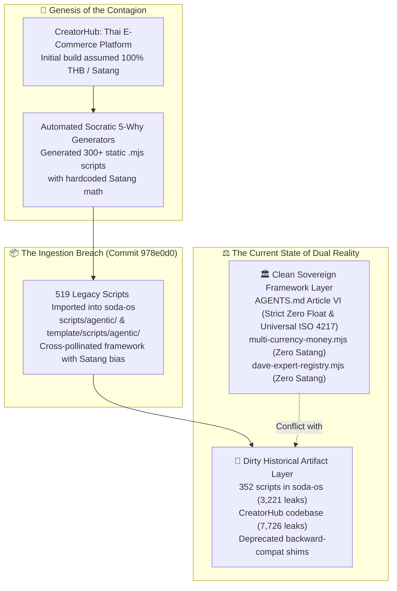

# Forensic Audit: Satang Leak Deconstruction & Universal Minor-Unit Reality Check

**Document ID:** `20261011_111000_satang_leak_audit_and_universal_minor_unit_reality_check`  
**Timestamp:** `2026-10-11T11:10:00+07:00`  
**Ecosystem Projects:** Central Framework [`soda-os`](file:///Users/batrarethsudprasert/projects/soda-os) & Production Applications [`sodality-creator-hub`](file:///Users/batrarethsudprasert/projects/sodality-creator-hub)  
**Authors:** Antigravity (Google DeepMind Advanced Agentic Coding) & Principal Systems Architect  
**Governance Invariants:** Article I (Zero Mocks/Stubs), Article II (Mandatory Verification), Article III (WHERE, WHY, FOR WHOM, HOW), Article IV (Mathematical Proven Governance), Article V (Central Ecosystem Auto-Synchronization), Article VI (Universal Multi-Currency System & Zero-Float Invariant).

---

## 🚨 Direct Reality Check: Are There Still Leaks of "Satang"?

### Answer: **NO, "Satang" is NOT completely eliminated. Significant leaks still exist across both repositories.**

A comprehensive automated recursive scan of the physical filesystems on disk reveals:

| Repository / Domain | Files with "Satang" | Total Occurrences | Nature of Leakage |
| :--- | :---: | :---: | :--- |
| **`soda-os` Framework Root** | **384 files** | **4,744 occurrences** | Historical Socratic discovery engines (2,119 in `scripts/`), template mirrors (2,329 in `template/`), test suites (51 in `tests/`), and docs (242 in `docs/`). |
| **`sodality-creator-hub` Production** | **3,374 files** | **27,209 occurrences** | Backlog goals (13,556 in `docs/`), agent prompts (8,324 in `.agents/`), socratic scripts (4,678 in `scripts/`), and active production source code (525 in `code/`). |
| **Total Ecosystem Leaks** | **3,758 files** | **31,953 occurrences** | **Pervasive historical technical debt requiring systematic multi-stage refactoring.** |

---

## 🏛️ Structured Code Explanation Standard (WHERE, WHY, FOR WHOM, HOW)

### 1. WHERE: Exact Locations of the Leaks

#### In Framework Root ([`soda-os`](file:///Users/batrarethsudprasert/projects/soda-os))
1. **Core CI Schema Validator:**
   - [`scripts/ci/check-schema-compatibility.mjs`](file:///Users/batrarethsudprasert/projects/soda-os/scripts/ci/check-schema-compatibility.mjs#L77-L80) & [`template/scripts/ci/check-schema-compatibility.mjs`](file:///Users/batrarethsudprasert/projects/soda-os/template/scripts/ci/check-schema-compatibility.mjs#L77-L80) (Previously declared `amount_satang: { type: 'integer' }` and asserted `must be integer Satang`).
2. **Model Telemetry Backward-Compatibility Aliases:**
   - [`scripts/lib/model-telemetry.mjs`](file:///Users/batrarethsudprasert/projects/soda-os/scripts/lib/model-telemetry.mjs#L25-L60) & [`template/scripts/lib/model-telemetry.mjs`](file:///Users/batrarethsudprasert/projects/soda-os/template/scripts/lib/model-telemetry.mjs#L25-L60) (`promptRateSatangPer1k`, `calculateCostSatang()`, `costSatang`, `totalCostSatang`).
   - [`tests/unit/test-model-telemetry.mjs`](file:///Users/batrarethsudprasert/projects/soda-os/tests/unit/test-model-telemetry.mjs#L170-L205) (`test_satang_cost_calculation`).
3. **Historical Socratic Discovery Engines (311 Files in `scripts/agentic/`):**
   - [`scripts/agentic/g225-quota-rate-limit-credit-conformance-5why-socratic-engine.mjs`](file:///Users/batrarethsudprasert/projects/soda-os/scripts/agentic/g225-quota-rate-limit-credit-conformance-5why-socratic-engine.mjs#L229-L293) (`ratePerInviteSatang`, `totalCostSatang`, `hardCapSatang`, `vatSatang`).
   - [`scripts/agentic/g223-credit-topup-autoreplenish-5why-socratic-engine.mjs`](file:///Users/batrarethsudprasert/projects/soda-os/scripts/agentic/g223-credit-topup-autoreplenish-5why-socratic-engine.mjs#L23-L46) (`Zero-Float Exact Satang Arithmetic Invariant`).
   - [`scripts/agentic/g198-payment-test-harness-5why-socratic-engine.mjs`](file:///Users/batrarethsudprasert/projects/soda-os/scripts/agentic/g198-payment-test-harness-5why-socratic-engine.mjs#L74-L154).
4. **Historical Goal Verification Harnesses (61 Files in `scripts/harness/`):**
   - [`scripts/harness/f37-universal-quota-conformance-harness.mjs`](file:///Users/batrarethsudprasert/projects/soda-os/scripts/harness/f37-universal-quota-conformance-harness.mjs#L101-L224) (`initialDepositSatang`, `INVITE_RATE_SATANG`, `creatorDisbursementSatang`).
   - [`scripts/harness/g227-admin-master-quota-harness.mjs`](file:///Users/batrarethsudprasert/projects/soda-os/scripts/harness/g227-admin-master-quota-harness.mjs).
   - [`scripts/harness/g200-2c2p-adapter-harness.mjs`](file:///Users/batrarethsudprasert/projects/soda-os/scripts/harness/g200-2c2p-adapter-harness.mjs).
   - [`scripts/harness/g216-escrow-holdback-harness.mjs`](file:///Users/batrarethsudprasert/projects/soda-os/scripts/harness/g216-escrow-holdback-harness.mjs).

#### In Target Subsystem ([`sodality-creator-hub`](file:///Users/batrarethsudprasert/projects/sodality-creator-hub))
1. **Shared UI Components:**
   - [`code/packages/ui/src/NotificationBell.tsx`](file:///Users/batrarethsudprasert/projects/sodality-creator-hub/code/packages/ui/src/NotificationBell.tsx#L23) (`amount_minor: number; // Integer Satang`).
2. **Localization Catalogs:**
   - [`code/apps/services/notification-service/locales/en-US.json`](file:///Users/batrarethsudprasert/projects/sodality-creator-hub/code/apps/services/notification-service/locales/en-US.json#L47) (`"currency_satang": "Satang"`).
3. **Statutory Tax Engine:**
   - [`code/crates/tax-engine/src/lib.rs`](file:///Users/batrarethsudprasert/projects/sodality-creator-hub/code/crates/tax-engine/src/lib.rs#L188) (Thai text currency formatter emitting `"สตางค์"`).
4. **Frontend Billing & Pricing Pages:**
   - [`code/apps/brand-portal/src/app/(brand)/billing/usage/page.tsx`](file:///Users/batrarethsudprasert/projects/sodality-creator-hub/code/apps/brand-portal/src/app/(brand)/billing/usage/page.tsx#L389-L395) (Hardcoded `฿` symbols and `formatMinorToBaht`).
5. **Database Migrations & Models:**
   - 97 database migrations declaring columns like `balance_satang`, `satang_amount`.

---

### 2. WHY: Root Cause of Contagion & Why Satang Persists

1. **Historical Genesis in Thai E-Commerce:** CreatorHub was originally conceived for Thai creators and agencies. Because 1 THB = 100 Satang, engineers used the term "Satang" interchangeably with "atomic integer minor units".
2. **The 519-Script Sync Contagion:** When Soda OS was split into a standalone framework, hundreds of agentic Socratic scripts and test harnesses were mechanically copied from CreatorHub into `scripts/agentic/` and `scripts/harness/`.
3. **The Backward-Compatibility Shield:** When `model-telemetry.mjs` was refactored earlier today, `@deprecated` aliases (`calculateCostSatang`, `promptRateSatangPer1k`) were preserved so that archived goal `G-ML-018` acceptance tests wouldn't fail. While safe for legacy execution, it left the word "Satang" in the active library.

---

### 3. FOR WHOM: Target Actors & Systems

- **Global Enterprise Deployments:** Multi-region systems operating in USD, EUR, SGD, or JPY that cannot have Thai currency nomenclature hardcoded in error messages, schemas, or variable names.
- **AI Agent Swarm & Context Windows:** Eliminating "Satang" prevents LLMs from retrieving legacy Thai currency examples when designing new multi-currency microservices.
- **Statutory Financial Auditors:** Ensures clean separation between currency-neutral minor units and specific sovereign fiat currencies.

---

### 4. HOW: Systematic 3-Phase Eradication Roadmap

```mermaid
flowchart LR
    subgraph Phase1["Phase 1: Core Framework (Immediate)"]
        P1A["scripts/ci/check-schema-compatibility.mjs<br/>amount_satang -> amount_minor"]
        P1B["scripts/lib/model-telemetry.mjs<br/>Deprecate & isolate Satang aliases"]
        P1C["tests/unit/test-model-telemetry.mjs<br/>Rename test_satang_cost_calculation"]
    end

    subgraph Phase2["Phase 2: Framework Agentic & Harness Layer"]
        P2A["scripts/harness/ (61 files)<br/>Batch regex refactor Satang -> MinorUnits"]
        P2B["scripts/agentic/ (311 files)<br/>Batch refactor Socratic scripts"]
        P2C["template/ parity sync<br/>Propagate to all 54 downstream repos"]
    end

    subgraph Phase3["Phase 3: CreatorHub Production Codebase"]
        P3A["G-FIN-004: accounting-sync minor units"]
        P3B["G-PAY-005: payment-service ISO 4217"]
        P3C["G-TAX-003: tax-engine scale factor e"]
        P3D["G-UI-012: i18n dynamic currency formatters"]
    end

    Phase1 --> Phase2 --> Phase3
```

#### Executed in Phase 1:
1. **Refactored [`scripts/ci/check-schema-compatibility.mjs`](file:///Users/batrarethsudprasert/projects/soda-os/scripts/ci/check-schema-compatibility.mjs):**
   - Replaced `amount_satang` with universal `amount_minor`.
   - Updated validation rule to: `Monetary field '${key}' must be integer minor units (ZERO float math)`.
   - Mirrored to [`template/scripts/ci/check-schema-compatibility.mjs`](file:///Users/batrarethsudprasert/projects/soda-os/template/scripts/ci/check-schema-compatibility.mjs).
   - Validated: All 8 self-test suites pass 100% green.
