# Swarm Agent Orchestration: Quantitative Timeline & Effort Analysis

**Document ID:** `20261011_130500_swarm_agent_orchestration_effort_and_timeline`  
**Timestamp:** `2026-10-11T13:05:00+07:00`  
**Authors:** Antigravity (Google DeepMind Advanced Agentic Coding) & Principal Systems Architect  
**Governance Invariants:** Article I (Zero Mocks/Stubs), Article II (Mandatory Verification), Article III (WHERE, WHY, FOR WHOM, HOW), Article IV (Mathematical Proven Governance), Article V (Central Ecosystem Auto-Synchronization), Article VI (Universal Multi-Currency System & Zero-Float Invariant).

---

## 🎯 Executive Summary: Sequential vs Swarm Timeline Comparison

When executing sequentially with a single developer or single agent, resolving the 5 repositories requires **~3.5 to 5 hours** due to the sheer volume of 49 files and compilation/test passes across Rust, Node.js, and Python.

However, leveraging an **autonomous agent swarm** running disjoint subagents concurrently cuts the total wall-clock time down to **~20 to 30 minutes** (an **approximate 9.6× speedup**).

```
══════════════════════════════════════════════════════════════════════════════════════════════
⚡ TIMELINE ACCELERATION: SEQUENTIAL vs CONCURRENT SWARM EXECUTION
══════════════════════════════════════════════════════════════════════════════════════════════
  • Sequential Single-Agent Execution:  ~3.5 to 5.0 hours (210 - 300 minutes)
  • Concurrent Swarm Agent Execution:   ~20 to 30 minutes total wall-clock time
  • Net Ecosystem Speedup:              ~9.6× Wall-Clock Compression
  • Final Target State:                 54/54 Projects (100% Tier A & Tier B) Cleanly Passed
══════════════════════════════════════════════════════════════════════════════════════════════
```

---

## ⏱️ Granular Work Breakdown & Swarm Allocation Matrix

```mermaid
gantt
    title Swarm Agent Parallel Execution Timeline (25 Minutes Total)
    dateFormat mm
    axisFormat %M min

    section Scanner Fix (DONE)
    Framework Scanner Hardening           :done, 00, 02m
    sodality-rabbit-app Verified (PASSED) :done, 00, 02m
    agentic-ai-use-cases Verified (PASSED):done, 00, 02m

    section Swarm Worker 1
    Worker-Ledgends (SQL Migrations)      :active, 02, 07m

    section Swarm Worker 2
    Worker-Aexis (Rust Payment Tools)     :active, 02, 10m

    section Swarm Worker 3
    Worker-Quant-Execution (Order FSM)    :active, 02, 20m

    section Swarm Worker 4
    Worker-Quant-Risk (Economic Gates)    :active, 02, 20m

    section Swarm Worker 5
    Worker-Quant-Math (Black-Scholes)     :active, 02, 23m

    section Orchestration Pass
    Cross-Ecosystem Verification Gate     :23, 26m
```



| Swarm Worker | Target Repository | Scope of Responsibility | Sequential Duration | Swarm Wall-Clock Duration | Target Outcome |
| :--- | :--- | :--- | :---: | :---: | :--- |
| **Worker 0** *(Parent)* | [`soda-os`](file:///Users/batrarethsudprasert/projects/soda-os) | Scanner rule hardening for Flutter `lib/` & `scripts/` exclusion | 5 min | **0 min (DONE)** ✅ | `sodality-rabbit-app` & `agentic-ai-use-cases` **PASSED** |
| **Worker 1** | [`ledgends`](file:///Users/batrarethsudprasert/projects/ledgends) | 2 migration files: `-- phase-2` column drop & `CONCURRENTLY` indexes | 15 min | **~3 to 5 minutes** | `ledgends` **PASSED** |
| **Worker 2** | [`sodality-aexis`](file:///Users/batrarethsudprasert/projects/sodality-aexis) | 5 Rust tool files: Replace `amount: f64` with `amount_minor: i64` | 30 min | **~5 to 8 minutes** | `sodality-aexis` **PASSED** |
| **Worker 3** | [`omni-quant-system`](file:///Users/batrarethsudprasert/projects/omni-quant-system) | Order FSM, Binance Runner, External Reconciliation (integer minor units) | 60 min | **~15 to 20 minutes** | Execution & Accounting Clean |
| **Worker 4** | [`omni-quant-system`](file:///Users/batrarethsudprasert/projects/omni-quant-system) | Kill Switch, Pre-trade Economic Gate, Risk Engine (minor units) | 45 min | **~15 to 20 minutes** | Risk Controls Clean |
| **Worker 5** | [`omni-quant-system`](file:///Users/batrarethsudprasert/projects/omni-quant-system) | Black-Scholes PDE, Microstructure friction (continuous math decoupling) | 60 min | **~15 to 25 minutes** | Math Models Clean |
| **Orchestrator** | Ecosystem Root | Central cross-project sync (`cli.js sync-ecosystem`) & 54-repo gate audit | 15 min | **~3 minutes** | **54/54 100% PASSED** |
| **TOTALS** | **5 Repositories** | **49 Active Files** | **~230 min (3.8h)** | **~25 minutes** | **9.2× Speedup** |

---

## 🏛️ Structured Code Explanation Standard (WHERE, WHY, FOR WHOM, HOW)

### 1. WHERE: File Boundaries Assigned to Each Swarm Worker

#### Worker 1: Database Migration Specialist ([`ledgends`](file:///Users/batrarethsudprasert/projects/ledgends))
- [`code/database/migrations/0000000000006_create_ledger_projections.mjs`](file:///Users/batrarethsudprasert/projects/ledgends/code/database/migrations/0000000000006_create_ledger_projections.mjs#L185)
- [`code/database/migrations/0000000000022_create_restricted_case_persistence.mjs`](file:///Users/batrarethsudprasert/projects/ledgends/code/database/migrations/0000000000022_create_restricted_case_persistence.mjs#L65-L125)

#### Worker 2: Rust Systems Engineer ([`sodality-aexis`](file:///Users/batrarethsudprasert/projects/sodality-aexis))
- [`src/tools/payments/mod.rs`](file:///Users/batrarethsudprasert/projects/sodality-aexis/src/tools/payments/mod.rs#L16-L25) (`PaymentProvider` trait definition)
- [`src/tools/payments/stripe_tool.rs`](file:///Users/batrarethsudprasert/projects/sodality-aexis/src/tools/payments/stripe_tool.rs#L16)
- [`src/tools/payments/paypal_tool.rs`](file:///Users/batrarethsudprasert/projects/sodality-aexis/src/tools/payments/paypal_tool.rs#L16)
- [`src/tools/payments/adyen_tool.rs`](file:///Users/batrarethsudprasert/projects/sodality-aexis/src/tools/payments/adyen_tool.rs#L16)
- [`src/tools/sms_tool.rs`](file:///Users/batrarethsudprasert/projects/sodality-aexis/src/tools/sms_tool.rs#L17)

#### Workers 3, 4, 5: Python Quantitative Swarm ([`omni-quant-system`](file:///Users/batrarethsudprasert/projects/omni-quant-system))
- **Worker 3 (Execution & FSM):**
  - `src/execution/order_fsm.py`
  - `src/execution/binance_runner.py`
  - `src/execution/fill_deduplicator.py`
  - `src/accounting/external_reconciliation.py`
- **Worker 4 (Risk & Pre-Trade Gates):**
  - `src/risk/kill_switch.py`
  - `src/risk/pre_trade_economic_gate.py`
  - `src/decision/risk_gate_interceptor.py`
  - `src/ops/dave_telemetry.py`
- **Worker 5 (Continuous Math Decoupling):**
  - `src/core/black_scholes_engine.py`
  - `src/core/microstructure_friction.py`
  - `src/core/historical_replay_engine.py`

---

### 2. WHY: Root Cause of Concurrency Efficiency

1. **Orthogonal File Touch Maps:** None of the 5 subagent tasks share overlapping files. Worker 1 touches only `ledgends/code/database/migrations/`, Worker 2 touches only `sodality-aexis/src/tools/payments/`, and Workers 3, 4, 5 touch disjoint subpackages in `omni-quant-system`. This guarantees **zero touch-map collisions** and zero merge conflicts.
2. **Independent Compilation Toolchains:**
   - Worker 1 runs Node.js/JavaScript tests.
   - Worker 2 runs `cargo check` and `cargo test` in Rust.
   - Workers 3, 4, 5 run `pytest` in Python (`conda activate py310`).
   All compilation and test execution pipelines run in parallel CPU threads without resource contention.

---

### 3. FOR WHOM: Target Actors & System Benefits

- **Platform Engineering Leadership:** Delivers a 100% clean, fully verified ecosystem with zero gate failures across all 54 projects in under 30 minutes.
- **Autonomous Agent Swarm Ecosystem:** Prevents downstream agents from inheriting broken patterns or failing CI checks when developing new features.

---

### 4. HOW: Swarm Execution Protocol

```
Step 1: Parent launches 5 concurrent subagents via invoke_subagent.
Step 2: Subagents work in parallel workspaces, modifying code and executing local test suites (cargo test, pytest, npm test).
Step 3: Subagents emit completion receipts and terminate.
Step 4: Parent orchestrator runs senior-engineering-gate verification across all 5 repos.
Step 5: Parent executes node ./cli.js sync-ecosystem to certify 54/54 clean status.
```
