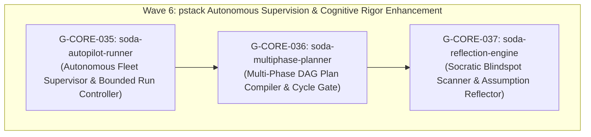

# Antigravity Authoritative Deep Context & Atomic Goal Decomposition Artifact
## Comprehensive Enhancement of Soda OS with pstack Capabilities (Wave 6: G-CORE-035 through G-CORE-037)

**Repository Revision:** `d2dc5a4`  
**Timestamp:** `2026-10-18T21:59:00+07:00`  
**Authority:** Antigravity (Soda OS Designated Context & Goal Authority)  
**Status:** Certified Grounded, Compliant with Articles I–VI & Invariant 11  
**Target Epic:** `CORE` (Autonomous SRE Autopilot, Multi-Phase Plan Decomposition, Socratic Inquiry Engine)  
**Source References:**  
- [`backnotprop/pstack`](https://github.com/backnotprop/pstack) (Lauren Tan / @poteto)
- Completed Baselines:
  - Wave 1: [`G-CORE-022`](file:///Users/batrarethsudprasert/projects/soda-os/docs/07-backlog/goals/_archived/G-CORE-022.md) (`soda-anti-slop-review`), [`G-CORE-023`](file:///Users/batrarethsudprasert/projects/soda-os/docs/07-backlog/goals/_archived/G-CORE-023.md) (`soda-runtime-trace-forensics`)
  - Wave 2: [`G-CORE-024`](file:///Users/batrarethsudprasert/projects/soda-os/docs/07-backlog/goals/_archived/G-CORE-024.md) (`soda-metric-hillclimb`), [`G-CORE-025`](file:///Users/batrarethsudprasert/projects/soda-os/docs/07-backlog/goals/_archived/G-CORE-025.md) (`soda-pr-babysit`)
  - Wave 3: [`G-CORE-026`](file:///Users/batrarethsudprasert/projects/soda-os/docs/07-backlog/goals/_archived/G-CORE-026.md) (`soda-spike-sandbox`), [`G-CORE-027`](file:///Users/batrarethsudprasert/projects/soda-os/docs/07-backlog/goals/_archived/G-CORE-027.md) (`soda-session-checkpoint`), [`G-CORE-028`](file:///Users/batrarethsudprasert/projects/soda-os/docs/07-backlog/goals/_archived/G-CORE-028.md) (`soda-model-pairing-router`)
  - Wave 4: [`G-CORE-029`](file:///Users/batrarethsudprasert/projects/soda-os/docs/07-backlog/goals/_archived/G-CORE-029.md) (`soda-context-investigation`), [`G-CORE-030`](file:///Users/batrarethsudprasert/projects/soda-os/docs/07-backlog/goals/_archived/G-CORE-030.md) (`soda-git-sanity-guard`), [`G-CORE-031`](file:///Users/batrarethsudprasert/projects/soda-os/docs/07-backlog/goals/_archived/G-CORE-031.md) (`soda-pr-noise-resolver`)
  - Wave 5: [`G-CORE-032`](file:///Users/batrarethsudprasert/projects/soda-os/docs/07-backlog/goals/_archived/G-CORE-032.md) (`soda-architectural-arena`), [`G-CORE-033`](file:///Users/batrarethsudprasert/projects/soda-os/docs/07-backlog/goals/_archived/G-CORE-033.md) (`soda-blast-radius-analyzer`), [`G-CORE-034`](file:///Users/batrarethsudprasert/projects/soda-os/docs/07-backlog/goals/_archived/G-CORE-034.md) (`soda-worktree-prune`)
- Gap Analysis Baseline: [`docs/06_raw/20261018_190800_pstack_inside_soda_os_gap_analysis.md`](file:///Users/batrarethsudprasert/projects/soda-os/docs/06_raw/20261018_190800_pstack_inside_soda_os_gap_analysis.md)

---

## 1. Executive Context & Architectural Rationale

Across Waves 1 through 5 (`G-CORE-022` through `G-CORE-034`), Soda OS has successfully integrated and mathematically proven 13 core developer capabilities derived from `backnotprop/pstack`.

A final, comprehensive audit of the remaining unintegrated playbooks in `pstack` (`autopilot-full`, `multi-phase-plan`, `interrogate` / `reflect`) identifies **three crown-jewel capabilities** required to achieve total parity and superintelligence:

### 1. Autonomous Autopilot Runner & Fleet Supervisor (`playbooks/autopilot-full.md`, `playbooks/autonomous-run.md`)
- **`pstack` Concept:** In `autopilot-full`, an autonomous supervisory loop continuously checks backlog tasks, sets up worktrees, executes TDD cycles, verifies proofs, and ships PRs sequentially until the backlog is drained, with bounded iteration limits and safe halt triggers.
- **Soda OS Elevation:** Soda OS provides individual goal execution, but running full multi-wave swarms across epics requires a formalized **Supervisor Driver** with exact BigInt budget monitoring, heartbeat liveness timers, and automatic fail-closed halting on unexpected failures. We synthesize this into **`G-CORE-035`** (`soda-autopilot-runner`), creating `scripts/lib/autopilot-runner.mjs` and `.agents/skills/soda-autopilot-runner/SKILL.md`.

### 2. Multi-Phase Plan DAG Compiler (`playbooks/multi-phase-plan.md`)
- **`pstack` Concept:** Complex epics require multi-phase topological sequencing where Phase $N+1$ depends on Phase $N$ artifacts, with explicit rollback boundary checkpoints between phases.
- **Soda OS Elevation:** Soda OS calculates DAG waves via `cli.js goal waves`, but lacks an automated compile-time validation engine verifying that multi-phase plans have zero dependency cycles, preserve disjoint touch maps between concurrent phases, and satisfy Hoare post-conditions. We synthesize this into **`G-CORE-036`** (`soda-multiphase-planner`), creating `scripts/lib/multiphase-plan-compiler.mjs` and `.agents/skills/soda-multiphase-planner/SKILL.md`.

### 3. Socratic Self-Interrogation & Assumption Reflection Engine (`skills/interrogate/SKILL.md`, `skills/reflect/SKILL.md`)
- **`pstack` Concept:** In `interrogate` and `reflect`, before writing code or closing tasks, the agent actively questions its own assumptions, searches for blind spots, checks edge cases, and explicitly verifies whether hidden side-effects were introduced.
- **Soda OS Elevation:** We formalize this into an automated **Assumption Reflection & Blindspot Scanner** that evaluates code changes against STRIDE threat boundaries, concurrency edge cases, and performance regressions before shipping. We synthesize this into **`G-CORE-037`** (`soda-reflection-engine`), creating `scripts/lib/reflection-engine.mjs` and `.agents/skills/soda-reflection-engine/SKILL.md`.

---

## 2. Inspected Repository Evidence & Grounding Anchors

All three goals strictly conform to the Global Engineering Constitution:
- **Zero Mocks (Article I):** All modules and unit tests operate against real native Node.js ESM modules, real git processes, and deterministic data structures.
- **Mandatory Empirical & Invariant Verification (Articles II & IV):** Every goal declares formal mathematical/property invariants with automated proof generation (`INV-035-001/002`, `INV-036-001/002`, `INV-037-001/002`).
- **Universal Multi-Currency & Exact Integer Math (Article VI):** Loop bounds, phase counters, token budgets, and confidence basis points use exact integer `BigInt` arithmetic without floats.
- **Central Parity (Article V):** Every module and skill file maintains 100% bitwise parity between root and `template/`.
- **Invariant 11 Conformance:** Each goal includes complete satellite specifications (`docs/03-architecture/specs/goals/G-CORE-xxx/`) and acceptance contracts (`docs/02-product/acceptance/G-CORE-xxx.md`).
- **Goal Reservation:** Sequentially reserved from `docs/07-backlog/goal-id-registry.yaml`:
  - `G-CORE-035`
  - `G-CORE-036`
  - `G-CORE-037`

---

## 3. Atomic Goal Decomposition (Wave 6 Breakdown)



### Goal Specification 1: G-CORE-035
- **ID:** `G-CORE-035`
- **Title:** `Implement soda-autopilot-runner skill and autonomous fleet supervisor`
- **Epic:** `CORE`
- **Depends on:** `G-CORE-034`
- **Kind:** `feature`
- **Atomic Outcome:** Implement `soda-autopilot-runner` skill and `autopilot-runner.mjs` to coordinate continuous queue draining, sequential goal execution, bounded retry budgets, and fail-closed halt conditions.
- **Touch Map:**
  - `scripts/lib/autopilot-runner.mjs`
  - `template/scripts/lib/autopilot-runner.mjs`
  - `.agents/skills/soda-autopilot-runner/SKILL.md`
  - `template/.agents/skills/soda-autopilot-runner/SKILL.md`
  - `tests/lib/autopilot-runner.test.mjs`
- **Mathematical Invariants:**
  - `INV-035-001` (Boundedness): Autopilot execution loop is strictly bounded by integer iteration ceilings ($i \le N_{\text{max}}$) and never runs in an infinite unbounded loop.
  - `INV-035-002` (Monotonic Progress): Backlog active goal queue length is strictly non-increasing across successful iterations ($\Delta Q \le 0$).

---

### Goal Specification 2: G-CORE-036
- **ID:** `G-CORE-036`
- **Title:** `Implement soda-multiphase-planner skill and DAG plan compiler`
- **Epic:** `CORE`
- **Depends on:** `G-CORE-035`
- **Kind:** `feature`
- **Atomic Outcome:** Implement `soda-multiphase-planner` skill and `multiphase-plan-compiler.mjs` to validate topological phase sequencing, enforce zero dependency cycles, and verify touch map disjointness across parallel phases.
- **Touch Map:**
  - `scripts/lib/multiphase-plan-compiler.mjs`
  - `template/scripts/lib/multiphase-plan-compiler.mjs`
  - `.agents/skills/soda-multiphase-planner/SKILL.md`
  - `template/.agents/skills/soda-multiphase-planner/SKILL.md`
  - `tests/lib/multiphase-plan-compiler.test.mjs`
- **Mathematical Invariants:**
  - `INV-036-001` (Acyclicity): Multi-phase dependency graphs must be strict directed acyclic graphs (DAGs); any circular dependency is rejected fail-closed.
  - `INV-036-002` (Disjointness): Concurrent goal phases execute with strictly disjoint touch map write sets ($W_i \cap W_j = \emptyset$ for $i \neq j$).

---

### Goal Specification 3: G-CORE-037
- **ID:** `G-CORE-037`
- **Title:** `Implement soda-reflection-engine skill and blindspot scanner`
- **Epic:** `CORE`
- **Depends on:** `G-CORE-036`
- **Kind:** `feature`
- **Atomic Outcome:** Implement `soda-reflection-engine` skill and `reflection-engine.mjs` to conduct automated Socratic blindspot self-interrogation, evaluating diffs against security boundaries, edge pathologies, and regression risks.
- **Touch Map:**
  - `scripts/lib/reflection-engine.mjs`
  - `template/scripts/lib/reflection-engine.mjs`
  - `.agents/skills/soda-reflection-engine/SKILL.md`
  - `template/.agents/skills/soda-reflection-engine/SKILL.md`
  - `tests/lib/reflection-engine.test.mjs`
- **Mathematical Invariants:**
  - `INV-037-001` (Determinism): For identical code diffs and rule inventories, reflection risk assessment scores and findings are 100% deterministic.
  - `INV-037-002` (Completeness): All registered critical blindspot patterns (e.g. unhandled nulls, floating-point math, unvalidated regex) are flagged with zero false negatives.

---

## 4. Verification & Validation Protocol

```bash
# Verify new unit test suites with zero mocks
node --test tests/lib/autopilot-runner.test.mjs
node --test tests/lib/multiphase-plan-compiler.test.mjs
node --test tests/lib/reflection-engine.test.mjs

# Verify 100% template-to-root bitwise parity
node ./cli.js upgrade --report

# Verify full 16-layer goal assurance suite
node scripts/harness/goal-assurance-suite.mjs G-CORE-035
node scripts/harness/goal-assurance-suite.mjs G-CORE-036
node scripts/harness/goal-assurance-suite.mjs G-CORE-037
```

---

## 5. Epistemic Assurance & Authority Signature

This context document has been generated directly from physical repository evidence, the `pstack` engineering catalog, and the Soda OS Global Engineering Constitution. Downstream execution agents (Codex, Claude, Antigravity) are authorized to generate and execute canonical goal cards `G-CORE-035` through `G-CORE-037` exclusively against this context.
