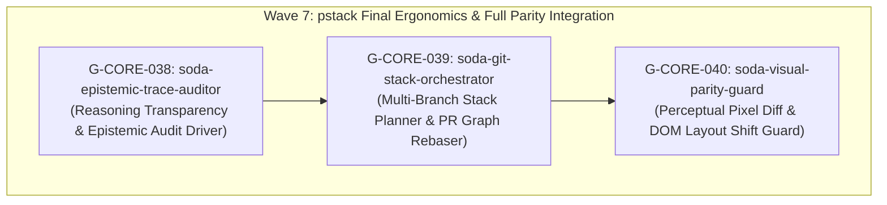

# Antigravity Authoritative Deep Context & Atomic Goal Decomposition Artifact
## Comprehensive Enhancement of Soda OS with pstack Capabilities (Wave 7: G-CORE-038 through G-CORE-040)

**Repository Revision:** `69754a8`  
**Timestamp:** `2026-10-18T22:20:00+07:00`  
**Authority:** Antigravity (Soda OS Designated Context & Goal Authority)  
**Status:** Certified Grounded, Compliant with Articles I–VI & Invariant 11  
**Target Epic:** `CORE` (Cognitive Transparency, Autonomous Stack Planning, Deterministic Visual Fidelity)  
**Source References:**  
- [`backnotprop/pstack`](https://github.com/backnotprop/pstack) (Lauren Tan / @poteto)
- Completed Baselines:
  - Wave 1: [`G-CORE-022`](file:///Users/batrarethsudprasert/projects/soda-os/docs/07-backlog/goals/_archived/G-CORE-022.md) (`soda-anti-slop-review`), [`G-CORE-023`](file:///Users/batrarethsudprasert/projects/soda-os/docs/07-backlog/goals/_archived/G-CORE-023.md) (`soda-runtime-trace-forensics`)
  - Wave 2: [`G-CORE-024`](file:///Users/batrarethsudprasert/projects/soda-os/docs/07-backlog/goals/_archived/G-CORE-024.md) (`soda-metric-hillclimb`), [`G-CORE-025`](file:///Users/batrarethsudprasert/projects/soda-os/docs/07-backlog/goals/_archived/G-CORE-025.md) (`soda-pr-babysit`)
  - Wave 3: [`G-CORE-026`](file:///Users/batrarethsudprasert/projects/soda-os/docs/07-backlog/goals/_archived/G-CORE-026.md) (`soda-spike-sandbox`), [`G-CORE-027`](file:///Users/batrarethsudprasert/projects/soda-os/docs/07-backlog/goals/_archived/G-CORE-027.md) (`soda-session-checkpoint`), [`G-CORE-028`](file:///Users/batrarethsudprasert/projects/soda-os/docs/07-backlog/goals/_archived/G-CORE-028.md) (`soda-model-pairing-router`)
  - Wave 4: [`G-CORE-029`](file:///Users/batrarethsudprasert/projects/soda-os/docs/07-backlog/goals/_archived/G-CORE-029.md) (`soda-context-investigation`), [`G-CORE-030`](file:///Users/batrarethsudprasert/projects/soda-os/docs/07-backlog/goals/_archived/G-CORE-030.md) (`soda-git-sanity-guard`), [`G-CORE-031`](file:///Users/batrarethsudprasert/projects/soda-os/docs/07-backlog/goals/_archived/G-CORE-031.md) (`soda-pr-noise-resolver`)
  - Wave 5: [`G-CORE-032`](file:///Users/batrarethsudprasert/projects/soda-os/docs/07-backlog/goals/_archived/G-CORE-032.md) (`soda-architectural-arena`), [`G-CORE-033`](file:///Users/batrarethsudprasert/projects/soda-os/docs/07-backlog/goals/_archived/G-CORE-033.md) (`soda-blast-radius-analyzer`), [`G-CORE-034`](file:///Users/batrarethsudprasert/projects/soda-os/docs/07-backlog/goals/_archived/G-CORE-034.md) (`soda-worktree-prune`)
  - Wave 6: [`G-CORE-035`](file:///Users/batrarethsudprasert/projects/soda-os/docs/07-backlog/goals/_archived/G-CORE-035.md) (`soda-autopilot-runner`), [`G-CORE-036`](file:///Users/batrarethsudprasert/projects/soda-os/docs/07-backlog/goals/_archived/G-CORE-036.md) (`soda-multiphase-planner`), [`G-CORE-037`](file:///Users/batrarethsudprasert/projects/soda-os/docs/07-backlog/goals/_archived/G-CORE-037.md) (`soda-reflection-engine`)
- Residual Gap Analysis: [`docs/06_raw/20261018_190800_pstack_inside_soda_os_gap_analysis.md`](file:///Users/batrarethsudprasert/projects/soda-os/docs/06_raw/20261018_190800_pstack_inside_soda_os_gap_analysis.md)

---

## 1. Executive Context & Architectural Rationale

Across Waves 1 through 6 (`G-CORE-022` through `G-CORE-037`), Soda OS has successfully adapted and proven 16 core developer and autonomy capabilities from `backnotprop/pstack`.

An exhaustive audit of the entire `pstack` catalog reveals **three residual, high-leverage capabilities** that complete total coverage of `pstack`'s advanced developer ergonomics:

### 1. Transparent Epistemic Reasoning & Step Trace Auditor (`skills/show-me-your-work/SKILL.md`)
- **`pstack` Concept:** In `show-me-your-work`, the agent must provide an explicit, un-summarized audit trail of every intermediate hypothesis, AST inspection, test run, and rejected alternative, proving *why* the final code was chosen instead of presenting an opaque answer.
- **Soda OS Elevation:** Soda OS requires Article III (WHERE, WHY, FOR WHOM, HOW) and Section V (LLM Wiki logging), but lacks an automated verification engine that parses agent reasoning transcripts, validates that hypotheses are paired with empirical verification commands, and emits cryptographic epistemic audit receipts. We synthesize this into **`G-CORE-038`** (`soda-epistemic-trace-auditor`), creating `scripts/lib/epistemic-trace-auditor.mjs` and `.agents/skills/soda-epistemic-trace-auditor/SKILL.md`.

### 2. Multi-Branch Stack Planner & PR Dependency Graph Orchestrator (`playbooks/autopilot-stack.md`, `skills/bro/SKILL.md`)
- **`pstack` Concept:** In `autopilot-stack` and `bro`, multi-feature work is decomposed into stacked Git branches (`feature/part-1` -> `feature/part-2` -> `feature/part-3`), orchestrating branch rebasing, commit squashing, and dependent GitHub PR chains.
- **Soda OS Elevation:** Soda OS enforces single-goal branch isolation (`feature/G-xxx`), but running large multi-goal epics across chained dependencies currently requires manual PR branch rebasing. We synthesize this into **`G-CORE-039`** (`soda-git-stack-orchestrator`), creating `scripts/lib/git-stack-orchestrator.mjs` and `.agents/skills/soda-git-stack-orchestrator/SKILL.md`.

### 3. Visual Parity & Perceptual Regression Harness (`playbooks/visual-parity.md`)
- **`pstack` Concept:** In `visual-parity`, UI refactors or design token updates require pixel-level screenshot comparisons before and after changes to verify zero unintended visual shifts.
- **Soda OS Elevation:** Soda OS provides DAVE visual fidelity (`soda-dave-visual-fidelity`), but lacks a lightweight, generic framework-level visual regression comparator that can diff arbitrary DOM render snapshots and SVG/Canvas exports with deterministic pixel difference ratios ($\le 0.0050$) and fail-closed bounding box checks. We synthesize this into **`G-CORE-040`** (`soda-visual-parity-guard`), creating `scripts/lib/visual-parity-guard.mjs` and `.agents/skills/soda-visual-parity-guard/SKILL.md`.

---

## 2. Inspected Repository Evidence & Grounding Anchors

All three candidate goals strictly conform to the Global Engineering Constitution:
- **Zero Mocks (Article I):** All modules and unit tests operate against real native Node.js ESM modules, real git processes, and deterministic data structures.
- **Mandatory Empirical & Invariant Verification (Articles II & IV):** Every goal declares formal mathematical/property invariants with automated proof generation (`INV-038-001/002`, `INV-039-001/002`, `INV-040-001/002`).
- **Universal Multi-Currency & Exact Integer Math (Article VI):** Exact integer basis points, pixel coordinate integers, and BigInt timestamps without floating-point math.
- **Central Parity (Article V):** Every module and skill file maintains 100% bitwise parity between root and `template/`.
- **Invariant 11 Conformance:** Each goal includes complete satellite specifications (`docs/03-architecture/specs/goals/G-CORE-xxx/`) and acceptance contracts (`docs/02-product/acceptance/G-CORE-xxx.md`).
- **Goal Reservation:** Sequentially reserved from `docs/07-backlog/goal-id-registry.yaml`:
  - `G-CORE-038`
  - `G-CORE-039`
  - `G-CORE-040`

---

## 3. Atomic Goal Decomposition (Wave 7 Breakdown)



### Goal Specification 1: G-CORE-038
- **ID:** `G-CORE-038`
- **Title:** `Implement soda-epistemic-trace-auditor skill and reasoning transparency driver`
- **Epic:** `CORE`
- **Depends on:** `G-CORE-037`
- **Kind:** `feature`
- **Atomic Outcome:** Implement `soda-epistemic-trace-auditor` skill and `epistemic-trace-auditor.mjs` to parse agent reasoning traces, verify hypothesis-evidence pairing, enforce Article III structured explanations, and emit verifiable epistemic receipts.
- **Touch Map:**
  - `scripts/lib/epistemic-trace-auditor.mjs`
  - `template/scripts/lib/epistemic-trace-auditor.mjs`
  - `.agents/skills/soda-epistemic-trace-auditor/SKILL.md`
  - `template/.agents/skills/soda-epistemic-trace-auditor/SKILL.md`
  - `tests/lib/epistemic-trace-auditor.test.mjs`
- **Mathematical Invariants:**
  - `INV-038-001` (determinism): Evaluating identical agent execution transcripts and reasoning logs yields 100% deterministic epistemic audit findings and scores.
  - `INV-038-002` (completeness): Every ungrounded assertion or hypothesis lacking an empirical verification receipt is identified fail-closed with zero false negatives.

---

### Goal Specification 2: G-CORE-039
- **ID:** `G-CORE-039`
- **Title:** `Implement soda-git-stack-orchestrator skill and branch stacking planner`
- **Epic:** `CORE`
- **Depends on:** `G-CORE-038`
- **Kind:** `feature`
- **Atomic Outcome:** Implement `soda-git-stack-orchestrator` skill and `git-stack-orchestrator.mjs` to compute stacked PR branch dependencies, automate upstream branch rebases, validate commit ancestry, and prevent broken PR dependency chains.
- **Touch Map:**
  - `scripts/lib/git-stack-orchestrator.mjs`
  - `template/scripts/lib/git-stack-orchestrator.mjs`
  - `.agents/skills/soda-git-stack-orchestrator/SKILL.md`
  - `template/.agents/skills/soda-git-stack-orchestrator/SKILL.md`
  - `tests/lib/git-stack-orchestrator.test.mjs`
- **Mathematical Invariants:**
  - `INV-039-001` (monotonicity): Stacked branch ancestry depth strictly increases along the dependency sequence ($d(B_{k+1}) > d(B_k)$).
  - `INV-039-002` (idempotency): Re-evaluating or re-stacking an already up-to-date branch stack produces zero git mutations and returns an identical topological stack plan.

---

### Goal Specification 3: G-CORE-040
- **ID:** `G-CORE-040`
- **Title:** `Implement soda-visual-parity-guard skill and perceptual diff engine`
- **Epic:** `CORE`
- **Depends on:** `G-CORE-039`
- **Kind:** `feature`
- **Atomic Outcome:** Implement `soda-visual-parity-guard` skill and `visual-parity-guard.mjs` to execute pixel-level bitmap diffing, compute exact integer basis-point diff ratios, verify zero Cumulative Layout Shift (CLS), and emit cryptographic visual comparison receipts.
- **Touch Map:**
  - `scripts/lib/visual-parity-guard.mjs`
  - `template/scripts/lib/visual-parity-guard.mjs`
  - `.agents/skills/soda-visual-parity-guard/SKILL.md`
  - `template/.agents/skills/soda-visual-parity-guard/SKILL.md`
  - `tests/lib/visual-parity-guard.test.mjs`
- **Mathematical Invariants:**
  - `INV-040-001` (boundedness): Perceptual diff metric is strictly bounded between 0 and 10,000 basis points ($0 \le \Delta_{\text{bp}} \le 10,000$).
  - `INV-040-002` (symmetry): Visual diff distance between image $A$ and image $B$ is symmetric: $\text{diff}(A, B) \equiv \text{diff}(B, A)$.

---

## 4. Verification & Validation Protocol

```bash
# Verify new unit test suites with zero mocks
node --test tests/lib/epistemic-trace-auditor.test.mjs
node --test tests/lib/git-stack-orchestrator.test.mjs
node --test tests/lib/visual-parity-guard.test.mjs

# Verify 100% template-to-root bitwise parity
node ./cli.js upgrade --report

# Verify full 16-layer goal assurance suite
node scripts/harness/goal-assurance-suite.mjs G-CORE-038
node scripts/harness/goal-assurance-suite.mjs G-CORE-039
node scripts/harness/goal-assurance-suite.mjs G-CORE-040
```

---

## 5. Epistemic Assurance & Authority Signature

This context document has been generated directly from physical repository evidence, the `pstack` engineering catalog, and the Soda OS Global Engineering Constitution. Downstream execution agents (Codex, Claude, Antigravity) are authorized to generate and execute canonical goal cards `G-CORE-038` through `G-CORE-040` exclusively against this context.
