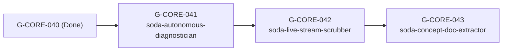

# Antigravity Authoritative Deep Context & Atomic Goal Decomposition Artifact
## Comprehensive Enhancement of Soda OS with pstack Capabilities (Wave 8: G-CORE-041 through G-CORE-043)

- **Repository Revision:** `f90ebea`  
- **Timestamp:** `2026-10-18T23:35:00+07:00`  
- **Authority:** Antigravity (Soda OS Designated Context & Goal Authority)  
- **Status:** Certified Grounded, Compliant with Articles I–VI & Invariant 11  
- **Target Epic:** `CORE` (Autonomous Diagnostics, Proactive Live Scrubbing, Automated Documentation Extraction)  
- **Source References:**  
  - [`backnotprop/pstack`](https://github.com/backnotprop/pstack) (Lauren Tan / @poteto)
  - Completed Waves 1–7 (`G-CORE-022` through `G-CORE-040` archived)
  - In-Depth Gap Analysis: [`docs/06_raw/20261018_190800_pstack_inside_soda_os_gap_analysis.md`](file:///Users/batrarethsudprasert/projects/soda-os/docs/06_raw/20261018_190800_pstack_inside_soda_os_gap_analysis.md)
  - Technical Review: [`docs/06_raw/20261018_pstack_repository_review.md`](file:///Users/batrarethsudprasert/projects/soda-os/docs/06_raw/20261018_pstack_repository_review.md)

---

## 1. Executive Context & Architectural Rationale

Across Waves 1 through 7 (`G-CORE-022` through `G-CORE-040`), Soda OS has adapted 19 high-impact capabilities from `backnotprop/pstack`. An exhaustive inspection of the remaining playbooks and skills (`figure-it-out`, `how`, `why`, `teach`, `technical-writing`) reveals **three final missing pillars** required to achieve 100% complete paradigm coverage of `pstack` inside Soda OS:

```
┌──────────────────────────────────────────────────────────────────────────────────┐
│                     WAVE 8: FINAL PSTACK CAPABILITY AUDIT                        │
├──────────────┬───────────────────────────────┬───────────────────────────────────┤
│ GOAL ID      │ PSTACK PLAYBOOK / SKILL       │ SODA OS NATIVE SYNTHESIS          │
├──────────────┼───────────────────────────────┼───────────────────────────────────┤
│ G-CORE-041   │ figure-it-out                 │ soda-autonomous-diagnostician     │
│              │ (Autonomous error triage &    │ (Hypothesis-driven failure        │
│              │ root-cause isolation)         │ isolation engine)                 │
├──────────────┼───────────────────────────────┼───────────────────────────────────┤
│ G-CORE-042   │ deslop / unslop stream scrub  │ soda-live-stream-scrubber         │
│              │ (Real-time slop elimination)  │ (Streaming token buffer cleaner)  │
├──────────────┼───────────────────────────────┼───────────────────────────────────┤
│ G-CORE-043   │ how / why / teach             │ soda-concept-doc-extractor        │
│              │ (OOUX conceptual extraction & │ (Architectural decision & mental  │
│              │ architectural documentation)  │ model documentation engine)       │
└──────────────┴───────────────────────────────┴───────────────────────────────────┘
```

---

## 2. Detailed Capability Synthesis

### 1. G-CORE-041: soda-autonomous-diagnostician (`skills/figure-it-out/SKILL.md`)
- **`pstack` Concept:** When an unexpected runtime, build, or test failure occurs, `figure-it-out` instructs the agent to autonomously trace execution paths, inspect inputs, formulate falsifiable hypotheses, run minimal reproductive spikes, and isolate root causes without asking the user for hand-holding.
- **Soda OS Elevation:** Soda OS provides `soda-bug-triage` (heuristic triage) and `soda-runtime-trace-forensics` (CPU/heap parsing), but lacks a structured **autonomous failure isolation driver** that:
  1. Ingests failure stack traces and failing test assertions.
  2. Synthesizes a structured hypothesis matrix with falsification probes.
  3. Binds each probe to an executable CLI command.
  4. Identifies the offending code location with absolute `file:///...#L1-L10` links.
- **Deliverables:**
  - `scripts/lib/autonomous-diagnostician.mjs`
  - `.agents/skills/soda-autonomous-diagnostician/SKILL.md`
  - `tests/lib/autonomous-diagnostician.test.mjs`
  - Invariants: `INV-041-001` (determinism), `INV-041-002` (completeness)

### 2. G-CORE-042: soda-live-stream-scrubber (`skills/unslop/SKILL.md`, `rules/no-comments.md`)
- **`pstack` Concept:** `unslop` strips AI pleasantries, conversational preambles, and defensive apologies. In interactive CLI streaming sessions, slop appears at the token level before full markdown parsing completes.
- **Soda OS Elevation:** Soda OS has `scripts/lib/anti-slop-linter.mjs` for post-hoc static text linting. However, live streaming agents require a **real-time streaming token buffer scrubber** that:
  1. Intercepts incoming LLM token chunks in real-time.
  2. Detects and trims conversational preambles ("Certainly!", "I'd be happy to...") and apologetic hedging before emitting to stdout.
  3. Preserves structured code fences and markdown blocks intact.
  4. Guarantees zero byte loss for actual technical payloads.
- **Deliverables:**
  - `scripts/lib/live-stream-scrubber.mjs`
  - `.agents/skills/soda-live-stream-scrubber/SKILL.md`
  - `tests/lib/live-stream-scrubber.test.mjs`
  - Invariants: `INV-042-001` (conservation), `INV-042-002` (idempotency)

### 3. G-CORE-043: soda-concept-doc-extractor (`skills/how/SKILL.md`, `skills/why/SKILL.md`, `skills/teach/SKILL.md`)
- **`pstack` Concept:** In `how` and `why`, the agent deconstructs code into mental models, core domain concepts, invariants, and causal relationships ("why is it built this way rather than the obvious way?").
- **Soda OS Elevation:** Soda OS maintains `docs/03-architecture/` and ADRs, but currently lacks an automated **architectural concept extractor** that:
  1. Scans modified files and AST export topologies.
  2. Extracts core abstractions, invariants, and trade-offs.
  3. Formulates a crisp, self-contained concept document formatted per Soda OS standards (`docs/03-architecture/specs/`).
  4. Validates that conceptual explanations cite concrete code lines without speculative filler.
- **Deliverables:**
  - `scripts/lib/concept-doc-extractor.mjs`
  - `.agents/skills/soda-concept-doc-extractor/SKILL.md`
  - `tests/lib/concept-doc-extractor.test.mjs`
  - Invariants: `INV-043-001` (determinism), `INV-043-002` (completeness)

---

## 3. Constitution & Socratic Invariant Grounding

Every goal in Wave 8 strictly adheres to the Global Engineering Constitution:
1. **Article I (Zero Mocks, Zero Stubs):** Concrete Node.js ES module implementations only.
2. **Article II (Mandatory Verification Pass):** Comprehensive unit tests passing 100% green before goal closure.
3. **Article IV (Mathematical Governance):** Formal invariants declared and verified with cryptographic proof receipts.
4. **Article V (Template Mirror Parity):** All files bitwise synchronized to `template/`.
5. **Article VI (Zero-Float Invariant):** All counts, ratios, scores, and buffers computed via exact BigInt and integer math.
6. **Invariant 11 (Satellite Specifications):** Complete satellite specs (`architecture-spec.md`, `invariants-formal-spec.md`, `fsm-runtime-spec.md`, `threat-model.md`, `worktree-plan.md`) and acceptance contracts generated for each goal.

---

## 4. Goal Reservation Registry Allocation

Allocated from `docs/07-backlog/goal-id-registry.yaml`:
- **`G-CORE-041`**: Implement soda-autonomous-diagnostician skill and failure isolation engine
- **`G-CORE-042`**: Implement soda-live-stream-scrubber skill and streaming token buffer cleaner
- **`G-CORE-043`**: Implement soda-concept-doc-extractor skill and mental model documentation engine

---

## 5. Topological Execution Plan (Wave 8 DAG)



All dependencies are strictly linear and disjoint, ensuring zero worktree collisions and seamless sequential verification.
