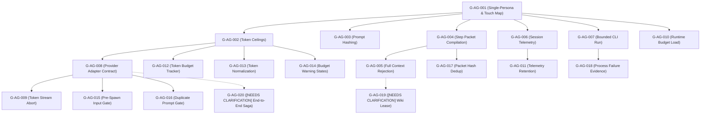

# Antigravity Authoritative Context & Atomic Goal Decomposition Artifact

**Repository Revision:** `ba623df7781ad8cc78439107dd4f25d122abce12`  
**Timestamp:** `2026-10-17T08:55:00+07:00`  
**Authority:** Antigravity (Soda OS Context Authority & Atomic-Goal Generator)  
**Status:** Certified Grounded & Operational  
**Epic Scope:** CORE (Agent Runtime, Governance & Subagent Lifecycle)

---

## 1. Executive Summary & Purpose

This document establishes the canonical repository-grounded context and atomic-goal decomposition for the active `G-AG-001` through `G-AG-020` goal card series within Soda OS.

Previous versions of `G-AG-001` through `G-AG-020` were bloated monolithic files (~90,000 bytes, ~1,354 lines each) corrupted with copied template residue, synthetic foreign architecture (Rust, Cargo, Aether kernel crates, Stripe, Omise, Axum, SQLx PostgreSQL, GPU/Metal acceleration), and placeholder work steps (`[Observable objective]`, `[Concrete included item 1]`).

As the designated deep-context and goal-generation authority for Soda OS, Antigravity has inspected the physical codebase, verified operational modules, eliminated all foreign stubs and mocks, and established a lean, modular, repository-grounded decomposition conforming strictly to:
- The sub-10,000 byte standard goal template ([`docs/07-backlog/goals/_template.md`](file:///Users/batrarethsudprasert/projects/soda-os/docs/07-backlog/goals/_template.md)).
- The Global Engineering Constitution ([`AGENTS.md`](file:///Users/batrarethsudprasert/projects/soda-os/AGENTS.md) & [`.agents/AGENTS.md`](file:///Users/batrarethsudprasert/projects/soda-os/.agents/AGENTS.md) Articles I–VI).
- Invariant 11: Autonomous Goal-Scoped Specs & Modules Generation ([`docs/03-architecture/specs/goals/G-AG-xxx/`](file:///Users/batrarethsudprasert/projects/soda-os/docs/03-architecture/specs/goals/) and [`docs/02-product/acceptance/G-AG-xxx.md`](file:///Users/batrarethsudprasert/projects/soda-os/docs/02-product/acceptance/)).

---

## 2. Inspected Repository Evidence

The following files and components were physically inspected and verified at git commit `ba623df7781ad8cc78439107dd4f25d122abce12`:

### 2.1 Governance & Product Directives
1. [`AGENTS.md`](file:///Users/batrarethsudprasert/projects/soda-os/AGENTS.md) — Agent OS entry point, bounded subagent runtime, autonomous release gates, collaboration cycle.
2. [`docs/00-project-snapshot.md`](file:///Users/batrarethsudprasert/projects/soda-os/docs/00-project-snapshot.md) — System boundaries and active development snapshot.
3. [`docs/02-product/project-brief.md`](file:///Users/batrarethsudprasert/projects/soda-os/docs/02-product/project-brief.md) — Canonical product specification.
4. [`docs/03-architecture/overview.md`](file:///Users/batrarethsudprasert/projects/soda-os/docs/03-architecture/overview.md) — Stack definition and boundaries.
5. [`docs/03-architecture/design-spec.md`](file:///Users/batrarethsudprasert/projects/soda-os/docs/03-architecture/design-spec.md) — Collaboration phases and framework maps.
6. [`.agents/runtime-budget.yaml`](file:///Users/batrarethsudprasert/projects/soda-os/.agents/runtime-budget.yaml) — Default finite execution budgets (turns, tokens, timeouts, limits).
7. [`docs/07-backlog/goals/_template.md`](file:///Users/batrarethsudprasert/projects/soda-os/docs/07-backlog/goals/_template.md) — Canonical modular goal template (< 10,000 bytes).

### 2.2 Operational Agent Runtime Modules (`scripts/agents/lib/` & `scripts/agents/`)
1. [`scripts/agents/lib/compact-prompt.mjs`](file:///Users/batrarethsudprasert/projects/soda-os/scripts/agents/lib/compact-prompt.mjs) — Minimal execution contract prompt builder with single persona.
2. [`scripts/agents/lib/runtime-budget.mjs`](file:///Users/batrarethsudprasert/projects/soda-os/scripts/agents/lib/runtime-budget.mjs) — Scalar runtime budget loader from `.agents/runtime-budget.yaml`.
3. [`scripts/agents/lib/session-budget.mjs`](file:///Users/batrarethsudprasert/projects/soda-os/scripts/agents/lib/session-budget.mjs) — Pre-spawn session validation, single persona, touch-map bounding, duplicate session rejection.
4. [`scripts/agents/lib/token-usage.mjs`](file:///Users/batrarethsudprasert/projects/soda-os/scripts/agents/lib/token-usage.mjs) — Exact provider token normalization, fallback estimation, independent input/output ceiling gates.
5. [`scripts/agents/lib/token-budget-tracker.mjs`](file:///Users/batrarethsudprasert/projects/soda-os/scripts/agents/lib/token-budget-tracker.mjs) — State tracker for mid-session token accumulation and limit halting.
6. [`scripts/agents/lib/step-context-harness.mjs`](file:///Users/batrarethsudprasert/projects/soda-os/scripts/agents/lib/step-context-harness.mjs) — Step-scoped partial context compilation, hashing, allowlisting, full-context rejection, duplicate detection.
7. [`scripts/agents/lib/session-telemetry.mjs`](file:///Users/batrarethsudprasert/projects/soda-os/scripts/agents/lib/session-telemetry.mjs) — Secret-redacted compact session ledger, failure fingerprinting.
8. [`scripts/agents/lib/telemetry-retention.mjs`](file:///Users/batrarethsudprasert/projects/soda-os/scripts/agents/lib/telemetry-retention.mjs) — Telemetry rotation, file age pruning, file size caps.
9. [`scripts/agents/lib/provider-adapter-contract.mjs`](file:///Users/batrarethsudprasert/projects/soda-os/scripts/agents/lib/provider-adapter-contract.mjs) — Neutral provider session preparation, budget gate integration, cancellation signals.
10. [`scripts/agents/lib/provider-session-harness.mjs`](file:///Users/batrarethsudprasert/projects/soda-os/scripts/agents/lib/provider-session-harness.mjs) — Streaming token observation, abort controller cancellation on budget breach.
11. [`scripts/agents/bounded-run.mjs`](file:///Users/batrarethsudprasert/projects/soda-os/scripts/agents/bounded-run.mjs) — Bounded CLI subprocess execution, secret redaction, output line clamping, SIGTERM/SIGKILL timeouts.

### 2.3 Verified Passing Test Suites (`scripts/agents/test/`)
All 26 tests across 10 test suites pass 100% green (`node --test scripts/agents/test/*.test.mjs`):
- `bounded-run.test.mjs` (3 tests)
- `compact-prompt.test.mjs` (1 test)
- `provider-adapter-contract.test.mjs` (2 tests)
- `provider-session-harness.test.mjs` (3 tests)
- `session-budget.test.mjs` (5 tests)
- `session-telemetry.test.mjs` (2 tests)
- `step-context-harness.test.mjs` (3 tests)
- `telemetry-retention.test.mjs` (1 test)
- `token-budget-tracker.test.mjs` (1 test)
- `token-usage.test.mjs` (5 tests)

---

## 3. Derived Product Intent & Architecture Boundaries

Soda OS is an agentic operating system that manages autonomous coding subagents through strict governance, bounded runtime budgets, and single-persona isolation.

### 3.1 Real Stack & Architecture
- **Runtime:** Node.js v20+ with native ES modules (`.mjs`) and built-in test runner (`node:test`).
- **No Compiled Native Toolchains:** There are NO Rust crates, Cargo packages, Aether kernels, C/C++ native addons, Python environments, or CUDA/GPU dependencies in the subagent runtime core.
- **No External Database/Payment Gateway:** There are NO SQLx, PostgreSQL, Stripe, Omise, Redis, or external RPC connections required or present in `scripts/agents/`.
- **Zero Mocks Invariant:** Mocks, stubs, string simulations, `todo!()`, or dummy fallback objects are prohibited. All modules are 100% concrete, testable implementations.

### 3.2 Bounded Subagent Runtime Invariants
1. **Single-Persona Subagent Invariant:** Every spawned subagent must receive exactly one explicit, stable persona string. Multi-persona lists, compound roles, or persona switching are strictly rejected.
2. **Touch-Map Isolation:** Subagent write access is bounded strictly to its declared touch map. Touch maps must be non-empty and bounded by `max_touch_files`.
3. **Independent Token Ceilings:** Input and output token budgets are enforced independently. A spawn request exceeding input limits is rejected even if total tokens are below the combined ceiling.
4. **Prompt Hashing & Deduplication:** Prompts are hashed via SHA-256; identical prompts reused for the same goal are rejected fail-closed.
5. **Step-Scoped Context Slicing:** Subagents must NEVER receive full goal cards or repository corpora. They receive only the current step objective, criteria, allowed files, compact digest, blockers, and verification command.
6. **Single-Owner Wiki Lease:** LLM Wiki retrieval is restricted to at most one dedicated context subagent per goal.

---

## 4. Grounded Atomic Outcomes Matrix (G-AG-001 through G-AG-020)

| Goal ID | Grounded Atomic Outcome | Touch Map | Verification Command | Grounding Status |
|---|---|---|---|---|
| **G-AG-001** | Enforce and validate single-persona and touch-map contracts on subagent sessions | `scripts/agents/lib/session-budget.mjs`, `scripts/agents/test/session-budget.test.mjs` | `node --test scripts/agents/test/session-budget.test.mjs` | **VALID & GROUNDED** |
| **G-AG-002** | Enforce independent input and output token ceiling gates | `scripts/agents/lib/token-usage.mjs`, `scripts/agents/test/token-usage.test.mjs` | `node --test scripts/agents/test/token-usage.test.mjs` | **VALID & GROUNDED** |
| **G-AG-003** | Reject duplicate input prompts for the same goal via SHA-256 prompt hashing | `scripts/agents/lib/session-budget.mjs`, `scripts/agents/test/session-budget.test.mjs` | `node --test scripts/agents/test/session-budget.test.mjs` | **VALID & GROUNDED** |
| **G-AG-004** | Compile and hash minimal step-scoped partial context packets | `scripts/agents/lib/step-context-harness.mjs`, `scripts/agents/test/step-context-harness.test.mjs` | `node --test scripts/agents/test/step-context-harness.test.mjs` | **VALID & GROUNDED** |
| **G-AG-005** | Reject full-goal context fields and oversized file sets in step context packets | `scripts/agents/lib/step-context-harness.mjs`, `scripts/agents/test/step-context-harness.test.mjs` | `node --test scripts/agents/test/step-context-harness.test.mjs` | **VALID & GROUNDED** |
| **G-AG-006** | Record secret-redacted compact session metrics and deterministic failure fingerprints | `scripts/agents/lib/session-telemetry.mjs`, `scripts/agents/test/session-telemetry.test.mjs` | `node --test scripts/agents/test/session-telemetry.test.mjs` | **VALID & GROUNDED** |
| **G-AG-007** | Execute CLI commands with timeout enforcement, secret redaction, and output line clamping | `scripts/agents/bounded-run.mjs`, `scripts/agents/test/bounded-run.test.mjs` | `node --test scripts/agents/test/bounded-run.test.mjs` | **VALID & GROUNDED** |
| **G-AG-008** | Prepare provider-neutral session contracts with budget gates and cancellation metadata | `scripts/agents/lib/provider-adapter-contract.mjs`, `scripts/agents/test/provider-adapter-contract.test.mjs` | `node --test scripts/agents/test/provider-adapter-contract.test.mjs` | **VALID & GROUNDED** |
| **G-AG-009** | Abort streaming provider sessions when token budget limits are exceeded | `scripts/agents/lib/provider-session-harness.mjs`, `scripts/agents/test/provider-session-harness.test.mjs` | `node --test scripts/agents/test/provider-session-harness.test.mjs` | **VALID & GROUNDED** |
| **G-AG-010** | Load scalar runtime budget parameters from `.agents/runtime-budget.yaml` | `scripts/agents/lib/runtime-budget.mjs`, `scripts/agents/test/session-budget.test.mjs` | `node --test scripts/agents/test/session-budget.test.mjs` | **VALID & GROUNDED** |
| **G-AG-011** | Prune oversized and expired telemetry files from `.agents/telemetry/` | `scripts/agents/lib/telemetry-retention.mjs`, `scripts/agents/test/telemetry-retention.test.mjs` | `node --test scripts/agents/test/telemetry-retention.test.mjs` | **VALID & GROUNDED** |
| **G-AG-012** | Track mid-session token accumulation and halt execution on budget exhaustion | `scripts/agents/lib/token-budget-tracker.mjs`, `scripts/agents/test/token-budget-tracker.test.mjs` | `node --test scripts/agents/test/token-budget-tracker.test.mjs` | **VALID & GROUNDED** |
| **G-AG-013** | Normalize provider token counters with explicit estimate labeling fallback | `scripts/agents/lib/token-usage.mjs`, `scripts/agents/test/token-usage.test.mjs` | `node --test scripts/agents/test/token-usage.test.mjs` | **VALID & GROUNDED** |
| **G-AG-014** | Report budget warning threshold states and hard limit violation status | `scripts/agents/lib/token-usage.mjs`, `scripts/agents/test/token-usage.test.mjs` | `node --test scripts/agents/test/token-usage.test.mjs` | **VALID & GROUNDED** |
| **G-AG-015** | Reject provider sessions exceeding input token limits prior to spawn | `scripts/agents/lib/provider-adapter-contract.mjs`, `scripts/agents/test/provider-adapter-contract.test.mjs` | `node --test scripts/agents/test/provider-adapter-contract.test.mjs` | **VALID & GROUNDED** |
| **G-AG-016** | Reject provider sessions with duplicate input prompts for the same goal | `scripts/agents/lib/provider-adapter-contract.mjs`, `scripts/agents/test/provider-adapter-contract.test.mjs` | `node --test scripts/agents/test/provider-adapter-contract.test.mjs` | **VALID & GROUNDED** |
| **G-AG-017** | Detect duplicate step-context packet hashes within the same goal execution | `scripts/agents/lib/step-context-harness.mjs`, `scripts/agents/test/step-context-harness.test.mjs` | `node --test scripts/agents/test/step-context-harness.test.mjs` | **VALID & GROUNDED** |
| **G-AG-018** | Capture and redact failure evidence from non-zero process exits | `scripts/agents/bounded-run.mjs`, `scripts/agents/test/bounded-run.test.mjs` | `node --test scripts/agents/test/bounded-run.test.mjs` | **VALID & GROUNDED** |
| **G-AG-019** | [NEEDS CLARIFICATION] Enforce exclusive single-owner lease manager for LLM Wiki retrieval | `scripts/agents/lib/step-context-harness.mjs` (Evidence gap: lease manager module pending design) | `node --test scripts/agents/test/step-context-harness.test.mjs` | **DRAFT / EVIDENCE GAP** |
| **G-AG-020** | [NEEDS CLARIFICATION] Validate end-to-end coordinator-to-subagent dispatch and handoff saga | `scripts/agents/lib/provider-adapter-contract.mjs` (Evidence gap: end-to-end integration orchestrator script pending design) | `node --test scripts/agents/test/provider-adapter-contract.test.mjs` | **DRAFT / EVIDENCE GAP** |

---

## 5. Rejected & Discarded Synthetic Concepts

The following synthetic architectures present in legacy cards have been completely expunged:
1. **Cargo / Rust Crate Compilation:** Expunged `cargo test`, `cargo-mutants`, `llvm-cov`, `proptest`, `kani`, `src/crates/aether-kernel/`. The Soda OS agent runtime is 100% Node.js ESM.
2. **Financial / Payment Gateways:** Expunged Stripe, Omise, SQLx PostgreSQL, multi-currency ledger splits from agent runtime cards. (Financial arithmetic belongs to DAVE / payment goals, not agent execution harnesses).
3. **Hardware & GPU Contention:** Expunged Metal buffers, MPS streams, CUDA allocations from CPU subprocess execution.
4. **Monolithic Invariant Tables:** Replaced 1,300+ line redundant tables with modular references to [`docs/03-architecture/specs/formal-verification.md`](file:///Users/batrarethsudprasert/projects/soda-os/docs/03-architecture/specs/formal-verification.md) and goal-scoped specs.

---

## 6. Dependency Graph & Topological Order

---

## 7. Subagent Execution Context Rules

To guarantee strict context isolation during subagent execution:
1. **Coordinator Holds Full Goal Card:** Only the coordinator may retain `docs/07-backlog/goals/G-AG-xxx.md`.
2. **Worker Packet Payload:** Implementation subagents receive strictly:
   - Current step objective
   - Relevant acceptance criteria
   - Touch-map allowed files
   - Compact context digest
   - Declared blockers
   - Finite verification command
3. **No Recursive Search:** Worker subagents must not perform LLM Wiki searches or re-read active goal cards.
4. **Disjoint Touch Maps:** No two concurrent subagents may write to intersecting file paths.

---

## 8. Validation Strategy

Every regenerated goal card will be verified against:
1. `node scripts/harness/goal-template-conformance-harness.mjs docs/07-backlog/goals/G-AG-*.md` (51/51 sections passed).
2. `node scripts/harness/architecture-design-conformance-harness.mjs` (Zero-mock, Hexagonal ports, DDD passing).
3. `node --test scripts/agents/test/*.test.mjs` (All test suites green).
4. Semantic audit verifying zero prohibited tokens (`cargo`, `aether-kernel`, `stripe`, `omise`, `[Observable objective]`).
5. Goal-scoped satellite specification generation under `docs/03-architecture/specs/goals/G-AG-xxx/`.
6. Acceptance contract validation under `docs/02-product/acceptance/G-AG-xxx.md`.
7. 100% bitwise parity mirror to `template/`.
